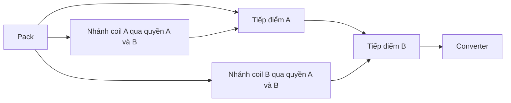

# P0-15 — connector cassette và hai đường ngắt tải

Chưa có việc nào cần Founder cung cấp để tiếp tục thiết kế trên giấy. Mức 22 mm của cơ cấu cassette và phương án relay dưới đây vẫn là đầu vào nghiên cứu.

## Cassette

Ứng viên đầu cắm **SFM-110-T2-S-D-A / TFM-110-02-S-D-A** có 20 tiếp điểm. Cấu hình 12 đường sense và hai đường nguồn dùng 14 vị trí chức năng. Chiều dài socket theo công thức kích thước tham chiếu trong bản vẽ là **16,64 mm**. Hai tiếp điểm công suất vẫn cần đối chiếu tải và nhiệt thực tế. Con số 3,2 A trong tài liệu họ SFM/TFM áp dụng cấu hình thử một tiếp điểm cấp tải trên mỗi hàng, không dùng để suy dòng định mức của mọi bố trí. Báo cáo 2.500 chu kỳ thuộc đúng cặp 50 tiếp điểm, nên tuổi thọ của cặp 20 tiếp điểm còn chờ qualification. [Trang TFM-110](https://www.samtec.com/products/tfm-110-02-s-d-a) · [Dòng mã SFM cùng lựa chọn plating](https://www.samtec.com/products/sfm-110-t2-l-d-a) · [Spec Samtec Rev E, tr. 2](../../../../../research/downloads/p0-15/samtec-sfm-tfm-productspec.pdf) · [Báo cáo chu kỳ](https://suddendocs.samtec.com/testreports/1170762_report_rev_1_elp.pdf)

Nếu giữ lead style, tiết diện SMT, datum và envelope phần dẫn của phép tính trước, mốc để bảo đảm khoảng hở sàng lọc 2 mm là 15,658 mm. Lưỡi cassette nhả ở 16,8 mm nên phần dư xấp xỉ **1,142 mm**. Điều kiện cần kiểm trên cụm thiết kế là vị trí hai mặt lắp và phần dẫn thực, độ nghiêng tương đối, chốt giữ terminal và mất hành trình khi lắp. Cận này áp dụng cho hướng rút, không thay bằng chứng tiếp xúc điện khi cầu đã hạ. [Phép tính và điều kiện](connector-allocation-results.json)

## Vị trí bộ đo pin

Spec Samtec Rev E ghi tiêu chí thử cách điện 1 GΩ và giá trị báo cáo 5 GΩ. Mức 5 GΩ trong bảng không bảo đảm toàn bộ đường rò ở điện áp sử dụng sau lắp, ẩm hoặc mòn. Phép sàng lọc cho thấy một đường rò 1 GΩ ở chênh áp 7,2 V có thể chiếm 7,2 nA. Với mạng 604 kΩ, nếu bo và dây đã dùng 2,5 nA thì connector chỉ còn khoảng **5,09 nA mỗi node** dưới các phân bổ của phép tính trước. Tương đương điện trở cách điện tổng hợp tối thiểu khoảng 1,414 GΩ ở 7,2 V. Đây là yêu cầu phân bổ có điều kiện, chưa là phép đo connector. [Kết quả sàng lọc](connector-allocation-results.json)

Hướng lead ưu tiên phân tích tiếp là đặt guard và hai bộ đo UV trong cassette. Khi đó đường trở cao nằm gần cell, còn đầu cắm chuyển nguồn và tín hiệu hợp lệ của từng kênh. Ngân sách chức năng tối thiểu giảm từ 14 xuống **8 đường** gồm hai đường tải và ba đường mỗi kênh cho cấp nguồn, return và tín hiệu. Cần tính lại bo nhỏ trong cassette, cấp nguồn CHECK, dòng khi OFF và BOM trước khi chốt kiến trúc. Cả hai kênh vẫn phải lấy tín hiệu độc lập từ đầu cell.

Phép tính thử hai tín hiệu hợp lệ ngược cực tính cho thấy một chập giữa hai đường không thể cấp đồng thời hai quyền nếu chênh ngưỡng nhỏ nhất lớn hơn sai lệch ground lớn nhất. Thử A hợp lệ ở mức không quá 0,4 V, B hợp lệ từ 1,4 V và sai lệch ground tối đa 0,2 V cho biên 0,8 V. Nếu ground A trôi lên 1,1 V so với B, một nút chung 1,4 V lại có thể tạo hai quyền. Vì vậy còn phải chứng minh giữ trạng thái OFF khi mất return hoặc cấp ngược. Các ngưỡng trên là phân bổ chức năng để kiểm logic. [Phản ví dụ](cutoff-path-results.json)

## Ngắt tải và đường nuôi phụ

Box 02 đề xuất hai tiếp điểm thường mở TX2-3V nối tiếp trước converter. Mỗi coil nhận nguồn qua hai phần tử cho phép riêng, một do A điều khiển và một do B điều khiển. Khi một kênh báo khỏe giả, kênh kia có quyền ngắt cả hai coil. Hai tiếp điểm độc lập giúp một tiếp điểm khỏe vẫn cắt tải khi tiếp điểm kia hàn dính. Hai nhánh coil cần giữ riêng sau các phần tử ngắt. [Phân tích Box 02](BOX02-DUAL-CUTOFF.md)

Phép kiểm đường dẫn gồm 9 ca tải và 6 ca coil. Một chập Pack+ vào nhánh coil sau cả hai phần tử ngắt vẫn có thể nuôi coil đó, dù tiếp điểm còn lại cắt được converter. Nếu hai coil dùng chung một rail sau gate, một chập vào rail đó có thể giữ cả hai tiếp điểm đóng. Vì vậy bằng chứng ngắt tải và bằng chứng giới hạn xả sau trip phải bao đường nguồn phụ, kể cả tụ và clamp. [Kết quả ca lỗi](cutoff-path-results.json)

Panasonic ghi mỗi coil 3 V tiêu thụ khoảng **140 mW danh định**, tương đương khoảng **93,4 mA** cho hai coil tại 3 V. Phần này chưa tính bộ cấp coil và tải tay cầm. Tiếp điểm chuẩn có định mức 2 A cho tải DC thuần trở. Thời gian nhả 4 ms MAX ghi tại 20 °C, coil đã cấp áp định mức, chưa tính bounce và dùng điều kiện không diode. Bằng chứng cho hệ cần kiểm clamp thật, nguồn thấp/cao, nhiệt độ, tải converter có inrush, mất bias, và ngắt được bằng một tiếp điểm. Giữ relay làm ứng viên để so ngân sách, chưa có đủ dữ liệu thời lượng pin hay chi phí để đề nghị chọn nó. [Panasonic ATX201](https://industry.panasonic.com/global/en/products/control/relay/signal/number/atx201) · [Panasonic ASCTB18E, tr. 2–3](https://mediap.industry.panasonic.eu/assets/download-files/import/ds_61022_en_tx.pdf)

Điện lượng rút từ pin sau trip còn cần cận dòng tải và tổng thời gian phát hiện, ngắt cấp coil và hết dẫn qua tiếp điểm. Dòng sense 77,57 µA ở nghiên cứu trước và dòng AON tính riêng trong thời gian lưu pin. Một phép đo có giá trị phải ghi đồng thời dòng pack, điện áp coil và trạng thái từng tiếp điểm, vì tụ converter có thể giữ tải chạy sau khi nguồn pin đã ngắt.

## Việc cần trước B1

Chốt cách bố trí hai bộ đo, kiểm cận dòng qua nguồn phụ và lỗi chung, rồi so ngân sách toàn tay cầm. Phần cơ cần ràng buộc datum connector thật với lưỡi khóa, giữ dẫn hướng và xử lý chu trình V/probe/witness. Sau khi có phương án tích hợp và review đúng hồ sơ mới trình Founder duyệt cấu hình AA để xét B1. Phép đo vật lý `NOT_RUN`.
