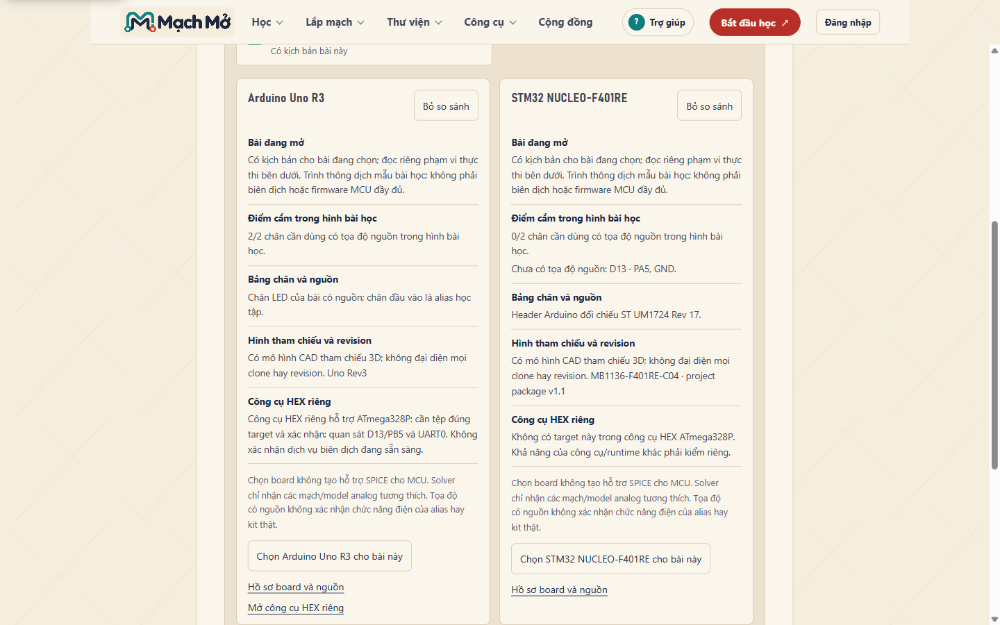

# So sánh khả năng board theo bài — 18/11/2026

Task MM-SW-BOARD-CAPABILITIES-001, lát cắt EXP-01/EXP-04/CAT-01 trong M01/M02/M03. [Thiết kế](../../../software/local-learning/2026-11-18-diagnostics-board-design.md) · [Review độc lập](review.md) · [6 file/SHA-256](snapshot-reviewed.json).

## Kết quả

Trong bước chọn board có phần tùy chọn “Chưa biết chọn board? So sánh khả năng”. Mở tìm kiếm/bộ lọc không chọn hộ board hoặc tạo mạch. Danh sách hiển thị có giới hạn, tăng thêm khi cần; tối đa hai card so sánh. Chọn card dùng callback cũ; native select vẫn hoạt động tức thời như trước.

Mỗi card phân biệt kịch bản bài hiện tại và lý do khóa, pinout có nguồn, coverage tọa độ endpoint trong bài, CAD/revision, công cụ HEX riêng và giới hạn SPICE. Uno ở bài blink có 2/2 chân cần dùng có tọa độ; Nucleo có bảng chân theo tài liệu nhưng hiện 0/2 tọa độ bài. Pico W có pinout theo nguồn không có nghĩa đã được bind vào presentation của bài. Unknown ID không fallback thành ESP32/Uno.

Thông tin HEX ATmega328P của Uno/Nano không phải xác nhận dịch vụ compiler đang chạy, cũng không đổi bài thành firmware. Reference-only giữ đúng tên/nguồn, không có nút vào bài chưa hỗ trợ. Không thêm tọa độ từ ước lượng hoặc đổi manifest/pin mapping.

## Kiểm chứng

| Lệnh | Exit | Kết quả |
| --- | --- | --- |
| `node --test tests/lesson-board-capabilities.test.mjs` | 0 | 7/7, sau sửa nhãn cũng chạy lại đạt |
| `npm.cmd run typecheck` | 0 | Snapshot cuối |
| `npm.cmd test` | 0 | 736/736, không fail/skip/cancel/todo |
| `npm.cmd run build:local` qua wrapper E2E chuẩn | 0 | Bản local production preview |
| `npm.cmd run test:e2e -- e2e/workspace-interaction-regressions.spec.mjs e2e/lesson-board-capabilities.spec.mjs e2e/lesson-board-selection.spec.mjs` | 0 | 27/27, không skip |
| `node ../docs/agents/validate.mjs` | 0 | 87 task, errors/warnings rỗng trước đóng task |

Lượt đầu có 4 ca E2E đỏ: hai ca finder vì nhãn bọc cả select/options, hai ca task diagnostics vì locator chọn dây trùng SVG/list. Sửa label thành phần tử riêng có htmlFor/id; không nới assertion. Task diagnostics chỉ scope locator vào danh sách. Sau sửa đã review delta, build lại và chạy lại bộ chuẩn nêu trên đạt 27/27.

Đợt này thêm 13 unit/SSR và 6 E2E tổng cộng cho hai task (736 so với 723 unit trước đợt); không ca mới nào bị skip. Không chạy lại toàn bộ E2E web trong đợt này; các suite tác động đã chạy theo lệnh trên. [Log và bằng chứng](checks/). Scope hash kiểm 16 file của hai lease, không có thay đổi source ngoài lease hoặc xóa file.

## Ảnh

[Ảnh mobile](finder-mobile.png).

## Giới hạn và phần tiếp theo

Finder hiển thị dữ liệu/capability đã có, không nghiệm thu board vật lý, runtime đang sẵn sàng hoặc thêm mô hình mới. Nucleo còn vướng xác minh chuyển đổi/quyền nguồn; Blue Pill community CAD không được gán âm thầm vào generic profile; Pico W/Pico 2 còn cần task binding/review riêng. Không bịa anchor cho các profile thiếu nguồn được chấp nhận.

Build có warning eval từ rp2040js hiện có, không thay dependency. Public release không thuộc kiểm chứng build local này. Server/online, nghiên cứu với người mới và screen reader thực tế chưa chạy trong đợt. Không deploy hoặc push GitHub.
