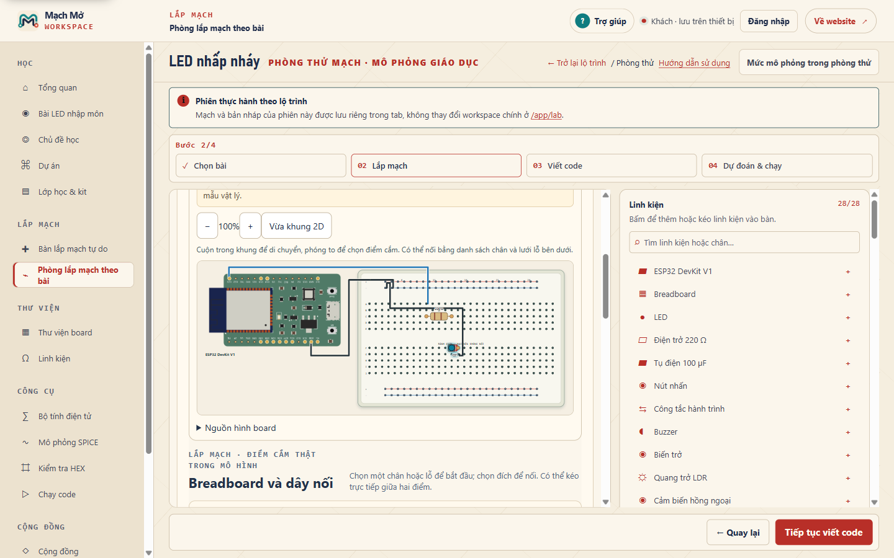

# Điều hướng từ chẩn đoán tới mạch — 18/11/2026

Task MM-SW-DIAGNOSTIC-NAV-001, lát cắt EXP-05/EXP-07 trong M01/M04/M07. [Thiết kế](../../../software/local-learning/2026-11-18-diagnostics-board-design.md) · [Review độc lập](review.md) · [10 file/SHA-256](snapshot-reviewed.json).

## Kết quả

- Cảnh báo G7 về chân hở, G6 về dây và G8 về LED có metadata mục tiêu có kiểu và nút xem vị trí. Thông báo/verdict hiện có được giữ; không dò câu tiếng Việt để đoán ID.
- Tái dùng chọn part/pin/wire/net của mạch hiện hành. Wire net tính lại khi bấm. Báo cáo, doc, board hoặc bài đã đổi thì hành động cũ bị từ chối; target đã xóa không được thay bằng phần tử cùng thứ tự.
- Thao tác xem hủy pending nối dây, không tạo dây/nháp hoặc đổi layout/code/ID/revision. Trạng thái gesture nội bộ của breadboard được khởi tạo lại cho inspection. Mạch chỉ đọc vẫn xem được vị trí và net.
- PCB tham chiếu/bàn logic hoặc thiếu hình học phù hợp chuyển sang schematic với lý do rõ. Không đoán tọa độ chân. Có focus sau render và nút quay lại chẩn đoán.

## Kiểm chứng

| Lệnh | Exit | Kết quả |
| --- | --- | --- |
| Focused gate/presentation/navigation của builder | 0 | 19/19; log focused-tests.txt |
| SSR import CircuitBuilderPage | 0 | Builder đã chạy |
| `npm.cmd run typecheck` | 0 | Snapshot cuối |
| `npm.cmd test` | 0 | 736/736, fail/skip/cancel/todo đều 0 |
| `npm.cmd run build:local` qua wrapper E2E chuẩn | 0 | Bản local production preview |
| `npm.cmd run test:e2e -- e2e/workspace-interaction-regressions.spec.mjs e2e/lesson-board-capabilities.spec.mjs e2e/lesson-board-selection.spec.mjs` | 0 | 27/27, không skip |
| `node ../docs/agents/validate.mjs` | 0 | 87 task, errors/warnings rỗng trước đóng task |

Lượt E2E đầu có hai ca diagnostics chưa tới hành vi do locator trùng SVG và danh sách dây. Đã scope locator vào `.breadboard-wire-list`, giữ nguyên assertion. Lượt kết hợp cũng tìm ra nhãn bộ lọc board ở task song song; xem báo cáo task đó. Lượt cuối 27/27 đạt sau sửa và rebuild, không sửa config hoặc cờ bỏ test.

[Log chung và bản chạy cuối](../MM-SW-BOARD-CAPABILITIES-001/checks/) · [Focused log](checks/focused-tests.txt). Review nguồn độc lập pass, reviewer không tự nhận đã chạy browser. Lead kiểm trực quan Chromium 1440×900 và 375×812; chọn đúng led-1:anode, không pageerror ở lượt desktop, mobile không tràn ngang tài liệu. Browser assertions kiểm storage bytes và phím/focus/return.

## Ảnh

[Ảnh mobile sau điều hướng chân](diagnostic-mobile.png).

## Giới hạn

Chỉ thêm target cho các chẩn đoán đã biết chính xác vị trí thuộc G6/G7/G8, không biến mọi lỗi thành nút sửa tự động. Lỗi toàn cục hoặc thiếu identity vẫn là giải thích. Đây là kiểm tra mô hình/topology/hình học tham chiếu, không phải ERC/solver đầy đủ hoặc phép đo kit thật. Không sửa schema, dependency, file hardware hay nguồn tham khảo.

Các task server/online và bổ sung anchor từ nguồn mới vẫn theo roadmap, không được suy ra đã đạt từ đợt này. Không deploy hoặc push GitHub.
