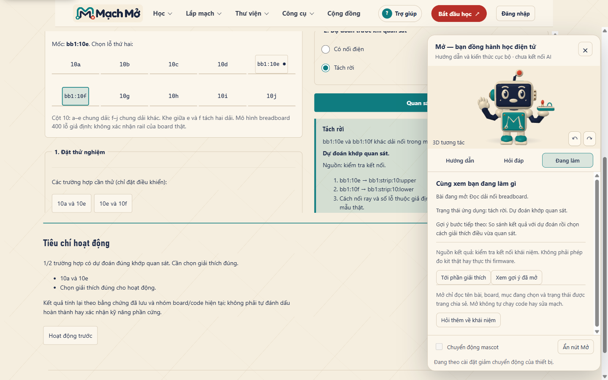
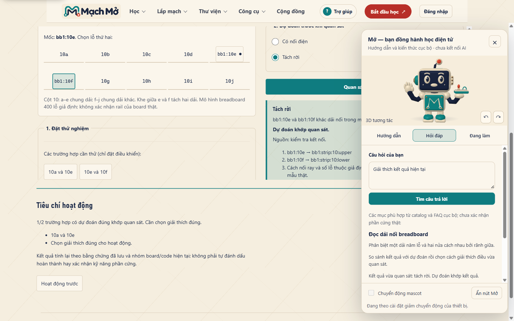

# Đợt 2a — trợ giúp theo hoạt động và quan sát hiện hành

Ngày 18/11/2026. Task MM-SW-LOCAL-GUIDE-001. [Thiết kế](../../../software/local-learning/2026-11-18-context-guide-design.md) · [Review độc lập](review.md) · [7 file và SHA-256](snapshot-reviewed.json).

Năng lực liên quan: EXP-05, EXP-07, LRN-02, OPS-06; phân hệ M01/M02/M14. Đây là một lát cắt tutor local cho khóa nền tảng, không nhận toàn bộ độ sâu D3 của các năng lực này. Task phụ thuộc hai task khóa học đã đóng ở đợt 1.

## Khoảng cách được xử lý

| Điểm cần cải thiện | Thay đổi đã triển khai | Bằng chứng |
| --- | --- | --- |
| Người mới không biết thao tác tiếp theo ở đâu | Mở đọc đúng activity/bước và có action tới board, điều khiển, dự đoán, quan sát, giải thích, gợi ý | E2E hai viewport kiểm focus bằng bàn phím và bytes lưu không đổi khi chỉ điều hướng |
| Hướng dẫn chung chưa giải thích kết quả vừa thấy | Tab Đang làm và hai câu hỏi theo ngữ cảnh dùng đúng quan sát hiện hành, kèm nhãn topology/trace và nguồn nội dung | Kết quả breadboard tách rời xuất hiện đúng sau Observe; trước Observe không có outcome |
| Câu trả lời cũ có thể còn sau khi đổi board/input | Answer gắn context key, ẩn ngay khi ngữ cảnh đổi; giữ câu hỏi để người học hỏi lại | E2E đổi input và board; lịch sử không được dùng giả làm kết quả hiện tại |
| Câu trả lời theo ngữ cảnh có thể làm nhầm model | Chỉ hai whole-question intent được ghép vào activity; câu có Uno R4/clone vẫn qua guard tra cứu hiện có | Unit và E2E guard explicit board/clone, null/unknown board |

Tái dùng GuideContextBridge, Guide panel và dữ liệu gợi ý của bài. Không tạo store/gợi ý/scoring mới. Adapter không chia sẻ code, signature, controls, toàn bộ session, raw, lịch sử hoặc kết quả văn bản riêng tư. Action dùng ID allowlist và focus/scroll tới phần tử đã tồn tại trong khóa; không sửa điều khiển, không tự chạy, không mở thêm hint và không đánh dấu hoàn thành. Escape vẫn trả focus về nút mở; action trả focus về đúng mục tiêu.

## Kiểm tra

| Lệnh | Exit | Kết quả |
| --- | --- | --- |
| `npm.cmd run typecheck` | 0 | Không lỗi |
| `npm.cmd test` | 0 | 723/723, fail/skip/cancel/todo đều 0 |
| `npm.cmd run build:local` — wrapper E2E gọi trực tiếp | 0 | Build production local; không phải public release |
| `npm.cmd run test:e2e -- e2e/beginner-course.spec.mjs e2e/beginner-guide.spec.mjs e2e/mascot-guide.spec.mjs e2e/guide-depth.spec.mjs` | 0 | 25/25, không skip, gồm cả 12 E2E mới của hai đợt |
| Builder focused adapter/catalog/SSR/knowledge | 0 | 24/24; reviewer chỉ kiểm nguồn, không tự nhận đã chạy các ca này |

Lượt toàn web ở cuối đợt 1: **207 passed, 1 skipped, 0 failed**, trước integration đợt 2a. Ca skip duy nhất thuộc môi trường analytics server riêng; không có cờ mới để bỏ test. Sau integration, chạy lại các suite bị ảnh hưởng nêu trên, không báo đã chạy lại toàn bộ E2E lần hai.

Lead kiểm trực quan Chromium 1440×900/375×812, không có pageerror ở lần kiểm. Review nguồn độc lập đạt, không có finding P0/P1/P2. Hash và kiểm scope không thấy sửa ngoài lease hoặc xóa file. Log được giữ tại [checks/](checks/), bản chạy gốc ở `.tmp/agent-checks/MM-SW-LOCAL-GUIDE-001/`. Hai đợt có tổng 21 unit/SSR và 12 E2E mới, không skip ca mới.

## Ảnh

[Ảnh mobile](context-mobile.png).

## Giới hạn

Hai câu hỏi theo ngữ cảnh là tra cứu deterministic cục bộ: “Tôi nên làm gì tiếp?” và “Giải thích kết quả hiện tại”. Đây không phải AI hội thoại tự do. Các câu hỏi chuyên môn khác vẫn dựa vào catalog/FAQ hiện hành, có giới hạn và guard theo đúng biến thể. Không xác nhận kỹ năng/phần cứng, chưa có nghiên cứu với người học thật hoặc screen reader thực tế. Build vẫn có warning `eval` từ thư viện rp2040js hiện có; task này không thay dependency đó.

Các phần cross-probe/anchor sâu hơn, probe/debug mới, mini-project và gói giáo viên còn theo [roadmap](../../../software/local-learning/2026-11-17-web-update-roadmap.md). Server/sync/chia sẻ online đợi môi trường được kết nối. Đợt này chỉ build local, chưa deploy hoặc push GitHub.
