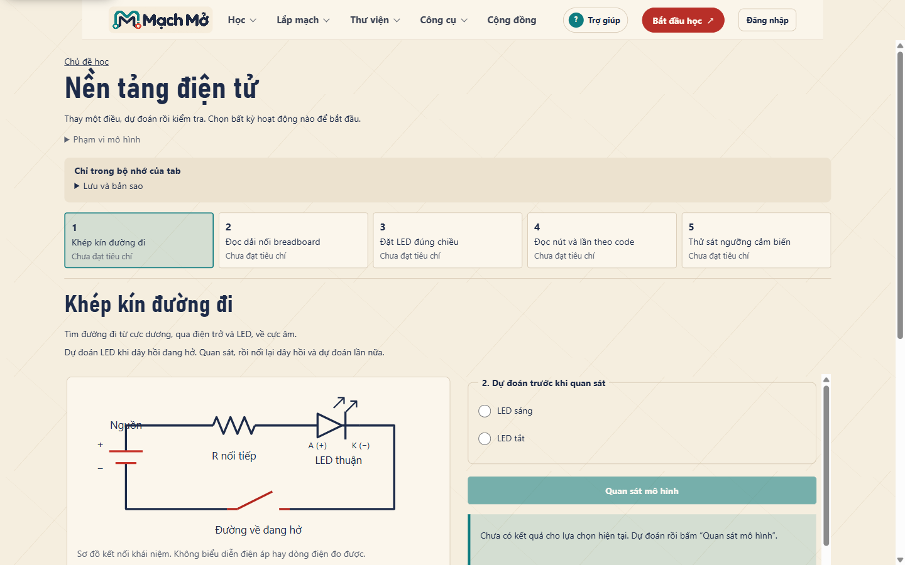
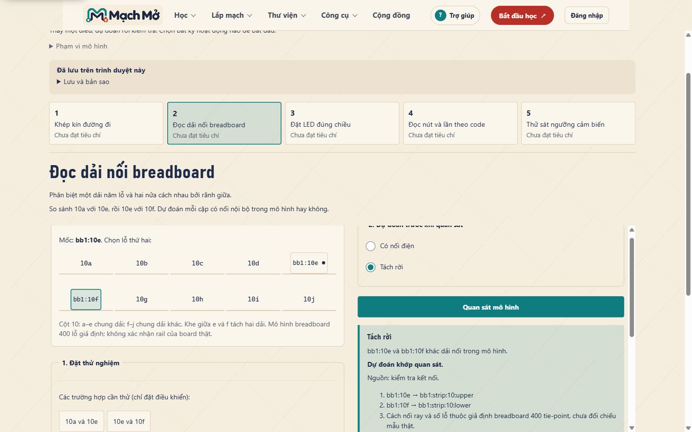
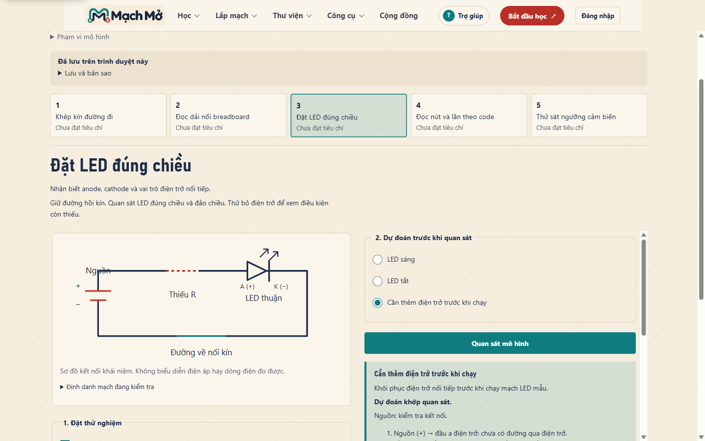
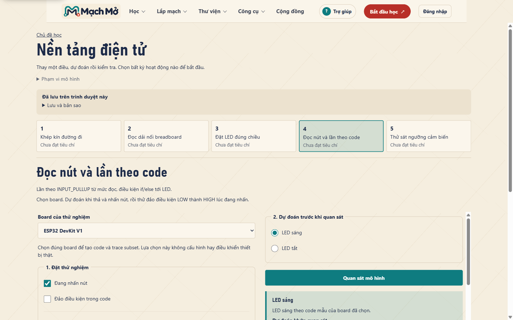

# Đợt 1 — khóa nền tảng và quay lại tiếp tục

Ngày triển khai: 17–18/11/2026. Tasks: MM-SW-LOCAL-LEARNING-001 và MM-SW-LOCAL-LEARNING-UI-001. Phạm vi local, không phụ thuộc Mini PC.

[Roadmap lợi thế → khoảng cách → đợt triển khai](../../../software/local-learning/2026-11-17-web-update-roadmap.md) · [Thiết kế](../../../software/local-learning/2026-11-17-design.md) · [Review độc lập](review.md) · [SHA-256 18 file mã/test](snapshot-reviewed.json).

## Thay đổi đã thực hiện

- Thêm `/learn/basics` và `/app/learn/basics`, có điểm vào ở trang chủ, không gian học và chủ đề. Giữ đường dẫn bài cũ và bàn tự do bắt đầu trống.
- Năm hoạt động: mạch kín, dải breadboard, cực LED/điện trở, INPUT_PULLUP, cảm biến theo ngưỡng. Người học đặt điều kiện, dự đoán, chủ động quan sát rồi chọn giải thích; có ba mức gợi ý và danh sách trường hợp cần thử.
- Ba bài nền dùng topology của CircuitDocV2 và quy tắc lỗ/dải hiện có. Đảo LED đổi chân thật trong footprint; bỏ điện trở không đưa ra kết quả dòng/áp đoán. Hai bài code yêu cầu chọn board tường minh và dùng interpreter giáo dục đang có. Bằng ngưỡng không bị nhầm thành lớn hơn ngưỡng.
- Hoàn thành dựa trên các dự đoán đúng khớp quan sát của đúng activity/board/code/threshold và giải thích đúng. Tiến độ tự đánh dấu cũ được giữ riêng. Sửa điều khiển, board hoặc dự đoán xóa kết quả hiển thị hiện hành.
- Khóa mới `machmo-beginner-course-v1` lưu hoạt động, board, điều khiển và bằng chứng có giới hạn. Không ghi đè workspace/checklist cũ. JSON hỏng/phiên bản mới được giữ nguyên; quota/từ chối lưu chuyển sang bộ nhớ với tải bản sao. Thay đổi từ tab khác báo conflict, không tự lấy bản mới thay phiên đang học. Có tải bản đang học và bytes gốc.

## Kiểm chứng

| Lệnh/kiểm tra | Exit | Kết quả |
| --- | --- | --- |
| `npm.cmd run typecheck` | 0 | Snapshot sau sửa inference của CourseState |
| `node --test tests/beginner-course.test.mjs tests/beginner-course-storage.test.mjs tests/beginner-course-ui.test.mjs` | 0 | 14/14, reviewer chạy độc lập |
| `npm.cmd test` | 0 | 716/716; fail/skip/cancel/todo đều 0 |
| `npm.cmd run test:e2e -- e2e/beginner-course.spec.mjs` | 0 | 7/7 trên production preview theo config chuẩn; wrapper đã chạy build:local |
| `npm.cmd run test:e2e` | 0 | 207 passed, 1 skipped, 0 failed; ca bị bỏ qua là analytics cần môi trường server riêng |
| Kiểm trực quan Chromium 1440×900 và 375×812 | 0 | Không lỗi pageerror ở lần kiểm, không tràn ngang tài liệu; keyboard và lưu/conflict có E2E |

Log lệnh được lưu ở [checks/](checks/) và bản chạy gốc trong `.tmp/agent-checks/MM-SW-LOCAL-LEARNING-001/`. Test mới của đợt này: 14 unit/SSR và 7 E2E, không bỏ qua ca nào. Ca analytics bị skip là `e2e/local-analytics.spec.mjs`, được task server riêng yêu cầu môi trường đang chưa bật; đây không phải bằng chứng analytics online đạt. Tổng 716 có cả các test analytics/SPICE đã tồn tại trong checkout từ công việc khác; không nhận toàn bộ phần tăng so với báo cáo cũ là của task này.

## Ảnh kiểm chứng

[Ảnh mobile của hoạt động nút](course-mobile-button.png) · [Mạch kín](course-closed-loop-observation.png).

## Giới hạn và bước tiếp

Đây là kiểm tra topology/trace subset theo bài, không phải solver analog, thực thi firmware đầy đủ hoặc phép đo trên kit thật. Số lỗ/ray breadboard vẫn là giả định giáo dục chưa xác minh vật lý. Tiến độ chỉ có độ bền của localStorage khi trình duyệt cho phép; kiểm tra stale-write không phải giao dịch nguyên tử giữa nhiều tab. Bản JSON là sao lưu tải xuống; giao diện import/đồng bộ khóa học không thuộc đợt này. Chưa thử với người học thật hoặc screen reader thực tế, chưa có số liệu chứng minh retention.

Đợt 2a nối Mở Bot vào hoạt động và kết quả hiện hành theo [thiết kế ngữ cảnh](../../../software/local-learning/2026-11-18-context-guide-design.md). Cross-probe nâng cao, anchor có nguồn, debug/probe sâu hơn, mini-project và gói giáo viên tiếp tục theo roadmap. Các phần online/sync/community/analytics server đợi Mini PC. Chưa phát hành hoặc đẩy GitHub trong lần triển khai này.

Snapshot trong báo cáo này là phiên bản kết thúc đợt 1. Các thay đổi integration sau đó ở trang khóa học/Guide được review và kiểm lại trong [báo cáo đợt 2a](../MM-SW-LOCAL-GUIDE-001/report.md); dùng báo cáo đó cho bytes hiện hành của các file được integration sửa.
