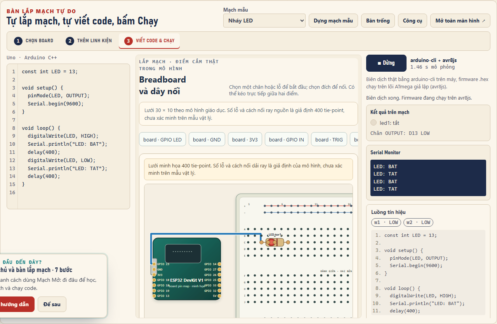
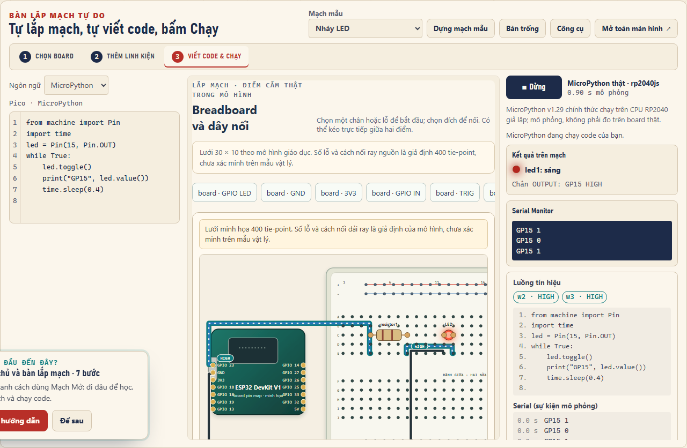
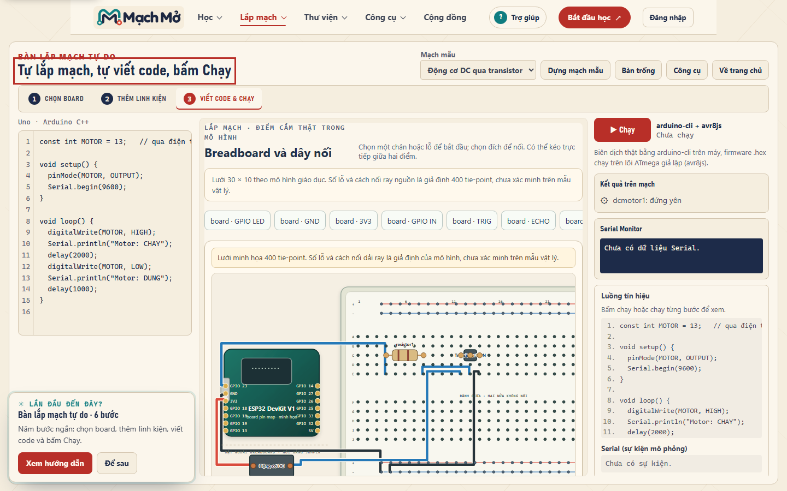
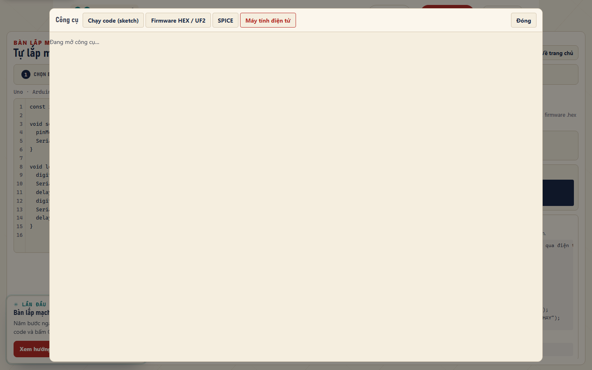
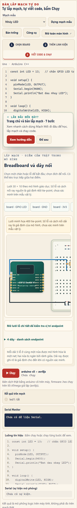

# 09 · Bàn lắp mạch tự do ở trang chủ và chạy code thật

Ngày: 2026-11-14 → 2026-11-15 · Không commit. Mọi kết quả chạy code là **mô phỏng trên máy tính**, không phải đo trên board thật.

## 1. Tóm tắt

| Board | Cách chạy code khi có dịch vụ cục bộ (`vite` dev/preview) | Bản web tĩnh (không có dịch vụ) |
|---|---|---|
| Arduino Uno, Nano | **Biên dịch thật** bằng arduino-cli 1.5.1 + core AVR 1.8.8 → `.hex` chạy trên avr8js (ATmega328P) | Trình thông dịch rút gọn |
| Arduino Mega 2560 | **Biên dịch thật** → `.hex` chạy trên avr8js với cấu hình ATmega2560 tự viết | Trình thông dịch rút gọn |
| Raspberry Pi Pico | **MicroPython v1.29.0 chính thức** chạy trên rp2040js; Arduino C++ chạy bằng trình thông dịch | Chỉ C++ (trình thông dịch); MicroPython báo cần dịch vụ |
| ESP32, ESP32-S3, STM32 Blue Pill, Nucleo-F401RE | Trình thông dịch rút gọn (ghi rõ giới hạn trên giao diện) | Như bên trái |

Trang chủ `/` thay khối "BOARD BÀI ĐẦU TIÊN" (model 3D ESP32) bằng **bàn lắp mạch tự do** 3 bước: *Chọn board → Thêm linh kiện → Viết code & Chạy*. Có 4 mạch mẫu bấm 1 nút, lưu localStorage, nút "Mở toàn màn hình" sang `/build/freestyle` (URL mới; URL cũ giữ nguyên), nút "Công cụ" mở Sketch / Firmware HEX / SPICE / Máy tính điện tử ngay trong bàn.

## 2. Đánh giá nhanh phương án khác (trước khi làm)

| Phương án | Kết luận đợt này |
|---|---|
| ESP32/ESP32-S3 bằng QEMU của Espressif | Không làm. QEMU Espressif chạy native (GPL-2.0), không có bản wasm được duy trì cho Xtensa. Muốn chạy thật phải thêm toolchain arduino-esp32/ESP-IDF (cỡ GB) và chạy QEMU như một dịch vụ cục bộ giống arduino-cli. Khả thi ở đợt sau, không khả thi trong đợt này. |
| STM32 bằng emulator wasm | Không làm. Chưa có emulator Cortex-M3/M4 + ngoại vi STM32 chạy trong trình duyệt được duy trì. Hướng thực tế là Renode hoặc QEMU chạy native qua dịch vụ cục bộ, cộng toolchain STM32duino. |
| Pico C++ biên dịch thật (arduino-pico) | Không làm: máy chưa cài core rp2040 cho arduino-cli. MicroPython là đường chạy thật cho Pico trong đợt này. |

Ghi chú bằng chứng: các kết luận ESP32/STM32 ở trên dựa trên hiểu biết về hệ sinh thái, **chưa kiểm bằng tool trong đợt này** (không tải hay build QEMU). Đây là điểm cần kiểm trước khi lên kế hoạch đợt sau.

## 3. Việc đã làm

### 3.1 Dịch vụ biên dịch cục bộ — `scripts/arduino-compile-service.mjs`
- API: `POST /api/local-tools/compile {board, source}` → `{ok, hex, log}`; `GET /api/local-tools/health`; `GET /api/local-tools/rp2040-bootrom`.
- Gắn vào `vite` dev **và** preview qua plugin `machmo-local-tools` trong `vite.config.ts`; chạy riêng được: `node scripts/arduino-compile-service.mjs` (cổng 5197, chỉ nghe 127.0.0.1).
- Đường dẫn CLI mặc định `D:/Arduino/Arduino IDE/resources/app/lib/backend/resources/arduino-cli.exe`, đổi được bằng biến môi trường `MACHMO_ARDUINO_CLI`.
- Bảo mật:
  - Chỉ nhận socket loopback **và** Host/Origin là localhost (chặn DNS rebinding, trang lạ gọi vào).
  - Board là danh sách đóng (`arduino-uno-r3`, `arduino-nano`, `arduino-mega-2560`) → FQBN cố định. Người dùng không gửi được cờ dòng lệnh.
  - `spawn` không qua shell, đối số cố định.
  - Sketch tối đa 64 KB; body tối đa 68 KB; từ chối ký tự NUL.
  - Chặn `#include` đường dẫn tuyệt đối hoặc chứa `..` (tránh đọc file trên máy rồi lộ qua log lỗi).
  - Mỗi lượt một thư mục tạm `machmo-sketch-*`, luôn xóa trong `finally`; log thay đường dẫn tạm bằng `<sketch>`, cắt ở 16 000 ký tự.
  - Timeout 120 s (kill tiến trình); mỗi lúc chỉ một lượt biên dịch, lượt thứ hai nhận HTTP 429.
- Không có dịch vụ (bản tĩnh): `/api/local-tools/health` không trả JSON → web tự dùng trình thông dịch và ghi "Chạy bằng trình thông dịch rút gọn…".

### 3.2 Chạy firmware AVR thật liên tục — `src/lib/avrLiveMachine.ts`, `src/workers/avrLive.worker.ts`
- Chạy `.hex` theo nhịp thời gian thực (worker chạy mỗi 16 ms đúng số chu kỳ 16 MHz đã trôi), nhận đầu vào digital/analog từ mạch, trả mức chân + **duty PWM đo từ timer thật**, Serial từ USART0.
- Mega 2560: tự khai báo bảng chân Arduino Mega (D0–D69), vector ngắt ATmega2560, chân so sánh timer, và SRAM bắt đầu ở 0x200 (lỗi đầu tiên tìm ra khi test: thiếu 256 byte làm stack hỏng, firmware không chạy tới `setup()`).
- Giới hạn: A8–A15 của Mega chưa nối ADC (cấu hình ADC của avr8js chỉ có kênh 0–7). `avr8jsRunner.ts` cũ (giới hạn 1 s cho công cụ HEX) giữ nguyên.

### 3.3 MicroPython thật trên Pico — `src/lib/micropythonRunner.ts`, `src/workers/micropython.worker.ts`
- Firmware: `public/firmware/micropython/RPI_PICO-20260824-v1.29.0.uf2` (MIT), kèm `NOTICE.txt` và `LICENSE-micropython.txt`.
- Code người dùng nạp qua USB CDC bằng **raw REPL** (Ctrl-C, Ctrl-B, Ctrl-A, gửi code, Ctrl-D); stdout và traceback tách riêng. Lượt chạy sau: ngắt chương trình cũ rồi soft reset, không khởi động lại MicroPython.
- GPIO GP0–GP29 nối vào mạch; ADC GP26–GP28 nhận giá trị thanh trượt.
- Sửa một sai khác của rp2040js: `Pin.value()` trên chân OUTPUT luôn trả 0 vì pad input không đọc lại mức xuất. Runner tự phản chiếu mức xuất vào input như chip thật.
- Tốc độ: trong Node test, khởi động + chạy code mất khoảng 3 s thực. Trong trình duyệt, LED sáng sau khoảng 1,1 s kể từ khi bấm Chạy (đo bằng JS trên dev server). Mô phỏng có thể chậm hơn thời gian thực; giao diện hiển thị "x s mô phỏng".

### 3.4 Lõi bàn tự do — `src/lib/freestyle/freestyleCircuit.ts`, `freestyleRuntime.ts`
- Tài liệu mạch vẫn là **CircuitDocV2** (`lessonId: "freestyle"`); đặt/dời/xoay linh kiện dùng `canMount`/`footprintHoles`, nối mạng dùng `createNetIndexV2`.
- Part `board` có sẵn có các chân trừu tượng (GPIO LED, GPIO IN, TRIG, ECHO, chân 2–8). Bàn tự do gán số chân thật cho từng chân bằng `pinMap` (ví dụ GPIO LED → D13 trên Uno, GP15 trên Pico, PA5 trên Blue Pill). Người dùng đổi được ở bước 1.
- Mô hình mạch logic (không phải mô phỏng điện):
  - Lan truyền HIGH/LOW, phân biệt nối thẳng và đi qua điện trở; công tắc, nút, transistor, MOSFET và relay đóng/ngắt theo cực điều khiển.
  - Đầu ra: LED (độ sáng theo PWM; cảnh báo khi thiếu điện trở hạn dòng), LED RGB, buzzer, động cơ DC (chiều và tốc độ), servo (góc từ duty 50 Hz), LED 7 đoạn.
  - Đầu vào gửi vào firmware: nút nhấn, công tắc gạt/hành trình, cảm biến IR (bật/tắt), biến trở/LDR/NTC (thanh trượt).
  - HC-SR04, OLED, TB6612, L298N: hiện cảnh báo "chưa mô phỏng trên bàn tự do".
- Trình thông dịch có thêm 2 board STM32 (`sketchInterpreter.ts`, trường mới `nameAliases`):
  - Blue Pill viết chân bằng tên `PA5`, `PC13`.
  - Nucleo-F401RE dùng header Arduino D0–D15, A0–A5, cộng tên `PA5`…
- 4 mạch mẫu (Nháy LED, Nút nhấn bật LED, Biến trở chỉnh độ sáng, Động cơ DC qua transistor) dựng được trên cả 8 board, kèm code C++ và MicroPython.

### 3.5 Giao diện — `src/components/freestyle/*`, `src/pages/FreestyleLabPage.tsx`
- `FreestyleBench`: tab 3 bước có điều khiển bàn phím (←/→). Vùng giữa là `BreadboardEditor` có sẵn: nối dây bằng bấm chân/lỗ hoặc kéo; LED sáng bằng `litPartIds`; nhãn HIGH/LOW/PWM trên dây bằng `wireSignals`.
- Cột phải gồm:
  - Nút ▶ Chạy và tên engine đang dùng, kèm ghi chú giới hạn.
  - Thanh trượt và nút đầu vào; "Kết quả trên mạch".
  - Serial Monitor và `SignalFlowPanel` có sẵn.
- Thêm linh kiện: kéo từ thư viện thả vào lỗ breadboard, hoặc bấm "Thêm" để tự tìm chỗ trống (dùng được với bàn phím và di động). Chọn linh kiện thì có Di chuyển (chọn lỗ đích), Xoay 180° và Xóa.
- Lưu: `localStorage["machmo-freestyle-v1"]`, lưu ngay mỗi lần đổi. Dữ liệu hỏng được sao lưu bằng `backupDamagedValue` rồi dùng mạch mặc định.
- Trang chủ: `ExplorePage` bỏ `HeroCircuit` + `FirstBoardStudio` (`FirstBoardStudio` vẫn dùng ở `/app`).
- Route mới trong `App.tsx`: `/build/freestyle` và `/app/lab/freestyle` (toàn màn hình, khung `mm-fit`).
- Ngăn công cụ `FreestyleToolsDrawer`: `<dialog>` modal, 4 tab nạp lazy các trang công cụ hiện có, không đổi URL.

### 3.6 Sửa nhỏ ngoài phạm vi mới
- `SignalFlowPanel.tsx`: thêm `tabIndex={0}` cho vùng code cuộn được (axe `scrollable-region-focusable`, serious).
- `FreestyleBench.css` tăng tương phản chữ "Bấm chạy…" / "Chưa có sự kiện." của SignalFlowPanel **chỉ trong bàn tự do**. CSS gốc dùng `opacity: .7`, chỉ đạt 3,94:1 trên nền kem; phòng lắp mạch cũ không đổi.

## 4. Tái dùng và những gì chưa tái dùng
- Tái dùng: `CircuitDocV2`, `BreadboardEditor`/`BreadboardDiagram`, `circuitNetsV2`, `mountResolve`, `circuitDocEdits`, `SignalFlowPanel`, `sketchInterpreter`, `intelHex`, `parseUf2`, `workspaceStorage`, các trang công cụ.
- `logicTraceV2` chưa tái dùng vì chỉ hỗ trợ bài `blink` và `button-led`. Bàn tự do có bộ đánh giá mạch tổng quát riêng.
- **`AssemblyStage` (3D) chưa đưa vào bàn tự do.** Component cần mô hình bài học V1 (`parts`/`wires` kiểu cũ, `lessonId`, `pinPoint`…), và phiên lab-models-signal đang sửa các file 3D. Đợt này không sửa file 3D nào và không đổi props 3D.
- "Mở toàn màn hình" đi tới `/build/freestyle` (cùng component, cùng localStorage), **không** nạp vào `CircuitBuilderPage` (`/build`). Phòng `/build` gắn chặt với bài học (`validateCircuit` theo `lessonId`); nhồi mạch tự do vào đó là một đợt riêng.

## 5. Dependency và tài sản
- **Không thêm package npm nào.** Dùng `avr8js` và `rp2040js@1.4.1` (MIT) đã có.
- Thêm tài sản: MicroPython UF2 v1.29.0 (MIT, 680 960 byte, SHA-256 `e1160e60…f4e9`), có NOTICE.
- **Không đóng gói** bootrom RP2040 B2. File chứa `mufplib.S` của Mark Owen, chỉ được Raspberry Pi cấp phép "dùng trên chip RP2040" (hoặc GPLv2 từ tác giả). Dịch vụ cục bộ tải `b2.elf` từ release chính thức `raspberrypi/pico-bootrom-rp2040`, kiểm SHA-256 `3a3c4c61…49aa`, tách đoạn 16 KB, rồi cache ở `.tmp/firmware-cache/` (đã gitignore).

## 6. Kiểm tra đã chạy

| Lệnh | Kết quả |
|---|---|
| `node --max-old-space-size=4096 node_modules/typescript/bin/tsc -p tsconfig.app.json --noEmit` | sạch (lần chạy 2026-11-15) |
| `tsc -p tsconfig.node.json --noEmit` (vite.config.ts) | sạch |
| `npm.cmd test` | **619/619 pass**, gồm test mới: `arduino-compile-service` (5), `avr-live-machine` (3, biên dịch thật Uno + Mega), `micropython-runner` (2, MicroPython thật), `freestyle-circuit` (8) |
| `npm.cmd run build:local` | OK. Một lần giữa chừng fail do `src/components/board/glbParser.ts` của phiên khác; lần chạy cuối pass |
| Playwright `e2e/freestyle-bench.spec.mjs`, config tạm `.tmp/playwright.freestyle.config.mjs` cổng 5296 (cổng 5196 đang bị giữ) | **8/8 pass** (xem bảng dưới) |
| Toàn bộ e2e trên cổng 5296 | 109 pass, 4 fail (xem dưới) |

Chi tiết 8 test freestyle:
- Uno: dựng tay R + LED + 3 dây → code Blink → arduino-cli → LED nháy, Serial `LED: BAT/TAT`. Lỗi biên dịch thật báo đúng "Dòng 2".
- Pico: MicroPython thật nháy LED GP15, Serial `GP15 1`.
- Không có dịch vụ: route giả trả 404 → trình thông dịch nháy LED; giữ nút trên bàn thì LED sáng và Serial "Nhan".
- Toàn màn hình giữ mạch/code, không cuộn tài liệu ở 1440×900; ngăn công cụ mở đủ 4 tab.
- Axe serious/critical = 0 và không cuộn ngang ở `/` và `/build/freestyle`, bề rộng 375 và 1440.

4 fail trong lượt e2e toàn bộ:
- `a11y 375px /app/classroom-kits`: chạy lại riêng thì pass (flake).
- `3D event marker … 1440px/375px` và `3D lesson preview ignores stale legacy parts…`: selector `.assembly-pin-marker` và chữ "Đang xem trước topology mạch v5" nằm trong `AssemblyStage.tsx`. File này đang được phiên lab-models-signal sửa; đợt này không đụng. Cần phiên đó xác nhận.

Chưa chạy: `npm.cmd run build` đầy đủ (có `check:public-release`, cổng ngspice không liên quan) và kiểm tra trên board thật.

## 7. Giới hạn và câu hỏi mở
- Trình thông dịch chỉ là tập con Arduino C++ (không thư viện, không WiFi/I²C/SPI). ESP32/STM32 chưa có đường chạy thật.
- Mô hình mạch là logic giáo dục: không tính dòng hay áp. LED "thiếu điện trở" chỉ là cảnh báo.
- Chân 5 V của part `board` chưa có tọa độ trên sơ đồ breadboard (`boardPinsMm` thiếu `v5`), nên mạch mẫu động cơ lấy nguồn từ VCC.
- Sơ đồ board trên breadboard vẫn là board ESP32 dùng chung với nhãn chân trừu tượng. Số chân thật nằm ở bảng gán chân bước 1.
- **Câu hỏi cho founder:** bootrom RP2040 được tải về máy người dùng khi chạy MicroPython (không phân phối trong repo). Cách này có chấp nhận được về license không? Nếu không, Pico chỉ còn trình thông dịch C++.

## 8. File đã đổi / thêm
Thêm:
- `scripts/arduino-compile-service.mjs`, `scripts/arduino-compile-service.d.mts`
- `src/lib/avrLiveMachine.ts`, `src/lib/micropythonRunner.ts`
- `src/lib/freestyle/freestyleCircuit.ts`, `src/lib/freestyle/freestyleRuntime.ts`
- `src/simulation/liveRuntimeProtocol.ts`
- `src/workers/avrLive.worker.ts`, `src/workers/micropython.worker.ts`
- `src/components/freestyle/FreestyleBench.tsx`, `src/components/freestyle/FreestyleBench.css`, `src/components/freestyle/FreestyleToolsDrawer.tsx`
- `src/pages/FreestyleLabPage.tsx`
- `public/firmware/micropython/` (UF2, LICENSE, NOTICE)
- Test: `tests/arduino-compile-service.test.mjs`, `tests/avr-live-machine.test.mjs`, `tests/micropython-runner.test.mjs`, `tests/freestyle-circuit.test.mjs`
- E2e: `e2e/freestyle-bench.spec.mjs`
- Ảnh: `img/09/*.png`

Sửa:
- `vite.config.ts` (plugin), `src/App.tsx` (2 route), `src/pages/ExplorePage.tsx`
- `src/lib/sketchInterpreter.ts` (STM32), `src/components/builder/SignalFlowPanel.tsx` (`tabIndex`)
