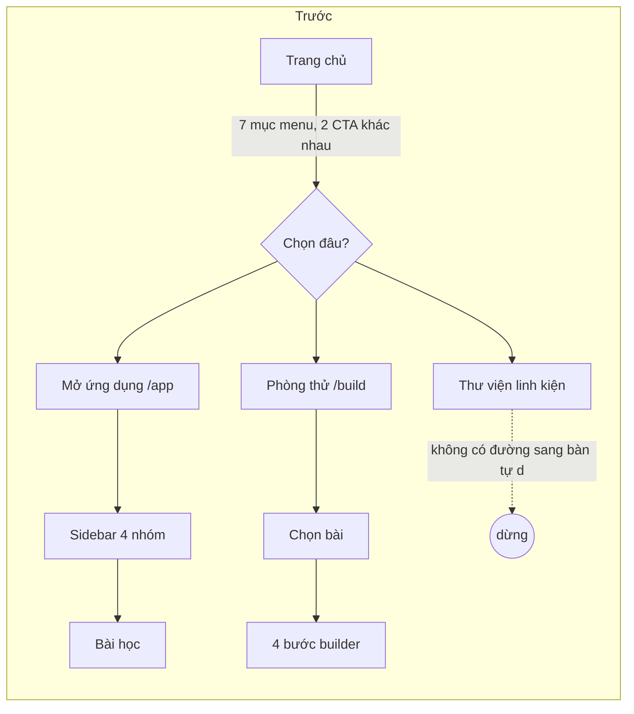
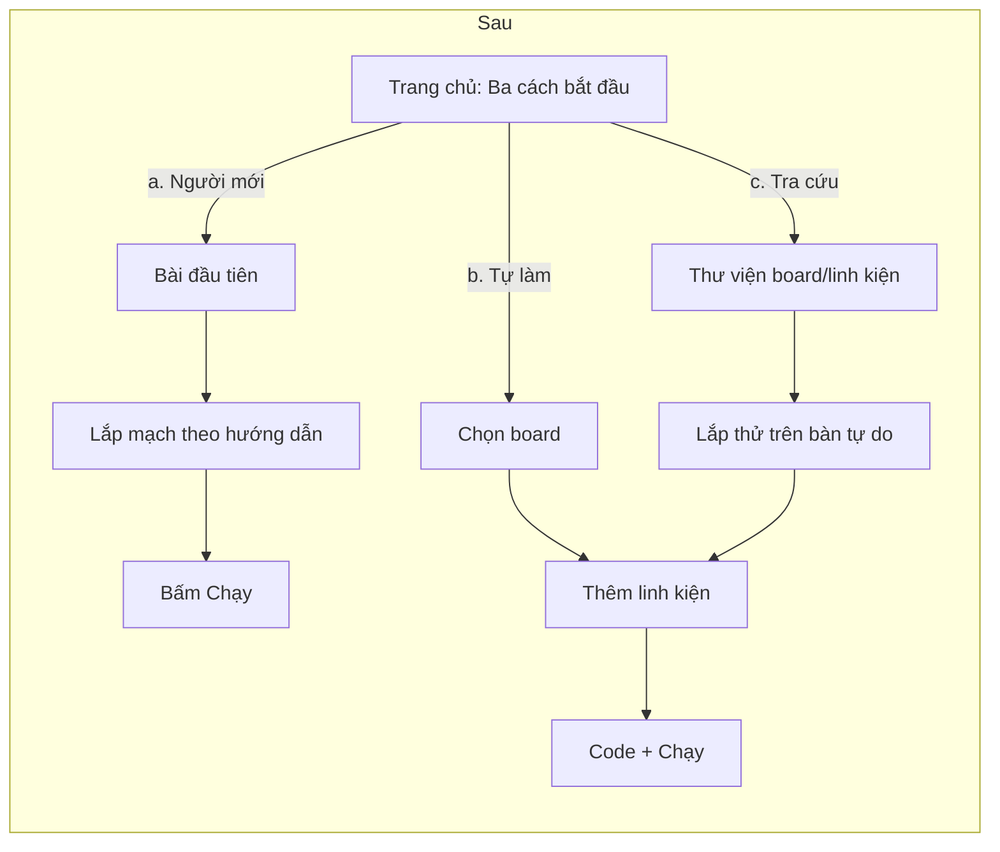

# 10 — Thiết kế lại UI/UX toàn site (2026-11-15)

Phạm vi: điều hướng, luồng chính, tour lần đầu, lớp thị giác và vi tương tác, sửa 3 e2e 3D. Chưa commit.
Bàn giao cho Codex làm tiếp: `11-ke-hoach-codex-trien-khai.md`.

## 0. Xác minh nền

| Kiểm tra | Kết quả trước khi sửa |
|---|---|
| e2e toàn bộ (113 test) | 110 pass, 3 fail: `journeys.spec.mjs:35` ×2, `:812` |

Ba test fail chính là ba test 3D `AssemblyStage` mà phiên freestyle báo:

- `:35` ×2 — `.assembly-pin-marker` không còn hiện. Nguyên nhân: `AssemblyStage.tsx` đổi `sceneTracedPin = circuitProjection ? '' : tracedPin`, nên mọi caller có `circuitDocV2` mất marker. Comment ngay trên dòng này nói caller bài học truyền trace từ cùng CircuitDocV2. Sửa: khôi phục `circuitProjection && flows.size === 0 ? '' : tracedPin`, và phòng lắp mạch tự truyền `tracedPin={v2CircuitActive?'':tracedPin}` (`CircuitBuilderPage.tsx`) để trace cũ không tô sai mạch v5.
- `:812` — test lỗi thời. Tiêu đề "Đang xem trước topology mạch v5" đã được phiên khác đổi có chủ đích, vì bài blink giờ có trace V2. Test được cập nhật sang "Xem thử trace trên mạch bài học", vẫn giữ ý định: xác nhận đang ở chế độ xem trước rồi mở 3D.

## 1. astryx (github.com/meta/astryx)

- Repo có thật; license MIT (Copyright 2026 Meta Platforms); bản beta. Package `@astryxdesign/core` cần peer `react >=19`, `react-dom >=19`, `@stylexjs/stylex ^0.19`. Repo có ví dụ Vite. Kết luận: dùng được.
- Đã cài cố định (`--save-exact`): `@astryxdesign/core@0.7.16`, `@stylexjs/stylex@0.19.2`. Script postinstall của astryx **không chạy**, vì npm chặn (`allowScripts`). Script này chỉ in gợi ý `astryx init`.
- **Chỉ dùng** `useFocusTrap` từ `@astryxdesign/core/hooks` cho hộp thoại tour, để bẫy Tab và đóng bằng Esc.
- **Không dùng** `astryx.css` (292 KB, chứa mọi component), `reset.css` hay theme. Lý do: hai file này áp lại style toàn site và đụng ngôn ngữ thị giác `--mm-*`.
- Tác động bundle: chunk `index-*.js` tăng 316 937 → 338 628 B (+21,7 KB). Con số này gồm cả onboarding và điều hướng mới. Bundle không chứa runtime StyleX.

## 2. Kiến trúc thông tin và luồng

### Điều hướng

| | Trước | Sau |
|---|---|---|
| Cấp 1 công khai | Giới thiệu · Không gian học · Thư viện▾ · Phòng thử · Công cụ▾ · Lộ trình▾ · Cộng đồng + "Mở ứng dụng" | **Học▾ · Lắp mạch▾ · Thư viện▾ · Công cụ▾ · Cộng đồng** + Trợ giúp + "Bắt đầu học" |
| Sidebar `/app` | KHÔNG GIAN HỌC · TRA CỨU & THỰC HÀNH · CÔNG CỤ · CỘNG ĐỒNG | HỌC · LẮP MẠCH · THƯ VIỆN · CÔNG CỤ · CỘNG ĐỒNG |
| Thanh dưới mobile `/app` | 7 mục | 5 mục, trùng 5 khu vực |

Không đổi hay xoá URL nào. Các trang trùng nhau (`/x` và `/app/x`) vẫn giữ route; link chỉ được gom vào đúng nhóm. Bàn tự do có thêm feature `freestyle` (`/build/freestyle` ↔ `/app/lab/freestyle`) trong registry.

### Luồng trước/sau

- (a) Từ trang chủ, CTA "Bắt đầu bài đầu tiên" mở `/learn/esp32-led`. Thanh dưới của bài học dẫn tới bước chạy.
- (b) `/build/freestyle` có sẵn 3 tab: Chọn board · Thêm linh kiện · Viết code & Chạy.
- (c) Mới: nút "Lắp thử trên bàn tự do" ở trang Linh kiện (`?part=`) và trang Board (`?board=`). Bàn tự do áp tham số đúng một lần, mở đúng tab, rồi xoá tham số khỏi URL.

## 3. Hướng dẫn người lần đầu

- `src/components/onboarding/` gồm `tours.ts`, `GuidedTour.tsx`, `Onboarding.tsx` và `Onboarding.css`.
- Có 4 tour: trang chủ (6 bước), bàn tự do (6), phòng lắp mạch (5), bài học (5).
- Lần đầu vào trang, một lời mời hiện ở góc trái dưới. Lời mời **không chặn thao tác** và có hai nút: "Xem hướng dẫn" / "Để sau".
- Tour làm mờ trang, khoét sáng vùng đang nói tới, và đặt hộp thoại cạnh vùng đó. Ở <640px, hộp thoại neo ở đáy màn hình.
- Bàn phím: ← → để đổi bước, Esc để bỏ qua. Tab chỉ chạy trong hộp thoại nhờ `useFocusTrap`, và `#root` được đặt `inert` trong lúc tour mở. Khi đóng tour, focus trả về chỗ cũ.
- ARIA: `role="dialog"`, `aria-modal`, `aria-labelledby` và `aria-describedby`.
- Menu **Trợ giúp** có trên header công khai và topbar `/app`. Menu cho mở lại tour của trang đang xem, mở tour của trang khác (chuyển trang rồi tự chạy), và đặt lại lời mời.
- Trạng thái lưu ở `localStorage['mm-tour-seen']` = `{home|freestyle|lab|lesson: epoch ms}`.

## 4. Thị giác và hiệu ứng

`src/styles/redesign.css` được nạp sau `one-screen.css`:

- Thêm token: `--mm-space-*`, `--mm-text-*`, `--mm-shadow-card/lift`, `--mm-accent-hover`, `--mm-led-on`.
- Header: CTA dạng pill, menu con có mô tả, gạch chân trượt cho mục đang mở. Ở mobile header nằm một hàng (logo · Trợ giúp · Menu); CTA ẩn ở ≤520px vì đã có ở hero và menu Học.
- Nút có trạng thái hover/active/focus. Thẻ nhấc lên khi hover. Empty state dùng viền nét đứt. Skeleton thay chữ "Đang tải trang…"; chữ vẫn giữ cho trình đọc màn hình.
- Vi tương tác, chỉ dùng CSS:
  - Chuyển trang: chỉ dùng `translate`, không đổi opacity, để axe không đo sai độ tương phản.
  - Panel trượt lên.
  - Nút Chạy nháy 3 lần khi sẵn sàng và có sọc chạy khi đang mô phỏng.
  - LED bật có hiệu ứng nảy kèm quầng sáng theo độ sáng.
  - Dây tín hiệu dùng `mm-wire-flow` có sẵn.
- `prefers-reduced-motion: reduce` tắt toàn bộ animation và transition. Có e2e kiểm tra điều này.
- **Chế độ tối: chưa làm.** CSS còn 1 552 màu hard-code, riêng `app.css` có 804. Bật dark mode lúc này sẽ cho ra trang nửa sáng nửa tối và lỗi tương phản. Kế hoạch theo giai đoạn ở file 11.

## 5. Kiểm tra (số liệu từ tool)

| Kiểm tra | Kết quả |
|---|---|
| `npm.cmd run typecheck` | sạch |
| `npm.cmd test` | **623/623 pass** (619 cũ + 4 mới ở `tests/onboarding-tours.test.mjs`) |
| `npm.cmd run build:local` | thành công |
| e2e toàn bộ (`.tmp/pw-redesign.config.mjs`, port 5311) | **119/119 pass** (113 cũ + 6 mới ở `e2e/onboarding-tour.spec.mjs`); 3 fail baseline đã hết |
| Axe serious/critical, 38 route × {375, 1440} | before 0/76 · **after 0/76** |
| Cuộn ngang ở 375px | before 0 · after 0 route |
| Trang `mm-fit` cuộn dọc ở ≥1280 (1366×768, 1440×900) | before 0 · after 0 |
| Ảnh | `img/10/before/` và `img/10/after/`: 38 route × 3 kích thước (1440×900, 1366×768, 375×812). `img/10/tour/`: 11 ảnh tour, menu Trợ giúp, bàn đang chạy |

Lỗi tìm thấy và đã sửa trong lúc làm:
- `button-name` ở 375px: nút Trợ giúp mất tên khi nhãn bị ẩn. Đã thêm `aria-label`.
- `target-size` ở `/learn/blink` 375px: header xuống 2 hàng và nút Menu đè lên breadcrumb. Đã chuyển header về một hàng và cho link breadcrumb vùng bấm tối thiểu 24px.

Chưa chạy: thử bằng trình đọc màn hình thật (NVDA), thử trên thiết bị di động thật, và đo Lighthouse/hiệu năng.

Lệnh tái lập: xem mục 5 của file 11.

## 6. File

- Mới: `src/components/onboarding/{tours.ts,GuidedTour.tsx,Onboarding.tsx,Onboarding.css}`, `src/styles/redesign.css`, `tests/onboarding-tours.test.mjs`, `e2e/onboarding-tour.spec.mjs`.
- Sửa: `src/App.tsx`, `SiteShell.tsx`, `SiteNavigation.tsx/.css`, `AppWorkspaceNavigation.tsx/.css`, `productFeatureRegistry.ts`, `productRoutes.ts`, `ExplorePage.tsx`, `BoardCatalogPage.tsx`, `ComponentsPage.tsx`, `FreestyleBench.tsx`, `AssemblyStage.tsx`, `CircuitBuilderPage.tsx` (1 thuộc tính), `e2e/journeys.spec.mjs` (1 dòng), `package.json` và `package-lock.json` (astryx).
- Công cụ tạm (không thuộc sản phẩm): `.tmp/route-audit.mjs`, `.tmp/pw-redesign.config.mjs`, `.tmp/dist-before/`.

## 7. Việc còn lại

Chi tiết và tiêu chí nghiệm thu ở file 11.
1. Chế độ tối theo giai đoạn.
2. Cỡ chữ: còn 468 khai báo `font-size` 8–11px.
3. Thử thủ công với NVDA và trên thiết bị thật.
4. Tour cho bề mặt `/app` và thêm vài trang khác nếu founder muốn.
5. Founder duyệt: ẩn CTA ở ≤520px, nhãn mới "Phòng lắp mạch theo bài".
