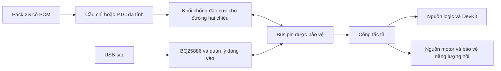

# Đề xuất cải tiến PCB MoBot — tay cầm và robot

**Ngày:** 15/11/2026 · **Trạng thái:** Đề xuất để founder xem xét · **Người duyệt:** Founder.

**Đề xuất chính:** giữ nền ESP32 DevKit tháo lắp, tay cầm 3 AA, robot 2S và hai motor của bản thiết kế mới nhất; làm lại các cụm nguồn và bảo vệ trước, sau đó bố trí PCB theo đường dòng thực. Ưu tiên sửa có hệ thống trên nền hai bo hiện tại, chưa cần thay toàn bộ thiết kế.

Đây là hồ sơ phương án, chưa phải cấu hình mới được duyệt hay chỉ dẫn xuất sản xuất. MPN thay thế, giá, số liệu chưa có bằng chứng vẫn ghi TBD. Đề xuất không sửa schematic, PCB, queue hoặc bản cấu hình.

## 1. Căn cứ và mục tiêu

- [Review độc lập 14/11](../reviews/2026-11-14-pcb-independent-review/report.md), gồm F01–F10, số đo từ KiCad và nguồn hãng.
- [Snapshot có hash](../reviews/2026-11-14-pcb-independent-review/snapshot.json): kiểm lại ngày 15/11 không có thay đổi trong tập file đã ghim.
- [Thiết kế Claude r3](claude-support/2026-11-12-pcb-2layer/02-tai-lieu-thiet-ke.md), [kết quả mới nhất](claude-support/2026-11-12-pcb-2layer/03-ket-qua-thiet-ke.md): tay cầm 80×76 mm, robot r4 100×80 mm, hai lớp. Robot hiện tại là hai motor; yêu cầu bốn motor trong lịch sử chưa được tự đưa trở lại.
- Giữ mô hình học tập, bảo trì thuận tiện: DevKit/module tháo được, đầu nối có nhãn, test point dễ chạm, schematic đọc được.
- Mục tiêu kiểm chứng: nguồn có cận ở các trạng thái sử dụng, bảo vệ bao phủ đúng đường lỗi, footprint khớp MPN, vòng switching gọn, nhiệt và cơ khí có hồ sơ riêng.

**Giá:** hồ sơ r3 ghi founder chấp nhận vượt trần ở EVT0. Báo giá bộ đầy đủ và giá sản phẩm sau EVT0 vẫn phải tách riêng; tài liệu này không cam kết tổng bộ dưới 1 triệu đồng và chưa kiểm giá/tồn kho.

## 2. So sánh ba hướng thực hiện

| Hướng | Lợi ích | Đánh đổi | Đề xuất |
|---|---|---|---|
| A. Sửa kiến trúc và layout các cụm lỗi trên hai PCB hiện có | Tận dụng phần đã làm; ít thay đổi cơ khí và firmware hơn | Cần kỹ năng layout nguồn, hàn QFN và review bảo vệ | **Hướng chính cho EVT0**, với các điều kiện về DevKit/nguồn bên dưới |
| B. Đưa các cụm nguồn/driver sang module có tài liệu | Dễ thay module, chia nhỏ lỗi và thử nghiệm | Cao/lớn hơn, thêm đầu nối; module không rõ hãng vẫn thiếu cận | Phương án dự phòng cho cụm không khép được bằng chứng; chỉ dùng module đã xác minh |
| C. Thiết kế lại board MCU tích hợp ESP32 module trần | Kiểm soát được nguồn, USB và footprint | Tăng phạm vi RF, sản xuất, firmware nạp và xác minh | Để thế hệ sau, chưa cần cho lần sửa này |

Module phù hợp để giữ: ESP32 DevKit, OLED, MAX98357A và cảm biến khi đã khóa pinout. Cụm sạc hoặc DC/DC chỉ nên module hóa nếu có schematic, MPN, giới hạn nhiệt/dòng, reverse behavior và kích thước. Nhãn “5 V/3 A” trên trang bán chưa đủ để nhận module vào BOM.

## 3. Tay cầm: cấu trúc đề xuất

### 3.1. Nguồn và hành vi cắm USB

Giữ 3 AA → bảo vệ đầu vào → công tắc → buck-boost → hạn dòng → tải là hướng tận dụng được phần lớn thiết kế. Có hai cách hoàn thiện đường cấp DevKit:

| Phương án | Điều kiện để chọn | Đánh đổi |
|---|---|---|
| H-A: giữ cấp vào 3V3 | Chọn được đúng DevKit CH340 có sơ đồ/regulator xác định, chứng minh regulator chịu backdrive và các nguồn cùng tồn tại | Hiệu suất/diện tích thuận lợi; phụ thuộc đúng SKU/revision của DevKit |
| H-B: cấp qua cổng USB của DevKit bằng đường nguồn được giới hạn và chặn ngược | Chốt thiết kế 5 V và giao diện cấp qua USB có trạng thái xác định; tính cả regulator onboard | Thêm tổn hao và cáp/không gian nhưng giảm phụ thuộc backdrive regulator từ 3V3 |

**Khuyến nghị:** chỉ giữ H-A khi tài liệu của một model mua được đóng được bài toán. Nếu tiếp tục dùng clone không xác định regulator, chuyển proposal sang H-B. Không khép F05 bằng cách gắn thêm ideal diode phía carrier: phần đó vẫn chưa cách ly output regulator onboard khỏi rail 3V3.

Thay đổi H-A→H-B là thay đổi kiến trúc cần trình duyệt; tài liệu này chưa chọn MPN hay cấp phép sửa pin/nguồn. Không yêu cầu founder tự đo mẫu trước khi tiếp tục lập phương án; có thể tìm SKU có tài liệu trước và để xác minh mẫu thật ở mốc phù hợp.

### 3.2. Các việc cải tiến cụ thể

| ID | Thực hiện đề xuất | Đầu ra cần có |
|---|---|---|
| H01 | Giữ TPS631000 làm ứng viên; đặt lại U1/L1/C1/C2/C3 thành một cell theo layout TI | Cin/Cout sát chân tương ứng, vòng dòng ngắn/rộng, FB tránh LX; bản vẽ đường đi và return |
| H02 | Tính lại setpoint và sai số, rồi mới quyết định giữ 576k/100k hay đổi | Cận V3V3_BB và V3V3_DEV sau switch, gồm reference, R, RON, nhiệt, ripple, startup và load step |
| H03 | Đặt C6 sát IN của TPS2553, kiểm current-limit và inrush cả DevKit | Không brownout khi boot/radio, không vượt budget pin/PTC; chưa có số đo ghi NOT_RUN |
| H04 | Khép USB/UART coexistence, gồm programmer cấp/không cấp nguồn | Bảng các trạng thái nguồn và dòng cấp ngược cho regulator, UART, EN và ADC pin |
| H05 | Kiểm UVLO khi pin sụt rồi hồi; giữ tự phục hồi đã được founder chốt | Cận ngắt/bật lại theo nhiệt và dung sai; giải thích trường hợp dao động ON/OFF, không tự đổi sang latch-off |
| H06 | Chốt joystick trần theo MPN mua được và bản vẽ hãng | Pinout/land pattern/chiều cao/núm/hành trình, bản lắp vỏ và khoảng tay |
| H07 | Tách nhánh LiPo DNP thành variant rõ | BOM và assembly drawing ghi rõ AA-only; vị trí jumper, cụm không lắp và cấm lắp nhầm |
| H08 | Đưa ADC/joystick về vùng tín hiệu yên, có đường hồi ngắn | Phân tích lọc RC, settling ADC, nhiễu khi radio chạy và hành vi khi MCU mất điện |

**Số hiện tại cần sửa trong tài liệu:** với VFB 0,495–0,505 V, R2/R3=576k/100k cùng ±1%, cận tĩnh là **3,28974–3,47256 V**, danh định 3,380 V. Đây chưa phải cận cuối tại DevKit. Không lấy việc nằm trong một khoảng điện áp danh định làm bằng chứng chịu được mọi xung startup hoặc USB coexistence. [Nguồn TPS631000](https://www.ti.com/lit/ds/symlink/tps631000.pdf).

**LiPo DNP:** khuyến nghị EVT0 tay cầm giữ AA-only trong hướng A. Có thể giữ footprint DNP để giảm thay đổi ngay; nếu nó cản placement nguồn/ergonomics, đề xuất variant PCB riêng bỏ cụm này. Việc bỏ footprint là lựa chọn cần founder duyệt. Không coi cụm DNP là phương án LiPo đã sẵn sàng lắp.

### 3.3. Bố trí và trải nghiệm cầm

- Giữ DevKit giữa bo, anten ở mép trên và keepout trên mọi lớp có liên quan. Đối chiếu anten của đúng DevKit với vỏ, joystick, pin và dây; keepout trên carrier chưa giải quyết vật kim loại trong vỏ.
- Giữ hai joystick hai bên làm điểm xuất phát; khoảng tâm hiện 56,5 mm là dữ liệu bố trí, chưa phải kết quả ergonomics. Dựng envelope núm khi nghiêng và khi nhấn, khoảng ngón cái với nút và mép vỏ trước khi khóa tọa độ.
- Chừa truy cập nút BOOT/EN và hướng tháo DevKit; kiểm chiều cao linh kiện bên dưới bằng mặt cắt stack, không chỉ courtyard 2D.
- Nguồn vào và công tắc ở mép; nhãn cực pin nhìn thấy sau khi lắp. Giữ test point nguồn trước/sau bảo vệ, output converter, output switch và GND.
- Với mục tiêu dễ sửa, ưu tiên linh kiện hai chân 0805 ở nơi có chỗ; không đổi đồng loạt 0603 nếu làm vòng switching dài hơn. Chọn theo cell nguồn và khả năng hàn thực.

## 4. Robot: cấu trúc đề xuất

### 4.1. Đường pin/sạc phải được sửa trước layout



Đây là sơ đồ chức năng, không phải schematic FET hoàn chỉnh. Khối RP cần chứng minh cho **đường sạc và đường xả**, pack đảo cực, USB có/không và nguồn mất bất chợt. Cách nối gate/body diode của FET phải được phân tích trước khi chọn. BQ25886 BAT hiện nối trước Q1 nên chưa được bảo vệ; chuyển nhãn net đơn thuần chưa đủ để đóng lỗi.

**Khuyến nghị:** giữ BQ25886 làm ứng viên vì đã có quyết định sản phẩm cho sạc onboard, nhưng sửa khối bảo vệ bao phủ BAT. Giữ chính sách khóa chạy khi sạc của bản hiện tại. Dùng SYS PowerPath để vừa chạy vừa sạc là phương án sản phẩm khác, chưa tự đưa vào lần sửa này. [BQ25886 §7.1, §11](https://www.ti.com/lit/ds/symlink/bq25886.pdf).

### 4.2. Motor và năng lượng hồi

Giữ DRV8833, hai kênh và VM khoảng 6 V làm nền phân tích; điều kiện là motor N20 cụ thể có dòng khởi động/tải phù hợp cận chop. Chưa được chọn driver chỉ theo chữ “1,5 A”. Rsense 0,62 Ω±1% với Vtrip 0,16–0,24 V cho **0,2555–0,3910 A/kênh**; cần chốt motor chạy được với dải đó. [DRV8833](https://www.ti.com/lit/ds/symlink/drv8833.pdf).

| Hướng xử lý VM | Ưu/nhược | Đề xuất |
|---|---|---|
| TVS + bulk hiện tại | Đơn giản, nhưng chưa có cận clamp theo năng lượng và dòng thực | Không nhận là giải pháp đã chứng minh |
| Clamp chủ động + điện trở tiêu tán | Có thể đặt cận rõ, xử lý năng lượng hồi có tính toán | **Ưu tiên tính phương án này** nếu nguồn converter không nhận được năng lượng hồi |
| Đổi driver chịu áp cao hơn | Tăng khoảng cách tới hỏng driver, có thể thêm diện tích/chi phí | Chỉ xem xét sau khi kiểm cả tụ/converter/motor; không tự giải quyết năng lượng hồi |

Điều kiện thiết kế: `VM_normal,max < Vtrip,min`; `Vtrip,max + ΔV_delay + overshoot < VM_operating_ceiling`. Chọn ceiling vận hành có margin dưới absolute maximum của linh kiện yếu nhất trên rail; không lấy 11,8 V absolute max của DRV8833 làm điểm vận hành mong muốn. Phải tính cả converter output và tụ.

`Ecap = 1/2 × Ceff × (Vceiling² − Vstart²)`; `ΔV_delay ≈ Iregen,max × tdelay,max / Ceff,min`. Ceff phải trừ dung sai/DC bias/nhiệt; tính resistor theo năng lượng mỗi lần và công suất lặp, MOSFET theo SOA. Thiếu motor/inertia/braking profile thì các biến đó để TBD.

SMAJ8.0A có VC max 13,6 V tại điều kiện datasheet, nên không chứng minh được cận 11,8 V cho driver. Chọn TVS khác chỉ khi có đường đặc tính/cận đầy đủ, tránh lấy VBR làm VC. [Vishay 88390 tr.2](https://www.vishay.com/docs/88390/smaj50a.pdf).

### 4.3. Các việc cải tiến cụ thể

| ID | Thực hiện đề xuất | Đầu ra cần có |
|---|---|---|
| R01 | Làm lại bảo vệ pack/sạc hai chiều | Schematic và bảng trạng thái/fault; không có BAT charger bị áp âm ngoài giới hạn |
| R02 | Chốt model pack 2S có PCM và NTC phù hợp | Charge voltage/current/temp, PCM, đầu nối/cực, hồ sơ hãng; NTC phải phản ánh nhiệt cell |
| R03 | Kiểm lại nguồn vào sạc USB-C | Phân biệt nhận dạng BC1.2 trên D+/D− với quảng bá dòng Type-C trên CC; giới hạn dòng không dựa trên giả định hai cơ chế tương đương |
| R04 | Thay bộ phát hiện CC bằng source controller có tài liệu hoặc comparator có cận | Attach/detach, orientation, VBUS enable/discharge, reset và backfeed; không ép bật bằng cầu kéo CC chưa review |
| R05 | Bố trí lại U7/C_SYS/C_PMID/L2/BTST/REGN theo layout hãng | Tụ tại chân liên quan, vòng dòng gọn; đủ đường thermal dưới EP |
| R06 | Bố trí lại buck 5V U2 và buck 3V3 U4 | Cin sát VIN/GND, bootstrap sát BOOT/SW, FB lấy đúng đầu output và tránh SW |
| R07 | Bố trí lại U8, sửa R24 từ 0 Ω sang 10 kΩ theo TI | Cell nguồn motor gọn; R24/R25 assembly loại trừ nhau; strap EN/VSEL/PS_SYNC được kiểm đúng điều kiện |
| R08 | Đặt shunt sát U6 và lấy nhánh Kelvin | Đường sense công suất ngắn/rộng, tách nhánh ADC; tính điện trở đường thực |
| R09 | Thiết kế thermal cho U7 và U6 | Copper/via/stencil theo package, khả năng fab và budget nhiệt; không chỉ thêm via cho đẹp |
| R10 | Khép trạng thái motor khi reset/boot/brownout/program | EN/nSLEEP mặc định đúng, bảng chân ESP32 boot; phân biệt khóa phần cứng hiện có với watchdog độc lập chưa có |

R07 theo [TPS63070 SLVSC58B §11.1, tr.32](https://www.ti.com/lit/ds/symlink/tps63070.pdf). R04 phải kiểm cả TPS2553 và DevKit đích; reverse protection của một switch không bao phủ mọi đường trên hệ thống. [TPS2553](https://www.ti.com/lit/ds/symlink/tps2553.pdf).

### 4.4. Bố trí robot đề xuất

Giữ vùng anten phía trên, connector cảm biến ở mép thuận đường dây. Giữ charger/bảo vệ ở trái dưới gần đầu pack và cổng sạc; đặt cell buck logic về trái/giữa. Giữ driver ở mép phải sát đầu motor, nhưng ưu tiên đưa converter VM và clamp/bulk gần driver hơn bố trí hiện tại nếu chiều dài VM/return chưa đạt budget. Không chốt tọa độ trước khi khóa cell nguồn.

```text
MÉP TRÊN: cảm biến | keepout anten DevKit | cảm biến/OLED
TRÁI: buck logic   | DevKit tháo được    | driver + shunt + đầu motor
TRÁI DƯỚI: sạc     | nguồn USB DevKit    | converter VM + clamp/bulk
MÉP DƯỚI: NTC / USB sạc / pack / công tắc / USB ra DevKit
```

Sơ đồ trên chỉ là floorplan chức năng. Mạch sạc và các cell nguồn phải bố trí theo vòng dòng; không xếp IC, cuộn cảm rồi toàn bộ tụ theo hàng. Giữ mặt dưới cho đường hồi liên tục; hạn chế tín hiệu đi dưới SW/cuộn cảm và hạn chế đường motor cắt return ADC/logic. Không tự tách AGND/DGND thành các đảo: thực hiện kết nối theo khuyến nghị từng IC và dòng hồi thực.

## 5. Quy tắc chung cho hai PCB

| Hạng mục | Đề xuất bắt buộc trong hồ sơ sửa |
|---|---|
| Schematic | Chia sheet/khối theo nguồn, MCU, I/O; đúng pin type, nguồn và NC; annotate trạng thái DNP, dòng/áp và connector |
| BOM | MPN/suffix/package/link hãng, giá có ngày khi khảo giá, variant lắp, thông số điện/cơ và linh kiện thay tương đương đã kiểm |
| Cuộn cảm | Đúng land pattern hãng, L/Isat/Irms/DCR theo nhiệt và mode; không thay footprint chỉ vì cùng cỡ vỏ |
| MLCC/polymer | Ceff theo DC bias/nhiệt/dung sai, ESR/ripple/rating; kiểm cả tụ bulk và tụ nhỏ tại chân |
| Đường nguồn | Budget dòng/R/drop/nhiệt theo đoạn, via và copper thực; bề rộng 0,15 mm thoát chân không tự được coi đủ cho mọi rail |
| Thermal | Via trong/vùng EP theo datasheet, fab và stencil; ghi rõ tiêu chí nhiệt trước khi thử |
| Cơ khí | DevKit SKU/revision, socket pitch, stack height, cáp, núm joystick, đầu cắm, lỗ M3, khoảng vỏ và thao tác tháo |
| RF | Keepout theo đúng module/board, toàn bộ lớp và môi trường lắp; tránh dây/kim loại/khối nguồn gần anten |
| Silkscreen | Ref gần đúng linh kiện, cực/pin1 dễ đọc; test point ghi net; DNP và hướng cắm rõ; ghi các ref bắt buộc chuyển Fab |
| DFM | Luật từ fab được chọn: drill/annular/clearance/mask/silk, paste EP, via tenting và đồng dày thực |
| Kiểm tự động | ERC đúng pin types, DRC/parity không có lỗi chưa xử lý; liệt kê mọi ignored/excluded rule và lý do |

Không áp một bề rộng nguồn hoặc khoảng cách tụ chung cho tất cả IC. Mục tiêu nội bộ là đặt decoupling ngay tại chân trước khi route; chứng cứ cuối là topology/layout đối chiếu hãng, đường dòng, budget điện/nhiệt và kiểm thử phù hợp.

## 6. Phân công và thứ tự thực hiện đề xuất

Đây là work packages để cấp task sau khi duyệt; chưa cấp lease hay đổi queue.

| Gói | Vai trò | Có thể làm song song | Deliverable / điều kiện kết thúc |
|---|---|---|---|
| P1. Chốt nguồn và model DevKit tay cầm | EF + HK | Với P2 | So H-A/H-B, bảng trạng thái, reverse path và proposal cấu hình |
| P2. Bảo vệ/sạc/VM robot | EF | Với P1 | Reverse pack, nguồn USB, năng lượng hồi, budget và phương án có cận |
| P3. BOM/footprint/cơ khí | HK; Research hỗ trợ nguồn | Cùng P1/P2 bằng phạm vi đọc hoặc lease tách biệt | Exact part matrix, bản vẽ lắp và danh sách TBD trước layout |
| P4. Review kiến trúc, duyệt cấu hình | QA/Box08 + Founder | Sau P1–P3 | Review đúng bytes; founder duyệt revision/hash trước sửa build artifact |
| P5. Schematic và cell nguồn | HK/EF được lease | Hai bo song song nếu lease không chồng, tối đa 2 writer | Schematic đọc được, pin types đúng; cell placement và thermal review |
| P6. Layout/route | HK được lease | Theo từng bo sau P5 | Nguồn/FB/sense đi tay, tín hiệu sau; DRC/parity, DFM/assembly |
| P7. Review bản cuối | QA độc lập + TST | Có thể phân theo hai bo | F01–F10 có disposition; log và hash; Gerber/drill đúng snapshot |

**Trình tự ưu tiên:** giải quyết nguồn/đường lỗi → MPN/footprint → cơ khí → cell switching/thermal → route → hồ sơ chế tạo. Không đi dây lại toàn bo trong khi đường pin/sạc và DevKit còn thay kiến trúc.

## 7. Tiêu chí để nhận bản sửa

1. F01–F10 được đóng bằng bằng chứng hoặc ghi rõ phần cần thử và mốc chặn; không đóng bằng “DRC sạch”.
2. Hai bo có đúng một bộ revision nhất quán: schematic, PCB, BOM, assembly drawing, báo cáo và file fab.
3. Có bảng mọi rail ở MIN/MAX và startup/fault, tính từ part cụ thể; thiếu biến bắt buộc cho bảo vệ/layout thì giữ TBD và chặn bước phụ thuộc.
4. Review cell nguồn cho thấy tụ ở đúng chân/vòng dòng theo hãng; EP/copper/via có thermal budget; shunt có đường power/Kelvin rõ.
5. ERC pin types thật, DRC/parity và DFM đạt tập luật đã công khai; kiểm độc lập netlist/footprint không chỉ parity.
6. Bản thử khi được phép có kế hoạch power-up theo giai đoạn: kiểm nguội → nguồn giới hạn dòng không motor → logic/radio → motor tải xác định → trạng thái lỗi/regen/nhiệt. Ngưỡng PASS/FAIL phải viết trước, phép đo hiện tại là NOT_RUN.

## 8. Các quyết định cần trình founder sau khi có phương án cụ thể

- Tay cầm: giữ H-A nếu tìm được đúng DevKit có tài liệu hay đổi sang H-B; phương án phải có BOM/dimensions/budget để so trước khi hỏi duyệt.
- LiPo DNP: giữ footprint trong lần sửa hay làm variant AA-only để lấy chỗ. Khuyến nghị giữ AA-only về lắp ráp, quyết định bỏ footprint dựa trên placement mới.
- Nếu controller USB-C/clamp/bảo vệ làm tăng chi phí/diện tích: trình bảng chênh lệch có giá/ngày và footprint, không tự hạ yêu cầu bảo vệ.
- Không đề xuất đổi hai motor thành bốn, hai lớp thành bốn lớp hay thay MCU trong đợt này; chỉ trình lại nếu phân tích chỉ ra nền hiện tại không đáp ứng được.

Founder chưa cần tự có linh kiện để hoàn thành proposal trên giấy. Phần đội thiết kế có thể làm ngay là đối chiếu SKU công khai, tính cận, dựng cơ khí tham chiếu và chuẩn bị bản sửa review được. Thử mẫu thật cần tách thành mốc sau với quyền thực hiện riêng.

## 9. Tài liệu hãng cho người thực hiện

| Tài liệu | Dùng cho |
|---|---|
| [TPS631000 Rev C](https://www.ti.com/lit/ds/symlink/tps631000.pdf) | Feedback, mode, L/C và cell layout tay cầm |
| [TPS2553 Rev G](https://www.ti.com/lit/ds/symlink/tps2553.pdf) | Current limit, reverse protection, startup và điều kiện switch |
| [BQ25886 Rev A](https://www.ti.com/lit/ds/symlink/bq25886.pdf) | Charge/PowerPath, ngưỡng, BAT và thermal/layout |
| [TPS63070 Rev B](https://www.ti.com/lit/ds/symlink/tps63070.pdf) | PS/SYNC 10k, nguồn VM và layout |
| [DRV8833 Rev E](https://www.ti.com/lit/ds/symlink/drv8833.pdf) | VM, sense, mode/braking, nhiệt và bypass |
| [Vishay SMAJ document 88390](https://www.vishay.com/docs/88390/smaj50a.pdf) | Phân biệt breakdown/clamp và điều kiện xung |

Các link hãng đã mở đối chiếu ngày 15/11/2026. Khi dùng số để triển khai phải ghim đúng PDF/revision/trang và hash; tài liệu online có thể thay đổi. Không có MPN mới nào được duyệt chỉ từ đề xuất này.
