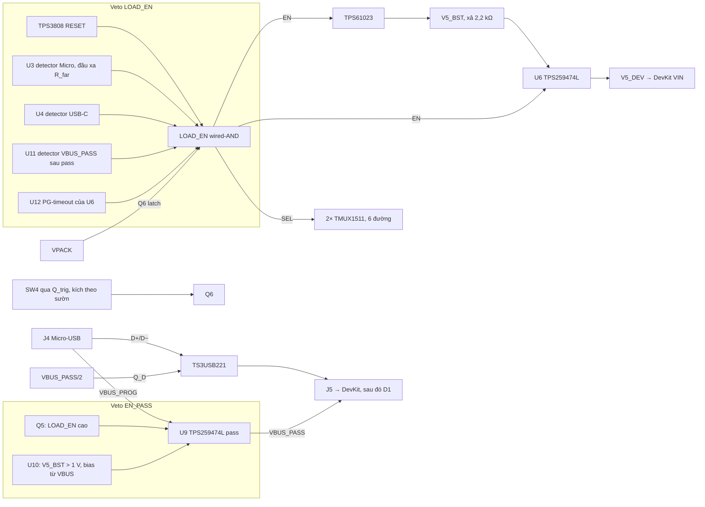

# MoBot V2 · Delta tay cầm theo review 06/11 (07/11/2026)

Trả lời [mobot-handset-claude-review-handoff-2026-11-06.md](../../../mobot-handset-claude-review-handoff-2026-11-06.md). Snapshot gốc: `kicad-input-spec-r7.md` `75f0c869…15c7`, `final-values.md` `87036c18…1dfc`, `final-bom.md` `5848c328…2fff`. Mọi thay đổi dưới đây đã được áp vào ba file đó; hash mới ghi ở cuối. Số liệu lấy từ `calc_r7.py`, hàm `d_delta_h` (exit 0).

Đây chỉ là phân tích và đề xuất. HQ giữ queue, phê duyệt và quyền ghi KiCad. Bench hiện là UNKNOWN.

## 0. Sơ đồ khối sau delta

## 1. Trình tự cấp VBUS và lỗi đơn

### 1.1 Thay đổi

| # | Net / linh kiện | Thay đổi | Lý do |
|---|---|---|---|
| 1 | U10 TLV6710DDCR | Mới. VDD ← VBUS_PROG. INB ← V5_BST qua 100k/68,1k. OUTB → EN_PASS. INA → GND | Pass chỉ bật khi **đo được** V5_BST < 0,97–1,01 V. Không dựa vào lệnh hay timing. Bias lấy từ chính cổng USB, nên vẫn hoạt động khi pack vắng. |
| 2 | R_dis 2,2 kΩ | Mới. V5_BST–GND | Xả rail cũ: 130–184 ms xuống dưới ngưỡng (C 35–50 µF). Tốn 2,3 mA ở 5 V. |
| 3 | U11 TLV6710DDCR | Mới. VDD ← VPACK. INB ← VBUS_PASS qua 10 kΩ. OUTB → LOAD_EN | Veto sau pass, trước D1. Có VBUS ở phía DevKit là carrier OFF, kể cả khi U9 dính đóng hoặc detector J4 hỏng. |
| 4 | R_pp 10 kΩ | Mới. VBUS_PASS–GND | VBUS_PASS mặc định thấp khi U9 tắt. |
| 5 | U6 PGTH | 100k/39,2k từ V5_DEV (PG ở 4,14–4,41 V), thay cho PGTH→GND | PG mới có nghĩa, dùng cho mục 2. |
| 6 | Q5, R55/R56/C29 | Giữ | Lớp veto theo lệnh, song song với U10. |

### 1.2 Bảng quyền cấp nguồn

Ký hiệu: C = carrier (boost + U6), P = pass U9, D = data TS3USB221, I/O = TMUX.

| Trạng thái Micro/C | C | P | D | I/O | Điều kiện |
|---|---|---|---|---|---|
| `00` | ON sau khi nhấn SW4 | OFF | OFF | ON | Pack ≥ ngưỡng, không veto |
| `10` | OFF | ON khi V5_BST < 1 V và Q5 tắt, trễ ≥ 3,2 ms (RC) | ON khi VBUS_PASS > ~2 V | OFF | |
| `01` | OFF | OFF | OFF | OFF | Sạc theo H3 |
| `11` | OFF | như `10` | như `10` | OFF | Sạc theo H3 |

| Chuyển tiếp | Diễn biến | Cận đã chứng minh |
|---|---|---|
| `00`→`10` (cắm Micro) | Detector U3 kéo LOAD_EN xuống trong tpd 9,9 µs typ. Latch nhả (Q6 τ 81 µs typ). Boost và U6 tắt. V5_BST xả. U10 thôi chặn. EN_PASS lên. U9 bật. | Pass không bật khi V5_BST > 1,01 V (đo thực). Khoảng 130–184 ms + RC. Không còn phụ thuộc 64,44 µs typ của U6. |
| `10`→`00` (rút Micro) | U9 mất VBUS và tắt. Latch đã nhả nên carrier vẫn OFF tới khi nhấn SW4 mới. | Không tự chạy lại |
| Cắm lại nhanh, C29 còn điện | U10 vẫn chặn khi V5_BST > 1 V. Carrier OFF do latch, V5_BST đã xả. | Trễ RC rút ngắn không ảnh hưởng an toàn |
| Cắm Micro và USB-C gần đồng thời, cả hai thứ tự | Cả hai detector đều kéo LOAD_EN. Thứ tự không quan trọng. | Wired-AND |
| Nảy tiếp điểm | Xung chặn đầu tiên đã xóa latch nếu dài hơn khoảng 162 µs (guard ×2). Xung ngắn hơn làm LOAD_EN lên lại, nhưng VBUS ổn định sau đó vẫn chặn liên tục. | Lần chạm ổn định cuối luôn veto |
| Đứt dây sense hoặc GND sense | S = VPACK → U3 chặn. Nếu pass bật, U11 cũng chặn. | Hai lớp |
| Mất pin | LOAD_EN mất nguồn kéo lên (Q6 cấp từ VPACK). Pass bật được, U10 lấy bias từ VBUS. | DevKit nạp được khi vắng pack |
| POR / brownout | TPS3808 RESET thấp từ VDD 0,8 V. Latch nhả. Khi phục hồi cần nhấn SW4. | |

### 1.3 Lỗi đơn

| Linh kiện / dây lỗi | Lớp còn hoạt động | Hậu quả |
|---|---|---|
| U3 kẹt "cho phép" | U11 (khi pass bật). U10 + Q5 giữ pass OFF khi carrier ON. D1 trên DevKit chặn cấp ngược vào host. | Carrier chạy khi cắm Micro; DevKit chỉ lấy nguồn từ carrier; không backfeed |
| U3 kẹt "chặn" | — | Carrier không chạy (an toàn) |
| R_far (R22) hở | S nổi lên theo R_bias → chặn | An toàn |
| R_bias hở | Dây nguyên: S = VBUS hoặc 0, vẫn đúng. Cần thêm lỗi thứ hai mới mất phát hiện đứt dây. | Lỗi tiềm ẩn, phát hiện bằng test sản xuất |
| U6 dính dẫn | LOAD_EN thấp tắt boost (true disconnect), V5_BST xả qua R_dis, U10 thôi chặn khi < 1 V. D1 chặn ngược. | Pass chỉ bật sau khi rail đã xả |
| Boost dính bật (EN mất tác dụng) | U10 thấy V5_BST > 1 V nên pass OFF mãi | DevKit không nạp qua USB, phát hiện được |
| U9 dính đóng | U11 thấy VBUS_PASS và chặn carrier. U9 RCB chặn ngược trong 1 µs. D1 vẫn chặn. | Carrier OFF khi có USB |
| Q5 hở hoặc mất drive | U10 vẫn chặn khi carrier ON (V5_BST 5 V) | An toàn |
| U10 mất bias hoặc hỏng | Q5 chặn theo lệnh. U11 chặn sau pass. D1. | Còn hai lớp |
| U11 hỏng | U3 ở J4. U10 + Q5. | Còn hai lớp |
| TS3USB221 dính ON | Data host↔CP2102 nối khi DevKit chạy bằng carrier. Hành vi CP2102 khi VBUS pin thấp: [CHƯA XÁC MINH], vì datasheet Silicon Labs không tải được. | Cận đường data: host chỉ có pull-down 15 kΩ |

## 2. Latch Q6/Q7, SW4 và lỗi eFuse

| # | Thay đổi | Cận |
|---|---|---|
| 1 | SW4 không kéo LATCH_G trực tiếp nữa. SW4 nối VPACK → nút A (1 MΩ xuống GND) → C_t 22 nF → gate Q_trig (100 kΩ xuống GND). Drain Q_trig → LATCH_G. | Mỗi lần nhấn tạo một xung 2,35–5,89 ms. Giữ nút không tạo xung mới, nên phải nhả rồi nhấn lại. |
| 2 | Q7 bắt được trong xung | Q7 cần 0,68 ms (Ciss 594 pF typ, guard ×2) < xung min 2,35 ms |
| 3 | Cắm pack khi đang giữ SW4 | Xung ≤ 5,8 ms < tD min 12 ms của TPS3808. RESET vẫn thấp nên không chốt. |
| 4 | Lỗi U6 xóa quyền chạy | U12 TLV6710 (VDD VPACK). INB ← X. X kéo lên LOAD_EN qua 1 MΩ, có C 150 nF xuống GND. Q_pg (gate = PG_NODE) xả X khi PG cao. PG_NODE kéo lên LOAD_EN qua 1 MΩ. Nếu PG không lên trong 16,8–27,6 ms, OUTB kéo LOAD_EN xuống. U6 cần ≤ 7,2 ms typ (tD,ON + ramp 0,91 V/ms tới 4,41 V); tốc độ dVdT không có min/max: TBD bench. |
| 5 | Pull-down LOAD_EN | R10 100k → 47k, thêm R_pd 220k, Q7 chia áp 1M/2M. LOAD_EN cao 2,49–3,40 V. Khi Q6 tắt: ≤ 205 mV với IDSS ≤ 1 µA, dưới VEN_L 0,35 V. |
| 6 | Mốc 106–319 µs | Thay bằng Ciss typ từ datasheet: Q6 nhả τ 81 µs typ, guard ×2 là 162 µs. Không có max, nên giữ TBD đo (BT-H4). |

| Tình huống giữ nút | Kết quả |
|---|---|
| Giữ SW4, cắm USB, rút USB, vẫn giữ | OFF. Không có sườn mới. |
| Giữ SW4 lúc UVLO, pack hồi, vẫn giữ | OFF |
| Nhấn SW4 khi đang có veto | Xung đến nhưng LOAD_EN bị kéo thấp, Q7 không chốt, OFF |
| Lỗi U6 khi đang chạy | U12 xóa latch sau ≤ 27,6 ms. Nhấn SW4 mới thì U6 thử lại (EN được toggle). |

## 3. I/O và USB data

| # | Thay đổi / chứng minh |
|---|---|
| 1 | Checklist sửa: **2** SEL dư (U8 SEL3, SEL4). U7 dùng đủ 4 kênh. |
| 2 | JOY_VCC: dòng 2 biến trở 10 kΩ khoảng 0,66 mA, dưới 25 mA liên tục của TMUX. Sụt trên RON ≤ 3 mV. Thêm 100 kΩ JOY_VCC_C–GND để khi tắt không nổi. |
| 3 | SEL ≤ 0,45 V khi veto: LOAD_EN ≤ VOL max 0,40 V (TPS3808 @1 mA; dòng thực 89 µA), cộng 10 kΩ × 1 µA → 0,41 V. Biên 40 mV, nhỏ nhất khi TPS3808 là phần tử kéo. Khi Q6 tắt: 0,205 V. |
| 4 | Thứ tự: JOY_VCC đi qua chính mux nên các kênh hở cùng lúc với rail ngoại vi. V3V3_DEV sụt dưới 1,5 V: TMUX vào powered-off, IPOFF ≤ 2 µA/pin. Rò tổng ≤ 12 µA. |
| 5 | **USB data:** thêm TS3USB221 (U13). VCC ← V3V3_DEV. S → GND. OE kéo lên VCC 100 kΩ, Q_D kéo OE xuống khi VBUS_PASS/2 > VGS(th) (2,18–2,78 V). D+/D− chỉ nối khi pass đang cấp VBUS. DevKit chưa có nguồn: IOFF ≤ 2 µA. Jumper VBUS bypass interposer vẫn hở. |
| 6 | ADC settling: giữ TBD, vì thiếu C lấy mẫu ADC1. |
| 7 | Bản đồ thông mạch interposer Rev. 1.1: Codex đã xác minh vị trí jumper; Claude chưa có bản vẽ. Cần HQ đính kèm để đối chiếu J4/J5. |

## 4. Ngân sách dòng, B15, UVLO, H3

| Mục | Kết quả | Còn TBD |
|---|---|---|
| U9 (host Micro-USB) | RILM 5,11k → **6,65 kΩ**, đúng điểm bảng 6.5: 0,421/0,500/0,581 A. ITIMER 1 nF → 10 nF (4,6–16 ms) để bỏ qua xung Wi‑Fi. | Giới hạn 100 mA trước enumeration của USB 2.0: [CHƯA XÁC MINH, chưa tải spec USB-IF]. DevKit tự nó đã vượt mức này khi ESP32 chạy; carrier không đổi được hành vi đó. **Founder chốt 07/11/2026: cổng Micro-USB chỉ dùng để nạp firmware**, không phải cổng cấp nguồn vận hành. Ghi vào hướng dẫn người dùng. Mạch không đổi: ở trạng thái `10`/`11` carrier và I/O vẫn OFF. |
| U6 (từ pack) | Giữ 5,11 kΩ: 0,545–0,758 A, dòng pin 1,06–1,48 A trước tải phụ và sụt áp | Đặc tuyến PCM B15 |
| USB-C sạc | 0,466 A cực xấu, dưới 500 mA Default (SLLSEQ8D Table 2) | Nhiệt bo 2 lớp: BT-H3 |
| B15 / UVLO | Cận falling tĩnh 3,262 V, biên 62 mV | Nội trở và sụt áp theo độ dài xung khi pin yếu: hồ sơ LK37478 |
| H3 tải OFF khi NTC hở/ngắn, pack vắng, PCM mở | Tải là carrier. Khi có USB-C, U4 luôn chặn LOAD_EN, không phụ thuộc NTC. Khi pack vắng hoặc PCM mở, VPACK có thể là VBAT do MCP73833 giữ, nhưng U4 vẫn chặn. Không có USB thì VPACK = 0, OFF. | — |
| LDO test mode | Chỉ vào khi THERM > VDD − 0,1 V và không có pin (§5.1.4.1). THERM chỉ có NTC xuống GND. Khi vắng pin, ITHERM tắt và có dòng kéo xuống 3–20 µA (Note 1–2), nên không vào test mode. | Đo xác nhận (BT-H3) |
| Timeout CV và kết thúc theo dòng | §4.6: cả hai đều là Charge Complete (STAT2 L). Timeout trong CC thì báo Timer Fault (Table 5-1). Không cần phân biệt cho an toàn, vì cả hai đều dừng sạc. Thêm test point STAT1/STAT2 để chẩn đoán. | Profile sạc B15 |

## 5. Thay đổi vật chất cho revision mới

Các mục sau vượt ra ngoài H3/R1/R5 của bytes r7, nên HQ cần lập revision mới (r8) và hash riêng:

1. Đường VBUS có kiểm soát: interposer với jumper hở, U9 pass, Q5, U10, U11.
2. Đường carrier→DevKit dùng TPS259474L latch-off (U6), thay LM66100.
3. Latch quyền chạy: Q6/Q7, nút SW4 kích theo sườn, U12 PG-timeout.
4. Cách ly I/O 2× TMUX1511 và cách ly USB data TS3USB221.
5. Detector fail-safe TLV6710 với R_far/R_bias.
6. UVLO TPS3808 có hysteresis chuyển mạch (Q1), điện trở 0,1 %.
7. Robot: UVLO TLV6710 (6,40–6,60 V), latch EN_NODE, AND3 MOTOR_EN, U16/U17, mạch CE trễ, TS 0–45 °C.

Biên bản duyệt hash r7 ngày 07/11 chỉ phủ bytes r7. Không dùng biên bản đó cho các mục trên.

## 6. Dữ liệu cần để đóng từng finding

| Finding | Đóng trước schematic bằng | Cần thêm | Xác nhận sau mẫu |
|---|---|---|---|
| 1 | U10 (đo V5_BST), U11 (sau pass), bảng lỗi đơn ở trên | Bản đồ interposer Rev. 1.1; datasheet CP2102 (để đóng trường hợp data dính) | BT-H4: cắm/rút, nảy, đứt sense, trễ |
| 2 | SW4 theo sườn, U12 PG-timeout, pull-down LOAD_EN | Ciss max (chỉ có typ) | BT-H4: thời gian nhả latch, PG thực của U6 |
| 3 | TS3USB221, sửa checklist, chứng minh SEL | Datasheet CP2102 | BT-H4: rò, ADC settling |
| 4 | RILM U9 6,65 kΩ, lập luận H3. Cổng Micro-USB chỉ để nạp firmware (founder 07/11) | Hồ sơ LK37478 | BT-H2, BT-H3 |

## 6b. Bổ sung 07/11 (lần 2)

- **Robot** đã được áp cùng kiến trúc: U18 veto V5_R (VDD từ VBUS) cho pass U17; U19 veto sau pass; U20 PG-timeout cho U16; SW4R kích theo sườn có chia áp (bước gate ≤ 4,2 V, dưới VGSS 8 V); Q_por giữ EN_NODE thấp ≥ 32 ms khi cắm pack, vì robot không có tD như TPS3808; switch data U21. U17 RILM 6,65 kΩ, ITIMER 10 nF. Hàm `d_delta_r`.
- **NTC:** dùng bảng R‑T Semitec gốc. Tay cầm cắt 0,2–4,6 °C và 40,7–48,4 °C. Robot RT2 đổi 2,00 MΩ → 511 kΩ: dừng −1,3…0,9 °C và 43,0…45,5 °C (có NTC ±1 %).
- **Phép đo bổ sung:** [bench-additions.md](bench-additions.md) (BT-H4a/b/c, BT-R6a, BT-ISEN, BT-R5a, BT-R4a).
- **Hướng dẫn người dùng:** [huong-dan-nguoi-dung-nguon.md](huong-dan-nguoi-dung-nguon.md).

## 7. Snapshot sau delta

Tính bằng SHA-256 sau lần chạy `python calc_r7.py` cuối cùng (exit 0), ngày 07/11/2026 (lần 2). Box08 tái review đúng các bytes này.

| Tệp | SHA-256 |
|---|---|
| kicad-input-spec-r7.md | `08c5ced62dedf2e1ea4199f2b6ed0eaeec0aa6f29043614ddc4748c6a597d811` |
| final-values.md | `9be0928a83fc713801635b8f35bb6ec3aa4cd48cabe95f227f4922e185019407` |
| final-bom.md | `d8a49a6baf8ada1a906870bed2add97949016b0c4a7894251e33573f79a81a20` |
| calc_r7.py | `0f5acf12e99e6cfe31eddb97ef97e236860000234c5c296c36c609b98b408b61` |
