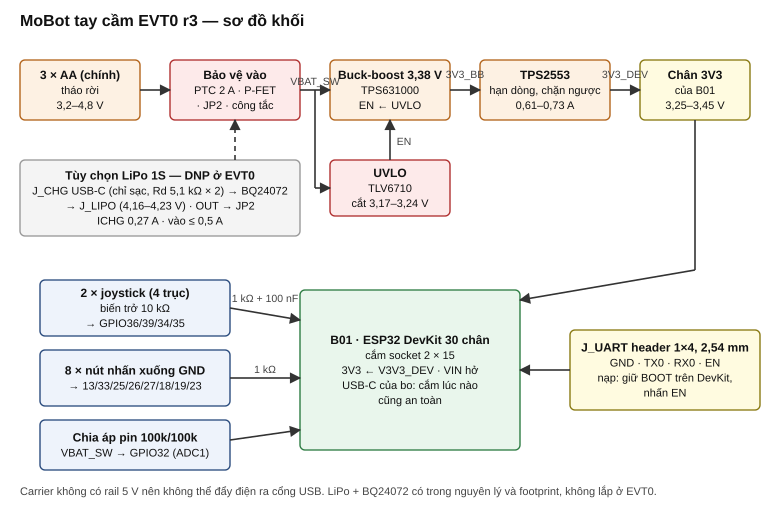
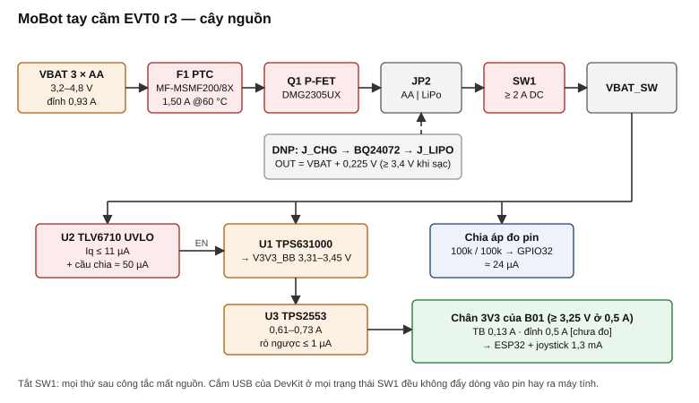
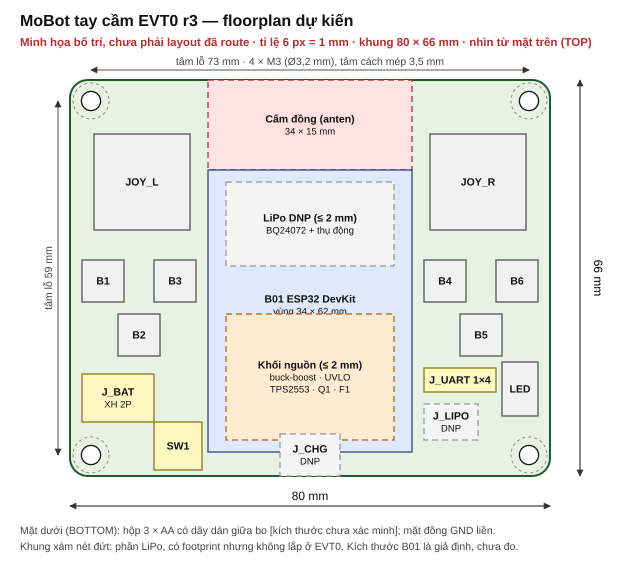
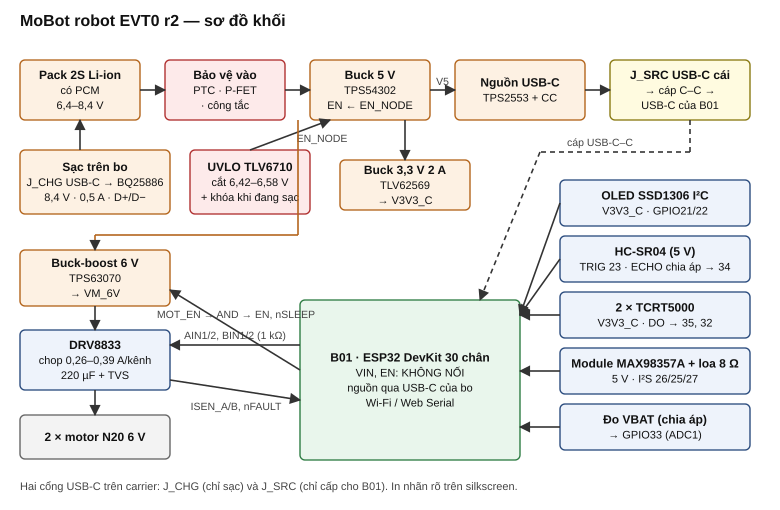
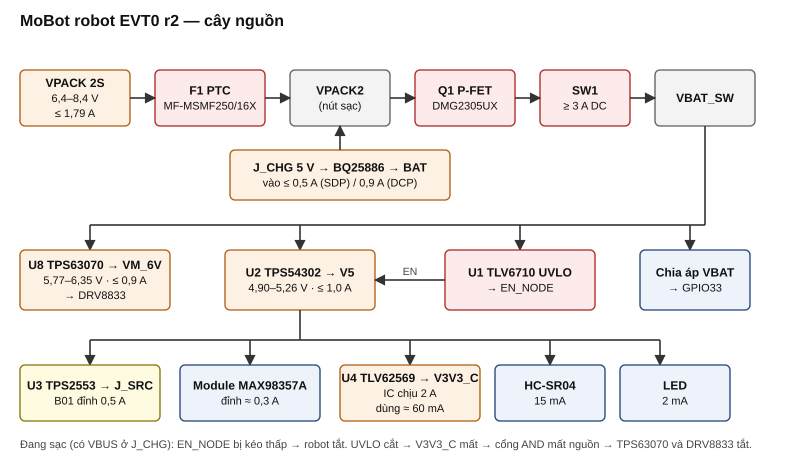
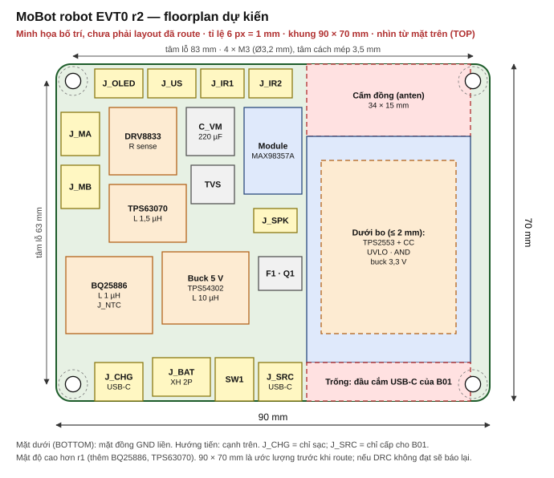

# MoBot EVT0 — Tài liệu thiết kế hai PCB 2 lớp · bản r3 (để founder duyệt)

- Ngày: 13/11/2026. Người viết: Claude. Trạng thái: **ĐỀ XUẤT r3, chờ founder trả lời "DUYỆT"**. Chưa có schematic, chưa có layout.
- r3 = r2 + khối nguồn tay cầm thiết kế lại theo câu trả lời N-1 ("người dùng sẽ cắm nhầm USB"). Các câu N-2…N-6 đã chốt: sạc LiPo 0,27 A; NTC rời qua J_NTC; chấp nhận VQFN; kích thước 80 × 66 và 90 × 70 mm; KiCad 10.0.7 ở `D:\StartupOS\.tools`. Phần robot không đổi so với r2.
- r2 thay toàn bộ r1 (12/11) theo phản hồi của founder ngày 12–13/11. Hiện trạng gốc: [01-hien-trang.md](01-hien-trang.md).
- Tài liệu này không đổi cấu hình r14, queue, gate hay lease, và không cấp quyền mua hàng, đặt PCB, cấp điện hay flash (L9).
- Ký hiệu: **[DS]** = số lấy từ datasheet hãng đã tải và đọc (Phụ lục A). **[r7]** = giá trị kế thừa từ `claude-support/2026-11-06-pcb-status/final/final-bom.md`, tôi không tính lại. **[chưa xác minh]** = chưa có nguồn hãng hoặc chưa đo. Giá là ước tính.

## 0. Phản hồi của founder đã áp dụng

| # | Phản hồi | Áp dụng trong r2 |
|---|---|---|
| 1 | Tay cầm nạp code bằng UART qua header 2,54 mm, không qua USB | J_UART 1×4: GND, TX0, RX0, EN. Nạp: giữ nút BOOT trên DevKit, nhấn EN (bo 30 chân không đưa GPIO0 ra chân) |
| 2 | Via 0,3 / 0,6 mm | Áp dụng cho cả hai bo |
| 3 | Bỏ USB-C của tay cầm (Q2, Q3), kích thước nhỏ nhất | Bỏ J_SRC, cáp C–C và mạch phát hiện CC. Bo 80 × 66 mm |
| N-1 | Không cấp qua VIN; thiết kế lại để cắm nhầm USB không gây hại | DevKit nhận **3,3 V qua chân 3V3** từ buck-boost TPS631000, sau công tắc chặn ngược TPS2553. Cắm USB lúc nào cũng an toàn (mục B.3) |
| 4 | Thêm nguyên lý LiPo 4,2 V + sạc BQ24072 | Có trong schematic và footprint, **không lắp (DNP)** ở EVT0; 3 AA vẫn là nguồn chính. Ngõ vào sạc: cổng USB-C chỉ để sạc (J_CHG) |
| 5 | Chia áp đọc dung lượng pin | VBAT_SW → 100 kΩ / 100 kΩ → GPIO32 (ADC1) |
| 6 | Robot: đổi LDO | Thay AP2112K bằng buck TLV62569 3,3 V / 2 A |
| 7 | Robot: tối ưu diện tích | 90 × 70 mm (ước lượng trước khi route) |
| Q1 | 2 lớp | Xác nhận, thay Q5 (4 lớp) |
| Q4 | Tự phục hồi sau cắt áp thấp | Giữ |
| Q5 | Giữ BQ25886 | Sạc trên bo qua J_CHG; bỏ TUSB320 vì BQ25886 tự nhận dạng nguồn qua D+/D− [DS] |
| Q6 | Giữ TPS63070 | VM_6V theo [r7] |
| Q7 | A | Chấp nhận vượt trần giá ở EVT0 |
| Q8 | Giữ DevKit | Giữ |
| Q9 | KiCad ở ổ D | Tìm thấy `D:\StartupOS\.tools\kicad-10.0.7\bin\kicad-cli.exe`; `kicad-cli version` → `10.0.7` |
| — | Robot vẫn dùng cáp USB-C cấp cho DevKit | Giữ J_SRC + TPS2553 + phát hiện CC trên robot |

### Quyết định LOCKED bị các phản hồi trên thay (chỉ cho tay cầm)

Founder là người quyết; tôi ghi lại để hồ sơ không mâu thuẫn ngầm.

| LOCKED cũ | Thay bằng | Hệ quả |
|---|---|---|
| F1: nguồn vào B01 chỉ qua cổng USB-C của B01, phát hiện CC trước khi cấp VBUS | 3,3 V vào chân 3V3 | Không phụ thuộc việc bo clone có diode VBUS → VIN hay không. Còn phụ thuộc một điều: ổn áp 3,3 V trên bo chịu được việc ngõ ra bị cấp ngược khi ngõ vào hở (rủi ro 1) |
| C1: VIN và EN không nối | VIN vẫn không nối; EN ra J_UART | — |
| N2/C11: 3V3 chỉ là ngõ ra ≤ 20 mA, không nguồn carrier nào nối 3V3 | 3V3 là ngõ **vào** nguồn của B01 | Giới hạn 20 mA không còn ý nghĩa |
| C10/N5: không dùng UART0 | TX0, RX0 ra J_UART (chỉ để nạp) | — |
| N4: không nguồn carrier nào chạm GPIO | Chia áp pin vào GPIO32 qua 100 kΩ | Dòng vào chân ≤ 54 µA khi B01 mất điện |
| F2: không sạc trong máy | Phần LiPo + BQ24072 có footprint, DNP | Khi lắp: quay lại bài toán điện áp sạc; BQ24072 sạc tới 4,16–4,23 V [DS], vượt "trần 4,200 V" cũ |

---

## Phần B — Tay cầm

### 1. Mô tả

Tay cầm không dây: 2 joystick analog (4 trục), 8 nút (6 nút rời + 2 nút nhấn joystick), đo điện áp pin. Bộ xử lý và radio là bo ESP32 DevKit 30 chân cắm socket. Nguồn chính 3 pin AA tháo rời; carrier tạo 3,3 V bằng buck-boost và cấp vào chân 3V3 của DevKit qua một công tắc chặn dòng ngược. Nạp firmware qua header UART 4 chân bằng mạch USB-UART 3,3 V rời. Phần pin LiPo 1S + sạc BQ24072 + cổng USB-C sạc có trong nguyên lý và trên PCB nhưng không lắp ở EVT0.

### 2. Thông số

| Mục | Giá trị | Nguồn |
|---|---|---|
| Điện áp vào | 3 × AA: 3,2–4,8 V. Tùy chọn LiPo 1S: 3,2–4,23 V | F2; [DS] |
| V3V3_BB (ngõ ra buck-boost) | 3,38 V danh định; 3,31–3,45 V | VFB 495–505 mV [DS], 576 kΩ / 100 kΩ 1 % |
| V3V3_DEV (tại chân 3V3) | 3,25–3,45 V ở 0–0,5 A (sụt ≤ 68 mV qua TPS2553); hạn dòng 0,607 / 0,665 / 0,730 A | tính từ [DS]; ESP32 cho phép 3,0–3,6 V [không đọc lại datasheet Espressif trong lượt này] |
| Dòng B01 | trung bình ≈ 0,13 A, đỉnh 0,5 A ở 3,3 V | [chưa xác minh], đo trên mẫu |
| Dòng pin | trung bình ≈ 0,16 A; xấu nhất tại hạn dòng, 3,2 V, η 85 %: 0,93 A | tính |
| Thời gian chạy | ≈ 12 giờ với NiMH 1900 mAh | ước tính |
| Cắt áp thấp | falling 3,172–3,236 V; rising cao hơn 16–96 mV; trễ bật lại ≈ 0,1–0,3 s (ngưỡng EN của TPS631000 [chưa trích]) | tính từ [DS] |
| Đo pin | VBAT_SW / 2 tại GPIO32: 1,6–2,4 V (AA), tới 2,7 V với pin lithium AA 5,4 V | tính |
| Bảo vệ | PTC giữ 1,50 A @ 60 °C; P-FET chống ngược cực; hạn dòng + chặn ngược tại V3V3_DEV (rò ≤ 1 µA @ 25 °C) | [DS] |
| Sạc LiPo (DNP) | VBAT(REG) 4,16 / 4,20 / 4,23 V; vào ≤ 450–500 mA (EN1 = 1, EN2 = 0); ICHG = 890 / RISET = 0,27 A với 3,3 kΩ (0,24–0,30 A); timer 5 h; OUT = VBAT + 0,225 V | [DS] |
| Tải joystick trên 3V3 | 4 biến trở 10 kΩ = 1,32 mA | tính |
| Giao tiếp | Radio 2,4 GHz; UART0 3,3 V để nạp | — |
| Kích thước bo | **80 × 66 mm**, 2 lớp, 1,6 mm, 1 oz | đề xuất |
| Lỗ bắt vít | 4 × M3 (Ø3,2 mm), tâm cách mép 3,5 mm, khoảng tâm 73 × 59 mm | đề xuất |

Vì sao không nhỏ hơn 80 × 66 mm: vùng DevKit 34 × 62 mm (kích thước giả định), hai joystick 16 × 16 mm hai bên, 6 nút 6 × 6 mm, và 15 mm cấm đồng cho anten. Bỏ lỗ vít hoặc bỏ footprint LiPo không làm bo nhỏ hơn.

### 3. Sơ đồ khối và cây nguồn





**Vì sao cắm nhầm USB không gây hại (thay cho phương án VIN):**

| Tình huống | Điều xảy ra | Cơ sở |
|---|---|---|
| SW1 tắt, cắm USB vào DevKit | DevKit chạy bằng USB. 3,3 V của DevKit xuất hiện ở ngõ ra U3 đang tắt; dòng ngược vào carrier ≤ 1 µA (25 °C). Pin không bị nạp | IREV của TPS2553 [DS] |
| SW1 bật, cắm USB vào DevKit | Hai nguồn 3,3 V song song: ổn áp của DevKit chỉ cấp ra, buck-boost để chế độ tiết kiệm (MODE = GND) nên không hút dòng ngược. Nguồn nào cao hơn thì gánh tải. Nếu phía DevKit cao hơn 95–190 mV quá 3–7 ms, U3 tự ngắt rồi tự đóng lại khi hết | §8.3.2 TPS2553 [DS] |
| SW1 bật, không cắm USB | Carrier cấp 3,3 V. Cổng USB của DevKit không có 5 V nên không có gì chảy ra máy tính | Rail 3,3 V không thể đẩy ngược lên 5 V |
| Cắm USB rồi mới bật SW1, hoặc ngược lại | Như hai dòng trên; không có thứ tự cấm | — |

Không trường hợp nào đưa 5 V của carrier ra cổng USB, vì carrier không còn rail 5 V. Nạp firmware được bằng cả hai đường: J_UART hoặc USB của DevKit.

Nguyên lý phần LiPo (DNP):

```
J_CHG (USB-C 16 chân: VBUS, GND, CC1/CC2 mỗi chân 5,1 kΩ xuống GND; không nối D+/D−)
   │ VBUS_CHG ── C 1 µF
   ▼
BQ24072RGT   IN(13)  ← VBUS_CHG
             EN1(6) = IN qua 10 kΩ (HI), EN2(5) = GND   → giới hạn vào 500 mA
             CE(4) = GND (cho phép sạc)   TD(15) = GND (cho phép kết thúc sạc)
             ISET(16) → 3,3 kΩ → GND      ILIM(12) → 1,5 kΩ → GND (không dùng ở chế độ này)
             TMR(14) hở (5 h)             TS(1) → 10 kΩ → GND (không dùng NTC, theo datasheet)
             CHG(9), PGOOD(7) → LED + 1 kΩ lên VBUS_CHG
             BAT(2,3) ↔ J_LIPO (JST PH 2 chân) ── C 4,7 µF
             OUT(10,11) ── C 4,7 µF ──► JP2 vị trí "LiPo"
JP2 (cầu hàn 3 chân): chọn VSYS_IN = sau Q1 (AA, mặc định) hoặc OUT của BQ24072 (LiPo)
VSYS_IN → SW1 → VBAT_SW → buck-boost, UVLO, chia áp đo pin
```

Khi dùng LiPo: cell phải có PCM; dung lượng ≥ 500 mAh cho dòng sạc 0,27 A; sạc được cả khi SW1 tắt. Ngưỡng cắt 3,17–3,24 V dùng chung cho cả hai loại pin.

### 4. Bảng gán chân MCU

Tên silkscreen theo `docs/hardware/evidence/esp32-devkit-v1-type-c-sample.md`; ánh xạ sang GPIO theo sơ đồ DOIT 30 chân phổ biến, chưa kiểm trên mẫu.

| Chức năng | Silk | GPIO | Mạch | Giới hạn boot/strap |
|---|---|---|---|---|
| Joystick trái X / Y | VP / VN | 36 / 39 | cần gạt → 1 kΩ → chân; 100 nF xuống GND | Chỉ vào, ADC1 |
| Joystick phải X / Y | D34 / D35 | 34 / 35 | như trên | Chỉ vào, ADC1 |
| **VBAT_ADC** | D32 | 32 | VBAT_SW → 100 kΩ / 100 kΩ, 100 nF | ADC1_CH4 |
| Nút L3 (nhấn joystick trái) | D13 | 13 | nút → GND, 1 kΩ nối tiếp, pull-up nội | Không strap |
| Nút R3 | D33 | 33 | như trên | Không strap |
| Nút B1, B2, B3 | D25, D26, D27 | 25, 26, 27 | như trên | Không strap |
| Nút B4, B5, B6 | D18, D19, D23 | 18, 19, 23 | như trên | Không strap |
| UART nạp TX0 / RX0 | TX0 / RX0 | 1 / 3 | thẳng ra J_UART qua 100 Ω | UART0; không dùng cho việc khác |
| Reset | EN | — | ra J_UART; không gắn tụ, không gắn trở | — |
| **Nguồn vào** | 3V3 | — | ← V3V3_DEV (từ U3); cũng cấp hai đầu biến trở joystick | 3,25–3,45 V |
| **Không nối** | VIN | — | hở | — |
| Dự phòng (pad thử) | D14, D4, D21, D22 | 14, 4, 21, 22 | — | GPIO14 phát PWM lúc boot |
| **Không dùng** | D12, D15, D2, D5, RX2, TX2 | 12, 15, 2, 5, 16, 17 | hở | strap / có điều kiện |

J_UART (1×4, 2,54 mm), thứ tự in trên silkscreen: `GND · TX0 · RX0 · EN`. Nối chéo với mạch USB-UART: TX0 → RX của mạch nạp, RX0 ← TX của mạch nạp. Chỉ dùng mức 3,3 V.

### 5. BOM

| Ref | Giá trị | MPN | Footprint | SL | Nguồn mua | Giá (đ) | Thay thế |
|---|---|---|---|---|---|---|---|
| A1 | Bo ESP32 DevKit 30 chân USB-C CH340 | theo mẫu founder | 2 × socket 1×15 | 1 | VN | 110.000 | — |
| J1, J2a–c | Socket cái 1×15, 2,54 mm (hàn J1 + một trong J2a/b/c: 22,86 / 25,40 / 27,94 mm) | — | PinSocket_1x15_P2.54mm | 2 (4 footprint) | VN | 6.000 | — |
| BT1 | Hộp 3 × AA có dây | — | ngoài bo | 1 | VN | 10.000 | — |
| J3 | JST XH 2 chân (pin AA) | B2B-XH-A | JST_XH_B2B-XH-A | 1 | LCSC/VN | 2.000 | — |
| F1 | PTC 2,0 A | Bourns MF-MSMF200/8X | 1812 | 1 | LCSC | 5.000 | MF-MSMF250/16X |
| Q1 | P-MOSFET −20 V | Diodes DMG2305UX-7 | SOT-23 | 1 | LCSC | 3.000 | AO3401A [chưa xác minh] |
| R1 | 100 kΩ (cổng Q1 → GND) | — | 0603 | 1 | LCSC | 200 | — |
| JP2 | Cầu hàn 3 chân, mặc định nối "AA" | — | SolderJumper_3_Bridged12 | 1 | — | 0 | — |
| SW1 | Công tắc trượt SPDT ≥ 2 A DC | SS-12D10 hoặc tương đương [chưa xác minh định mức DC] | THT | 1 | VN | 3.000 | MTS-102 |
| U1 | Buck-boost 3,3 V, 1,5 A | TI TPS631000DRLR | SOT-583 8 chân, bước 0,5 mm | 1 | LCSC | 25.000 | TPS63001 (VSON-10) [chưa xác minh] |
| L1 | 1,0 µH (0,7–1,3 µH hiệu dụng), Isat ≥ 3,5 A | Coilcraft XEL4030-102ME hoặc tương đương | 4 × 4 mm | 1 | LCSC | 8.000 | — |
| C1; C2, C3 | 10 µF 10 V; 22 µF 10 V X7R | — | 0805 | 3 | LCSC | 2.000 | — |
| R2 / R3 | 576 kΩ / 100 kΩ 1 % (FB → 3,38 V) | — | 0603 | 2 | LCSC | 400 | — |
| — | MODE của U1 nối GND (chế độ tiết kiệm, không hút dòng ngược); EN không để hở | — | — | — | — | — | — |
| U2 | Window comparator 400 mV | TI TLV6710DDCR | SOT-23-6 mỏng | 1 | LCSC | 12.000 | TPS3808G01 + đổi cầu chia |
| R4 / R5 | 71,5 kΩ / 10,2 kΩ **0,1 %** | — | 0603 | 2 | LCSC | 2.000 | — |
| C4 | 100 nF | — | 0603 | 1 | LCSC | 100 | — |
| R7, C5 | 470 kΩ; 1 µF (trễ EN buck-boost) | — | 0603 | 2 | LCSC | 400 | — |
| Q2, R6 | **DNP** DMN2075U-7; 1 MΩ 0,1 % (nâng ngưỡng bật lại) | — | SOT-23; 0603 | 0 | — | 0 | — |
| D1, R8, Q3 | LED đỏ pin yếu, 1 kΩ, 2N7002 | Diodes 2N7002 | 0603; SOT-23 | 3 | LCSC | 1.000 | — |
| U3 | Công tắc hạn dòng, chặn ngược | TI TPS2553DBVR (không phải bản "-1") | SOT-23-6 | 1 | LCSC | 15.000 | — |
| R9 | 39,2 kΩ 1 % (ILIM) | — | 0603 | 1 | LCSC | 200 | — |
| C6, C7 | 1 µF (IN); 10 µF (OUT) | — | 0603; 0805 | 2 | LCSC | 600 | — |
| R10 | 10 kΩ (EN U3 → V3V3_BB) | — | 0603 | 1 | LCSC | 100 | — |
| D2, R14 | LED xanh có nguồn + 2,2 kΩ | — | 0603 | 2 | LCSC | 500 | — |
| R27, R28, C13 | 100 kΩ, 100 kΩ 1 %; 100 nF (đo pin) | — | 0603 | 3 | LCSC | 300 | — |
| J5 | Header đực 1×4, 2,54 mm (J_UART) | — | PinHeader_1x04_P2.54mm | 1 | VN | 500 | — |
| R29, R30 | 100 Ω (TX0, RX0) | — | 0603 | 2 | LCSC | 200 | — |
| RV1, RV2 | Joystick 2 trục 10 kΩ có nút nhấn | Alps RKJXV1224005 hoặc tương đương | THT theo Alps RKJXV | 2 | VN | 16.000 | Module KY-023 nối dây |
| R15–R18; C9–C12 | 1 kΩ; 100 nF (trục) | — | 0603 | 8 | LCSC | 800 | — |
| SW2–SW7 | Nút nhấn 6 × 6 mm THT | — | SW_PUSH_6mm | 6 | VN | 3.000 | — |
| R19–R26 | 1 kΩ (nút) | — | 0603 | 8 | LCSC | 800 | — |
| TP1–TP6 | VBAT, VBAT_SW, EN_BB, V3V3_BB, V3V3_DEV, GND | — | TestPoint 1,5 mm | 6 | — | 0 | — |
| — | PCB 2 lớp 80 × 66 mm | — | — | 1 | đặt ngoài | 30.000 | — |
| **DNP — phần LiPo** | | | | | | | |
| U4 | Sạc 1S có power-path | TI BQ24072RGTR | VQFN-16 3 × 3 mm | 0 (1) | LCSC | (35.000) | BQ24075 (OUT 5,5 V, khác chân 15) |
| J4 | USB-C cái 16 chân, chỉ sạc | GCT USB4105-GF-A | theo hãng | 0 (1) | LCSC | (6.000) | [chưa xác minh] |
| J6 | JST PH 2 chân (LiPo) | B2B-PH-K-S | JST_PH_B2B-PH-K | 0 (1) | LCSC | (1.500) | — |
| R31, R32 | 5,1 kΩ (Rd CC1, CC2) | — | 0603 | 0 (2) | LCSC | (200) | — |
| R33–R36 | 3,3 kΩ (ISET); 1,5 kΩ (ILIM); 10 kΩ (TS); 10 kΩ (EN1) | — | 0603 | 0 (4) | LCSC | (400) | — |
| C14–C16 | 1 µF; 4,7 µF; 4,7 µF 10 V | — | 0603 | 0 (3) | LCSC | (600) | — |
| D3, D4, R37, R38 | LED CHG, LED PGOOD, 1 kΩ × 2 | — | 0603 | 0 (4) | LCSC | (800) | — |

Tổng tay cầm lắp ở EVT0 ≈ **260.000 đ** (chưa gồm pin AA, vỏ, mạch USB-UART). Phần LiPo nếu lắp thêm ≈ 45.000 đ + cell.

### 6. Quy tắc PCB

| Mục | Quy tắc |
|---|---|
| Stackup | 2 lớp FR-4 1,6 mm, đồng 1 oz. TOP: linh kiện, tín hiệu. BOTTOM: mặt GND liền, chỉ cắt cho đoạn nhảy ngắn |
| Bề rộng theo dòng | IPC-2221 lớp ngoài 1 oz, ΔT 10 °C, vẽ ≥ 1,5 lần mức tính [hằng số theo r7, chưa tra bản gốc]. VBAT, VBAT_SW (0,93 A): ≥ 1,0 mm hoặc đổ đồng. V3V3_BB, V3V3_DEV (0,73 A): ≥ 0,6 mm. Hai nút LX1, LX2 của buck-boost: đổ đồng ngắn nhất. Tín hiệu: 0,25 mm |
| Clearance | Đồng–đồng ≥ 0,2 mm; đồng–mép bo ≥ 0,3 mm; đồng–lỗ vít ≥ 1,0 mm |
| **Via** | **Khoan 0,3 mm, pad 0,6 mm** (founder). Đường nguồn đổi lớp: ≥ 3 via song song. Via GND khâu quanh khối boost |
| Keep-out anten | 34 × 15 mm tại mép trên, không đồng cả hai lớp, không linh kiện |
| Chiến lược mass | Một mặt GND liền ở BOTTOM. Vòng buck-boost (C1–U1–L1–C2) khép kín ở TOP, xuống GND bằng via tại tụ. Cầu chia UVLO và chia áp đo pin đặt xa nút SW, nối GND tại chân IC |
| Tản nhiệt | ≈ 0,3 W tại U1/L1: đổ đồng TOP nối GND. U4 (DNP): pad nhiệt nối GND bằng 4 via |
| DFM | Thụ động 0603 trở lên. IC nhỏ nhất: SOT-583 bước 0,5 mm (U1) và VQFN-16 (U4, DNP — cần khò nhiệt). Tên chân B01 và thứ tự J_UART in trên silkscreen |

Khả năng tối thiểu của nhà sản xuất PCB (via 0,3/0,6, khoảng cách 0,2 mm) [chưa xác minh] — đối chiếu trước khi xuất Gerber.

### 7. Bố trí dự kiến



### 8. Rủi ro còn lại và bring-up

1. **Cấp ngược vào ngõ ra ổn áp của DevKit.** Khi chạy bằng pin, 3,3 V của carrier đặt lên ngõ ra của ổn áp trên DevKit trong khi ngõ vào của nó hở. Với ổn áp họ 1117 đây là cách dùng phổ biến, nhưng loại ổn áp trên bo clone chưa biết và dòng rò ngược của nó [chưa xác minh]. Hậu quả xấu nhất dự kiến: tốn thêm vài mA. Đo ở bước bring-up 6.
2. Khi cả pin và USB cùng cấp, điện áp 3V3 là mức cao hơn trong hai nguồn (tối đa 3,45 V từ carrier). Trong giới hạn ESP32; hành vi chia tải thực tế đo trên mẫu.
3. Nạp UART: chân TXD của CH340 trên DevKit cũng lái RX0; mạch giữa CH340 và RX0 trên bo clone [chưa xác minh]. Nếu J_UART không nạp được thì nạp qua USB của DevKit — giờ an toàn ở mọi trạng thái công tắc. Nạp UART cần giữ nút BOOT bằng tay.
4. Biên PTC giờ rộng: 1,50 A @ 60 °C so với 0,93 A xấu nhất.
5. Pin yếu bật–tắt lặp; cell yếu đảo áp không được phát hiện. Quyết lắp Q2/R6 sau khi đo.
6. Chia áp đo pin đọc điện áp, không đọc dung lượng. Quy đổi sang % cần bảng theo loại pin (alkaline, NiMH, LiPo khác nhau) trong firmware; ADC của ESP32 cần hiệu chuẩn [chưa xác minh sai số].
7. Phần LiPo chưa được kiểm chứng trên giấy đầy đủ: nhiệt của BQ24072 khi sạc, hành vi khi JP2 đặt sai (AA nối vào OUT của bộ sạc), cell không có NTC. Không lắp cho đến khi có review riêng.
8. Khoảng hàng chân DevKit, footprint joystick, kích thước hộp pin chưa đo.

Bring-up (cần quyền theo L9; không cắm B01 đến bước 6):

| # | Bước | Đạt khi |
|---|---|---|
| 1 | Soi mối hàn; đo thông mạch VBAT–GND, V3V3_BB–GND | Không chập |
| 2 | Nguồn bàn 4,5 V hạn dòng 0,2 A vào J3, SW1 bật; lặp lại ở 3,4 V và 5,0 V | V3V3_BB 3,31–3,45 V ở cả ba mức (chế độ boost, buck-boost, buck) |
| 3 | Hạ nguồn bàn | V3V3_BB tắt trong 3,17–3,24 V |
| 4 | Tải 6,8 Ω trên V3V3_DEV; rồi tải 3,9 Ω | ≥ 3,25 V ở 0,5 A; hạn dòng 0,61–0,73 A |
| 5 | Đảo cực nguồn bàn (hạn 50 mA); cấp 3,3 V ngoài vào V3V3_DEV khi SW1 tắt | Dòng ≈ 0 |
| 6 | Cắm B01, SW1 bật, không USB; đo dòng nguồn bàn, áp chân 3V3 và áp chân VIN | B01 khởi động; ghi dòng rò ngược qua ổn áp của bo (rủi ro 1) |
| 6b | Thử cắm nhầm: SW1 bật rồi cắm USB; cắm USB rồi bật SW1; SW1 tắt + USB. Đo dòng trên dây pin | Không có dòng chảy vào pin; B01 không reset; 3V3 ≤ 3,6 V |
| 7 | Nạp qua J_UART (giữ BOOT, nhấn EN) và qua USB | Nạp thành công ít nhất một đường |
| 8 | Lắp 3 AA; đọc ADC 4 trục, 8 nút, GPIO32; so GPIO32 với đồng hồ | Sai lệch đo pin ghi lại |
| 9 | Chạy đến khi cắt; quan sát bật lại; đo nhiệt U1, L1, F1 | Ghi kết quả; quyết Q2/R6 |

---

## Phần C — Robot

### 1. Mô tả

Bo mang của robot hai bánh MoBot (lõi Starter, D1). Mang bo ESP32 DevKit 30 chân, lái 2 motor N20 6 V, đọc HC-SR04 và 2 TCRT5000, hiển thị OLED I²C, phát lời chào qua loa (D3). Pack 2S Li-ion có PCM, **sạc trên bo** bằng BQ25886 qua cổng USB-C riêng (J_CHG). DevKit nhận nguồn qua cổng USB-C của chính nó bằng cáp C–C từ J_SRC; nạp firmware hoặc Web Serial (D4): rút cáp đó, cắm cáp máy tính.

### 2. Thông số

| Mục | Giá trị | Nguồn |
|---|---|---|
| Điện áp pack | 6,4–8,4 V | L6 |
| UVLO | falling 6,418–6,582 V; rising 6,85–7,15 V (pack phải > 7,15 V mới bật) | [r7]; tôi kiểm lại hệ số 16,25 × 397–403 mV = 6,45–6,55 V trước dung sai điện trở |
| Sạc | 8,358 / 8,40 / 8,442 V (VSET hở); ICHG = 1,91 kΩ / 3810 = 0,50 A (±15 %); giới hạn vào = min(nhận dạng D+/D−, 1110 / 1,24 kΩ = 0,895 A); VBUS 4,3–6,2 V | [DS]; điện trở theo [r7] |
| V5 | 5,08 V; 4,90–5,26 V; dùng ≤ 0,9 A | tính từ [DS] |
| V3V3_C | 3,32 V (0,6 V × (1 + 453 k / 100 k)); IC chịu 2 A; dùng ≈ 60 mA | [DS]; dung sai VFB [chưa trích] |
| VM_6V | 5,77–6,35 V | [r7] |
| Dòng motor | chop 0,258 / 0,323 / 0,387 A mỗi kênh | tính từ VTRIP [DS], 0,62 Ω |
| Dòng pack | xấu nhất @ 6,4 V: (6 × 0,78 / 0,80 + 5,1 × 0,88 / 0,85) / 6,4 + 0,05 ≈ 1,79 A | tính; hiệu suất giả định |
| Bảo vệ | PTC giữ 2,50 A @ 23 °C, 1,85 A @ 60 °C; P-FET chống ngược; UVLO; khóa tải khi đang sạc; TVS VM; nSLEEP + EN converter khóa cứng | [DS] |
| Kích thước bo | **90 × 70 mm** (ước lượng trước khi route), 2 lớp, 1,6 mm, 1 oz | đề xuất |
| Lỗ bắt vít | 4 × M3, tâm cách mép 3,5 mm, khoảng tâm 83 × 63 mm | đề xuất |

### 3. Sơ đồ khối và cây nguồn





Các điểm nối chính:

- **Sạc:** J_CHG (VBUS, GND, CC1/CC2 mỗi chân 5,1 kΩ, D+/D− về BQ25886). BQ25886: VBUS(23), PMID(21,22) → L 1 µH → SW(17,18); BAT(13,14) → VPACK2 (sau F1, trước Q1/SW1, nên sạc được khi SW1 tắt); SYS(15,16) chỉ nối tụ [r7]; CE(3) kéo xuống GND 10 kΩ; OTG(5) → GND; VSET(6) hở; ILIM(8) 1,24 kΩ; ICHGSET(10) 1,91 kΩ; TS(7) chia áp REGN 9,53 kΩ / 511 kΩ song song NTC 10 kΩ qua J_NTC [r7]; STAT(2) → LED.
- **Khóa khi sạc:** VBUS_CHG → 100 kΩ / 100 kΩ → cổng 2N7002 kéo EN_NODE xuống GND. Có nguồn sạc thì buck 5 V tắt, robot tắt.
- **UVLO:** TLV6710 OUTA (open-drain) kéo EN_NODE; EN_NODE = VBAT_SW qua 100 kΩ / 68 kΩ (2,59–3,40 V) → EN của TPS54302.
- **Khóa motor:** SN74LVC1G08 cấp từ V3V3_C; A = MOT_EN (GPIO13, kéo xuống 100 kΩ), B = V3V3_C; Y = MOTOR_EN → EN của TPS63070 và nSLEEP của DRV8833.
- **Nguồn B01:** V5 → TPS2553 (39,2 kΩ) → J_SRC; bật khi một trong CC1/CC2 thấy Rd (2 × 2N7002 nối tiếp, Rp 56 kΩ × 2, RC 470 kΩ / 1 µF); cầu hàn JP1 (mặc định hở) ép bật nếu B01 không có Rd.

### 4. Bảng gán chân MCU

| Chức năng | Silk | GPIO | Hướng | Mạch | Giới hạn boot/strap |
|---|---|---|---|---|---|
| AIN1, AIN2 | RX2, TX2 | 16, 17 | ra | 1 kΩ → DRV8833 | Không strap |
| BIN1, BIN2 | D18, D19 | 18, 19 | ra | như trên | Không strap |
| MOT_EN | D13 | 13 | ra | kéo xuống 100 kΩ → AND | Mặc định tắt |
| I2S BCLK / LRCLK / DIN | D26 / D25 / D27 | 26 / 25 / 27 | ra | 1 kΩ → module ampli | Không strap |
| US_TRIG | D23 | 23 | ra | 1 kΩ | Không strap |
| US_ECHO | D34 | 34 | vào | 10 kΩ / 20 kΩ | Chỉ vào |
| IR1, IR2 | D35, D32 | 35, 32 | vào | 1 kΩ | 35 chỉ vào |
| VBAT_ADC | D33 | 33 | analog | VBAT_SW → 100 kΩ / 27 kΩ + 100 nF | ADC1 |
| ISEN_A, ISEN_B | VP, VN | 36, 39 | analog | 10 kΩ + 100 nF | Chỉ vào, ADC1 |
| DRV_nFAULT | D14 | 14 | vào | kéo lên 10 kΩ về V3V3_C, 1 kΩ nối tiếp | PWM lúc boot |
| I²C SDA, SCL | D21, D22 | 21, 22 | 2 chiều | 100 Ω; pull-up trên module OLED | Không strap |
| Dự phòng | D4 | 4 | — | pad thử | — |
| **Không dùng** | D12, D15, D2, D5, RX0, TX0 | 12, 15, 2, 5, 3, 1 | — | hở | strap / UART0 |
| **Không nối** | VIN, EN, 3V3 | — | — | hở | — |

### 5. BOM

| Ref | Giá trị | MPN | Footprint | SL | Nguồn | Giá (đ) | Thay thế |
|---|---|---|---|---|---|---|---|
| A1 | Bo ESP32 DevKit 30 chân | theo mẫu founder | 2 × socket 1×15 | 1 | VN | 110.000 | — |
| J1, J2a–c | Socket cái 1×15 | — | PinSocket_1x15_P2.54mm | 2 (4 footprint) | VN | 6.000 | — |
| BT1 | Pack 2S Li-ion có PCM, ≥ 2 A, JST XH | founder chọn; ứng viên MTM 7V2AH-4A-2S1P | ngoài bo | 1 | VN | 119.000 | — |
| J3 | JST XH 2 chân (pack) | B2B-XH-A | JST_XH | 1 | LCSC/VN | 2.000 | — |
| F1 | PTC 2,5 A 16 V | Bourns MF-MSMF250/16X | 1812 | 1 | LCSC | 6.000 | MF-MSMF260/16X |
| Q1; R1, R2 | P-MOSFET; 100 kΩ × 2 (cổng = VBAT/2) | Diodes DMG2305UX-7 | SOT-23; 0603 | 3 | LCSC | 3.400 | — |
| SW1 | Công tắc ≥ 3 A DC | KCD1 hoặc MTS-102 [chưa xác minh] | THT / dây | 1 | VN | 5.000 | — |
| J4 | USB-C cái 16 chân (J_CHG, sạc) | GCT USB4105-GF-A | theo hãng | 1 | LCSC | 6.000 | [chưa xác minh] |
| R3, R4 | 5,1 kΩ (Rd) | — | 0603 | 2 | LCSC | 200 | — |
| U7 | Sạc boost 2S | TI BQ25886RGER | VQFN-24 4 × 4 mm | 1 | LCSC | 65.000 | — |
| L2 | 1,0 µH | Vishay IHLP2525CZER1R0M01 hoặc tương đương | 2525 | 1 | LCSC | 10.000 | — |
| R5, R6 | 1,24 kΩ (ILIM); 1,91 kΩ (ICHGSET) 1 % | — | 0603 | 2 | LCSC | 400 | — |
| R7, R8; J13; RT | 9,53 kΩ; 511 kΩ; JST PH 2 chân (J_NTC); NTC 10 kΩ 103AT-2 dán lên pack | Semitec 103AT-2 | 0603; JST_PH | 4 | LCSC/VN | 12.000 | — |
| C1–C8 | 1 µF, 10 µF (VBUS/PMID); 2 × 22 µF 16 V (SYS); 2 × 10 µF 16 V (BAT); 47 nF (BTST); 4,7 µF (REGN) | — | 0603 / 0805 | 8 | LCSC | 5.000 | — |
| R9; D5, R10 | 10 kΩ (CE → GND); LED STAT + 2,2 kΩ | — | 0603 | 3 | LCSC | 600 | — |
| Q5; R11, R12 | 2N7002 khóa khi sạc; 100 kΩ × 2 | Diodes 2N7002 | SOT-23; 0603 | 3 | LCSC | 900 | — |
| U1 | UVLO | TI TLV6710DDCR | SOT-23-6 mỏng | 1 | LCSC | 12.000 | — (TLV6700 FAIL) |
| R13 / R14 / R15; Q2 | 180 kΩ / 11,1 kΩ / 2,84 MΩ **0,1 %**; DMN2075U-7 | Diodes DMN2075U-7 | 0603; SOT-23 | 4 | LCSC | 5.000 | — |
| R16 / R17; C9 | 100 kΩ / 68 kΩ (EN_NODE); 100 nF | — | 0603 | 3 | LCSC | 500 | — |
| U2; L1 | Buck 5 V; 10 µH Isat ≥ 2 A | TI TPS54302DDCR | SOT-23-6; 5 × 5 mm | 2 | LCSC | 17.000 | — |
| R18 / R19; C10–C13 | 100 kΩ / 13,3 kΩ; 10 µF 25 V, 2 × 22 µF 10 V, 100 nF | — | 0603 / 0805 | 6 | LCSC | 3.000 | — |
| U4; L3 | Buck 3,3 V 2 A; 2,2 µH Isat ≥ 2,5 A | TI TLV62569DBVR | SOT-23-5; 3 × 3 mm | 2 | LCSC | 9.000 | LDO TLV75733PDBV (1 A) [chưa xác minh] |
| R20 / R21; C14, C15 | 453 kΩ / 100 kΩ 1 %; 4,7 µF (vào), 10 µF (ra) | — | 0603 / 0805 | 4 | LCSC | 800 | — |
| U8; L4 | Buck-boost 6 V; 1,5 µH | TI TPS63070RNMR; Coilcraft XFL4020-152ME | VQFN-15 2,5 × 3 mm; 4 × 4 mm | 2 | LCSC | 70.000 | — |
| R22 / R23; R24, R25 | 649 kΩ / 100 kΩ 1 %; 0 Ω (PS/SYNC → VIN, lắp); 0 Ω (→ GND, DNP) | — | 0603 | 4 | LCSC | 600 | — |
| C16–C21 | 2 × 10 µF 25 V (vào); 3 × 22 µF 16 V (ra); 100 nF (VAUX) | — | 0805 / 0603 | 6 | LCSC | 5.000 | — |
| C22 | 220 µF 16 V polymer, ESR thấp (tổng VM ≤ 470 µF [r7]) | — | 8 × 8 mm | 1 | LCSC | 8.000 | — |
| D1 | TVS | Vishay SMAJ8.0A (VWM 8,0 V; VBR 8,89–9,83 V) | SMA | 1 | LCSC | 2.000 | — |
| U5; R26; C23 | AND; 100 kΩ (kéo xuống MOT_EN); 100 nF | TI SN74LVC1G08DBVR | SOT-23-5; 0603 | 3 | LCSC | 2.300 | — |
| U6 | Driver 2 cầu H | TI DRV8833PWPR | HTSSOP-16 | 1 | LCSC/VN | 20.000 | — |
| R27, R28 | 0,62 Ω 1 % 0,25 W | — | 1206 | 2 | LCSC | 1.000 | — |
| C24–C26 | 10 nF (VCP); 2,2 µF (VINT); 10 µF 25 V (VM) | — | 0603 / 0805 | 3 | LCSC | 1.100 | — |
| D3, D4 | **DNP** Schottky trên xISEN | — | SOD-323 | 0 | — | 0 | — |
| R29–R31; C27, C28 | 10 kΩ × 2 (ISEN → ADC); 10 kΩ (kéo lên nFAULT); 100 nF × 2 | — | 0603 | 5 | LCSC | 500 | — |
| U3 + R32–R36, C29–C31, Q3, Q4, JP1, J5 | Khối nguồn USB-C cho B01: TPS2553DBVR, 39,2 kΩ, 2 × 56 kΩ, 470 kΩ, 4,7 kΩ, 1 µF × 2, 10 µF, 2 × 2N7002, cầu hàn, USB4105-GF-A (J_SRC) | như trên | SOT-23-6 … | 1 bộ | LCSC | 25.000 | — |
| W1 | Cáp USB-C–C 10–20 cm, không e-marker | — | ngoài bo | 1 | VN | 20.000 | — |
| R37–R46; R47, R48 | 1 kΩ × 10 (nối tiếp tín hiệu); 100 Ω × 2 (I²C) | — | 0603 | 12 | LCSC | 1.200 | — |
| R49 / R50; R51 / R52, C32 | 10 kΩ / 20 kΩ (ECHO); 100 kΩ / 27 kΩ, 100 nF (VBAT) | — | 0603 | 5 | LCSC | 500 | — |
| J6, J7; M1, M2 | JST XH 2 chân × 2; motor N20 6 V 100 rpm × 2 | B2B-XH-A; GA12-N20 | JST_XH | 4 | VN | 134.000 | Pololu #992 |
| J8, DS1 | Header cái 1×4; OLED 0,96" SSD1306 (thứ tự chân theo module mua được) | — | PinSocket_1x04 | 2 | VN | 56.000 | — |
| J9 + module | Header cái 1×4; HC-SR04 | — | PinSocket_1x04 | 2 | VN | 21.000 | — |
| J10, J11 + module | Header 1×3 × 2; TCRT5000 × 2 | — | PinHeader_1x03 | 4 | VN | 21.000 | — |
| J12 + module | Header cái 1×7; module MAX98357A | — | PinSocket_1x07 | 2 | VN | 41.000 | IC MAX98357AETE+T |
| J14, LS1 | JST PH 2 chân; loa 8 Ω 1 W | — | JST_PH | 2 | VN | 16.000 | — |
| D2, R53 | LED nguồn + 2,2 kΩ | — | 0603 | 2 | LCSC | 500 | — |
| TP1–TP9 | VPACK2, VBAT_SW, EN_NODE, V5, V3V3_C, VM_6V, VBUS_OUT, MOTOR_EN, GND | — | TestPoint | 9 | — | 0 | — |
| — | PCB 2 lớp 90 × 70 mm | — | — | 1 | đặt ngoài | 30.000 | — |

Tổng robot ≈ **875.000 đ** (chưa gồm bánh xe, khung). Cả bộ ≈ 260.000 + 875.000 = **1.135.000 đ**, vượt trần 1.000.000 đ; founder đã chấp nhận cho EVT0 (Q7 = A). Mọi giá là ước tính.

### 6. Quy tắc PCB

Như tay cầm (B.6, gồm via 0,3 / 0,6 mm), cộng:

| Mục | Quy tắc |
|---|---|
| Bề rộng theo dòng | VPACK2, VBAT_SW (≤ 2,5 A): ≥ 1,6 mm hoặc đổ đồng. VM_6V, V5, VBUS_CHG (≈ 1 A): ≥ 0,8 mm. Ngõ ra motor, xISEN: ≥ 0,5 mm |
| Bốn bộ chuyển mạch | BQ25886, TPS54302, TLV62569, TPS63070: mỗi bộ theo layout EVM của hãng; vòng tụ vào–IC–cuộn cảm ngắn nhất; không đặt hai cuộn cảm sát nhau cùng trục |
| Pad nhiệt | BQ25886, TPS63070, DRV8833: pad nối GND, ≥ 4–6 via 0,3 mm xuống BOTTOM |
| Chiến lược mass | Một mặt GND liền ở BOTTOM. Dòng motor và dòng sạc khép vòng ở nửa trái; không đi dưới anten. Cầu chia UVLO, TS và đường ADC đi xa các nút SW |
| Keep-out anten | 34 × 15 mm tại mép trên bên phải, không đồng cả hai lớp |
| C22, D1 | Trong 10 mm tính từ chân VM của DRV8833 |
| DFM | **VQFN-24 (BQ25886) và VQFN-15 (TPS63070) cần khò nhiệt hoặc lò; không hàn được bằng mỏ hàn thường.** Hai cổng USB-C in nhãn "SẠC" và "RA → ESP32" |

Rủi ro mật độ: bốn bộ chuyển mạch + DevKit + 9 connector trên 90 × 70 mm, 2 lớp, linh kiện một mặt. Nếu khi route không giữ được mặt GND liền hoặc DRC không đạt, tôi sẽ dừng và báo kích thước cần (điều kiện dừng của nhiệm vụ), không tự nới.

### 7. Bố trí dự kiến



### 8. Rủi ro còn lại và bring-up

1. B01 không có Rd trên CC → J_SRC không bật. Xử lý: hàn JP1.
2. Các blocker r8-robot **chưa được đóng** bằng thiết kế này, chỉ được đưa vào mạch theo [r7]: R4 (năng lượng hồi về ngõ ra TPS63070), R5 (TS/NTC, hành vi sạc khi pack cạn), R3/Q7 (pack chưa chọn, chưa có hồ sơ). Chúng thành mục đo trên mẫu theo D10.
3. Pack trong shortlist không có dây NTC. NTC rời dán lên pack có thể không phản ánh nhiệt cell. Nếu bỏ NTC phải thay bằng điện trở cố định và mất bảo vệ nhiệt khi sạc.
4. Tải nối ở BAT (không dùng SYS) theo [r7]; khi sạc robot bị khóa tắt nên không có tải song song, trừ dòng tĩnh của UVLO.
5. Cắm cáp từ J_SRC sang J_CHG của chính bo: bo tự sạc bằng pin của mình rồi bị khóa tắt, lặp lại. Không nguy hiểm nhưng phải ghi trong hướng dẫn.
6. xISEN vượt abs max 0,5 V khi ngắn mạch ngõ ra (rủi ro founder đã chấp nhận 07/11); giữ footprint D3, D4.
7. Biên PTC: 1,85 A @ 60 °C so với 1,79 A xấu nhất.
8. Ngưỡng EN của TPS63070, VFB của TLV62569 và TPS63070, ngưỡng T3 của BQ25886 chưa được trích từ datasheet trong lượt này [chưa xác minh]; phải đọc trước khi vẽ schematic.
9. Module OLED/TCRT/ampli: tải và thứ tự chân [chưa xác minh].

Bring-up (cần quyền theo L9; không cắm B01, motor, pack thật cho đến bước ghi rõ):

| # | Bước | Đạt khi |
|---|---|---|
| 1 | Soi mối hàn (đặc biệt VQFN); đo thông mạch các rail | Không chập |
| 2 | Nguồn bàn 7,4 V hạn 0,2 A vào J3 | V5 4,90–5,26 V; V3V3_C ≈ 3,3 V; VM_6V = 0 (MOT_EN thấp); VBUS_OUT ≈ 0 |
| 3 | Hạ nguồn bàn | Tắt trong 6,42–6,58 V; bật lại 6,85–7,15 V |
| 4 | Đảo cực (hạn 50 mA) | Dòng ≈ 0 |
| 5 | Kéo MOT_EN lên 3,3 V | VM_6V 5,77–6,35 V |
| 6 | Rd 5,1 kΩ tại J_SRC + tải 10 Ω | VBUS_OUT ≥ 4,75 V ở 0,5 A |
| 7 | Cấp 5 V hạn 1 A vào J_CHG, nguồn bàn thay pack ở chế độ sink hoặc tải điện tử CV | V5 tắt (khóa khi sạc); áp sạc 8,36–8,44 V; dòng ≈ 0,5 A |
| 8 | Cắm B01 qua cáp C–C; nạp firmware bằng cáp máy tính | Khởi động; nSLEEP = 0 khi MOT_EN = 0 |
| 9 | Một motor, giữ kẹt trục ≤ 1 s | Dòng chop 0,26–0,39 A |
| 10 | Pack thật (sau quyền riêng): hai motor + loa + Wi-Fi; đo dòng pack, VM khi đảo chiều; nhiệt U2, U6, U7, U8 | ≤ 1,79 A; VM ≤ 9,8 V; ghi nhiệt |

---

## Cần founder quyết (r3)

Đã chốt 13/11: N-1 = thiết kế lại (đã làm ở r3); N-2 = A (0,27 A); N-3 = A (NTC rời qua J_NTC); N-4 = có; N-5 = chốt 80 × 66 và 90 × 70 mm; N-6 = có.

Còn một câu. Không trả lời thì dùng phương án in đậm.

| # | Câu hỏi | Lựa chọn |
|---|---|---|
| P-1 | Khối nguồn tay cầm r3: buck-boost TPS631000 3,3 V → TPS2553 → chân 3V3 của DevKit; chấp nhận rủi ro 1 (cấp ngược ngõ ra ổn áp của bo clone, đo ở bring-up)? | **Có** / Không |

Trả lời "DUYỆT" = đồng ý P-1 và cho bắt đầu Giai đoạn 4 (schematic, layout, ERC/DRC, Gerber trong `kicad/handset/` và `kicad/robot/`). Giai đoạn 4 không gồm đặt PCB, mua hàng hay gửi file ra ngoài.

---

## Phụ lục A — Nguồn datasheet

Tải ngày 12–13/11/2026, đọc bằng trích văn bản theo trang.

| Linh kiện | Tài liệu | Link | Số đã dùng |
|---|---|---|---|
| TPS631000 | SLVSFH3C | https://www.ti.com/lit/ds/symlink/tps631000.pdf | VIN 1,6–5,5 V; VOUT 1,2–5,3 V; 2 A ra ở VIN ≥ 3 V, 1,5 A ở VIN ≥ 2,7 V (VOUT 3,3 V); VFB 495/500/505 mV; L 0,7–1,3 µH; abs max 6 V; ISD 0,5 µA typ; ngắt tải khi tắt; chân 1 VOUT, 2 LX2, 3 LX1, 4 VIN, 5 EN, 6 MODE, 7 GND, 8 FB. Ngưỡng EN/MODE chưa trích |
| TPS2553 | SLVS841G | https://www.ti.com/lit/ds/symlink/tps2553.pdf | rDS(on) 85 typ / 135 max mΩ; IOS = 22980/R^0,94, 23950/R^0,977, 25230/R^1,016 (mA, kΩ); ngưỡng ngược 95–190 mV, 3–7 ms; IREV ≤ 1 µA @ 25 °C; chân 1 IN, 2 GND, 3 EN, 4 FAULT, 5 ILIM, 6 OUT |
| TLV6710 | SNVSAV4B, 10/2018 | https://www.ti.com/lit/ds/symlink/tlv6710.pdf | VDD 1,8–36 V; VIT−(INA) 397/400/403 mV; trễ 2–12 mV; IIN ±25 nA; IDD ≤ 11 µA; chân 1 OUTA, 2 GND, 3 INA, 4 INB, 5 VDD, 6 OUTB |
| BQ24072 | SLUS810N, 10/2021 | https://www.ti.com/lit/ds/symlink/bq24072.pdf | VBAT(REG) 4,16/4,20/4,23 V; KISET 797/890/975 AΩ; IINmax 450–500 mA (EN1 HI, EN2 LO); OVP vào 6,4–6,8 V; timer 14400–21600 s (TMR hở); TS: 10 kΩ cố định nếu không dùng NTC; chân 1 TS, 2–3 BAT, 4 CE, 5 EN2, 6 EN1, 7 PGOOD, 8 VSS, 9 CHG, 10–11 OUT, 12 ILIM, 13 IN, 14 TMR, 15 TD, 16 ISET |
| BQ25886 | SLUSD88A, 06/2019 | https://www.ti.com/lit/ds/symlink/bq25886.pdf | VBUS 4,3–6,2 V; VREG 8,358/8,4/8,442 V (VSET > 150 kΩ); KICHGSET 3810; KILIM 1110; nhận dạng D+/D− tích hợp; chân 1 D−, 2 STAT, 3 CE, 5 OTG, 6 VSET, 7 TS, 8 ILIM, 9 PG, 10 ICHGSET, 11 REGN, 12 BTST, 13–14 BAT, 15–16 SYS, 17–18 SW, 4/19/20 GND, 21–22 PMID, 23 VBUS, 24 D+ |
| TPS54302 | SLVSDG6C | https://www.ti.com/lit/ds/symlink/tps54302.pdf | VIN 4,5–28 V; VFB 0,581/0,596/0,611 V; EN lên 1,23 typ / 1,28 max, ≤ 5,5 V; chân 1 GND, 2 SW, 3 VIN, 4 FB, 5 EN, 6 BOOT |
| TLV62569 | SLVSDG1C, 10/2017 | https://www.ti.com/lit/ds/symlink/tlv62569.pdf | VIN 2,5–5,5 V; IOUT 2 A; VOUT từ 0,6 V; chân DBV 1 EN, 4 VIN (các chân còn lại và VFB phải đọc lại) |
| TPS63070 | SLVSC58B, 03/2019 | https://www.ti.com/lit/ds/symlink/tps63070.pdf | VIN 2–16 V; VOUT 2,5–9 V; 2 A; chân 1 PS/SYNC, 2 PG, 3 VAUX, 5 FB, 6 FB2, 7–8 VOUT, 12–13 VIN, 14 EN, 15 VSEL |
| DRV8833 | SLVSAR1E, 07/2015 | https://www.ti.com/lit/ds/symlink/drv8833.pdf | VM 2,7–10,8 V, abs 11,8 V; xISEN abs 0,5 V; VIH 2,0 V (nSLEEP 2,5 V); VTRIP 160/200/240 mV; IOCP 2 A min |
| SN74LVC1G08 | SCES217AA | https://www.ti.com/lit/ds/symlink/sn74lvc1g08.pdf | Ngõ vào chịu 5,5 V; Ioff ±10 µA @ VCC = 0 |
| DMG2305UX | DS36196 Rev. 8-2 | https://www.diodes.com/assets/Datasheets/DMG2305UX.pdf | VDSS −20 V; VGSS ±8 V; RDS(on) max 100 mΩ @ −2,5 V (cột typ/max nên đối chiếu lại PDF) |
| DMN2075U | DS31837 Rev. 7-3 | https://www.diodes.com/assets/Datasheets/DMN2075U.pdf | VGS(th) 0,4–1,0 V |
| 2N7002 | Diodes DS11303 Rev. 33-2 | https://www.diodes.com/assets/Datasheets/ds11303.pdf | VGS(th) 1,0–2,5 V |
| SMAJ | Vishay 88390, 09-Jan-2024 | https://www.vishay.com/docs/88390/smaj50a.pdf | SMAJ8.0A: VWM 8,0 V; VBR 8,89–9,83 V; VC 13,6 V @ 29,4 A |
| MF-MSMF | Bourns | https://www.bourns.com/docs/product-datasheets/mfmsmf.pdf | 200/8X: giữ 2,00 A, 1,50 A @ 60 °C, R 0,020–0,070 Ω. 250/16X: giữ 2,50 A, 1,85 A @ 60 °C |

Không tải được hoặc chưa đọc (mọi số liên quan là [chưa xác minh]): MAX98357A, GCT USB4105, joystick, HC-SR04, TCRT5000, SSD1306, công tắc, cuộn cảm, NTC 103AT-2. Giá trị USB Type-C (Rp 56 kΩ, Rd 5,1 kΩ) theo USB-IF như dẫn trong `mobot-v2-evt0-b1-intake-2026-11-11.md`; không mở lại spec.

## Phụ lục B — Phép tính chính

- Hạn dòng TPS2553, 39,2 kΩ: 25230 / 39,2^1,016 = 607 mA; 23950 / 39,2^0,977 = 665 mA; 22980 / 39,2^0,94 = 730 mA.
- UVLO tay cầm: k = 1 + 71,5 / 10,2 = 8,0098; 0,397 × k × 0,998 − 0,002 = 3,172 V; 0,403 × k × 1,002 + 0,002 = 3,236 V.
- V3V3_BB: k = 1 + 576 / 100 = 6,76; 0,495 × 6,76 = 3,346 V; 0,505 × 6,76 = 3,414 V; ±1 % điện trở → 3,31–3,45 V. Tại chân 3V3 ở 0,5 A: 3,31 − 0,135 × 0,5 = 3,25 V.
- Dòng pin tay cầm xấu nhất: 3,45 × 0,73 / (3,2 × 0,85) = 0,93 A. Trung bình: 3,38 × 0,13 / (3,6 × 0,85) = 0,14–0,16 A.
- Sạc LiPo: 890 / 3300 = 0,270 A (797 / 3300 = 0,24 A; 975 / 3300 = 0,30 A).
- UVLO robot: 180 k ∥ 2,84 M = 169,3 kΩ; k = 16,25; 6,45–6,55 V. Bật lại: k = 17,22; 6,89–7,11 V.
- Sạc robot: 1910 / 3810 = 0,50 A; ILIM 1110 / 1,24 k = 0,895 A.
- V3V3_C: 0,6 × (1 + 453 / 100) = 3,32 V.
- Dòng chop motor: 0,160 / 0,62 = 0,258 A; 0,200 / 0,62 = 0,323 A; 0,240 / 0,62 = 0,387 A.

## Báo cáo r3

- r3 (13/11): thay boost 5 V → VIN bằng buck-boost TPS631000 3,3 V → TPS2553 → chân 3V3; thêm bảng tình huống cắm nhầm USB và bước bring-up 6b. Tải thêm datasheet TPS631000 (PDF hợp lệ), sinh lại 2 hình tay cầm. Chưa kiểm chứng: ngưỡng EN/MODE của TPS631000, hành vi ổn áp trên bo clone khi bị cấp ngược.
- Đã làm ở r2: áp dụng 7 yêu cầu sửa và câu trả lời Q1–Q10; hỏi thêm 4 điểm thiếu dữ liệu (nguồn sạc, loại pin, đường cấp DevKit, kiểu header UART); viết lại tài liệu và 6 hình.
- File ghi: `02-tai-lieu-thiet-ke.md` (r2, thay r1); 6 SVG trong `images/` (thay r1). `01-hien-trang.md` không đổi — mục B-9 của nó (không có `kicad-cli`) đã lỗi thời.
- Lệnh đã chạy: quét ổ D tìm `kicad-cli.exe` → `D:\StartupOS\.tools\kicad-10.0.7\bin\kicad-cli.exe`, `version` → `10.0.7`; `curl` tải BQ24072, BQ25886, TPS63070, TLV62569 (4 PDF hợp lệ); sinh lại 6 SVG, `xml ok`, xem bằng mắt 2 floorplan.
- Chưa kiểm chứng: các mục [chưa xác minh] và [r7]; rủi ro 8 của robot (ba thông số chưa trích); giá; không có phép đo; không có review độc lập; chưa thử thư viện footprint của KiCad 10 cho các vỏ VQFN/USB-C.
- Dừng tại cổng duyệt. Giai đoạn 4 chỉ bắt đầu khi founder trả lời "DUYỆT".
