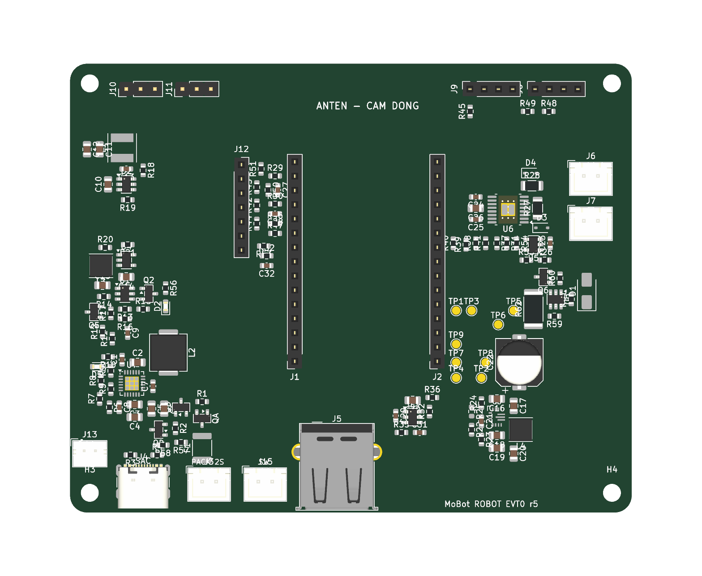
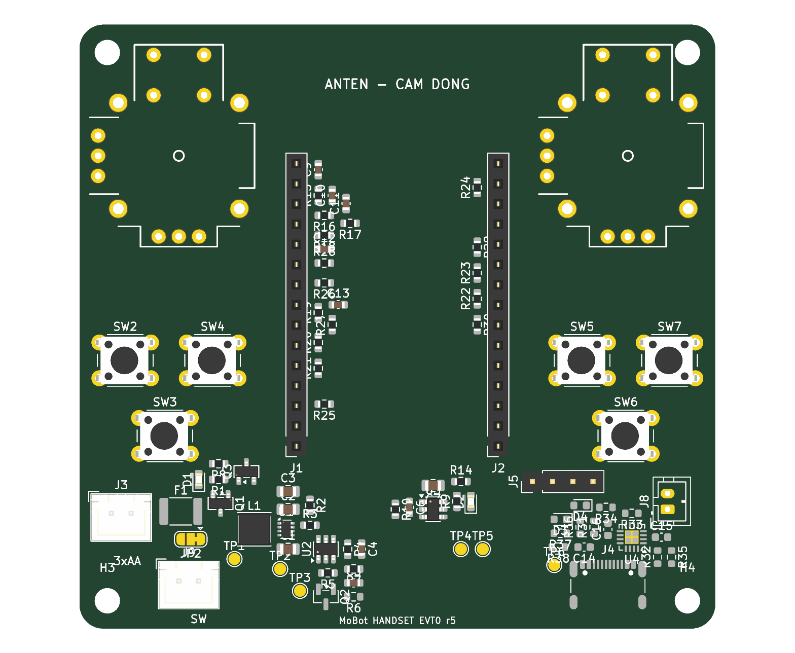

# MoBot r5 — CHECKPOINT 2: placement chờ founder duyệt

Ngày 15/11/2026. Founder đã chọn theo khuyến nghị ở [PLAN.md](PLAN.md) mục 4: a = A, b = chốt SKU trước (r5 giữ H-A), c = c3 USB-A, d = d1 clamp chủ động, e = e1. Bo **chưa route**, chưa có zone rail, chưa có Gerber. Đây là bản chờ review, không được phép chế tạo hay cấp điện.

## 1. Ảnh mặt trên (kicad-cli pcb render, chưa route)

Silkscreen còn đè nhau (ref, nhãn TP). Pha 3 sẽ dọn.

## 2. Khoảng cách tâm pad: r4 và r5, đúng các cặp F03 (+ F08)

Đo bằng `kicad/tools/measure_f03.py`. Mỗi cặp lấy khoảng cách thẳng từ tâm pad chân IC đến tâm pad cùng net gần nhất của linh kiện; đường đồng thực có thể dài hơn. Cột r4 lấy từ review 14/11.

**Robot**

| Cặp pad | r4 (mm) | r5 (mm) |
|---|---:|---:|
| U7.23 VBUS → C1 | 14,681 | 1,792 |
| U7.21 PMID → C2 | 17,401 | 1,774 |
| U7.12 BTST → C7 | 13,101 | 2,600 |
| U2.3 VIN → C10 | 11,794 | 2,112 |
| U2.6 BOOT → C13 | 5,871 | 1,836 |
| U4.4 VIN → C14 | 8,599 | 2,059 |
| U8.12 VIN → C16 | 8,376 | 1,858 |
| U8.3 VAUX → C21 | 8,813 | 1,623 |
| U6.12 VM → C26 | 5,383 | 1,939 |
| U6.11 VCP → C24 | 6,627 | 2,467 |
| U6.3 AISEN → R27 (F08) | 4,384 | 2,399 |
| U6.6 BISEN → R28 (F08) | 8,549 | 3,276 |

**Tay cầm**

| Cặp pad | r4 (mm) | r5 (mm) |
|---|---:|---:|
| U1.4 VIN → C1 | 8,011 | 1,750 |
| U1.1 VOUT → C2 | 12,314 | 1,750 |
| U1.1 VOUT → C3 | 4,110 | 4,000 |
| U3.1 IN → C6 | 13,278 | 1,864 |

Cả 16 cặp đều ngắn hơn r4, và mọi tụ nằm trong cell của IC tương ứng. C3 chỉ ngắn hơn 0,11 mm: nó là tụ VOUT thứ hai, đặt sau C2 và L1. Nếu cần, có thể đổi thứ tự để C3 sát hơn, đổi lại L1 xa hơn.

## 3. Những gì đã sửa (chỉ trong r5)

Pha 1, netlist và schematic (`kicad/tools/design_robot.py`, `design_handset.py`, `mobot_build.py`):
- **F01**: thay Q1/R1/R2 bằng QA/QB, hai PFET đối đầu chung source (MPN TBD). QD 2N7002 dò cực tính tại VPK, kèm R57/R58 và R1/R2 tính lại. BAT của U7, C5/C6, J15 và TP1 giờ cùng nằm trên net `VBAT_PROT`, sau khối bảo vệ.
- **F06**: R24 = 10 kΩ; R25 0 Ω để DNP và ghi "loại trừ R24".
- **F07**: J5 đổi sang USB-A (footprint `USB_A_Molex_67643_Horizontal`, suffix MPN TBD). Đã bỏ Q3/Q4/R33/R34/JP1. EN vẫn trễ bằng R35/C31.
- **F02**: thêm clamp chủ động U9 (comparator + ref, TBD) + R59/R60 chia áp + R61 + Q6 (TBD) + R62 điện trở 2512 (TBD). D1 TVS chuyển DNP để giữ đường d2. Mọi giá trị đều TBD.
- **F08**: ISEN_A/ISEN_B vào netclass nguồn.
- **F10**: pin IC có electrical type theo tên chân (power_in/out, input, open_collector, output). PWR_FLAG chỉ đặt trên các net được cấp từ connector hoặc cuộn cảm. ERC chưa chạy, để Pha 3.

Pha 2, placement:
- `mobot_build.py` bỏ bộ xếp hàng theo REGIONS. Thay bằng `place_cells`: IC đặt cố định, mỗi linh kiện vệ tinh tìm vị trí hợp lệ (courtyard không chồng) có tổng khoảng cách pad cùng net nhỏ nhất. Tụ quan trọng gắn đúng chân, ví dụ `("C2", "21")`. REGIONS còn dùng cho phần tín hiệu, với cùng bộ tìm có kiểm chồng.
- **Robot**: luồng mép dưới J4/J3/J15/J5 → RP (QA/QB/QD) → cell sạc U7 trái-dưới → cell 5V U2 và 3V3 U4 bên trái → DevKit giữa → cell U8 phải-dưới, rồi C22 + clamp, rồi U6 + shunt + J6/J7 mép phải. Vùng giữa hai hàng socket bị cấm đặt linh kiện (`part_keepout`).
- **Tay cầm**: J3 3×AA → F1/Q1/JP2 → J9 → cell U1 (26;63,5) → cell U3 (44,5;61) → J2.1 3V3. RC lọc joystick/ADC nằm giữa hai hàng socket, cách LX khoảng 30 mm. Cụm LiPo DNP dời sang phải-dưới (J4, J8, U4).
- **F04**: via nhiệt 0,6/0,3 mm trong EP. U7: 3×3, bước 0,9 mm. U6: 3×4, bước 1,0 mm. Robot có 21 via. Phép tính P_diss/θJA để biện minh số via chưa làm; sẽ ghi ở Pha 3 cùng xử lý stencil/tenting.

Kiểm nhanh: `kicad-cli pcb drc --severity-error` trên hai bo chưa route cho **0 violation** loại lỗi. Còn 274 (robot) và 154 (tay cầm) mục unconnected, vì chưa route. Snapshot cũ: kiểm lại **28/28 hash khớp**.

## 4. Điểm founder cần xem trước khi route

1. **J5 USB-A ở mép dưới.** Miệng ổ hướng ra ngoài, nên cáp USB-A→DevKit phải vòng từ mép dưới lên đầu USB của DevKit (y ≈ 58). Phương án khác là USB-A đứng (`USB_A_Molex_105057_Vertical`) đặt ngay dưới đầu USB DevKit, cho cáp ngắn hơn nhưng cao hơn.
2. **C22 bulk VM nằm gần U8 (~y 58), cách U6 khoảng 30 mm.** Clamp U9/Q6/R62 nằm giữa (~y 45–50). C26 10 µF vẫn sát chân VM của U6. Nếu muốn bulk sát driver đúng như T3, có thể đổi chỗ C22 với cụm TP.
3. **Đường ADC dòng motor.** RC R29/C27, R30/C28 nằm sát hàng chân trái (VP/VN). Đường ISEN chạy từ U6 bên phải sang, khoảng 30 mm.
4. **LiPo DNP tay cầm** đã dời sang phải-dưới, khá chật quanh J4/J8 nhưng DRC sạch.
5. **Chiều cao dưới phần nhô của DevKit** chưa kiểm vì SKU DevKit chưa chốt.

Pha 3 (route, zone, stitching, ERC/DRC/parity, Gerber) chỉ bắt đầu sau khi founder duyệt placement.
