# Mạch Mở — đối chiếu tính năng, UX và kiểm tra sau sửa

**Ngày rà soát:** 13/11/2026  
**Phạm vi:** nguồn trong `2026-11-13-web-app-reference-links.md`, các nguồn đối thủ có tài liệu chính thức, cùng các luồng Mạch Mở: bài học Button LED, workspace lắp mạch, breadboard, inspector linh kiện, schematic, 3D và PCB.  
**Mục tiêu:** tìm chỗ đối thủ làm tốt hơn, xác minh lỗi nhìn thấy trong ứng dụng, sửa lỗi có thể khép trong phạm vi hiện tại và ghi rõ việc còn chờ.

## Kết luận điều hành

Mạch Mở đã có một nền rộng hơn một bài học đơn lẻ: thư viện board/linh kiện, CircuitDocV2, lỗ breadboard, kết nối theo chân, schematic, scene 3D, traces bài học, SPICE cho các trường hợp được hỗ trợ, firmware HEX cho một số target, và dữ liệu PCB tham chiếu. Khoảng cách chính với các sản phẩm tham khảo không nằm ở số nút hay màu sắc; nó nằm ở **tính thống nhất giữa topology, thao tác và kết quả**.

Các sản phẩm tham khảo mạnh theo những mục tiêu khác nhau:

- Learn Arduino và Learn ESP32 ghép cảnh, schematic, mã, thông tin linh kiện và hướng dẫn trong một bài học.
- Wokwi làm rõ thao tác thêm linh kiện, chọn chân, nối dây, định tuyến và debug firmware trên những MCU/part mà họ hỗ trợ.
- Tinkercad giảm rào cản nhập môn bằng bài hướng dẫn theo bước và mạch kéo-thả.
- Falstad/EveryCircuit trực quan hóa điện áp, dòng và đáp ứng theo thời gian cho mạch analog.
- KiCad làm chuẩn tham chiếu cho ngữ nghĩa schematic, net highlight và kiểm tra ERC.
- Arduino Cloud và Proteus nối thêm workflow code, phần cứng và IoT; Renode tập trung vào mô phỏng target và kiểm thử lặp lại.

**Đã xác minh và sửa trong lượt này:** bộ chuyển workspace schema 4 sang CircuitDocV2 đếm sai các net cô lập của breadboard. Mạch có 1 net thực sự nối bị tính thành 76 net trong fixture kiểm thử, tạo lỗi G1 giả. Cách đếm đã được đồng bộ với validator; thêm test migration→gate. Cũng đã bỏ tiêu đề breadboard lặp và bổ sung kiểm tra keyboard/selection trong workspace.

**Chưa hoàn thiện:** provider trace CircuitDocV2 hiện chỉ có hợp đồng cho `blink` và `button-led`; các topology khác vẫn phải báo chưa hỗ trợ. Không bật mô phỏng giả để làm giao diện trông đầy đủ. Sau cập nhật cross-probe ngày 14/11, bộ E2E workspace riêng chạy exit 0, 11/11; kết quả này không thay cho toàn bộ `npm.cmd run test:e2e`.

## Phương pháp và mức độ bằng chứng

1. Dùng danh mục nguồn founder gửi: [`D:\2026-11-13-web-app-reference-links.md`](D:/2026-11-13-web-app-reference-links.md). Danh mục trộn website/app, tài liệu, mã nguồn, nhà cung cấp và artifact phần cứng; không xem mọi liên kết là đối thủ cùng loại.
2. Dùng báo cáo tương tác trước đó để đối chiếu các luồng đã thao tác trực tiếp: [Báo cáo trải nghiệm 13/11](../2026-11-13-web-experience-review/report.md) và [audit Learn Arduino / Learn ESP32 / Electronics 101](../../research/2026-11-12-learning-sites-interaction-audit.md).
3. Xem tài liệu chính thức cho khả năng hiện hành của Wokwi, Tinkercad, Arduino Cloud, KiCad, SimulIDE, Falstad, Proteus và Renode. Đây là **đối chiếu tài liệu**, không phải kiểm thử mọi tính năng trong các sản phẩm.
4. Kiểm tra Mạch Mở trong trình duyệt ở bài học 1440×900, bài học 375×812, workspace và trạng thái preview/migration. Ảnh ở thư mục `evidence/` là ảnh Mạch Mở. Ảnh đối thủ đã kiểm tra nằm trong báo cáo tương tác trước đó.
5. Chạy test trước/sau cho lỗi migration và đọc cổng G1, typecheck, build và Node test. Không cấp serial, không flash thiết bị và không coi trace hay hình học là phép đo vật lý.

**Giới hạn:** không thể xác nhận “tất cả tính năng” của mọi liên kết trong một lượt. Một số nguồn cần đăng nhập, app desktop, phần cứng, license hoặc môi trường cài đặt. Dưới đây luôn tách `đã thao tác`, `đọc tài liệu` và `chưa xác minh`; không suy khả năng sản phẩm từ tên hoặc marketing.

## So sánh theo năng lực

| Năng lực | Mạch Mở hiện tại | Điểm mạnh của tham khảo | Đánh giá và ưu tiên |
|---|---|---|---|
| Bài học tích hợp | Có bài Button LED với breadboard, scene, schematic, code, luồng tín hiệu và inspector; nhiều panel vẫn còn dài/cuộn | Learn Arduino/ESP32 đặt giải thích, scene, code, pinout và tiến độ trong một workspace; Electronics 101 trình bày chuỗi dự đoán→thử→quan sát→giải thích | **Cao:** giữ bài học làm entry point; giữ tab/đổi chế độ đồng bộ và giảm các panel trùng lặp. |
| Nối dây / breadboard | Có endpoint chân/lỗ, danh sách kết nối, grid và bàn phím; thao tác thay đổi còn khác giữa lesson/workspace/v5 | Wokwi/Tinkercad mô tả thao tác theo một chuỗi dễ hiểu: chọn part, chọn pin nguồn, chọn pin đích, thấy dây và sửa/xóa trực tiếp | **Rất cao:** một editor là nguồn topology; pointer/touch/keyboard phải cho kết quả tương đương; cổng và nút breadboard phải có hit target kiểm được. Wokwi mô tả thêm, xoay, kéo, wire-routing, undo và snap trên lưới. ([Wokwi Diagram Editor](https://docs.wokwi.com/guides/diagram-editor), [Tinkercad Circuits](https://www.tinkercad.com/circuits)) |
| Schematic | Mạch Mở sinh projection từ net và gắn cảnh báo giới hạn; đây chưa phải EDA/ ERC | KiCad có wire/junction, net highlight, net navigator, ERC và cross-probe | **Cao:** giữ graph chung; thêm chọn linh kiện/net đồng bộ giữa schematic và breadboard. Chỉ gọi ERC khi thực sự có luật và kiểm tra phù hợp. ([KiCad Eeschema](https://docs.kicad.org/9.0/en/eeschema/eeschema.html)) |
| Điện analog | Có SPICE cho các mạch/model đã hỗ trợ và ghi điều kiện; không phải mọi mạch/linh kiện | Falstad/EveryCircuit cho người học thấy điện áp, dòng, thao tác công tắc và waveform trực tiếp; Falstad có ví dụ theo chủ đề | **Cao:** tăng coverage có kiểm chứng; hiển thị nguồn/đơn vị/giả thiết và trạng thái không hỗ trợ cạnh kết quả. ([Falstad](https://www.falstad.com/circuit/), [Electronics demonstrations](https://www.falstad.com/circuit/e-index.html)) |
| Firmware / tín hiệu số | Có scenario trace và một số workflow HEX; các provider khác nhau, không phải mọi lệnh đều chạy trên firmware thật | Wokwi có debugger, serial monitor và logic analyzer/VCD theo MCU được hỗ trợ; debugger web được tài liệu hiện ghi hỗ trợ AVR, MCU khác có workflow VS Code | **Cao:** phân loại rõ provider, target và dòng code được hỗ trợ; thêm waveform/serial chỉ từ event thật của provider. Không animate dòng không có trong execution. ([Wokwi debugger](https://docs.wokwi.com/guides/debugger), [serial monitor](https://docs.wokwi.com/guides/serial-monitor), [logic analyzer](https://docs.wokwi.com/guides/logic-analyzer)) |
| 3D / callout | Có model board, breadboard, linh kiện, dây và inspector; một số hình học là tham chiếu/ước lượng | Learn Arduino/ESP32 kể được vai trò từng bộ phận ngay trên cảnh; component selected và callout gắn vào part | **Trung bình-cao:** tiếp tục đồng bộ selection và endpoints; không tuyên bố hình học đã đo khi provenance là parametric/unknown. |
| PCB copper | Viewer CAD board tham chiếu có F.Cu/B.Cu, net search, mã linh kiện, vùng đồng và “Vừa board”; ảnh chụp mới cho thấy board lấp đầy khung ở cả hai mặt | KiCad/EasyEDA là ứng dụng EDA đầy đủ, còn board pages như Pindexio/SnapEDA chủ yếu tra cứu part/board | **Đạt ở board được kiểm:** blank area không tái hiện trên ESP32 clone; còn cần pan/zoom và net highlight theo nhiều net/board khác. Không gộp viewer tham chiếu với thiết kế PCB Mạch Mở. |
| IoT / cloud | Mạch Mở ưu tiên local-first; chưa phải IoT cloud console | Arduino Cloud có device/things, dashboards, triggers, templates, data visualization; Proteus IoT Builder nối virtual front panel với chương trình mô phỏng; đây là phạm vi cloud/runtime khác | **Thăm dò sản phẩm:** bài học IoT mô phỏng local có thể dạy sensor→property→dashboard trước. Không thêm account/backend/cloud mặc định. ([Arduino Cloud Education](https://docs.arduino.cc/arduino-cloud/education/arduino-cloud-for-education/), [Proteus IoT Builder](https://www.labcenter.com/iotbuilder/)) |
| Test firmware có thể lặp | Hiện chưa tuyên bố runtime cho mọi MCU | Renode tập trung mô hình target và automated Robot Framework tests | **Thăm dò kỹ thuật:** chỉ thêm target khi có model và test fixture; không gọi logic trace là MCU emulation. ([Renode testing](https://renode.readthedocs.io/en/latest/introduction/testing.html)) |

## Các nguồn tham khảo và trạng thái kiểm tra

### Đã thao tác trực tiếp ở mức đại diện

| Nguồn | Đã mở/thao tác | Lấy được gì | Giới hạn |
|---|---|---|---|
| [Learn Arduino Red](https://learn-arduino-red.vercel.app/#button) | Bài Push a Button; schematic overlay, code, inspector, Pinout/Example/Specifications, component drawer | Bố cục tích hợp, callout theo vai trò, gắn code với linh kiện | Một bài đại diện; không xác minh upload hoặc mọi bài. |
| [Learn ESP32](https://learn-esp32.vercel.app/#sensor) | Distance Meter; board, cảm biến, OLED, vật cản, code và schematic | Cảnh gắn với bài cảm biến, input thay đổi và panel theo ngữ cảnh | Một bài đại diện; không xác minh thiết bị thật. |
| [Electronics 101](https://electronics-101-six.vercel.app/closed-loop) | Mạch đóng/mở, switch, Overview/Circuit/Maths | Giải thích điện áp/dòng trực quan; phát hiện được một state không đồng bộ ở lượt audit trước | Không dùng làm bằng chứng đúng điện nếu state/math đang lệch. |
| [Wokwi](https://wokwi.com/) | Mở editor, palette và thêm part trên bản nháp; không lưu | Editor workflow và cấu trúc part/pin dễ nhận biết | Không chạy firmware trong lượt đó; chỉ lấy tính năng analyzer/debug từ docs. |
| Mạch Mở | Lesson, workspace, preview, migration, inspector và mobile | Các ảnh dưới đây và test source-backed | Không đo vật lý; E2E runner bị treo như ghi ở phần kiểm tra. |

### Đối chiếu tài liệu chính thức / trạng thái chưa xác minh

- **Đọc tài liệu chính thức:** [Tinkercad Circuits](https://www.tinkercad.com/circuits), [KiCad Eeschema](https://docs.kicad.org/9.0/en/eeschema/eeschema.html), [Arduino Cloud Editor](https://docs.arduino.cc/arduino-cloud/guides/editor/), [Arduino Cloud Education](https://docs.arduino.cc/arduino-cloud/education/arduino-cloud-for-education/), [Proteus IoT Builder](https://www.labcenter.com/iotbuilder/), [Falstad](https://www.falstad.com/circuit/), [SimulIDE](https://simulide.com/p/), [Renode](https://renode.readthedocs.io/).
- **Link trong inventory nhưng chưa kiểm thử trực tiếp đầy đủ:** [LearnArduino](https://learnarduino.vercel.app/), [AIXENIX](https://arduino.aixenix.com/en/), [Arduinax](https://arduinax.com/), [OhStem xBot](https://ohstem.vn/xbot/), [Little Bird](https://littlebirdelectronics.com.au/learning-paths/crack-the-code), LEGO SPIKE resources/app, [EveryCircuit](https://everycircuit.com/?lang=en), [CRUMB](https://crumbsim.com/), [Scheme-It](https://www.digikey.com/en/resources/design-tools/schemeit), [CircuitLab](https://www.circuitlab.com/), [EasyEDA](https://easyeda.com/), [Fritzing](https://fritzing.org/), [Pindexio](https://pindexio.com/esp32-c3-devkitm-1/), [SnapEDA](https://www.snapeda.com/parts/ESP32-DEVKIT-V1/Do%20it/view-part/), [Arduino IDE](https://www.arduino.cc/en/software), [MakeCode](https://makecode.com/), [QEMU](https://www.qemu.org/docs/master/).
- **Nguồn code/thư viện/linh kiện, không phải sản phẩm UX để xếp hạng:** CircuitJS1, EEcircuit, tscircuit/circuit-json, Wokwi Elements/AVR8js/RP2040js, Adafruit CAD Parts, Espressif KiCad libraries, Fritzing parts, LCSC/DigiKey/Mouser/Octopart và SnapEDA assets. Xem inventory gốc để có link từng repo/vendor.
- [Claude Artifact MoBot](https://claude.ai/artifact/NKzoyN5pcRE3WyC5xBxWPz) là concept phần cứng, không phải website đối thủ.

Trạng thái truy cập, giá, kế hoạch và năng lực của sản phẩm có thể thay đổi; bảng không khẳng định mọi tính năng đã được thử nghiệm. Tài liệu Tinkercad nêu bài guided wiring/adding/breadboard; Arduino Cloud chính thức nêu online editor, compile/upload, serial, IoT dashboards, templates và courses. Proteus mô tả virtual front panel, simulation và debug; SimulIDE mô tả analog/digital, MCU, oscilloscope, logic analyzer và debugger. ([Tinkercad](https://www.tinkercad.com/circuits), [Arduino Cloud Editor](https://docs.arduino.cc/arduino-cloud/guides/editor/), [Arduino Cloud for Education](https://docs.arduino.cc/arduino-cloud/education/arduino-cloud-for-education/), [Proteus](https://www.labcenter.com/iotbuilder/), [SimulIDE](https://simulide.com/p/)).

## Kiểm tra Mạch Mở: ảnh, đánh giá và việc cần làm

### 1. Bài học Button LED — desktop và mobile

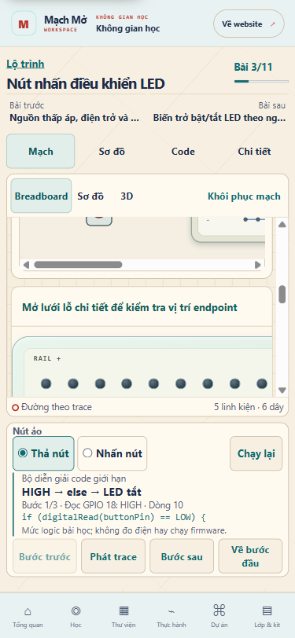

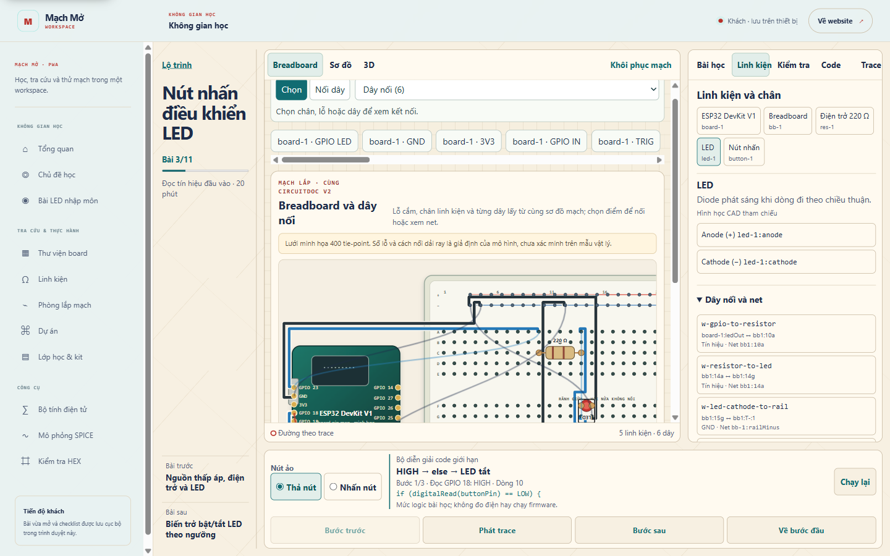

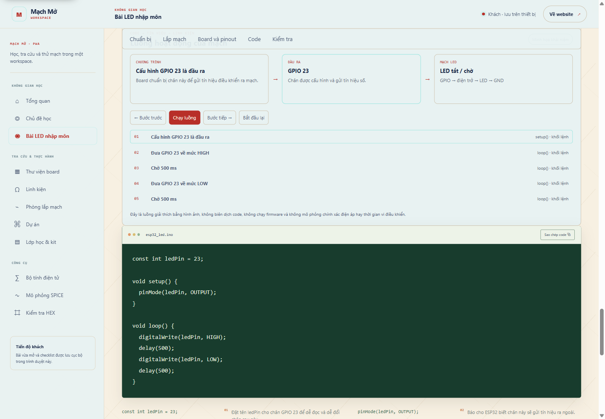

**Đạt trong snapshot:** bài học có progress, điều khiển, các tab Mạch/Sơ đồ/Code/Chi tiết; chọn thân LED chuyển inspector; các lỗ mạch hỗ trợ roving tabindex và phím mũi tên. 375 px không tràn ngang toàn trang.

**Còn thiếu:** canvas mạch trên mobile có vùng pan/scroll riêng; một số thông tin vẫn buộc cuộn bên trong panel. Kiểm tra width không đồng nghĩa layout đã tối ưu cho touch. Cần E2E thao tác drag-wire trên touch, chuyển tab giữ selection, và đọc screen reader.

### 2. Breadboard và dây

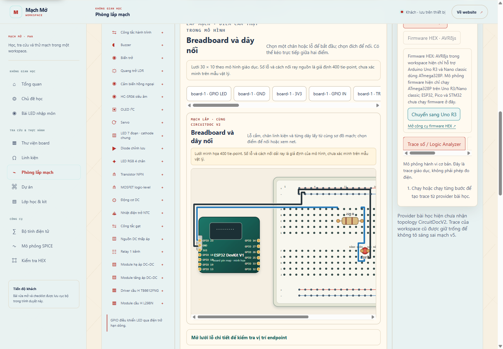

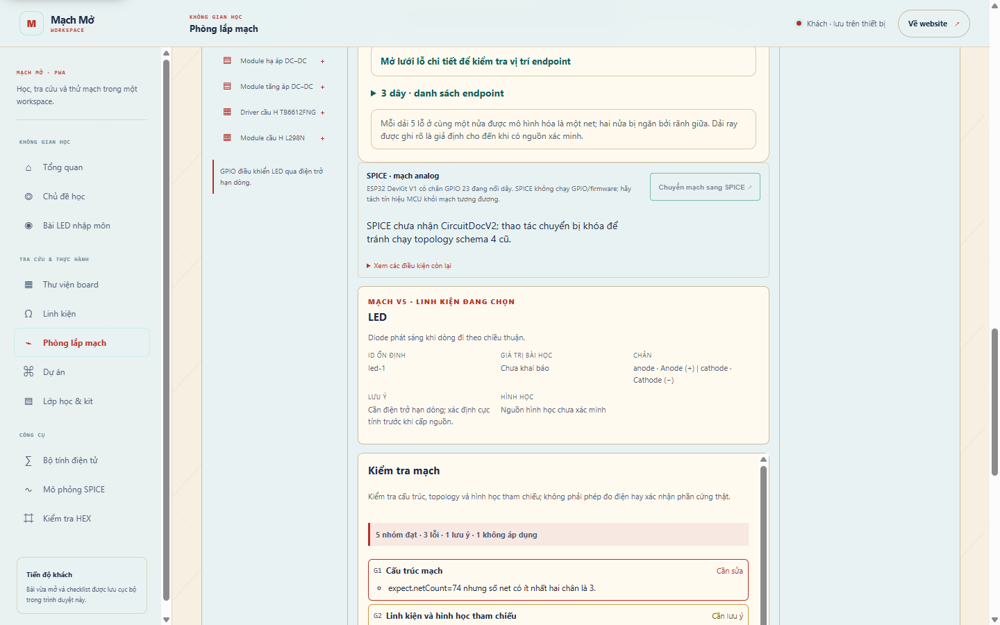

**Đã sửa:** workspace trước đó có hai heading cùng tên `Breadboard và dây nối`. Giờ editor workspace hiển thị một heading; lesson wiring vẫn giữ heading theo ngữ cảnh. Test snapshot kiểm cả hai mode.

**Còn thiếu:** rail 25 lỗ vẫn là giả định (đã gắn cảnh báo), không phải geometry đo của một board cụ thể. Cần một ca E2E thao tác pointer từ pin đến hole rồi chọn/xóa/sửa dây. Các link endpoint tồn tại nhưng không nên suy ra rằng route/pointer hit-testing đã tương đương Wokwi.

### 3. Vùng lắp thử 3D

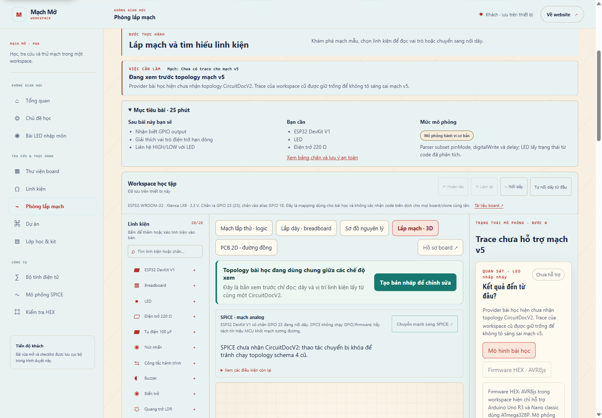

**Đạt:** scene lắp, linh kiện, dây, điểm chọn và inspector tồn tại; các gói SIM có test parity chân 2D–3D cho fixture đã hỗ trợ.

**Còn thiếu:** chất lượng hình học và dây phụ thuộc nguồn mesh/anchor. Không phải mọi part có CAD-backed geometry; chưa kiểm hết 28 loại hoặc mọi rotation/board variant. Cần ma trận fixture component×mount×rotation và screenshot visual regression thay vì claim “giống hệt” reference.

### 4. Schematic

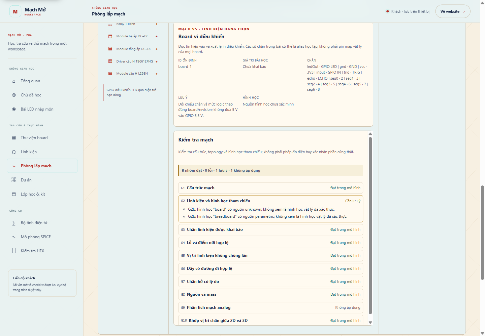

**Đạt:** topology là nguồn cho mạch và schematic projection; tài liệu UI nêu rõ không phải ERC hay mô phỏng điện.

**Còn thiếu:** đây chưa phải EDA đầy đủ; junction/crossing convention, symbol mapping có provenance và ERC vẫn chưa hoàn thiện. Net highlight và selection cross-probe đã được nối giữa schematic, breadboard và 3D trong bản cập nhật 14/11, nhưng chỉ được kiểm E2E trên fixture bài blink. Dùng KiCad làm chuẩn thuật ngữ và thao tác; không quảng cáo ERC khi chưa có checker đó.

### 5. PCB copper viewer

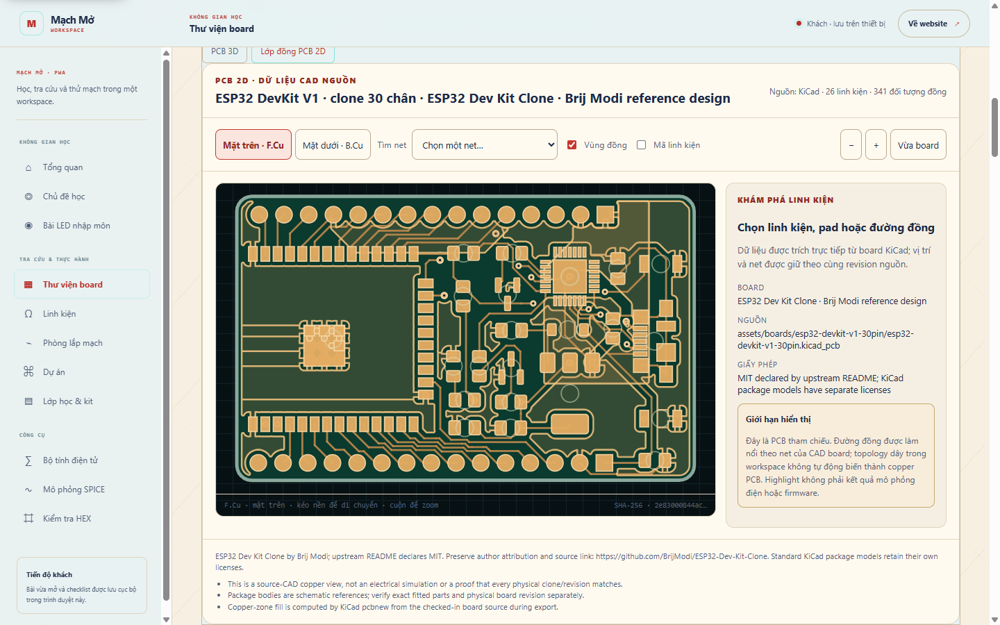

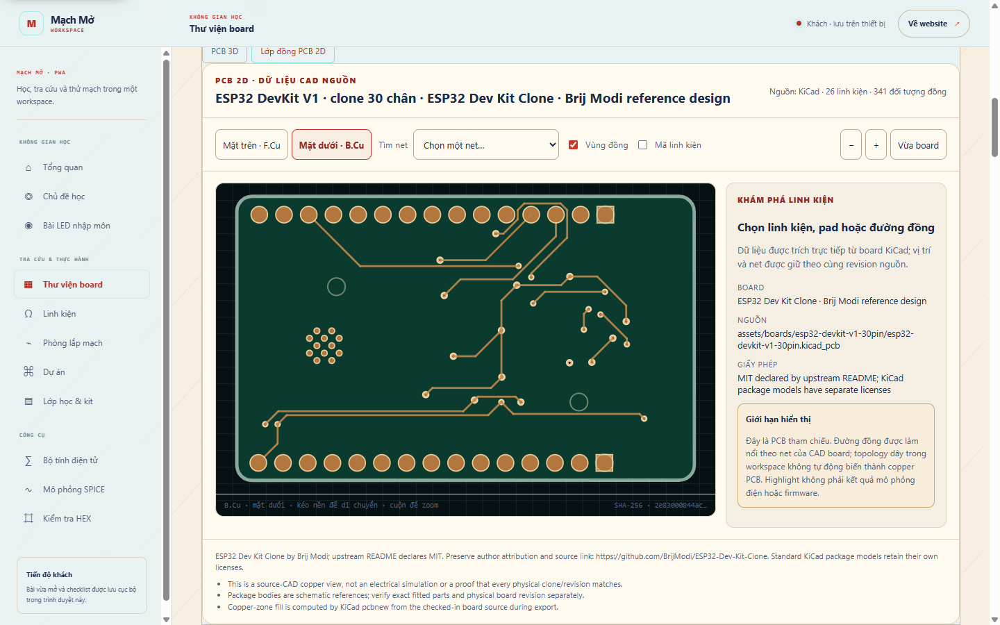

**Kiểm tra mới:** trong workspace local ngày 13/11, cả F.Cu và B.Cu được chụp tại khung “Vừa board”; board chiếm phần lớn viewport canvas, hiển thị đồng và pad trên cả hai mặt, không còn vùng nền đen lớn phía dưới như ảnh cũ. Điều này xác nhận lỗi khung/fit ở hai lớp quan sát được đã hết trên board tham chiếu ESP32 DevKit clone. Chưa kiểm pan/zoom ở nhiều tỉ lệ, net highlight nhiều net, hoặc board khác; không suy rộng kết quả sang board chưa có dữ liệu CAD.

### 6. Preview, migration và trace

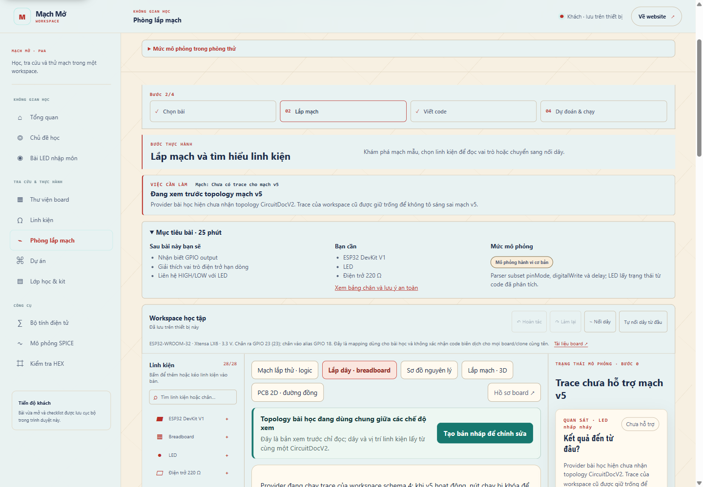

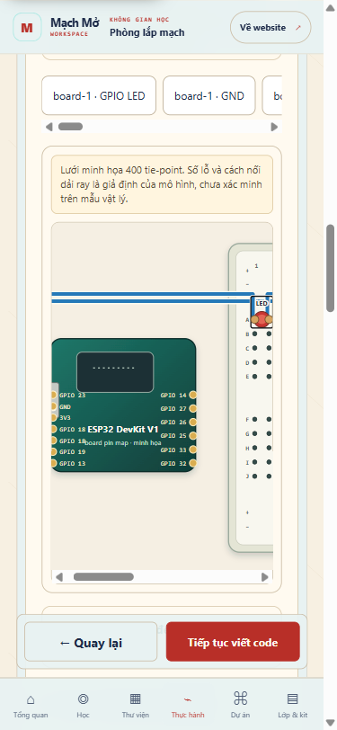

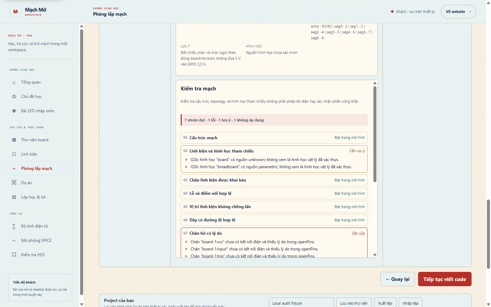

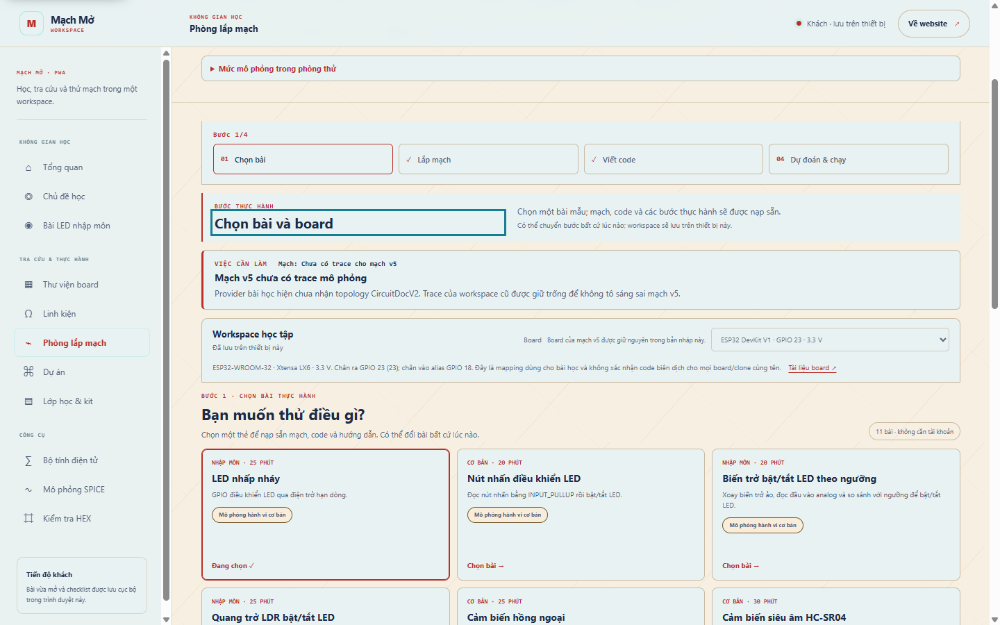

**Lỗi tìm được và sửa:** importer/migrator lưu `expect.netCount` bằng toàn bộ net trong index, gồm nhiều net cô lập của lỗ breadboard. Gate G1 lại so với số net có chân nối/dây. Cùng một mạch vì thế báo lỗi giả như `expect.netCount=74 ... có ít nhất hai chân là 3`. Sau sửa, migration dùng cùng định nghĩa connected-net count với editor/gate. Regression test xác nhận count khớp; màn hình trực tiếp sau khi chấp nhận fixture v4 ghi `expect.netCount=3` và G1 “Đạt trong mô hình”. Các cảnh báo G2/G7 khác vẫn được hiển thị, không bị che.

**Trạng thái tại thời điểm chụp:** workspace preview v5 ghi “Provider bài học hiện chưa nhận topology CircuitDocV2; trace workspace cũ được giữ trống để không tô sáng sai mạch v5.” Đây là bằng chứng lịch sử của khoảng trống trước khi bổ sung adapter, không mô tả trạng thái hiện tại.

**Cập nhật triển khai 14/11/2026:** thêm adapter trace CircuitDocV2 cho hai topology đã đăng ký (`blink`, `button-led`). Adapter lấy net từ pin/lỗ/dải/wire V2, chiếu nhãn logic giáo dục lên breadboard, schematic và cảnh 3D; khi thiếu hợp đồng hoặc có lỗi cấu trúc G1–G4/G8 thì không chạy. Sáu test mới và 19 test topology/schematic liên quan đạt; typecheck trực tiếp với heap 1 GB và `build:local` đạt. Đây vẫn là trace theo code bài học, không phải solver điện hay firmware. Chi tiết/hash: [run report](../../agents/runs/MM-SW-P0-V2-TRACE-001/report.md).

**Cập nhật PCB và cross-probe 14/11/2026:** chọn linh kiện trên schematic, breadboard hoặc danh sách linh kiện 3D dùng chung một trạng thái lựa chọn; chọn net trên schematic tô các dây cùng net ở breadboard/3D, còn chọn dây từ danh sách breadboard đổi net đang làm nổi trên schematic. Chọn chân làm nổi đúng terminal giữa schematic và breadboard; trong 3D hiện marker cho cùng endpoint tại tọa độ pin của assembly plan. Marker ghi “Vị trí theo model 3D”: một số part dùng geometry minh họa/parametric nên đây không phải khẳng định vị trí pad đã đo hoặc CAD xác thực. Trạng thái part/pin/net được phơi ra bằng `aria-pressed`, marker và highlight. Tôi cũng kiểm lại lớp đồng ESP32 DevKit V1 clone: hình học board lấp đầy viewport ở F.Cu và B.Cu; khoảng nền đen cao phía dưới trong ảnh cũ không tái hiện. Ảnh F.Cu/B.Cu nằm tại `evidence/mach-mo-pcb-copper-full.png` và `evidence/mach-mo-pcb-copper-back.png`. Kiểm tra mới nhất: `npm.cmd run typecheck` exit 0; 20 unit test topology/schematic/breadboard exit 0; `npm.cmd run build:local` exit 0; `e2e/workspace-interaction-regressions.spec.mjs` exit 0, 11/11, gồm selection hai chiều, pin-level schematic↔breadboard↔3D, thao tác dây pin→lỗ, coverage/ratio lớp đồng PCB và kiểm tra viewer trên 375×812 không tràn ngang. Chưa kiểm trên mọi bài, part, board variant, touch hoặc screen reader; marker 3D dùng geometry theo model và highlight net chỉ là lựa chọn/topology, không biểu thị dòng hay điện áp.

**Giới hạn còn mở:** các topology CircuitDocV2 khác chưa có trace contract; chưa xác minh thủ công browser cross-view sau khi đổi code. Không dùng trace schema cũ trên topology mới.

### 7. Code và luồng tín hiệu

**Điểm mạnh cần giữ:** trace chỉ nên tồn tại khi provider phát event tương ứng; khi topology/code/target không hợp lệ, trace cũ phải xóa. Hiển thị label “mô hình bài học”, “SPICE”, “firmware target” rõ ràng. Một visual signal flow không chứng minh compiler, firmware hoặc mạch vật lý.

**Khoảng cách so với đối thủ:** Wokwi có serial monitor và logic analyzer VCD cho firmware được hỗ trợ; Falstad/SimulIDE đưa nhiều đại lượng analog lên canvas/oscilloscope; Renode có test automation theo target. Mạch Mở nên mở rộng theo provider capability và fixture, không bật hết trên mọi part.

## Những thay đổi đã thực hiện trong lượt này

1. `src/lib/migrateV1toV2.ts`: `expect.netCount` sau migration dùng đúng định nghĩa connected net thay vì đếm toàn bộ net cô lập.
2. `tests/migrate-v1-v2.test.mjs`: thêm regression xác nhận netCount migration khớp G1 và không phát lỗi expectation giả.
3. `e2e/workspace-interaction-regressions.spec.mjs`: thêm assertion sau chấp nhận migration rằng G1 không báo mismatch `expect.netCount`.
4. Trong các thay đổi UI đang có trên checkout: chọn thân linh kiện mở inspector; lỗ có một tab stop và hỗ trợ phím mũi tên; heading breadboard không lặp; read-only preview không hiện điều khiển sửa dây trước khi tạo bản v5 cục bộ. `tests/breadboard-editor.test.mjs` và `tests/breadboard-diagram.test.mjs` cover heading/hit-target UI.
5. Chuyển chọn chân đang xem thành marker cùng endpoint trong cảnh 3D; marker giữ nhãn “theo model 3D” để không hàm ý CAD hoặc phép đo thực. Regression E2E kiểm key `res-1:a` sau khi chọn trong schematic.

Không sửa nội dung hardware, không chạy công cụ lên thiết bị, không cài package, không gửi nội dung dự án ra dịch vụ ngoài.

## Kết quả kiểm tra

| Kiểm tra | Kết quả |
|---|---|
| `node --test tests/migrate-v1-v2.test.mjs` trước sửa | **RED như mong đợi**: 3 pass, 1 fail; `76 !== 1` |
| `node --test tests/migrate-v1-v2.test.mjs tests/circuit-gates.test.mjs` sau sửa | **exit 0**, 14/14 |
| `node --test tests/breadboard-editor.test.mjs tests/breadboard-diagram.test.mjs` sau sửa heading | **exit 0**, 13/13 |
| `npm.cmd run typecheck` | **exit 0** |
| `npm.cmd run build:local` | **exit 0** |
| Workspace interaction + PCB fit E2E mới nhất (Playwright, preview cô lập cổng 5198) | **exit 0**, 11/11; gồm marker 3D đúng endpoint, board outline chiếm >80% cả chiều rộng/chiều cao SVG và kiểm tra lớp đồng trên viewport 375×812 không tràn ngang. Cổng mặc định 5196 đang bận nên lượt này không dừng server đang dùng cổng đó. |
| `npm.cmd test` | **exit 1**, 538 tests: 523 pass, 15 fail. 14 ca trong `logic-trace.test.mjs` cùng vấp một lỗi Vite SSR `fetchModule` transport timeout 60 s; chạy riêng file: **exit 0**, 14/14. Ca router 16 dây vượt ngưỡng trong suite (220.92 ms); chạy riêng: **exit 0**, 6/6, ca đó 71.18 ms. Full suite chưa xanh; không tính các isolated pass thay cho nó. |
| `node --test tests/logic-trace.test.mjs` | **exit 0**, 14/14 khi chạy riêng; khởi động Vite SSR chậm (122 s) nhưng hoàn tất |
| `node --test tests/wire-router.test.mjs` | **exit 0**, 6/6 khi chạy riêng; layout 16 dây 71.18 ms |
| `npm.cmd run test:e2e -- --grep "read-only lesson preview"` | Build production exit 0. Playwright im lặng hơn 2 phút và không trả kết quả; lượt chạy bị ngắt để tránh giữ runner treo. **Chưa có exit 0 — không tính là PASS.** |

## Còn lại / đề xuất theo thứ tự

| Ưu tiên | Việc | Vì sao / nghiệm thu |
|---|---|---|
| P0 | Mở rộng provider cho CircuitDocV2 workspace | Hai bài blink/button-led đã có adapter trace giáo dục; các bài còn lại chưa có contract. Mỗi bài cần topology, gate fixture, provider/input model và giới hạn rõ trước khi mở. |
| P0 | E2E dây thực tế và trace cross-view | Chuột/touch pin→hole, click chọn wire, sửa endpoint, xóa; trace blink xuyên breadboard→schematic→3D; keyboard tương đương; runner cần exit 0 ổn định. |
| P1 | Mở rộng kiểm tra PCB viewer | Mặt F.Cu/B.Cu trên ESP32 clone đã fit khung và có regression E2E; tiếp tục kiểm tra pan/zoom, highlight net và layout ở các board/viewport khác. |
| P1 | Ma trận mạch bài học | Tất cả 11 builder circuits được khai báo/kiểm topology; coverage part, pin, net, expected-open, provider/unsupported state; không gán giá trị điện đoán. |
| P1 | Cross-probe schematic↔breadboard↔3D | Part/net và pin-level endpoint đã có E2E trên fixture blink; 3D marker dùng tọa độ assembly plan và nói rõ là vị trí theo model. Còn kiểm các fixture, board variant, touch, screen reader và độ tin cậy geometry từng part. |
| P2 | Độ sâu phân tích analog và embedded | Mỗi bước mở rộng có model/test; phân biệt lesson trace, firmware runtime, SPICE, Renode/target emulation và physical observations. |
| P2 | Nâng cấp library/provenance | Part nào có revision, source, model confidence, footprint/pin mapping và compatibility; filter theo board/lesson/mount, không hứa mọi part tương thích. |

### Queue hiện tại

Trong queue chuẩn, các slice SIM Rev3A–F và P1-L08/L11 đã `done`. P1-L09 (Wokwi Elements spike) và P1-L10 (external source registry) đang `waiting` vì yêu cầu review ngoài mà policy workspace hiện cấm gửi Claude. Không đổi trạng thái hoặc làm như review đã tới. Chưa có task mở cho P0 trace-provider/E2E integration; các đề xuất P0/P1 ở trên cần được scope/ghi queue trước khi triển khai thêm.

## Nguồn kỹ thuật trực tiếp

- Wokwi: [Diagram Editor](https://docs.wokwi.com/guides/diagram-editor), [diagram format](https://docs.wokwi.com/diagram-format), [debugger](https://docs.wokwi.com/guides/debugger), [Serial Monitor](https://docs.wokwi.com/guides/serial-monitor), [Logic Analyzer](https://docs.wokwi.com/guides/logic-analyzer).
- KiCad: [Eeschema 9.0](https://docs.kicad.org/9.0/en/eeschema/eeschema.html).
- Arduino: [Cloud Editor](https://docs.arduino.cc/arduino-cloud/guides/editor/), [Cloud for Education](https://docs.arduino.cc/arduino-cloud/education/arduino-cloud-for-education/).
- Autodesk: [Tinkercad Circuits](https://www.tinkercad.com/circuits).
- Analog simulation: [Falstad Circuit Simulator](https://www.falstad.com/circuit/), [Electronics demonstrations](https://www.falstad.com/circuit/e-index.html), [SimulIDE](https://simulide.com/p/).
- IoT/embedded: [Proteus IoT Builder](https://www.labcenter.com/iotbuilder/), [Renode test framework](https://renode.readthedocs.io/en/latest/introduction/testing.html).

