# Đánh giá trải nghiệm web Mạch Mở và đối chiếu sản phẩm tham khảo

**Ngày kiểm tra:** 13/11/2026  
**Phạm vi:** Mạch Mở tại `/app/lab`; Learn Arduino; Learn ESP32; Electronics 101; Wokwi; tài liệu KiCad Eeschema.  
**Kết luận ngắn:** Mạch Mở có phạm vi mô phỏng và thông tin kỹ thuật phong phú, đồng thời đã ghi rõ nhiều giới hạn đúng đắn. Tuy nhiên, trải nghiệm hiện tại chưa tạo thành một luồng mạch duy nhất: trạng thái lưu không nhất quán, breadboard hiển thị nhiều cách biểu diễn đồng thời, nhiều thao tác của schema cũ bị khóa khi xem CircuitDocV2, và vùng PCB còn khoảng trống lớn. Learn Arduino và Learn ESP32 làm tốt hơn ở việc gắn cảnh lắp ráp, schematic, thông tin linh kiện và code vào cùng một bài học. Wokwi làm tốt hơn về thao tác dây theo chân linh kiện; KiCad làm tốt hơn về ngữ nghĩa và kiểm tra schematic. Báo cáo đề xuất ưu tiên tính đúng và một nguồn topology duy nhất trước khi đầu tư thêm vào độ bóng 3D.

## Cách đọc bằng chứng

- **Quan sát trực tiếp:** thao tác hoặc nội dung hiển thị trong trình duyệt ở ngày kiểm tra; ảnh nằm trong thư mục `evidence/` cạnh tài liệu này.
- **Tuyên bố của sản phẩm:** mô tả, số liệu hoặc thông số mà website tự hiển thị. Chưa được coi là thông số đã xác minh độc lập.
- **Tài liệu chính thức:** hành vi được mô tả trong hướng dẫn Wokwi/KiCad; đây không phải bằng chứng rằng Mạch Mở đã triển khai tính năng đó.
- **Đề xuất:** phương án sản phẩm và tiêu chí nghiệm thu được suy ra từ quan sát, không phải trạng thái đã làm.

Ảnh được chụp trong các phiên trình duyệt cô lập, không đăng nhập tài khoản người dùng. Ảnh dùng để đánh giá nội bộ; không tái sử dụng tài sản của website tham khảo trong sản phẩm.

## Phạm vi và giới hạn

Đã kiểm tra trực tiếp các luồng đại diện sau, kết hợp ảnh chụp và accessibility snapshot để nhận diện trạng thái hiển thị/announcement:

| Sản phẩm | Luồng kiểm tra trong phiên này | Đã xem |
|---|---|---|
| Mạch Mở | Phòng lắp mạch, trạng thái nháp/workspace, breadboard, schematic, 3D, lớp đồng PCB | Các chế độ và trạng thái đang hiển thị; không đo thiết bị thật |
| Learn Arduino | Bài Push a Button, schematic nổi, code, inspector, Pinout, Example, Specifications, component drawer | Đại diện một bài và các tab/inspector chính |
| Learn ESP32 | Bài Distance Meter, board/breadboard/cảm biến/OLED/vật cản, code, schematic, các tab và danh sách linh kiện | Đại diện một bài cảm biến |
| Electronics 101 | Open and closed circuits, Circuit/Maths, tương tác công tắc | Đã mở công tắc và kiểm tra lại bảng Maths |
| Wokwi | Dự án Uno trống, mở danh mục linh kiện, thêm LED vào bản nháp chưa lưu | Không lưu dự án, không chạy mô phỏng |
| KiCad | Tài liệu chính thức Eeschema 9.0, wire/junction, grid, net highlighting và ERC | Chỉ xem tài liệu; không mở ứng dụng KiCad |

Đối chiếu bổ sung từ báo cáo tương tác ngày 12/11/2026: [learning-sites-interaction-audit.md](../../research/2026-11-12-learning-sites-interaction-audit.md). Báo cáo trước đã kiểm thêm các bài Conductors & Insulators, Arduino LED, Learn ESP32 two-LED và một số thao tác cảm biến. **Đây chưa phải kiểm thử vét toàn bộ mọi bài, mọi tổ hợp board/part, toàn bộ tính năng hay mọi cỡ màn hình của các website.** Chưa chạy upload/flash, chưa cấp quyền cổng serial, chưa xác nhận thiết bị thật, chưa kiểm đầy đủ bàn phím/mobile hoặc mọi đường lỗi. Sự kiện `Run` của Wokwi không được chạy. Không coi nội dung mô phỏng nào là phép đo điện thực.

## Tổng quan đối chiếu

Mức đánh giá là định tính theo những luồng đã kiểm tra, không phải điểm xếp hạng sản phẩm.

| Khả năng | Mạch Mở hiện tại | Learn Arduino | Learn ESP32 | Electronics 101 | Wokwi | KiCad Eeschema |
|---|---|---|---|---|---|---|
| Đưa người mới từ bài học tới thực hành | Có bài mẫu và 4 bước Chọn bài → Lắp → Code → Dự đoán/chạy; còn phải cuộn nhiều, nhiều chế độ cùng trang | Tốt: bài học, tiến độ, scene, schematic, code và thông tin linh kiện cùng không gian | Tốt: cùng dạng workspace tích hợp, lesson carousel và điều khiển đầu vào cảm biến | Tốt cho khái niệm cơ bản: chủ đề, mạch thí nghiệm, Circuit và Maths | Là công cụ dựng/mô phỏng, không phải curriculum nhập môn hoàn chỉnh | Công cụ EDA, không phải curriculum |
| Tạo/chỉnh dây | Có nền CircuitDocV2 và biểu diễn breadboard nhưng ảnh ghi nhận các model lồng nhau; trạng thái preview/schema ảnh hưởng thao tác | Tập trung vào mạch bài học có sẵn; người học khám phá linh kiện và scene | Tập trung vào mạch bài học có sẵn, linh kiện và input sensor | Thay đổi vật thể/tham số thí nghiệm; không phải editor tùy ý | Mạnh: thêm part, kéo/thả, xoay, nối từ pin này tới pin kia và điều hướng dây | Mạnh cho kết nối schematic theo grid, pin/wire/label/junction |
| Breadboard / pin endpoints | Có lưới lỗ và endpoint, nhưng hình học 400 tie-point hiện ghi là giả định chưa xác minh bằng mẫu | Trình bày breadboard lắp sẵn, callout pin/linh kiện; không được xem là công cụ wiring tổng quát | Trình bày assembly cảm biến lắp sẵn và đường dây | Không phải trọng tâm | Mô hình parts/connections rõ theo endpoint trong diagram | Không phải breadboard layout |
| Schematic | Có projection theo net với cảnh báo chưa phải ERC hay mô phỏng; chưa ngang editor EDA đầy đủ | Bật/tắt schematic nổi, đồng bộ theo bài; không phải KiCad | Schematic bài học có sẵn, schematic có thể di chuyển/ẩn | Mạch nguyên lý đơn giản đặt cạnh lời giải thích và Maths | Không phải editor schematic | Chuẩn tham chiếu cao: wire, label, junction, grid/snap, net highlight, net navigator, ERC, netlist |
| 3D / trực quan linh kiện | Có board, breadboard, part và dây; chất lượng scene/độ gắn kết dây cần cải thiện | Scene nhiều chi tiết hơn, hotspot/callout đặt ngay tại part, camera và minimap | Scene board + sensor + vật cản/OLED có ý nghĩa theo bài; callout làm rõ vai trò | Scene 3D dễ hiểu cho mạch pin/công tắc/bóng đèn | 2D schematic simulator, không phải 3D lesson scene | PCB 3D riêng, không thay scene lắp thử |
| Code và luồng tín hiệu | Có code, mô hình subset, bước chạy và instrumentation, nhưng không tương đương compiler/firmware/SPICE; CircuitDocV2 hiện có đường bị khóa | Code example cạnh scene; có nút Run và serial UI, nhưng trạng thái UI không chứng minh đã flash board thật | Code, serial UI và input cảm biến trong cùng bài; không chứng minh thiết bị thật | Có biểu đồ/readout và lời giải thích vật lý ở mức bài học | Mô phỏng code, serial monitor; logic analyzer có thể ghi VCD; tài liệu debugger nêu hỗ trợ theo nền tảng | SPICE/IBIS và operating point là công cụ riêng; ERC kiểm quy tắc kết nối, không thay đo mạch thật |
| Inspector, nguồn và giới hạn | Có library 28/28, provenance PCB, cảnh báo giới hạn; cần làm rõ trạng thái lưu và revision/độ tin cậy cho từng claim | Có drawer, inspector và tab Specifications; nguồn/revision không hiện ở mọi thông số quan sát | Có component/reference panel và Specifications; nguồn/revision không hiện ở mọi claim quan sát | Tập trung vào giải thích; không phải registry BOM/source | Part/pin mô hình hóa rõ trong docs; model support tùy linh kiện | Part libraries, fields và footprint assignment; mức chuyên nghiệp/độ phức tạp cao |

**Lưu ý:** Wokwi và KiCad là tham chiếu theo một năng lực cụ thể (thao tác wiring/simulation và schematic/EDA), không nên xem là đối thủ có cùng mục tiêu giáo dục hoặc sao chép nguyên giao diện.

## Mạch Mở: phát hiện trực tiếp và bằng chứng

### 1. Luồng học, lưu trạng thái và khả năng thao tác

Trang có bốn bước thực hành, thư viện 28 loại linh kiện, bài mẫu và các mode logic, breadboard, schematic, 3D, PCB. Đây là phạm vi đáng kể và phần cảnh báo kỹ thuật tương đối cẩn trọng. Tuy vậy, trong phiên xem, accessibility tree có announcement ẩn `Không lưu được bản nháp`, trong khi trạng thái lưu đang thấy trong workspace là `Đã lưu trên thiết bị này`. Announcement là phần tử `sr-only` bị clip khỏi màn hình, nên đây là mâu thuẫn giữa thông báo cho công nghệ hỗ trợ và trạng thái hiển thị, không phải hai dòng chữ cùng xuất hiện nhìn thấy trên màn hình. Phiên bản hiện tại cũng hiển thị các nút thao tác dây/undo của workspace logic bị khóa trong khi đang ở trạng thái preview, cùng banner yêu cầu tạo/chấp nhận bản nháp để chỉnh sửa.

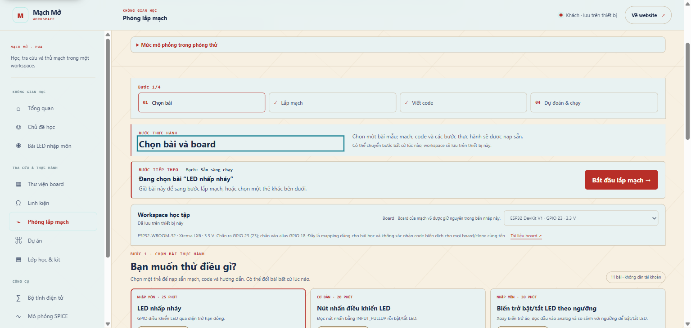

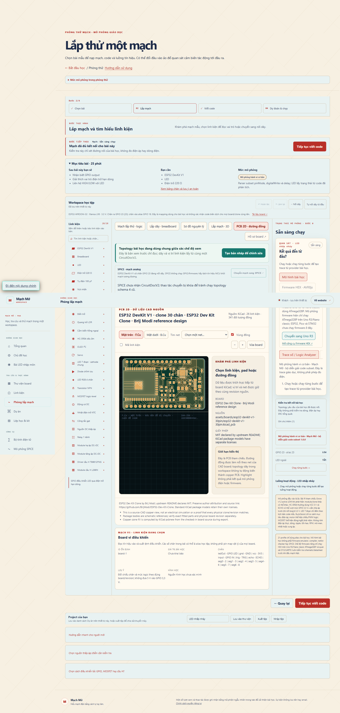

Snapshot hỗ trợ screen reader: [mach-mo-accessibility-status.yml](evidence/mach-mo-accessibility-status.yml).

**Đánh giá:** đây là lỗi tin cậy và accessibility mức cao: người dùng đọc màn hình có thể được thông báo rằng lưu thất bại trong khi UI cho người nhìn thấy báo đã lưu. Ảnh cho thấy trạng thái hiển thị, còn lỗi ẩn được xác nhận bằng accessibility snapshot/DOM (`role=status`, `aria-label`, class `sr-only`). Bằng chứng đến từ browser context cô lập của buổi review; chưa xác định được thông báo lỗi được đặt nhầm hay storage bị chặn/quota. Không nên kết luận mọi trình duyệt hoặc profile đều mất dữ liệu. Cần kiểm thử riêng khi local storage dùng được, bị chặn và hết quota; UI và announcement phải cùng phản ánh một trạng thái nguồn sự thật.

### 2. Breadboard và dây

Ảnh trang hiện tại hiển thị section breadboard 30 × 10 và danh sách endpoint, nhưng trong cùng luồng còn render một sơ đồ lắp mạch kiểu cũ, thêm một board hole-grid khác. Các phần xuất hiện chồng nối tiếp làm người mới khó biết board nào là nơi chỉnh thật và dây nào là topology chuẩn. Dòng cảnh báo cũng nói số lỗ/rail của breadboard là giả định 400 tie-point, chưa xác minh trên mẫu vật lý.

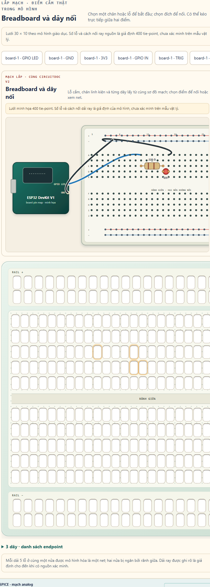

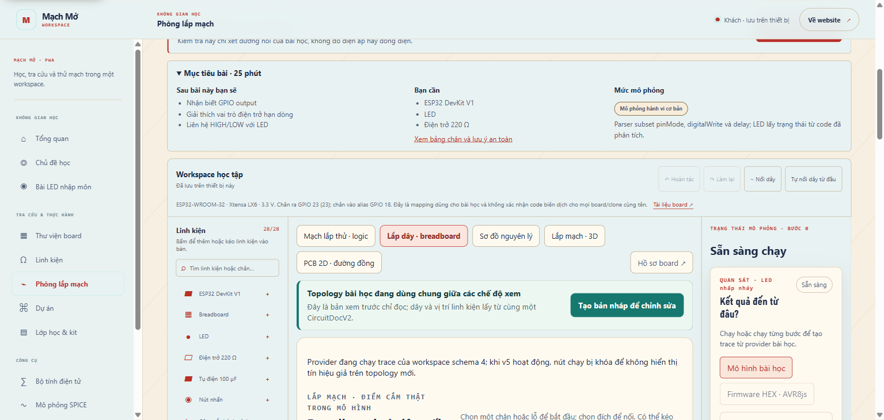

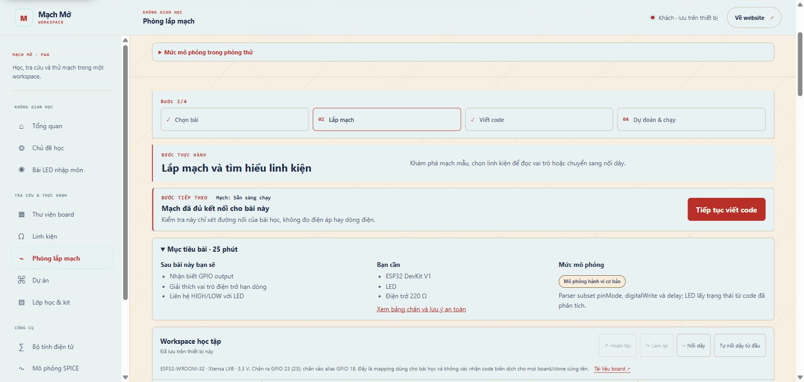

**Đánh giá:** mô hình lưới lỗ và endpoint là hướng đúng cho một công cụ học cách cắm dây. Nhưng cần chọn một canvas canonical cho một thời điểm; các bảng endpoint/net nên mở như inspector/phụ lục chứ không phải một bản mạch thứ hai có thể gây lệch. Giao diện cần nói rõ prototype nào chỉnh được, lỗ nào thuộc cùng strip, rãnh giữa tách ra sao và rail đang dựa trên model nào. Không quảng bá geometry là tương ứng chính xác với mọi breadboard thật.

### 3. Schematic

Schematic hiện lấy topology đã khai báo để vẽ board, resistor, LED, net labels và dây. Có cảnh báo công khai rằng hình là projection kết nối, không phải kết quả ERC hoặc mô phỏng điện. Đây là minh bạch tốt. Tuy nhiên, hình đang có wire routing dài/vuông và label N1/N2/N3, nhưng thiếu một số ký hiệu, junction/line-crossing convention, nguồn/GND tiêu chuẩn và quy trình chẩn đoán mà người dùng kỳ vọng từ KiCad.

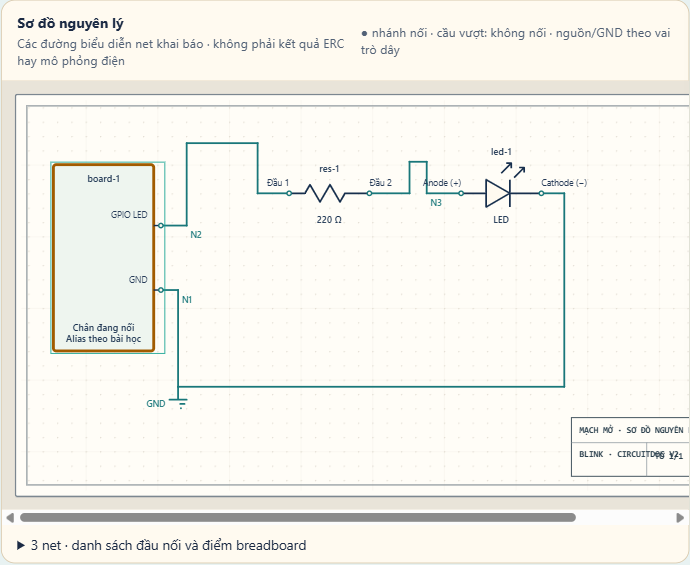

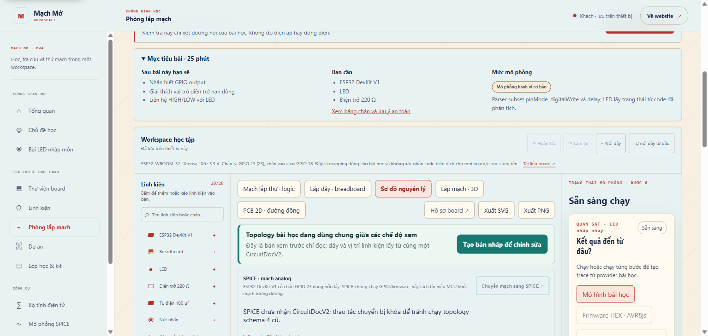

**Đánh giá:** làm schematic projection chuẩn hóa trước, không gọi nó là EDA đầy đủ. Tối thiểu phải thống nhất pin endpoint/net với breadboard và 3D; thể hiện rõ junction, crossing không nối, nguồn/GND và net highlight. Chỉ thêm “ERC” nếu thực sự có checker với rule set và báo cáo lỗi tương ứng.

### 4. Lắp ráp 3D

Scene 3D có board ESP32, breadboard, LED/resistor và dây, đồng thời có điều khiển camera cơ bản. Tuy nhiên, ảnh cho thấy scene còn khá schematic/khối đơn giản; dây và chân có đoạn nhìn như lơ lửng hoặc chưa thật sự gắn vào pad/holes. So với Learn Arduino/ESP32, thiếu hotspot/callout gắn chính xác lên các bộ phận, cross-probe khi chọn một pin/part và composition rõ về vật thể nào đang được lắp.

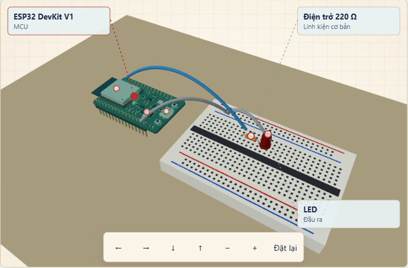

**Đánh giá:** ưu tiên độ khớp topology và endpoints trước shader/đồ họa. Mỗi wire phải kết thúc đúng pin/hole trong cùng circuit document; chọn part trong 3D phải mở đúng inspector và tô cùng net ở schematic/breadboard. Hình học chưa có source/revision phải mang nhãn tham khảo/giáo dục.

### 5. Lớp đồng PCB

Panel PCB có provenance tốt: board nguồn, tên thiết kế, số đối tượng, lớp F.Cu/B.Cu, net selector, copper fill, mã linh kiện, zoom và nút vừa board. Nó cũng nêu rõ đây là source-CAD copper view, không phải mô phỏng điện hoặc chứng minh mọi clone khớp.

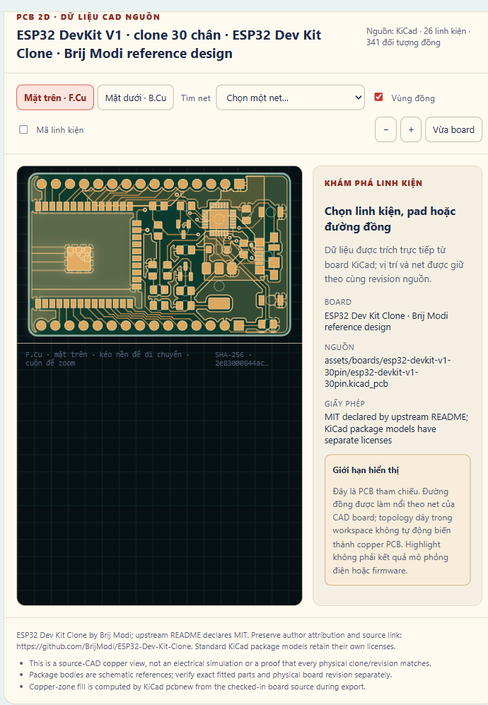

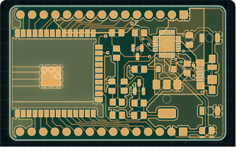

**Đánh giá:** lỗi dễ thấy là board chiếm phần trên của canvas nhưng phần đen phía dưới còn lớn, khiến tỷ lệ vùng hiển thị kém và trông như asset bị cắt. Nút “Vừa board” đã có nhưng ảnh chụp ở trạng thái chưa tự fit. Cần fit theo bounding box của board/pad/copper khi tải, đổi layer hoặc resize; giới hạn padding/aspect ratio và giữ tỉ lệ zoom người dùng sau tương tác. Không đổi nguồn CAD để che vấn đề canvas.

### 6. Kết quả code/tín hiệu và thông tin linh kiện

Mạch Mở có chẩn đoán bài học, provider label, input ảo, trạng thái GPIO/LED, step trace, logic flows, firmware riêng giới hạn Uno/Nano ATmega328P và một số model SPICE. Code hiện nêu rõ lesson simulation không phải firmware emulator/compiler/netlist checker/SPICE; các scenario buck/boost, motor, MOSFET không tính các đại lượng vật lý đầy đủ. Đây là ranh giới tốt cần giữ.

Rủi ro UX là người dùng có thể nhìn thấy “Sẵn sàng chạy”, sơ đồ hoặc đường tín hiệu ở nhiều chế độ rồi suy rằng circuit đã được kiểm tra điện. Hiện ảnh/snapshot cho thấy trạng thái “Mạch đã đủ kết nối cho bài này” kèm giải thích rằng đây chỉ kiểm tra đường nối, không đo điện áp/dòng. Cần giữ lời giải thích ngay cạnh kết quả, gắn nhãn nguồn kết quả trên mọi view và xóa trace cũ khi đổi lesson/topology/provider.

## Learn Arduino: mô hình trải nghiệm tích hợp tốt

Trong bài Push a Button, workspace giữ scene 3D, schematic overlay, component inspector, tab Overview/Pinout/Example/Specifications, code editor, điều khiển chạy, serial-monitor panel, callout cho nút/input/LED/pull-down và dải lesson/progress trong cùng màn hình. Đây là mẫu tham khảo tốt cho cách nối thông tin kỹ thuật với hành động hiện tại.

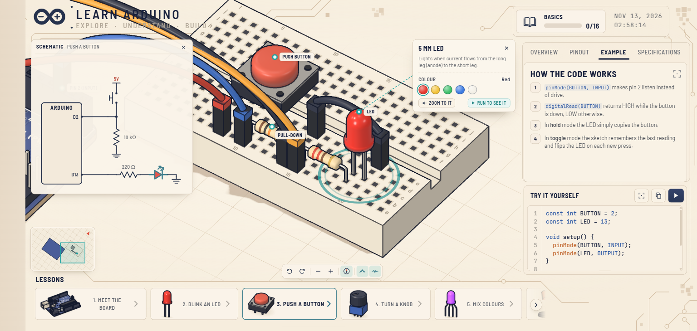

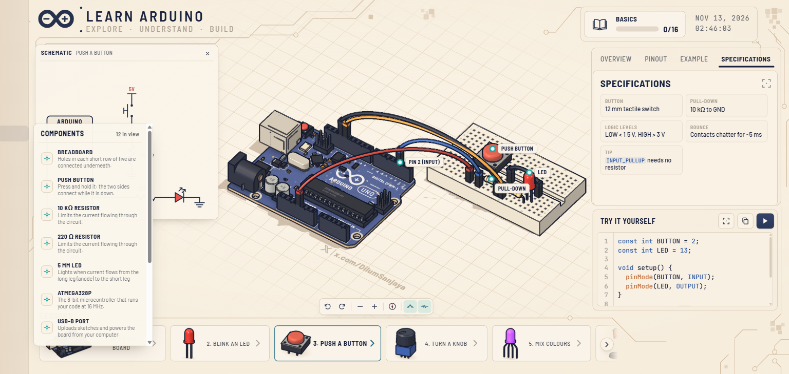

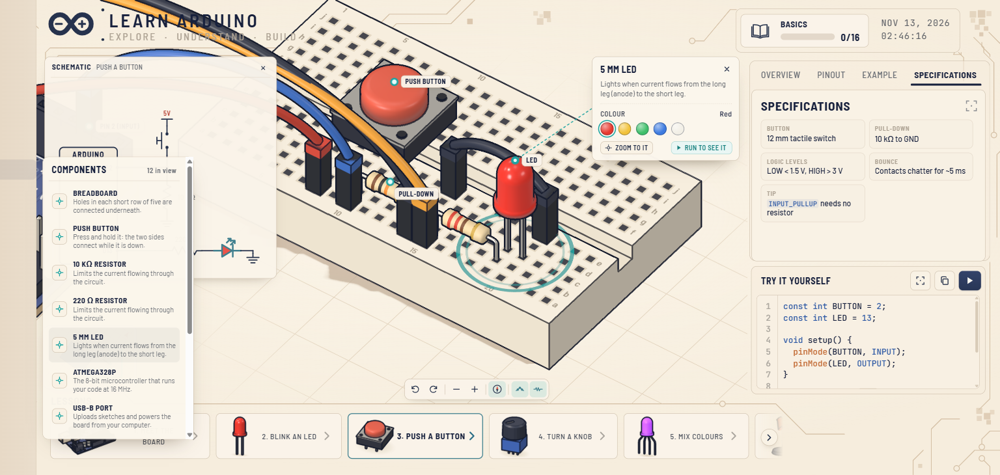

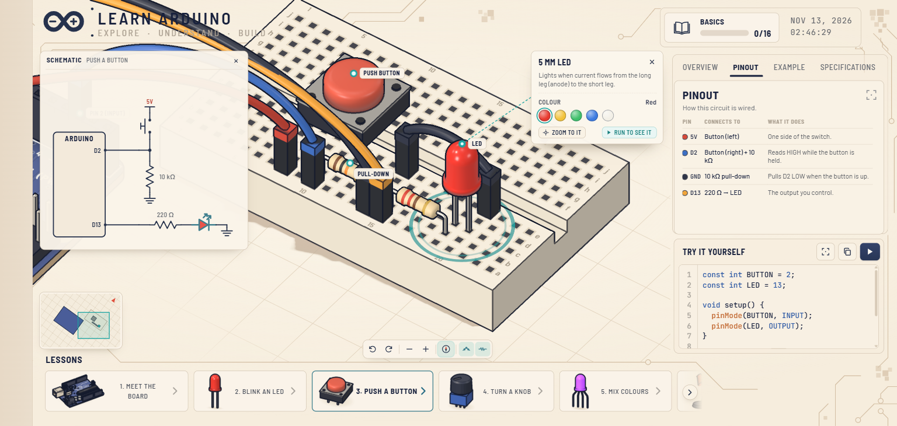

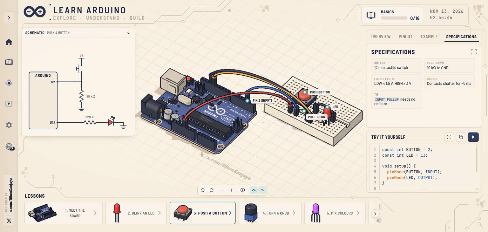

**Làm tốt hơn Mạch Mở ở:** scene rõ, callout trực tiếp trên vật thể, bố cục gộp nhiều panel, tiến độ/bài tiếp theo và giải thích code theo dòng. Mạch Mở nên học cách đặt inspector theo ngữ cảnh và giữ các panel quan trọng cùng một không gian, không sao chép nguyên layout/tài sản.

**Giới hạn cần lưu ý:** tab Specifications hiển thị số liệu nhưng không phải chỗ nào cũng thấy nguồn/revision ngay cạnh claim. Không coi thông số trên site là bằng chứng hãng. Nút Run/serial là hành vi UI của website; buổi review không cấp serial permission hay chứng minh một board được flash.

## Learn ESP32: scene theo ngữ cảnh cảm biến

Distance Meter đặt ESP32, HC-SR04P, OLED và vật cản trong một scene; callout chỉ pin/role, overview giải thích hoạt động, có schematic panel, code, component list, Specifications và lesson carousel. Slider đổi chu kỳ đo trong UI. Báo cáo ngày 12/11 còn quan sát thấy serial output cũ còn hiện sau khi đổi lesson; điểm này chưa được lặp lại ở lượt hôm nay, nên giữ là phát hiện trước đây cần tái kiểm chứ không coi là lỗi vừa tái hiện.

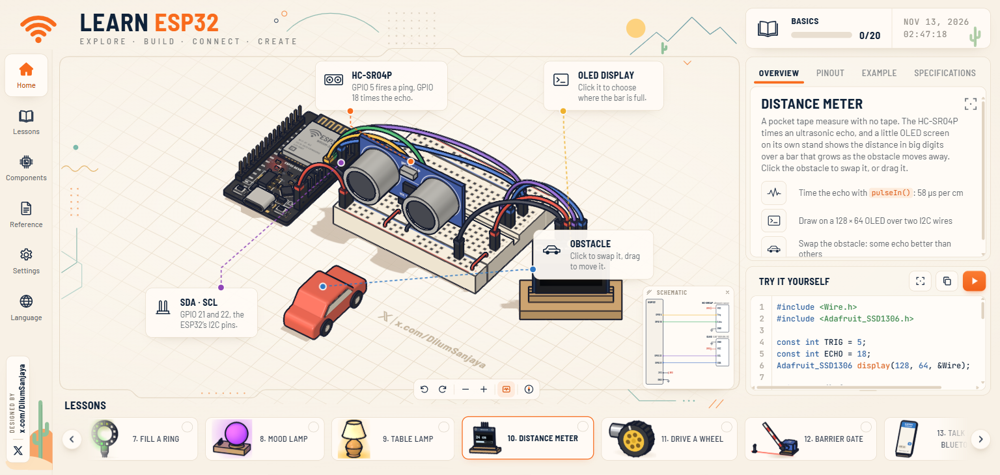

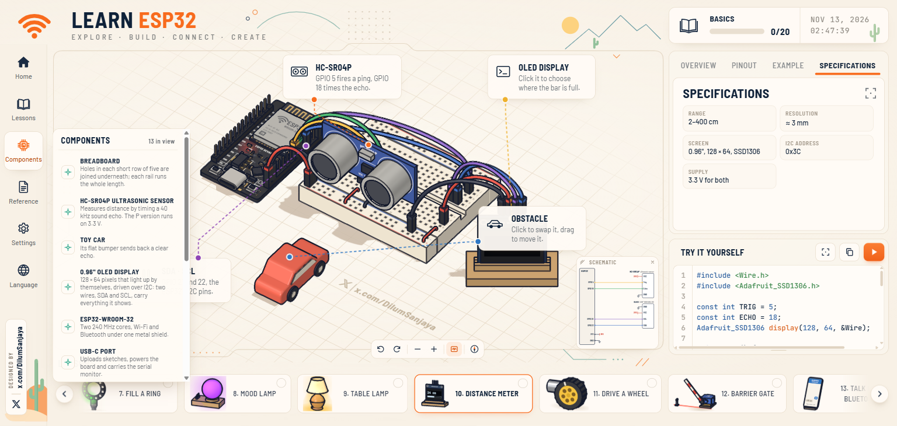

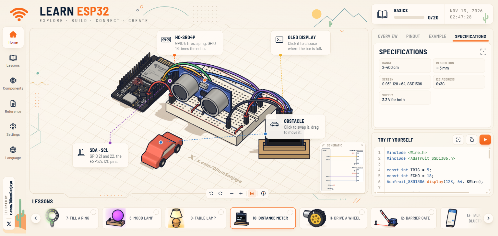

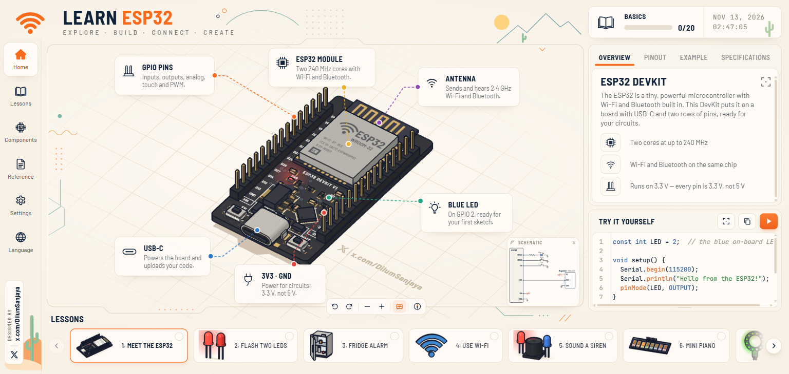

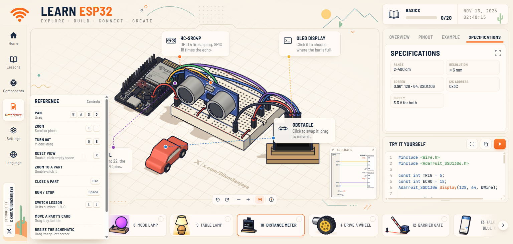

**Làm tốt hơn Mạch Mở ở:** scene kể được tình huống, component callout và context code khớp với sensor; nội dung thao tác có thể thay đổi stimulus.  
**Giới hạn:** giá trị/spec hiển thị không mặc nhiên đã đối chiếu datasheet; chưa kiểm thiết bị thật, serial hay độ đúng điện; lỗi trace cũ từ audit trước cần retest.

## Electronics 101: bài học khái niệm và lỗi đồng bộ thấy trực tiếp

Website có bài mở/đóng mạch, component/material controls, 3D scene, tab Overview/Components/Circuit/Maths, biểu đồ và tiến độ. Cách diễn giải `3V / 10Ω = 300mA` giúp người học thấy quan hệ số học ngay cạnh mạch. Nhưng lượt review hôm nay tái hiện một lỗi đồng bộ: sau khi bật công tắc sang mở, bóng tắt và trạng thái hiển thị “off”; tab Maths vẫn nói “Round a closed loop…” và giữ `300 mA`.

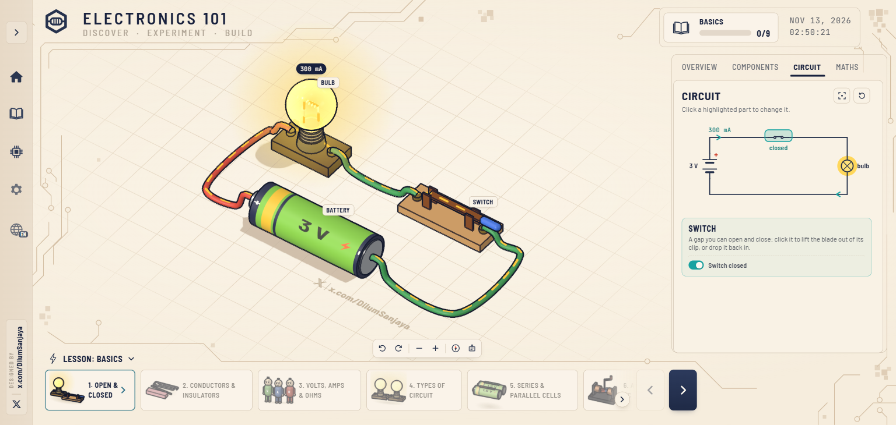

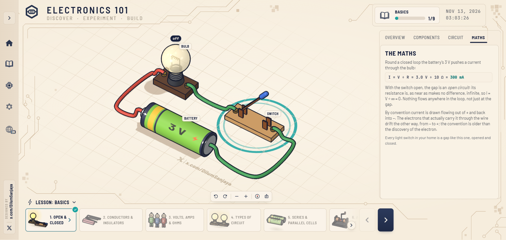

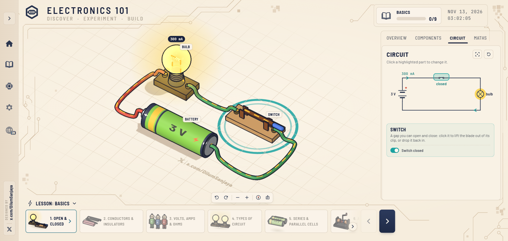

Đây là điểm quan trọng: không nên học theo UI đơn lẻ khi nó sai. Mạch Mở nên lấy từ Electronics 101 lối sư phạm `dự đoán → thay một yếu tố → quan sát → giải thích`, nhưng phải dùng state model kiểm chứng được, cập nhật mọi panel cùng một revision và ẩn/vô hiệu kết quả không còn hợp lệ.

## Wokwi: tham chiếu tương tác wiring

Trong dự án Uno trống, trình chỉnh sửa phân vùng diagram/code và simulator; người review mở danh mục part và thêm LED vào project chưa lưu. Tài liệu Wokwi mô tả thao tác thêm part, kéo, xoay, nhân bản, xóa và nối pin-to-pin; `diagram.json` chứa danh sách part và connections theo endpoint. Tài liệu nêu thêm `wokwi-cli lint` có thể bắt part type lạ, kết nối pin sai và ID trùng. Không lưu hoặc chạy project trong buổi review này.

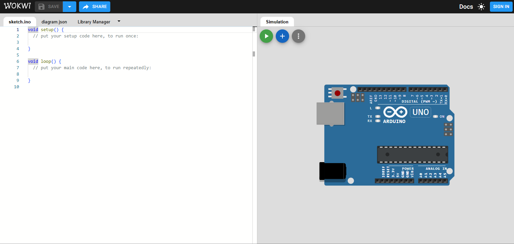

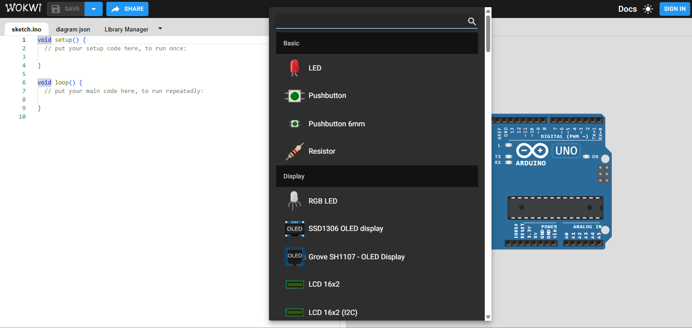

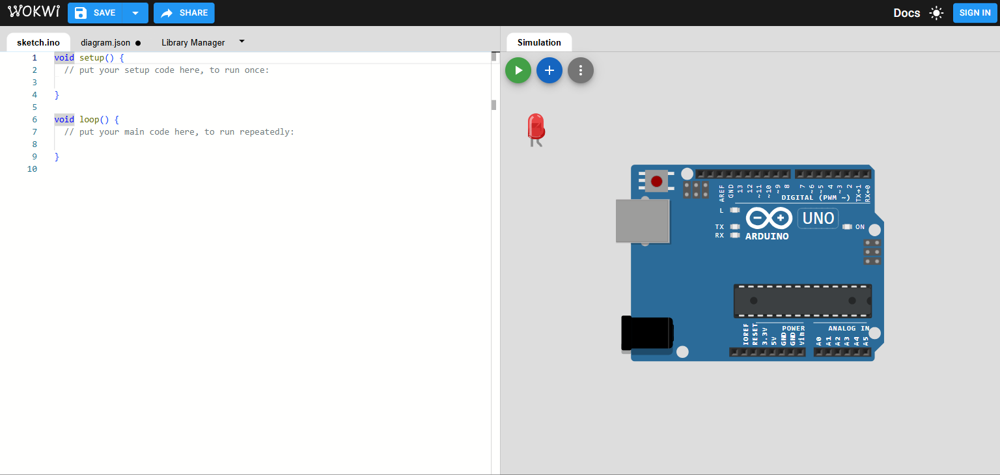

Tài liệu chính thức: [Interactive Diagram Editor](https://docs.wokwi.com/guides/diagram-editor), [diagram.json format](https://docs.wokwi.com/diagram-format). Đường dây được biểu diễn từ component/pin nguồn đến component/pin đích; route có thể hướng ngang/dọc. [Logic Analyzer](https://docs.wokwi.com/guides/logic-analyzer) mô tả 8 kênh số và xuất VCD; [Serial Monitor](https://docs.wokwi.com/guides/serial-monitor) cho phép xem/gửi dữ liệu serial. Đây là tính năng/tài liệu Wokwi, không phải khả năng đã xác minh ở Mạch Mở.

**Nên áp dụng vào Mạch Mở:** palette → đặt part → chọn pin/hole A → chọn pin/hole B → xem route → xác nhận; thao tác chuột, bàn phím và touch; Undo; endpoint/net inspector; chẩn đoán topology trước khi chạy. Ưu tiên `partId/pinId` ổn định và cùng graph làm nguồn cho breadboard, schematic, scene 3D và trace.

## KiCad: chuẩn semantics cho schematic, không phải chỉ màu và hình

Ảnh dưới đây là tài liệu chính thức KiCad Eeschema 9.0, **không phải ảnh ứng dụng đang chạy**. Hướng dẫn quy định các wire/pin phải khớp grid; nối trực tiếp cần endpoints trùng chính xác; junction dùng khi giao điểm cần thể hiện nối; labels có thể đặt tên net. Eeschema có net highlighting/net navigator và Electrical Rules Checker để phát hiện các loại lỗi như pin chưa nối, output bị chập hoặc kết nối trái phép.

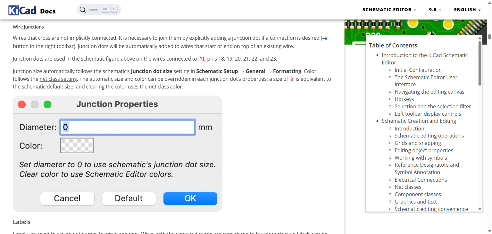

Nguồn: [KiCad 9.0 Eeschema manual](https://docs.kicad.org/9.0/en/eeschema/eeschema.html), các mục [Electrical Connections](https://docs.kicad.org/9.0/en/eeschema/eeschema.html#electrical-connections), [Net highlighting](https://docs.kicad.org/9.0/en/eeschema/eeschema.html#net-highlighting), [Electrical rules checking](https://docs.kicad.org/9.0/en/eeschema/eeschema.html#electrical-rules-checking).

**Nên áp dụng vào Mạch Mở:** ký hiệu điện tử nhất quán, wire snapping, chân/nhãn/net rõ, junction dot tách bạch khỏi crossing không nối, tô sáng toàn net giữa view. ERC cần được đặt tên đúng và có rule set, nếu chưa có thì dùng “kiểm tra topology/điều kiện bài học” chứ không gọi là ERC.

## Các phần tham khảo làm tốt hơn và bài học cho Mạch Mở

| Sản phẩm | Điểm mạnh đã quan sát/tài liệu chứng minh | Hành động nên lấy | Điều không nên suy diễn |
|---|---|---|---|
| Learn Arduino | Màn hình bài học liền mạch; scene có hotspot; schematic/code/part inspector/lesson nav gần nhau | Bố cục một workspace có cross-probe, thông tin theo lựa chọn và đường học tiến dần | Không xem số Specifications là datasheet-verified; không sao chép tài sản/layout |
| Learn ESP32 | Scene cảm biến có ý nghĩa, vật cản và pin-callout gắn đúng bài; code và tham số đầu vào cùng ngữ cảnh | Mỗi sensor lesson phải có stimulus cụ thể, unit và giải thích kết quả; selection cập nhật inspector | UI/serial không chứng minh đã nạp firmware hay đo phần cứng |
| Electronics 101 | Dạy từ loop, vật liệu, điện áp/dòng/điện trở đến breadboard và đo lường; Maths đặt gần thao tác | Bài học theo vòng dự đoán/quan sát/giải thích và giải nghĩa con số | Lượt hôm nay tái hiện kết quả Maths bị stale sau khi switch mở; đừng sao chép lỗi đồng bộ |
| Wokwi | Editor hoạt động theo part và pin endpoint; wire là kết nối cụ thể; simulator/serial/logic analyzer có tài liệu riêng | Xây wiring editor lấy endpoint làm dữ liệu gốc, route trực quan và kiểm pin/net | Mạch Mở chưa có compiler/MCU emulator tổng quát; không thể ngầm hứa tương đương |
| KiCad | Ngữ nghĩa nối/không nối, grid, net names, ERC và net navigator | Lấy chính xác quy ước schematic, không chỉ skin | Mạch Mở chưa phải EDA đầy đủ; không dùng nhãn KiCad/ERC nếu chưa triển khai semantics/checker tương ứng |

## Danh sách lỗi/cần nâng cấp theo mức độ

| ID / mức | Bằng chứng | Tác động tới người học | Hướng giải quyết | Tiêu chí nghiệm thu đề xuất |
|---|---|---|---|---|
| **MM-WEB-01 · P0 · trạng thái lưu/announcement mâu thuẫn** | Ảnh `mach-mo-save-status-conflict.png` cho trạng thái thấy được; accessibility snapshot/DOM cho `sr-only role=status aria-label="Không lưu được bản nháp"`, cùng workspace `Đã lưu trên thiết bị này` | Người dùng công nghệ hỗ trợ được thông báo lưu thất bại dù giao diện thông thường báo đã lưu; giảm tin cậy và gây hiểu nhầm | Một state machine lưu duy nhất; tách autosave workspace khỏi save-to-project; lỗi ghi có nội dung và hành động retry/export; announcement phải đồng bộ với UI | E2E success/failure/quota/blocked storage; cùng lúc chỉ một trạng thái đúng cả nhìn thấy và screen reader; reload/restore đúng revision |
| **MM-WEB-02 · P0 · hai breadboard/representation cùng hiện** | `mach-mo-breadboard-detail.png` | Không rõ canvas nào là bản thật; wire state có thể phân kỳ; trang dài | Chỉ một breadboard canvas canonical cho mode; bảng endpoint/net là inspector có thể mở; legacy view không render cạnh V2 | E2E thêm/sửa/xóa dây và refresh: một topology duy nhất; schematic/3D phản chiếu đúng IDs; không có duplicate scene |
| **MM-WEB-03 · P0 · mode read-only/disabled không rõ** | Snapshot local `/app/lab` ghi các nút wire/undo legacy disabled trong preview và hướng dẫn tạo/chấp nhận v5; SPICE và run V2 có giới hạn nêu trong source/UI | Người dùng tưởng dây hoặc chạy được toàn bộ, trong khi mode hiện tại chưa hỗ trợ; dead end khi chuyển mode | Mỗi mode công bố trạng thái `xem`, `chỉnh`, `chạy` riêng; nút chỉ hiện khi khả dụng; giải thích migration, draft và cách quay lại; không gọi draft preview là editor đầy đủ | E2E đi từ bài mẫu sang từng mode: mọi nút active có hành động thành công hoặc có reason; dữ liệu legacy vẫn phục hồi được |
| **MM-WEB-04 · P0 · tính đúng topology giữa các view** | Breadboard, schematic, 3D và PCB là các biểu diễn khác nhau; ảnh cho thấy dây/breadboard đang trộn legacy và CircuitDocV2; source `CircuitBuilderPage.tsx` có nhánh view riêng | Sửa dây ở một nơi có thể không đồng bộ nơi khác; trace cũ dễ thành kết quả của topology khác | Canonical CircuitDocV2 duy nhất (stable part/pin/wire/endpoint/net); mọi view là projection; đổi topology/lesson/provider thì clear hoặc đánh dấu trace cũ | Snapshot test graph parity; e2e chọn net/part ở mỗi view tô đúng IDs; invalid endpoint không được chạy; lesson switch xóa stale trace |
| **MM-WEB-05 · P1 · board PCB chiếm ít canvas, vùng đen thừa** | `mach-mo-pcb-panel.png`, `mach-mo-pcb-svg.png` | Trông như asset lỗi/cắt; thông tin nhỏ và mất chỗ xem | Tự fit bounding box trên load/layer/resize; cấu hình viewBox theo board và padding; giữ pan/zoom sau khi người dùng thao tác | 1440×900 và 375×812, board chiếm tối thiểu 70% vùng xem hữu dụng khi vừa board; không có dải đen không thuộc board lớn; F.Cu/B.Cu/net/filter không làm lệch board |
| **MM-WEB-06 · P1 · scene 3D chưa gắn dây/part rõ** | `mach-mo-3d-canvas.png`; so với `learn-arduino-button-live.png`, `learn-esp32-distance-meter.png` | Khó hiểu chân nào nối đâu; scene chưa giúp giải thích mạch | Gắn wire ends vào pad/hole/pin anchor; thêm hotspots/callout, zoom-to-part, net highlight và cross-probe; cải thiện material/lighting sau khi geometry đúng | Tất cả endpoint có anchor; không dây lơ lửng trong fixture; select part/pin đồng bộ inspector/net trên view; test rotate/zoom/reset |
| **MM-WEB-07 · P1 · schematic chưa đạt semantics người dùng yêu cầu** | `mach-mo-schematic-detail.png`; cảnh báo hiện tại nói không phải ERC | Crossing/junction hoặc power/GND có thể gây hiểu sai khi học nguyên lý | Chuẩn hóa symbol, grid snap, junction dots, no-connect, power/GND, refdes/value, net labels và highlight; duy trì caption `instructional schematic` khi chưa có ERC | Golden circuits có net partition đúng; test crossing nối/không nối; DRC/ERC claim chỉ xuất hiện khi checker cụ thể thật sự chạy |
| **MM-WEB-08 · P1 · trace không gắn revision/provider đủ rõ** | App có subset trace, firmware provider và instruments nhưng các path khác nhau; prior audit 12/11 ghi serial ESP32 giữ output bài trước (chưa tái kiểm hôm nay) | Người học nhầm trace minh họa thành output code/điện thực; context bài cũ có thể bị trình bày như mới | Mọi result có provider, run id, document revision, `observed/simulated/educational` label; invalidate khi source đổi; serialized output gắn lesson/run | E2E đổi bài/board/circuit đang có trace: trace bị xóa hoặc giữ nhãn bài cũ; unsupported code không hiện signal; không gọi là measured |
| **MM-WEB-09 · P1 · thông số part thiếu provenance sát claim** | Inspector và references có phần nguồn tốt, nhưng tab Specifications của Arduino/ESP32 trong các ảnh không thể hiện source/revision cạnh mọi giá trị | Dễ biến số tham khảo/clone thành thông số bảo đảm | Tách `sourced`, `inferred`, `unknown`; source, revision, variant và điều kiện hiện cùng property; không lấp dữ liệu chưa biết | Test fixture verified/inferred/unknown; export giữ provenance; clone khác revision được cảnh báo; giá trị thiếu không hiện như fact |
| **MM-WEB-10 · P1 · hành trình dài và nhiều panel** | `mach-mo-lab-current.png`; một trang chứa stepper, mục tiêu, palette, board, canvas, diagnostics, simulation result, projects và help; phải cuộn dài | Người mới mất vị trí giữa thao tác/công cụ; khó biết làm gì tiếp | Desktop: lesson rail, 1 canvas chính, contextual right inspector, bottom action/status; view switcher không tạo 2 canvas; mobile dùng tab Mạch/Schematic/Code/Chi tiết | 1440×900 không cuộn toàn trang trong bước chính; mobile không tràn ngang; focus/keyboard và chọn part giữ nguyên qua tab |
| **MM-WEB-11 · P2 · API/console noise** | Snapshot local có 404 `favicon.ico` duy nhất trong lượt này | Không chặn mạch, nhưng làm nhiễu console | Thêm favicon đúng hoặc route fallback; kiểm console lại | Console clean với favicon và không có lỗi app trong luồng lab |

P0 nghĩa là rủi ro về tính đúng, dữ liệu hoặc dead-end của luồng chính; P1 nghĩa là chức năng/hiểu biết cốt lõi bị giảm; P2 là cải thiện gọn/chất lượng. Mức ưu tiên không phải đánh giá mức an toàn điện.

## Phương án triển khai theo thứ tự

### Đợt A — Khóa đúng trạng thái và nguồn dữ liệu

1. Chọn một state machine cho bản nháp: `saved`, `saving`, `error`, `recovery available`; không để header/sidebar/component tự tổng hợp trạng thái riêng.
2. Chỉ một editor topology canonical. Khi chuyển sang CircuitDocV2 preview, hoặc chọn read-only rõ ràng, hoặc tạo draft để chỉnh; không render đồng thời editor legacy và V2 như hai bản song song.
3. Mỗi edit wire/part có revision/undo; storage báo độ bền thật. Export/recovery phải rõ khi local storage lỗi.
4. Khóa “Run” theo mức hỗ trợ của topology/provider, hiển thị lý do tại đúng nút; không để các panel trái/phải đưa ra tín hiệu mâu thuẫn.

**Cổng xong:** save/reload/recovery tests; một canonical graph; no stale result khi sửa mạch hoặc đổi bài.

### Đợt B — Một bài vertical slice xuyên suốt bốn biểu diễn

1. Chốt một bài LED/Button với board profile, component variants và exact pin map có nguồn.
2. Canonical document chứa `partId`, `pinId`, `wireId`, endpoint breadboard và geometry/source state.
3. Breadboard editor theo mô hình tương tác endpoint của Wokwi: palette, select pin, route, undo/redo, delete, endpoint ID/net inspector; hình học breadboard được chọn có source rõ hoặc đánh dấu assumption.
4. Schematic và 3D là projection từ cùng document; cross-probe và net highlight đồng bộ.
5. Chỉ mở logic trace/provider hỗ trợ bài đó; nguồn kết quả và giới hạn luôn cạnh output.

**Cổng xong:** tạo/edit/delete một wire ở breadboard; net/schematic/3D cập nhật; pin/hole đúng; unsupported graph bị chặn; responsive 375 px và 1440 px; keyboard path.

### Đợt C — Schematic dễ đọc theo chuẩn EDA

1. Symbols/pin labels/reference designator/value thống nhất; power/GND là net đúng nghĩa.
2. Grid/snap, junction dot, crossing không nối và no-connect được thể hiện riêng.
3. Select net/wire/part trong schematic tô sáng endpoints/parts ở breadboard/3D; cung cấp danh sách net/endpoint thay cho canvas-only operation.
4. Nếu chưa có ERC, ghi `topology checks` hoặc `lesson connectivity check`; không dùng nhãn ERC.

**Cổng xong:** test net partition và trực quan giao điểm; bài mẫu có thể đọc mà không cần đoán đường nối.

### Đợt D — 3D, PCB và bố cục workspace

1. 3D sửa geometry anchor/wire trước; sau đó mới thêm callout, lighting/materials, minimap và zoom-to-part.
2. PCB viewer tự fit theo bounding box, không đổi nguồn CAD để chỉnh layout.
3. Desktop dùng một view chính với panel ngữ cảnh và thanh hành động cố định; mobile tab hóa chức năng, giữ selection/state.

**Cổng xong:** không có wire lơ lửng trong fixture; board PCB được fit trong vùng xem; canvas không chảy xuống vùng đen; viewport/keyboard/mobile kiểm tra.

### Đợt E — Học, thông số và kiểm chứng

1. Migrate lesson theo nhóm nhỏ, mỗi bài có mục tiêu, một câu dự đoán, biến đầu vào, kết quả, giải thích và thử thách debug.
2. Component/board inspectors chỉ đưa ra con số khi có provenance, revision và điều kiện; clone chưa biết nội bộ phải giữ `unknown`.
3. Tách UI trạng thái: educational scenario trace, provider simulation, firmware emulator, SPICE, physical measurement. Mỗi kết quả phải mang nhãn và nguồn.
4. Re-test các phát hiện cạnh tranh bị stale (Electronics 101 hiện đã tái hiện, Learn ESP32 serial cũ cần kiểm lại).

**Cổng xong:** lesson switch/reset invalidates outputs; code/provider/circuit revision parity; không hiển thị giả định như số đo; test không tạo kết quả cho code/topology không hỗ trợ.

## Danh mục ảnh bằng chứng

Các ảnh PNG có thể mở trực tiếp trong thư mục `evidence/`:

### Mạch Mở

`mach-mo-lab-current.png`, `mach-mo-lab-overview.png`, `mach-mo-save-status-conflict.png`, `mach-mo-breadboard-current.png`, `mach-mo-breadboard-detail.png`, `mach-mo-breadboard-workbench.png`, `mach-mo-schematic-current.png`, `mach-mo-schematic-detail.png`, `mach-mo-3d-canvas.png`, `mach-mo-pcb-panel.png`, `mach-mo-pcb-svg.png`.

### Learn Arduino

`learn-arduino-button-live.png`, `learn-arduino-schematic-overlay.png`, `learn-arduino-components-drawer.png`, `learn-arduino-component-inspector.png`, `learn-arduino-pinout.png`, `learn-arduino-example.png`, `learn-arduino-specifications.png`.

### Learn ESP32

`learn-esp32-meet-board.png`, `learn-esp32-distance-meter.png`, `learn-esp32-components.png`, `learn-esp32-reference-panel.png`, `learn-esp32-specifications.png`.

### Electronics 101, Wokwi và KiCad

`electronics-101-circuit.png`, `electronics-101-maths.png`, `electronics-101-switch-open.png`, `electronics-101-maths-switch-open.png`, `electronics-101-switch-clicked.png`, `wokwi-uno-editor.png`, `wokwi-part-picker.png`, `wokwi-led-placement.png`, `kicad-eeschema-manual.png`, `kicad-wire-junctions.png`.

`learn-arduino-push-button.png` không được dùng làm bằng chứng chính vì ảnh được chụp trong lúc trang tải. Tổng thư mục có 34 ảnh; báo cáo tham chiếu những ảnh có ích, và bỏ ảnh loading nói trên khỏi kết luận.

## Nguồn

- [Mạch Mở — Phòng lắp mạch](http://127.0.0.1:5197/app/lab) (local, 13/11/2026; cần chạy server để mở)
- [Learn Arduino — Push a Button](https://learn-arduino-red.vercel.app/#button)
- [Learn ESP32 — Distance Meter](https://learn-esp32.vercel.app/#sensor)
- [Electronics 101 — Closed loop](https://electronics-101-six.vercel.app/closed-loop)
- [Wokwi — project Uno mới](https://wokwi.com/projects/new/arduino-uno)
- [Wokwi — Interactive Diagram Editor](https://docs.wokwi.com/guides/diagram-editor)
- [Wokwi — diagram.json format](https://docs.wokwi.com/diagram-format)
- [Wokwi — Logic Analyzer](https://docs.wokwi.com/guides/logic-analyzer)
- [Wokwi — Serial Monitor](https://docs.wokwi.com/guides/serial-monitor)
- [KiCad 9.0 — Eeschema manual](https://docs.kicad.org/9.0/en/eeschema/eeschema.html)
- Báo cáo tương tác trước: [2026-11-12-learning-sites-interaction-audit.md](../../research/2026-11-12-learning-sites-interaction-audit.md)
- Mã Mạch Mở được đối chiếu: `src/pages/CircuitBuilderPage.tsx`, `src/components/builder/BreadboardEditor.tsx`, `src/components/builder/CircuitSchematicV2.tsx`, `src/components/builder/AssemblyScene.ts`, `src/components/pcb/Pcb2DViewer.tsx`, `src/lib/circuitDocV2.ts`, `src/lib/simulationProviders.ts`, `src/components/builder/SimulationInstrumentsPanel.tsx`.
