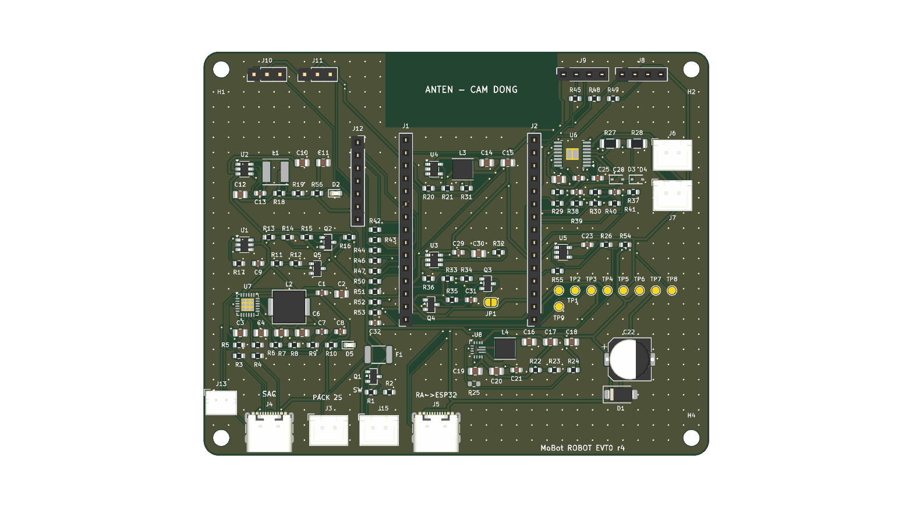
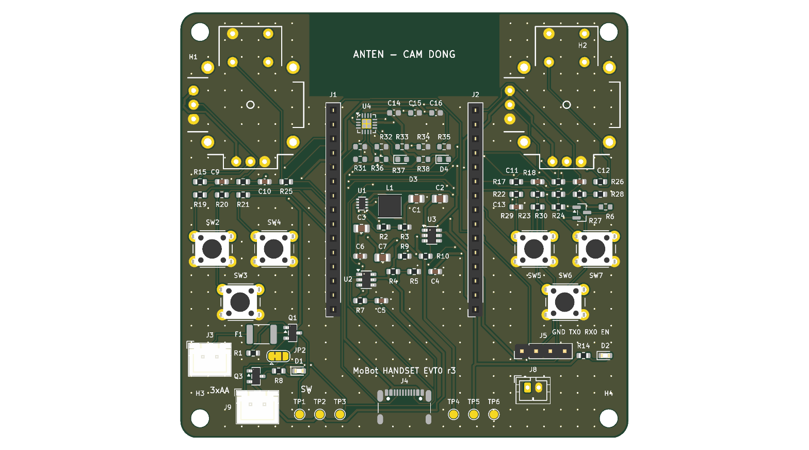

# Review PCB MoBot — robot r4 và tay cầm r3, 14/11/2026

**Kết luận: CHANGES_REQUESTED — chưa nên gửi chế tạo hoặc cấp điện pin/motor.** Hai bo có kết nối hình học sạch theo luật KiCad hiện hành, nhưng còn vấn đề thiết kế điện, bố trí nguồn, tản nhiệt và lựa chọn linh kiện. Đây là review, không phải duyệt cấu hình/hash hoặc thay đổi thiết kế.

## 1. Snapshot và cách kiểm

Nguồn: `docs/hardware/claude-support/2026-11-12-pcb-2layer/`; tay cầm 80×76 mm, robot r4 100×80 mm. Hash các PCB, schematic, project, BOM, placement và script nằm trong [snapshot.json](snapshot.json). Hồ sơ cũ có nhiều lớp lịch sử: robot dùng cập nhật lần 4 ngày 14/11, tay cầm dùng lần 3.

- Đã xem tay cầm trong KiCad PCB Editor; đã đọc cả hai board bằng pcbnew 10.0.7 và chạy CLI của KiCad 10.0.7.
- Đã xem ảnh render mặt trên cả hai bo do gói bàn giao cung cấp; ảnh là bằng chứng bố trí, không phải ảnh mạch thật.
- Mở robot bằng launcher desktop chưa xác nhận được cửa sổ robot; phần robot được kiểm bằng file PCB thực qua pcbnew/CLI và render hiện có. Không báo đã thao tác GUI robot.
- Hai nhánh review độc lập: EF kiểm điện/netlist/datasheet; HK đo placement, pad, via và BOM. Không gọi Claude, không sửa file thiết kế.
- Không đo điện, nhiệt, EMI hoặc hình học mẫu thật. Những phần đó vẫn NOT_RUN.
- Đối chiếu lại SHA-256 sau review: toàn bộ file trong snapshot không thay đổi. Thao tác GUI mở thêm project bị ngắt bởi input người dùng; không tiếp tục gửi phím vào cửa sổ có tranh chấp focus. Review robot GUI tương tác vẫn chưa hoàn tất; kết quả đọc hình học/DRC/ERC phía trên đã thực thi bằng KiCad.

| Kiểm mới trên file hiện tại | Tay cầm | Robot |
|---|---|---|
| `pcb drc --severity-all --schematic-parity --exit-code-violations --format json` | exit 0, 0 violations, 0 unconnected, 0 parity | exit 0, 0 violations, 0 unconnected, 0 parity |
| `sch erc --severity-all --exit-code-violations --format json` | exit 0, 0 violations | exit 0, 0 violations |

Log: [handset DRC](handset-drc.json), [robot DRC](robot-drc.json), [handset ERC](handset-erc.json), [robot ERC](robot-erc.json). CLI có cảnh báo không ghi được registry HKCU trong sandbox, nhưng hoàn tất và xuất các report trên. Không dùng refill/save-board.

**Giới hạn DRC/ERC quan trọng:** `kicad/tools/mobot_build.py:86` sinh tất cả pin dưới kiểu `passive`; ERC không kiểm được xung đột output hoặc power input chưa cấp. DRC có `ignored_checks` (ví dụ missing_courtyard, footprint_type_mismatch); project đặt min track 0,15 mm và min silk clearance 0. Vì vậy “0 lỗi” chỉ có nghĩa đạt tập luật đang bật, không chứng minh nguồn ổn định, footprint đúng MPN, nhiệt đạt hoặc silkscreen dễ lắp.

## 2. Những điểm cần sửa trước chế tạo

Các đường dẫn source sau tương đối với thư mục gói nguồn nêu trên.

### F01 — High: đảo cực pack robot vẫn đánh vào charger

`kicad/tools/design_robot.py:45–60`: J3 → F1 → VPACK2; Q1 bảo vệ nhánh VAA2/tải, nhưng U7 BQ25886 BAT13/14 nối trực tiếp VPACK2, trước Q1. Nhãn net cũng có trong schematic sinh ra (khoảng dòng 621/623). Đảo cực 2S đặt điện áp âm lên BAT. Datasheet BQ25886 §7.1 cho BAT tối thiểu −0,3 V; PTC không ngăn điện áp âm ban đầu.

**Sửa đề xuất:** thiết kế bảo vệ đảo cực bao phủ cả charger BAT và tải, có kiểm đường sạc hai chiều. Không chỉ chuyển BAT sau diode một chiều rồi mặc nhiên cho rằng sạc còn đúng. Kiểm trạng thái pack đúng/ngược, USB có/không, công tắc ON/OFF và lỗi bảo vệ.

### F02 — High: TVS SMAJ8.0A chưa bảo đảm bảo vệ DRV8833

`design_robot.py:135`: D1 SMAJ8.0A trên VM_6V. Vishay 88390 tr.2: VBR=8,89–9,83 V, nhưng VC max=13,6 V tại 29,4 A; DRV8833 VM absolute max=11,8 V, vùng hoạt động tới 10,8 V. Không được dùng điện áp breakdown thay cho điện áp clamp.

Chưa kết luận xung motor thực chắc chắn lên 13,6 V; kết luận là rating hiện tại **không chứng minh được cận bảo vệ cần thiết**. Phải tính dòng/năng lượng hồi, dung sai/nhiệt và điện cảm đường. Riêng C22 220 µF lý tưởng tích thêm từ 6 tới 10,8 V chỉ `0,5×220e-6×(10,8²−6²)=8,87 mJ`, chưa cộng MLCC và chưa trừ dung sai.

**Sửa đề xuất:** chốt motor/inertia/braking envelope; chọn clamp hoặc mạch tiêu tán có cận phù hợp và bố trí sát driver/VM. Chưa đủ dữ kiện để chọn thay một TVS cụ thể.

### F03 — High: tụ và vòng switching đặt quá xa

Khoảng cách dưới đây đo tâm pad tới tâm pad bằng pcbnew trên PCB hiện tại; là khoảng cách thẳng, đường đồng thực có thể dài hơn. Đây không phải ngưỡng tuyệt đối do hãng quy định, mà là bằng chứng bố trí không thực hiện yêu cầu tụ sát chân/vòng dòng nhỏ.

| Bo / cặp pad | Khoảng cách mm |
|---|---:|
| Tay cầm U1 VIN → C1 | 8,011 |
| Tay cầm U1 VOUT → C2 / C3 | 12,314 / 4,110 |
| Tay cầm U3 IN → C6 | 13,278 |
| Robot U7 VBUS → C1 | 14,681 |
| Robot U7 PMID → C2 | 17,401 |
| Robot U7 BTST → C7 | 13,101 |
| Robot U2 VIN → C10 / BOOT → C13 | 11,794 / 5,871 |
| Robot U4 VIN → C14 | 8,599 |
| Robot U8 VIN → C16 / VAUX → C21 | 8,376 / 8,813 |
| Robot U6 VM → C26 / VCP → C24 | 5,383 / 6,627 |

Định vị nhanh trên KiCad (mm): tay cầm U1=(32,45;34,15), C1=(42,15;33,30), C2=(46,35;33,30). Robot U7=(8,70;50,15), C2=(27,30;48,00), C7=(23,40;55,45); U8=(54,30;59,05), C16=(64,40;57,50).

Nguyên nhân: `design_handset.py:164–170`, `design_robot.py:239–259` xếp passives tuần tự theo REGIONS. Nhận xét “đặt gần IC” trong comment không khớp khoảng cách thực. TI TPS631000 tr.18 §7.4, BQ25886 tr.31–32 §11 và DRV8833 tr.15 đều yêu cầu tụ sát chân, vòng switching gọn.

**Sửa đề xuất:** đặt từng cell IC–Cin–L–Cout theo layout hãng; đi tay nguồn, bootstrap, feedback trước; autoroute chỉ phần tín hiệu sau đó. Giữ FB tránh LX/SW và chọn đường return không chung cổ chai với motor. Chưa đo ripple/EMI nên không gán giá trị lỗi thực tế.

### F04 — High: BQ25886 thiếu via nhiệt dưới EP

U7 EP25 tâm (8,70;50,15), 2,45×2,45 mm: không có via trong EP. Hai via GND gần nhất trong bán kính 5 mm cách tâm 2,91 và 4,93 mm. BQ25886 tr.31 yêu cầu sufficient thermal vias trực tiếp dưới IC. U6 DRV8833 cũng chưa có via trong EP; các via gần nhất cách tâm 2,81–2,96 mm, nằm ngoài EP.

**Sửa:** tạo đường truyền nhiệt EP→copper→via→plane theo package và khả năng fab; kiểm stencil/tenting/wicking. Chọn số via bằng thermal budget, không bịa số lượng chỉ để DRC xanh. Nhiệt junction thực vẫn cần kiểm.

### F05 — High, chưa đủ bằng chứng: cấp 3V3 tay cầm và USB DevKit

`design_handset.py:74–92` đưa nguồn carrier qua TPS2553 vào 3V3 DevKit. TPS2553 chặn reverse về phía carrier không tự cách ly regulator nằm trên clone. `02-tai-lieu-thiet-ke.md:82–85` khẳng định cắm USB mọi thứ tự nhưng dòng 201 còn chưa biết regulator/reverse behavior. Khi carrier cấp vào output regulator onboard, đường về USB/VIN phải được chứng minh trên đúng board.

**Sửa:** dùng đúng board/regulator có tài liệu, hoặc chọn kiến trúc loại đường chưa biết. Không coi chấp nhận rủi ro mẫu clone là bằng chứng “không backfeed”.

### F06 — Medium: strap TPS63070 PS/SYNC chưa theo TI

`design_robot.py:126`: R24=0 Ω từ PS_SYNC tới VBAT_SW. TI TPS63070 SLVSC58B tr.32 §11.1 yêu cầu điện trở nối tiếp 10 kΩ khi digital input EN/VSEL/PS_SYNC nối VIN. Đề xuất sửa R24 và quy định R24/R25 lắp loại trừ nhau; kiểm lại BOM/netlist sau sửa.

### F07 — Medium: CC nguồn USB-C dùng ngưỡng MOSFET chưa có cận

`design_robot.py:174–181`: Rp 56 kΩ, 2N7002 và RC 470 kΩ/1 µF. Rd 5,1 kΩ danh định tạo CC≈0,417 V; nhưng VGS(th) đo tại 250 µA không phải ngưỡng comparator bảo đảm tại dòng quyết định khoảng 10,6 µA. Cần cận nhiệt, attach/detach, startup, debounce và discharge. JP1 kéo CC1 xuống GND cũng tác động trực tiếp giao diện CC.

**Sửa:** ưu tiên source controller USB-C có trạng thái xác định, hoặc hoàn thiện thiết kế comparator có cận và state table. Không kết luận tuân thủ USB-C chỉ từ Rp.

### F08 — Medium: shunt ISEN cần đường công suất và Kelvin

Robot AISEN→R27 pad cách 4,384 mm; BISEN→R28 8,549 mm. Các net ISEN có segment nhỏ nhất 0,15 mm. Tổng segment 32,24/25,51 mm có cả nhánh ADC, **không dùng tổng này để tính sụt áp đường mang dòng**. `design_robot.py:149–159`, netclass `:264–266` chưa coi ISEN là đường nguồn.

**Sửa:** đặt R27/R28 cạnh driver, return ngắn/rộng về GND driver; lấy nhánh Kelvin từ pad shunt; tính lại riêng đoạn mang dòng và sai số sense. Không tự gán phần trăm sai số khi chưa trace đường.

### F09 — High trước chế tạo: BOM và footprint chưa đóng

- XEL4030-102ME dùng footprint Changjiang FNR4030S; XFL4020-152ME dùng FNR4020S. Đây là thay thế chưa xác minh, chưa kết luận chắc chắn sai. Phải so đúng recommended land pattern Coilcraft.
- Robot L1/L3 chưa có MPN; C22 polymer chưa có MPN; MLCC chưa có DC-bias curve, ESR/ripple và dielectric. Capacitance in trên BOM chưa phải effective capacitance.
- Joystick dùng footprint SparkFun COM-09032 nhưng BOM chưa chốt MPN mua được; tài liệu trước có Alps RKJXV. Không duyệt footprint bằng tên “joystick PS2”.
- Cả hai board chỉ dùng hàng socket cách 25,40 mm. Footprint ba hàng dự phòng tồn tại nhưng không được dùng như mô tả cũ.

**Sửa:** bảng mỗi linh kiện gồm MPN/package/revision/datasheet/land pattern/pin map/height/derating. Ưu tiên exact nguồn, inductors, joystick, DevKit, connectors.

### F10 — Medium: đồng bộ cơ khí, schematic và hồ sơ lắp

Tay cầm đã tăng 80×66 lên 80×76; robot r4 khác floorplan cũ. Joystick tâm cách 56,5 mm, chưa có envelope núm khi nghiêng, finger clearance và vỏ. Cụm nguồn dưới DevKit cần stack-height và chừa chỗ probe/rút module. Chưa thấy bằng chứng va chạm cụ thể; đây là phần chưa được xác minh.

Schematic hiện mỗi pin gắn label, toàn passive, khó review đường dòng và các trạng thái lỗi. Cần vẽ lại theo khối, đúng electrical pin type, explicit NC/DNP, nối nguồn/ground rõ. Silkscreen có ref bị chuyển F.Fab hoặc xa linh kiện; DRC không chứng minh lắp tay dễ.

## 3. Tính toán kiểm lại

| Mục | Kết quả / ý nghĩa |
|---|---|
| Tay cầm R2=576k, R3=100k, VFB=0,500 V | Vout danh định 3,380 V; chủ đích của thiết kế, không phải lỗi tính 3,3 V |
| VFB 0,495–0,505 V và hai R độc lập ±1% | MIN=0,495×(1+576×0,99/(100×1,01))=3,28974 V; MAX=0,505×(1+576×1,01/(100×0,99))=3,47256 V. Cận này rộng hơn 3,31–3,45 V trong hồ sơ; chưa gồm ripple/transient/line-load |
| DRV8833, Rsense=0,62 Ω±1%, Vtrip=0,16–0,24 V | 0,2555–0,3910 A; nominal 0,3226 A. P shunt max khoảng 0,094 W, cần tiếp tục derating điện trở 0,25 W theo nhiệt |
| Robot VSET BQ25886 để hở | Danh định 8,4 V theo hãng; không tự xem pin hở này là lỗi. Max regulation 8,442 V cần khớp đúng pack/PCM |
| Số motor | Tài liệu thiết kế hiện tại chọn 2 motor; không lấy yêu cầu 4 motor rất cũ để gán lỗi cho bản hiện tại khi chưa đối chiếu quyết định mới |

## 4. Bố trí đề xuất

**Giữ:** connector ở mép, anten ở mép trên với keepout, DevKit tháo được, phân vùng charger/buck/motor, joystick THT và test points. Bố cục tổng thể robot r4 có cơ sở hơn phiên cũ.

**Tay cầm:** giữ nút/joystick theo envelope bàn tay đã chốt; đặt U1–L1–C1–C2/C3 thành cụm nhỏ, Cin/Cout chạm sát các chân nguồn tương ứng, feedback ở phía yên. Đặt C6 sát U3 IN. Đưa đường ADC/joystick ra khỏi switching. Cân nhắc một variant 3AA-only bỏ vùng LiPo DNP để lấy diện tích cho nguồn; đây là lựa chọn sản phẩm cần founder quyết, chưa tự áp dụng.

**Robot:** giữ charger góc trái dưới nhưng xếp lại U7/C_SYS/C_PMID/L2/BTST theo layout hãng; làm thermal dưới U7. Giữ driver cạnh đầu motor, đưa shunt/C_VM/C_VCP/C_VINT sát driver và Kelvin sense. Đặt U8 + Cin/L4/Cout thành cell gọn, đưa bulk/clamp gần điểm nhận năng lượng motor. Buck 5V và 3V3 phải có tụ input sát chân trước khi giữ thứ tự trái–phải cho đẹp. Tránh route tín hiệu qua khe của return plane.

Mặt dưới nhiều đồng không đồng nghĩa mọi dòng return đều ngắn. Cần kiểm đường hồi thực dưới từng net switching và signal, chỗ cổ chai, via chuyển lớp, thermal relief và đường dòng motor. Không tối ưu đơn thuần theo tổng chiều dài autorouter.

## 5. Thứ tự sửa và điều kiện review lại

1. Khép F01/F02/F05/F07 ở schematic, bảng trạng thái và cận nguồn; khép MPN/footprint F09.
2. Sửa R24, cận tính toán nguồn và pin types ERC. Đồng bộ schematic/netlist/BOM cùng revision.
3. Đặt lại cell switching, shunt, tụ driver, thermal copper/vias; chốt cơ khí vỏ/socket/joystick.
4. Đi tay nguồn/feedback/Kelvin, rồi route tín hiệu; kiểm return path, antenna, silkscreen, probe access.
5. Chạy ERC/DRC/parity trên snapshot mới; kiểm Gerber/drill/stackup/assembly với fab cụ thể và review từng finding.
6. Thử điện/nhiệt/xung motor là kế hoạch kiểm riêng sau khi được phép; kết quả hiện tại không phải cho phép chế tạo hoặc cấp điện.

Không có cơ sở khẳng định “tối ưu nhất” về giá, EMI, nhiệt và kích thước khi MPN, motor load, enclosure và fab chưa đóng. Phương án trên ưu tiên đúng điện và khả năng chế tạo trước.

## 6. Nguồn hãng đã đối chiếu

- [TI TPS631000 SLVSFH3C, điện áp feedback và layout tr.18](https://www.ti.com/lit/ds/symlink/tps631000.pdf).
- [TI BQ25886 SLUSD88A, §7.1 và layout tr.31–32](https://www.ti.com/lit/ds/symlink/bq25886.pdf).
- [TI TPS63070 SLVSC58B, tr.32 §11.1](https://www.ti.com/lit/ds/symlink/tps63070.pdf).
- [TI DRV8833 SLVSAR1E, VM/ISEN và layout tr.15](https://www.ti.com/lit/ds/symlink/drv8833.pdf).
- [Vishay SMAJ, document 88390 tr.2](https://www.vishay.com/docs/88390/smaj50a.pdf).
- [TI TPS2553 §8.3.2](https://www.ti.com/lit/ds/symlink/tps2553.pdf).
- [Diodes 2N7002](https://www.diodes.com/_files/datasheets/2N7002.pdf).

## 7. Ảnh tham chiếu của snapshot bàn giao

Ảnh dưới do gói Claude cung cấp, đã mở xem trong lượt review; không phải ảnh chụp PCB thật hoặc ảnh mới xuất từ CLI.

