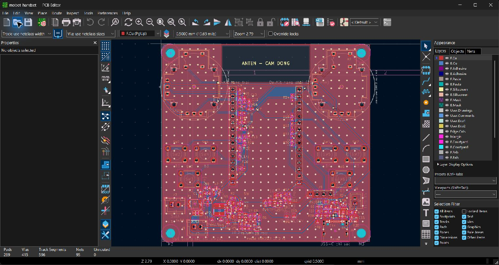
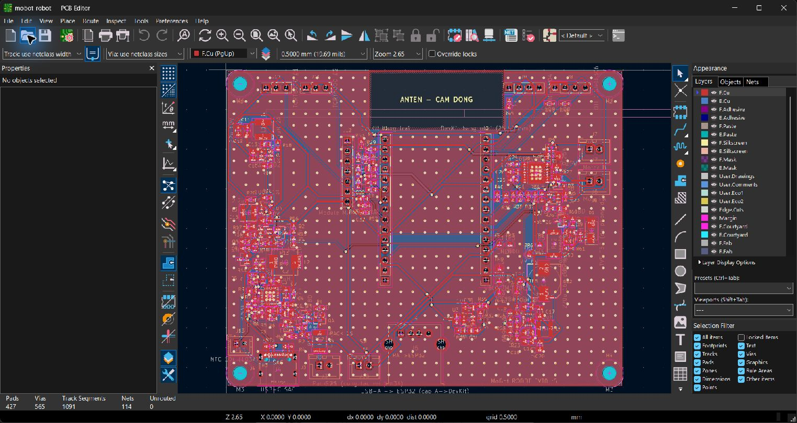
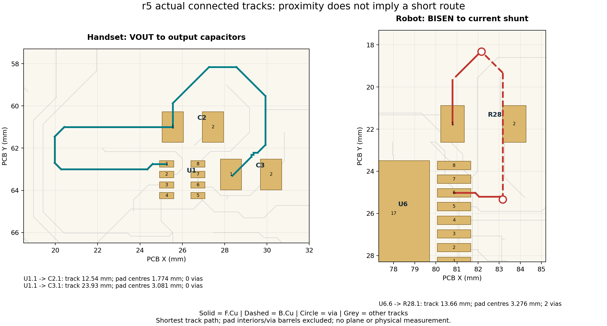

# Review độc lập PCB MoBot r5 — robot và tay cầm

Ngày: **16/11/2026**. Task: **MM-HW-R5-REVIEW-001**. Capability: KIT-05, KIT-06. Snapshot: hai bản **final** tại `docs/hardware/claude-support/2026-11-15-pcb-2layer-r5/kicad/`; không dùng stage A/A2 thay cho bản final.

**Kết luận: CHANGES_REQUESTED.** r5 đã sửa được nhiều điểm của r4, nhưng chưa đủ cơ sở chuyển sang chế tạo. Review xác nhận **1 High, 6 Medium, 1 Low**, cùng các mục OPEN-TBD mà tác giả đã khai báo. ERC/DRC/parity bằng cấu hình hiện tại đều đạt; điều này không chứng minh các vòng nguồn, interlock, footprint và quy trình hàn đã đạt yêu cầu điện/cơ/nhiệt.

Đây là kết luận review tài liệu/thiết kế. Không đổi trạng thái cổng, duyệt MPN/hash hay cấp lease. Không sửa schematic/PCB/project gốc, không xuất lại bộ fabrication. Kiểm tra điện trên mẫu, nhiệt, EMI, thử đảo cực, hồi năng lượng, USB backfeed và lắp vỏ: **NOT_RUN — không có mẫu/thiết bị đo**. Các nhận xét về dạng sóng và hàn là rủi ro cần kiểm, không phải hiện tượng đã đo.

## 1. Kết quả kiểm và snapshot

Đã mở bản sao của cả hai PCB bằng **KiCad PCB Editor 10.0.7**, quan sát và chụp trực tiếp. Bản sao giữ nguyên bytes PCB/project/schematic tại lúc mở; không lưu chỉnh sửa. Đồng thời đọc netlist XML xuất mới và phân tích track/pad/via từ file final bằng `pcbnew`.

| Kiểm tra trên nguồn final | Tay cầm | Robot |
|---|---:|---:|
| `sch erc --severity-all --exit-code-violations --format json` | exit 0; 0 violation | exit 0; 0 violation |
| `pcb drc --refill-zones --schematic-parity --severity-all --exit-code-violations --format json` | exit 0; 0 violation | exit 0; 0 violation |
| Unconnected / schematic parity | 0 / 0 | 0 / 0 |
| `sch export netlist --format kicadxml` | exit 0 | exit 0; có cảnh báo annotation |
| Footprint / pad / segment / via | 89 / 289 / 596 / 415 | 144 / 427 / 1091 / 565 |
| Kích thước outline danh định | 80 × 76 mm | 100 × 80 mm |

`--refill-zones` chỉ refill trong bộ nhớ; không dùng `--save-board`. Bounding box tính cả bề rộng nét Edge.Cuts lớn hơn kích thước danh định 0,1 mm; không coi đó là sai kích thước cơ khí.

Nguồn final và hồ sơ tính toán được ghim trong [snapshot-before.json](snapshot-before.json); kiểm cuối ở [snapshot-after.json](snapshot-after.json). Kết quả máy đọc và lệnh nằm trong [verification.json](verification.json). Các report gốc của lượt này ở [artifacts](artifacts/), không dùng lại kết quả DRC do tác giả gửi để thay cho chạy độc lập.

| File final | SHA-256 |
|---|---|
| handset/mobot-handset.kicad_pcb | `9ec9fecfbb70ed5de87cb2b02b6563bea883a822f7e405c898678684d86c8483` |
| handset/mobot-handset.kicad_sch | `bfb452b671a3e1ed1b1b9b2bc1d653e24424568b3e52f95a23c1340a90e8a604` |
| robot/mobot-robot.kicad_pcb | `1dca6bd6f646faff54b1aee246a85b822c76c47523913fb68e495169dca09071` |
| robot/mobot-robot.kicad_sch | `cd36da43987b8c5b62cd02ba9a78e596bc7f5eb28c82f8632353d257df03d579` |

### Ảnh trong KiCad

## 2. Findings cần xử lý

### R5-01 — High: tụ đặt sát nhưng đường VOUT đi vòng; chưa thể đóng F03 bằng khoảng cách tâm pad

**Tay cầm:** U1.1 VOUT → C2.1 có khoảng cách tâm pad **1,774 mm**, nhưng đường track nối được dài ít nhất **12,536 mm**. Đến C3.1: **3,081 mm** theo tâm pad, **23,925 mm** theo track. Đường rời U1 đi về x≈19,97 mm rồi vòng về tụ. Trên net này không có zone nguồn để thay đường vòng bằng một đường plane trực tiếp.

**Bằng chứng:** [PCB tay cầm:18099](../../hardware/claude-support/2026-11-15-pcb-2layer-r5/kicad/handset/mobot-handset.kicad_pcb#L18099) (U1), [PCB:4646](../../hardware/claude-support/2026-11-15-pcb-2layer-r5/kicad/handset/mobot-handset.kicad_pcb#L4646) (C2), các segment tại dòng 19474, 19498, 19523, 19619; [measure_f03.py:2](../../hardware/claude-support/2026-11-15-pcb-2layer-r5/kicad/tools/measure_f03.py#L2) ghi rõ phép đo cũ là tâm pad; [04-ket-qua-r5.md:19](../../hardware/claude-support/2026-11-15-pcb-2layer-r5/04-ket-qua-r5.md#L19) đóng F03 theo bố trí. Phép đo độc lập ở [route-measurements.json](artifacts/route-measurements.json), tái lập bằng [measure-routes.py](artifacts/measure-routes.py).

Đây là sai lệch giữa tiêu chí đóng finding và layout đồng thực tế. Datasheet [TPS631000, SLVSFH3C, §7.4.1, tr.18](https://www.ti.com/lit/ds/symlink/tps631000.pdf) yêu cầu đường tới tụ vào/ra ngắn, rộng và trực tiếp. Đường vòng tăng phần tử ký sinh; chưa đo ripple/ổn định/EMI nên không khẳng định đã có dao động.

Robot cũng cần review đường thật, không chỉ khoảng cách: U7.17 SW → L2.2 khoảng **11,434 mm**, U7.12 BTST → C7.1 khoảng **7,063 mm**. Các con số này tự chúng không phải giới hạn PASS/FAIL của hãng; cần xét cả đường hồi GND, diện tích vòng chuyển mạch và đoạn đi sát FB/TS/ADC.

**Đề xuất:** đi tay cell U1–L1–C1/C2/C3 và các vòng U7/U2/U8 trước khi route tín hiệu. Bảo vệ vị trí/đường công suất bằng rule cụ thể, tránh Freerouting làm vòng lại. Kiểm loop và đường hồi trên cả hai mặt, đo lại chiều dài track sau route; sau đó mới đóng F03 về layout. Không tự đổi giá trị linh kiện để bù một layout chưa sửa.

Hình trên dựng từ dữ liệu track/pad, không phải ảnh mô phỏng dòng điện. Nét liền F.Cu, nét đứt B.Cu, vòng tròn là via. Độ dài bỏ qua bên trong pad, thân via và dẫn qua plane; xem phương pháp ở §5.

### R5-02 — Medium: hồ sơ tính dòng sạc 2 A không khớp R6 thực tế

Robot có **R6 = 1,91 kΩ**, nối U7.10 ICHGSET xuống GND. Với hệ số điển hình 3810 Ω/A, dòng danh định là **1910/3810 ≈ 0,501 A**, termination ≈50 mA; không phải 2 A. Giá trị này chưa cộng dung sai/giới hạn điều chỉnh. Hiệu suất 93,4% ở trang đầu datasheet được nêu cho **1 A**, không phải 2 A. Vì vậy phép tính nhiệt 1,07 W và yêu cầu founder chốt “2 A” trong báo cáo không mô tả cấu hình hiện có. [BQ25886, SLUSD88A, tr.1, 8; §9.2.2.5 tr.27](https://www.ti.com/lit/ds/symlink/bq25886.pdf).

**Bằng chứng:** [04-ket-qua-r5.md:34](../../hardware/claude-support/2026-11-15-pcb-2layer-r5/04-ket-qua-r5.md#L34), dòng 36–39 và 110; [robot-netlist.xml:4266](artifacts/robot-netlist.xml#L4266) xác nhận net `/ICHG_C`; [PCB robot:2976](../../hardware/claude-support/2026-11-15-pcb-2layer-r5/kicad/robot/mobot-robot.kicad_pcb#L2976) là R6.

**Đề xuất:** sửa calculation sheet theo cấu hình 0,50 A và tính lại input power, tổn hao, thời gian sạc, termination, thermal/derating bằng điều kiện thực tế. R5=1,24 kΩ đặt input limit danh định khoảng 0,895 A; cần xét cả cấp tải hệ thống. Nếu muốn đổi dòng sạc thì đó là thay đổi thiết kế cần review riêng. Không mặc định thay R6 để biến sai tài liệu thành 2 A.

### R5-03 — Medium: khóa khi sạc chưa có cận bảo đảm ở VBUS thấp

Q5 2N7002 kéo `/EN_NODE` xuống GND; gate qua R11/R12=100k/100k từ VBUS. Tại VBUS=4,3 V, VGS danh định chỉ **2,15 V**. Datasheet 2N7002 được đối chiếu có VGS(th) tối đa **2,5 V** ở 250 µA/25°C; RDS(on) được bảo đảm ở 5/10 V. Không thể dùng ngưỡng điển hình/đường cong điển hình để bảo đảm Q5 kéo đủ mạnh ở 2,15 V trên mọi mẫu và nhiệt độ. [Diodes 2N7002, DS11303 Rev.40-2, tr.2](https://www.diodes.com/_files/datasheets/2N7002.pdf).

Tại VBAT_SW=8,442 V, để giữ EN_NODE ở 1,10 V, riêng R16=100k và R17=68k đòi dòng kéo khoảng **57,24 µA**, chưa tính các tải/dung sai khác. Mốc 1,10 V lấy từ cận EN falling của [TPS54302, SLVSDG6C, tr.5](https://www.ti.com/lit/ds/symlink/tps54302.pdf). Đây là phép kiểm yêu cầu sink, không phải chứng minh Q5 chắc chắn không đáp ứng: hiện **chưa có cận bảo đảm**.

**Bằng chứng:** [design_robot.py:96](../../hardware/claude-support/2026-11-15-pcb-2layer-r5/kicad/tools/design_robot.py#L96), dòng 99–104; [robot-netlist.xml:4106](artifacts/robot-netlist.xml#L4106) (`/CHG_SNS`), [4134](artifacts/robot-netlist.xml#L4134) (`/EN_NODE`). PCB Q5 tại dòng 9900, R11 21573, R12 19196, R16 8825, R17 18770.

**Đề xuất:** chọn mạch dò VBUS/phần tử kéo có đặc tính được bảo đảm tại mức gate xấu nhất, hoặc thiết kế lại tỷ lệ/cơ chế khóa sau khi xét đầy đủ điện áp định mức và startup. Lập bảng VBUS ramp/brownout, pin min/max, power off/on và hở/chập điện trở; xác minh cả EN nguồn và đường MOTOR_EN/nSLEEP. Chưa được kết luận “motor luôn tắt khi cắm sạc”.

### R5-04 — Medium: tiêu chí chọn QA/QB tại VGS −6 V không khớp bias thực tế

PLAN yêu cầu RDS(on) tại −6 V. Trong netlist r5, R1=R2=100k chia giữa source chung `/RP_S`, gate `/RP_G` và nhánh QD đang kéo xuống. Ở trạng thái QD dẫn mạnh, **|VGS| xấp xỉ nửa điện áp source**, khoảng 3–4,22 V với pack 6–8,442 V; khi startup còn có thể thấp hơn. Đó không phải điều kiện −6 V.

**Bằng chứng:** [PLAN.md:134](../../hardware/claude-support/2026-11-15-pcb-2layer-r5/PLAN.md#L134); [robot-netlist.xml:4398](artifacts/robot-netlist.xml#L4398), dòng 4404; PCB QA tại dòng 13868, QB 17602, R1 8345, R2 10272. QA/QB vẫn ghi `PFET >=20V TBD`, chưa phải một MPN được chọn.

**Đề xuất:** chốt điện áp pack và startup min, tính VGS có dung sai và ảnh hưởng QD/R57/R58, rồi chọn PFET có RDS(on) được bảo đảm ở bias đó. Kiểm SOA, body diode, dòng hai chiều, mất nguồn gate và tổn hao cả cặp. Đây là thiếu sót tiêu chí chọn linh kiện; chưa khẳng định PFET TBD cụ thể đã hỏng.

### R5-05 — Medium: BISEN đi vòng và qua hai via; đóng F08 theo khoảng cách là quá sớm

U6.6 → R28.1 chỉ cách tâm pad **3,276 mm** nhưng track nối được dài khoảng **13,664 mm**, qua **2 via**. Đường đi lên y≈18,32 mm rồi quay xuống shunt. Với giả thiết đồng 35 µm, riêng track của đường này khoảng **17,3 mΩ**, tương đương khoảng 2,8% của 0,62 Ω, chưa tính via, GND, nhiệt độ. Đây là ước lượng DC có giả thiết; không phải sai số đã đo hay cận thiết kế cuối.

**Bằng chứng:** [PCB robot:2502](../../hardware/claude-support/2026-11-15-pcb-2layer-r5/kicad/robot/mobot-robot.kicad_pcb#L2502) (R28), [14956](../../hardware/claude-support/2026-11-15-pcb-2layer-r5/kicad/robot/mobot-robot.kicad_pcb#L14956) (U6); segment/via dòng 38099, 38163, 38203, 38212; [04-ket-qua-r5.md:24](../../hardware/claude-support/2026-11-15-pcb-2layer-r5/04-ket-qua-r5.md#L24); [route-measurements.json](artifacts/route-measurements.json).

**Điểm đã làm đúng:** nhánh ADC dương lấy ở pad shunt: nhánh R30 xuất phát tại R28.1; nhánh R29 nối bên trong pad R27.1. Không có cơ sở kết luận ADC đang lấy từ đầu pin IC. Tuy nhiên đường R28.1 → R30.1 dài khoảng **54,36 mm**; cần đánh giá nhiễu PWM và đường tham chiếu GND, không quy toàn bộ chiều dài ADC thành sụt áp dòng motor.

**Đề xuất:** đi tay U6–shunt–GND công suất, ngắn và rộng; tách nhánh lấy mẫu ở pad shunt và đường tham chiếu về ADC/AGND theo ngân sách nhiễu. Kiểm dòng trip min/max với dung sai Rshunt và IC, sau đó kiểm bằng tải/motor đúng SKU. Giữ F08 mở về routing/độ chính xác cho tới khi có phân tích này.

### R5-06 — Medium: có via nhiệt nhưng chưa chốt cách hàn vùng EP

U7 có 9 via drill **0,30 mm**, pitch **0,90 mm** trong EP **2,45 × 2,45 mm**. Có 9 ô F.Paste **0,66 × 0,66 mm**, pitch 0,82 mm; vị trí drill nằm trong các ô paste. Pad EP mở F.Mask toàn vùng. Cấu hình có tenting nhưng không có filling/plugging/capping; riêng cờ tenting không chứng minh miệng lỗ bên trong một cửa sổ mask EP được bịt kín.

**Bằng chứng:** [PCB robot:11297](../../hardware/claude-support/2026-11-15-pcb-2layer-r5/kicad/robot/mobot-robot.kicad_pcb#L11297) (paste), [11552](../../hardware/claude-support/2026-11-15-pcb-2layer-r5/kicad/robot/mobot-robot.kicad_pcb#L11552) (EP), dòng 31403 (via), dòng 39–52 (quy trình via). U6 có 12 via trong copper EP 3,4 × 5 mm, nhưng vùng mask chỉ 2,46 × 2,31 mm: không được gọi cả 12 là via lộ miệng; **6** vị trí nằm trong cửa sổ mask đó (x=77/78/79 mm, y=25,5/26,5 mm).

**Đề xuất:** xác nhận phương án với đơn vị lắp ráp: via fill/cap hoặc cách tent từ mặt thích hợp, stencil/paste coverage, reflow và tiêu chí void/X-ray. Đối chiếu [TI QFN/SON PCB Attachment, SLUA271C, §3.4 tr.7–8](https://www.ti.com/lit/an/slua271c/slua271c.pdf). Không tự khẳng định sẽ mất thiếc/hỏng hàn, cũng không đóng DFM chỉ vì số via đã đủ trong hình học.

### R5-07 — Medium: mô tả “không ignore” sai; courtyard joystick chưa được kiểm

[04-ket-qua-r5.md:98](../../hardware/claude-support/2026-11-15-pcb-2layer-r5/04-ket-qua-r5.md#L98) nói không đặt severity ignore. Cả hai project thực tế có 5 rule `ignore`: `missing_courtyard`, `track_not_centered_on_via`, `tuning_profile_track_geometries`, `footprint_filters_mismatch`, `footprint_type_mismatch`. ERC cũng ghi 4 ignored checks trong report. `drc_exclusions` rỗng là đúng, nhưng khác với không bỏ qua rule. Không suy ra tác giả cố tình che lỗi; một số mức có thể là mặc định KiCad.

**Bằng chứng:** [robot.kicad_pro:73](../../hardware/claude-support/2026-11-15-pcb-2layer-r5/kicad/robot/mobot-robot.kicad_pro#L73), dòng 91, 94, 108, 130, 135; tay cầm có cùng nhóm mức severity. Report DRC/ERC xuất độc lập lưu đủ `ignored_checks`.

Chẩn đoán trên **bản sao có đủ fp-lib-table và thư viện custom**: chuyển các rule bị ignore thành warning, giữ nguồn gốc bất biến. Tay cầm **exit 5, 4 warnings**: 2 `track_not_centered_on_via`, 2 `missing_courtyard` tại **J6/J7**. Robot **exit 5, 2 warnings**: `track_not_centered_on_via`. Không có short/unconnected/parity phát sinh. Đây không phải kết quả DRC của project gốc; không được báo “DRC gốc đỏ”.

**Đề xuất:** công khai danh sách mức ignore và lý do, xử lý hoặc disposition từng cảnh báo. Thêm courtyard theo đúng joystick SKU/envelope trước khi dựa vào kiểm va chạm. Track-via lệch tâm còn nối điện và qua clearance hiện tại, không tự quy là mạch đứt. Hai report chẩn đoán: [handset-strict-drc.json](artifacts/handset-strict-drc.json), [robot-strict-drc.json](artifacts/robot-strict-drc.json).

### R5-08 — Low: BOM/reference và silkscreen chưa đồng bộ để bàn giao lắp ráp

[robot/bom.csv:41](../../hardware/claude-support/2026-11-15-pcb-2layer-r5/kicad/robot/bom.csv#L41) còn `Q5,QD?`, [dòng 43](../../hardware/claude-support/2026-11-15-pcb-2layer-r5/kicad/robot/bom.csv#L43) còn `QA?,QB?`, trong khi PCB/pos dùng QA/QB/QD. KiCad xuất XML exit 0 nhưng có cảnh báo annotation; cần kiểm nguyên nhân, không mặc định suy ra mọi net bị sai. DRC parity 0 không xác nhận một CSV BOM ngoài project đồng bộ.

Một số reference chỉ còn ở F.Fab hoặc bị ẩn, không có nhãn Silk dùng được: robot U7/U8/U1/QD/R10/R30/R42/R44/R46/R47/R50/C27; tay cầm J6/J7/R33/R36. Trong chế tạo/lắp tay/debug, Fab không thay được nhãn nhìn thấy trên bo.

**Đề xuất:** annotate hợp lệ và đồng bộ sch→PCB→BOM→pos; giữ mapping trước/sau nếu đổi reference. Bố trí lại nhãn chức năng, cực pin/motor/USB, pin 1, testpoint và DNP. Nếu bo quá chật, giữ ít nhất IC nguồn, connector, testpoint và linh kiện cấu hình quan trọng; xuất assembly drawing cho phần không thể đặt Silk. Không chỉ xóa nhãn để làm DRC sạch.

## 3. Những chỗ đã sửa đúng và các blocker đã biết

| Finding cũ | Đánh giá trên bytes r5 | Cần làm tiếp |
|---|---|---|
| F01: chống ngược pack / charger BAT | **Sửa đúng topology tĩnh:** U7 BAT13/14 nằm `/VBAT_PROT`, sau QA/QB đối đầu; không còn nối thẳng VPK. Đây là cải thiện thật | Chọn MPN/bias theo R5-04; PCM wakeup, đảo cực có USB, startup/timing còn OPEN |
| F02: motor hồi năng lượng | **OPEN như tác giả khai báo.** Có U9/Q6/R59–R62 nhưng giá trị/MPN TBD, D1 DNP | Chốt motor/pack/PCM, năng lượng, trip/độ trễ/SOA/công suất điện trở và case pin đầy/PCM mở/nguồn tắt |
| F03: vòng nguồn | Tâm pad tốt hơn r4, nhưng **chưa đóng routing** | R5-01; xét đường đi và hồi dòng thay cho chỉ khoảng cách |
| F04: nhiệt | Via nhiệt và vùng dành cho EP đã cải thiện | R5-02/R5-06; tính nhiệt đúng và chốt quy trình hàn; thử nhiệt NOT_RUN |
| F05: cấp 3V3 cho DevKit tay cầm | **OPEN đúng như hồ sơ.** TPS2553 OUT cấp 3V3 vào J2.1; chưa có SKU/regulator/USB-backfeed proof | Giữ H-A theo quyết định hiện hành; lấy schematic đúng DevKit, bảng mọi trạng thái nguồn/USB, absolute max và reverse current |
| F06: PS/SYNC | R24=10k lên VBAT_SW, R25=0 Ω DNP, khai loại trừ: **sửa đúng lựa chọn strap** | Thể hiện mutual exclusion trong assembly/BOM; không đồng nghĩa đã xử lý F02 |
| F07: CC USB-C host | Đã bỏ cơ chế CC cũ, J5 USB-A hiện diện; **sửa đúng hướng đã chọn** | Suffix/MPN connector và cơ khí vẫn TBD |
| F08: sense | Điểm lấy mẫu ADC dương ở pad shunt đúng, placement gần hơn | Routing ISEN/GND/ADC còn R5-05 |
| F09: MPN/footprint/cơ khí | **OPEN, chặn fabrication**, không phải finding mới phát hiện | Đối chiếu exact part/revision và nhà lắp ráp |
| F10: electrical types / presentation | Có electrical types và PWR_FLAG; ERC 0 thật theo rule hiện tại | Schematic còn dạng ký hiệu rời nối nhãn; cần sơ đồ theo khối, vòng nguồn và state table để review thuận lợi |

Về F02: [TPS63070 SLVSC58B, §8.4.1 tr.10](https://www.ti.com/lit/ds/symlink/tps63070.pdf) có mô tả dòng ngược từ output về input. Cần sửa câu cho rằng hãng không có thông tin chiều ngược. Tuy nhiên đó **không chứng minh** năng lượng motor được hấp thụ an toàn trong mode PFM hiện chọn, khi EN tắt, pin đầy hoặc PCM ngắt. Không đóng clamp chỉ nhờ một câu về khả năng dòng ngược.

Các mục cần giữ OPEN riêng:

- **Land pattern:** L1 tay cầm XEL4030-102ME và L4 robot XFL4020-152ME đang dùng footprint Changjiang; pad thực tế 1,1 × 3,7 mm, cách tâm 3,0 mm. Chưa đối chiếu được hình recommended land pattern hãng; không kết luận kích thước đó chắc chắn sai. PDF hãng xem được văn bản qua web nhưng tải local bị chặn Cloudflare; không có hash PDF Coilcraft và không vượt cơ chế chặn. [XEL4030](https://www.coilcraft.com/getmedia/8245f050-f190-4295-8c41-7c03d662ee3d/xel4030.pdf), [XFL4020](https://www.coilcraft.com/getmedia/50632d43-da1b-4cdb-8ab4-3029cab51df3/xfl4020.pdf).
- **Joystick/anten:** F.Fab của joystick vươn ra mép board theo trục X; vùng cấm đồng anten không cấm placement footprint. Chưa có exact joystick/knob/vỏ/DevKit pose để chứng minh va chạm hoặc RF đạt. Không gọi đây là va chạm vật lý đã xác nhận từ một F.Fab tham chiếu.
- **MLCC/inductor/bulk:** chưa có bảng C hiệu dụng sau DC bias, ESR, dung sai, Irms/Isat, DCR/nhiệt và tải min/max cho từng rail. Linh kiện TBD không thể được duyệt từ tên family/footprint.
- **Dòng motor:** DRV8833 PWP pin map kiểm được: nSLEEP1, nFAULT8, AISEN3, BISEN6, VCP11, VM12, VINT14. Shunt 0,62 Ω cho dải trip khoảng 0,256–0,391 A khi xét cận IC và dung sai 1%; chưa chứng minh phù hợp dòng khởi động/stall của N20 chưa chốt. [DRV8833 SLVSAR1E, tr.3–6, §7.3.3](https://www.ti.com/lit/ds/symlink/drv8833.pdf).

## 4. Ngân sách đường nguồn: phải tính từ đường thật

Các cặp dưới lấy từ [route-measurements.json](artifacts/route-measurements.json). Điện trở chỉ là **track ở 35 µm/20°C giả định**, chưa cộng via/pad/connector/đường GND/nhiệt độ. Chưa có copper weight và dòng vận hành chốt thì không dùng bảng này làm PASS nhiệt.

| Robot — đường | Track nối được (mm) | Via | R track giả định (xấp xỉ) |
|---|---:|---:|---:|
| J4.A4 USB → U7.23 | 34,32 | 0 | 44 mΩ |
| J15.2 → U2.3 VIN | 103,17 | 3 | 127 mΩ |
| U8.7 → U6.12 VM | 61,40 | 2 | 79 mΩ |
| U6.5 → J7.1 MB2 | 13,03 | 0 | 32 mΩ |

Đoạn MB2 khoảng 0,2 mm không tự động “không chịu được motor”: ở 0,391 A, 32 mΩ tương đương khoảng 12,5 mV và 4,9 mW trên track giả định. Vấn đề cần giải quyết là budget cả đường, transient, nhiệt và khả năng chế tạo, không phải phán đoán từ độ rộng đơn lẻ. T4 chưa có zone rail nguồn được tác giả công khai tại 04-ket-qua-r5.md:72–74; không tự coi việc thiếu zone đồng nghĩa lỗi điện nếu track đã được chứng minh đủ.

## 5. Phương pháp, độ bao phủ và giới hạn

**Hai hướng review độc lập:** EF kiểm net/pin map/giá trị/khóa nguồn và phép tính; HK kiểm bố trí/track/thermal-via/footprint/cơ khí. Cả hai chỉ đọc, không gọi Claude hoặc sửa thiết kế. Lead đối chiếu lại các finding bằng nguồn final, datasheet và script độc lập trước khi ghi báo cáo.

Đã đọc: PLAN, CHECKPOINT-2, 04-ket-qua-r5; hai schematic/PCB/project final; BOM/pos, symbol và footprint tables/custom footprints liên quan; design_handset.py, design_robot.py, mobot_build.py, measure_f03.py và các script sửa routing/thermal/silk được dẫn trong hồ sơ; netlist XML xuất mới; các datasheet ở [sources.md](sources.md). Những file cốt lõi có hash trước/sau; thư viện footprint bổ sung có hash ở manifest cuối. Việc đọc PCB/schematic bằng parser không tương đương kiểm từng thông số của mọi linh kiện.

Chưa kiểm toàn bộ: từng MPN/suffix trong BOM, mọi dung sai worst-case, firmware/pin policy của nhánh khác, tính đúng của toàn bộ Gerber/drill/BOM sản xuất, quy trình fab/lắp ráp, exact module/joystick/motor/pack, fit 3D vật lý, tuổi thọ, chứng nhận hoặc thử nghiệm điện/nhiệt/EMI. Không kế thừa approval từ các cấu hình lịch sử r11/r12/r13 để duyệt tự động r5 này.

**Đo đường:** Dijkstra trên segment endpoints và via F/B cùng net; nối các điểm trong cùng pad bằng cạnh 0; không cộng chiều đi bên trong pad/thân via, không giải trường điện từ và không tính plane. Số đo là chiều dài track nối được theo mô hình này, thường thấp hơn phép đo đi qua tâm pad. Vì vậy không trộn các số này với khoảng cách Euclidean hoặc số pad-centre-to-pad-centre của reviewer khác. Các net nguồn/sense đang bàn không có zone nguồn song song; đường hồi GND cần phân tích riêng.

**Kiểm chẩn đoán:** chỉ đổi mức ignore→warning trong project sao chép tại `.tmp/agent-checks/MM-HW-R5-REVIEW-001/strict/`, kèm thư viện. Lần thử trước khi chép đủ thư viện tạo thêm warning library path, đã loại khỏi kết quả cuối bằng cách sửa môi trường bản sao rồi chạy lại; không quy các warning đó cho thiết kế gốc. Không nâng kết quả này thành “toàn bộ ERC strict đã chạy”: strict ở đây chỉ là DRC.

**Thất bại công cụ đã xử lý:** lần đầu extractor gọi API width của via không phù hợp gây assert; dừng tiến trình của lượt kiểm và sửa script đọc-only. Lỗi chuyển kiểu tên library cũng được sửa trong script artifact. Kết quả dùng cho review là JSON tạo lại thành công; không có thay đổi PCB. Không cài thêm dependency. Test/build ứng dụng: **NOT_RUN — review PCB, không đổi phần mềm ứng dụng**.

## 6. Thứ tự cải thiện đề nghị cho vòng tiếp theo

1. **Sửa tính nhất quán hồ sơ:** dòng sạc, điều kiện hiệu suất, ignored rules, BOM/reference. Lập bảng component/value/MPN/footprint/source/dung sai/giới hạn; không đổi điện trở để che sai tài liệu.
2. **Khép thiết kế điện:** bảo đảm interlock VBUS thấp, bias QA/QB, PCM, USB-backfeed và regen clamp với đầy đủ trạng thái lỗi. Các quyết định sản phẩm/MPN vẫn cần chủ dự án duyệt riêng.
3. **Route lại các đường quan trọng bằng tay:** cell converter, switching/BOOT/FB, ISEN/GND/ADC, rồi mới tín hiệu phụ. Giữ footprint/pin/net ổn định, xuất bảng chiều dài/độ rộng/via và budget nguồn mới.
4. **Chốt cơ khí và DFM:** exact joystick/DevKit/connector/inductor; courtyard, envelope anten/vỏ/cáp; stencil/via process, testpoint và nhãn lắp ráp.
5. **Review snapshot mới:** ERC/DRC/parity; kiểm các rules đã disposition, BOM/pos/assembly/fab consistency; review độc lập theo hash mới. Physical verification giữ NOT_RUN cho tới khi có mẫu. Không gọi “ready for fabrication” chỉ từ DRC 0.

Những bước trên là đề xuất khắc phục sau review, chưa phải quyền sửa hoặc chế tạo hai mạch. Task review này hoàn tất khi báo cáo/evidence/snapshot được ghi; trạng thái thiết kế vẫn **CHANGES_REQUESTED**.
