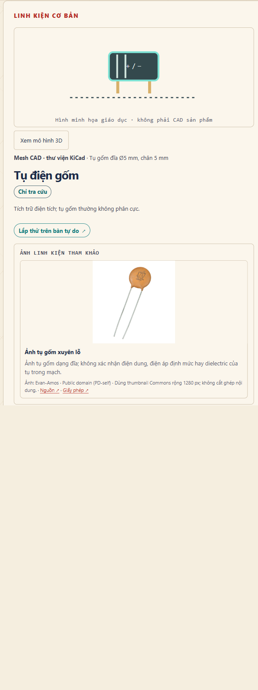
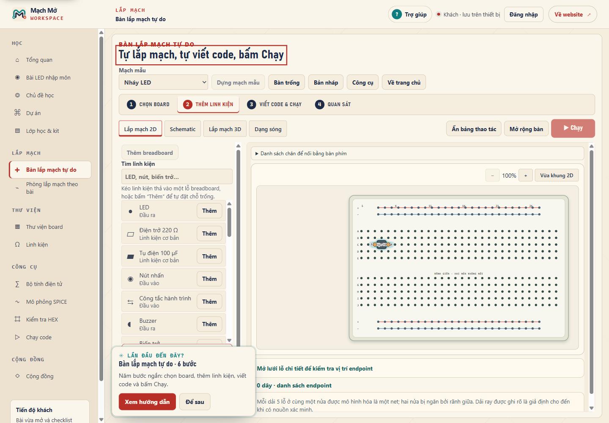
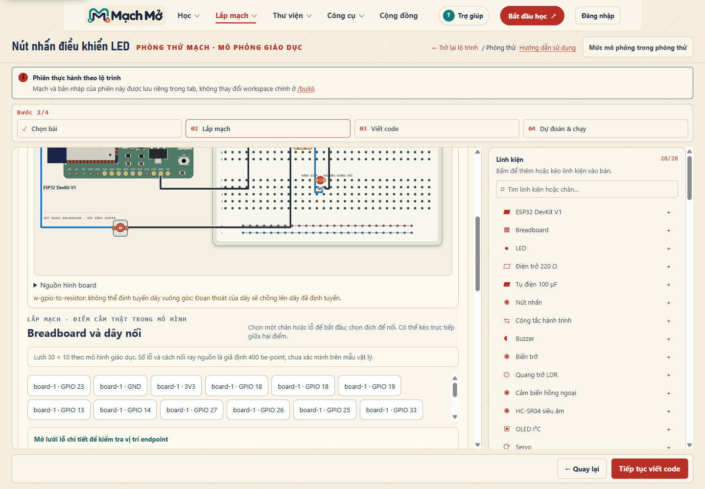
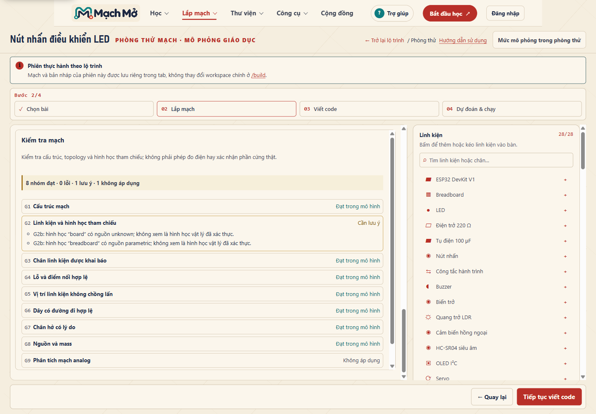
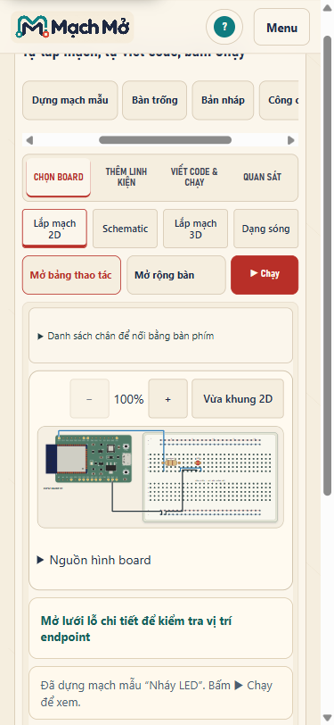

# Mạch Mở — audit người dùng thật và model

Task: `MM-SW-USER-AUDIT-20261116` · Kiểm ngày 16–17/11/2026 (Asia/Bangkok) · **CHANGES_REQUESTED**.

**Website có nhiều luồng hoạt động, nhưng chưa hoàn thiện cho người mới tự lắp mạch.** Có **16 phát hiện: 2 P1, 10 P2, 4 P3**, cùng các khoảng trống được tách riêng ở dưới. Ưu tiên sửa sai identity linh kiện, dây bị thiếu nhưng kiểm tra vẫn xanh, rồi thao tác kéo dây và thông tin board. Đây là báo cáo audit; lượt này không sửa source, model, assertion hay dữ liệu phần cứng.

Mở [gallery 407 ảnh](gallery.html), [ma trận bao phủ](coverage.md), [danh sách có cấu trúc](findings.json), [kết quả kiểm chứng](verification.json) và [chỉ mục file/ảnh có hash](artifact-index.json). Gallery có tìm kiếm tên, lọc nhóm và mở ảnh nguyên bản. Ảnh bao gồm cả phần hoạt động đúng; ảnh chụp một màn không tự chứng minh mọi thao tác trong màn đó đã đạt.

## 1. Phương pháp và giới hạn

- Trình duyệt Chromium/Chrome **157.0.8103.52** trên Windows; desktop **1440×1000**, mobile giả lập **375×812**. Chạy bản production tại `http://127.0.0.1:5320/`, bundle `index-B5Lz7MFp.js`. Không phải thử trên điện thoại vật lý hay trên nhiều browser.
- Bắt đầu bằng route/UI thật, thao tác click, bàn phím, pointer drag, nhập giá trị đúng/sai, tải file, tải model; sau đó đọc source để xác nhận nguyên nhân. Không gọi trực tiếp hàm nội bộ để thay cho thao tác UI. Kiểm checksum chỉ là bằng chứng phụ về identity asset.
- Mở 28 hồ sơ board, 59 thẻ linh kiện; render 16 board/17 scene và 45 model linh kiện; kiểm 70 asset duy nhất (62 GLB + 8 ảnh topview) cùng nguồn GLB của topview. Tất cả checksum trong phạm vi này khớp. **Không kết luận mọi hình học/chân/điện áp đều đúng vật lý.**
- Kiểm 11 bài theo bốn nhánh breadboard/schematic/3D/run, tám board freestyle, bốn mẫu freestyle, các công cụ, lưu/nhập/xuất, cộng đồng cục bộ, Mở Bot, bảy tour, theme và mobile. [Coverage](coverage.md) nêu chính xác các giới hạn; không thử mọi tổ hợp board × bài × linh kiện × code.
- Khi thao tác mở project có thể thay workspace, đã hủy ở context ban đầu và chuyển sang BrowserContext mới, xác nhận rỗng localStorage/cookie. Chỉ mở/đổi tên/xóa dữ liệu AUDIT do lượt test tạo trong context riêng. Không xóa bản nháp người dùng. Context thử riêng đã được đóng; một bài cộng đồng AUDIT cục bộ và project AUDIT tạo ở giai đoạn đầu có thể còn trong context test ban đầu, không phải bài online.
- Không gọi Claude, không Web Serial/USB thật, không flash/cấp nguồn, không đăng bài online, không gửi email/form ra ngoài, không cài dependency. Mẫu XML/IPC dùng fixture phần mềm, không phải thiết kế PCB được chấp thuận.

## 2. Kết quả theo nhóm tính năng

| Nhóm | Đã thao tác và quan sát | Kết quả / điều cần lưu ý |
|---|---|---|
| Trang chủ, điều hướng, không gian học | Mở route, bàn trống, chọn board, chuyển view, menu/Trợ giúp | Bàn mới không tự có ESP32/mạch/code. Có nhiều tầng điều hướng; mobile vẫn dài. |
| Bài học | 11 bài × breadboard/schematic/3D/run; bài LED tham chiếu năm tab; chọn board | Có trace/hoạt cảnh và nhãn giới hạn; F02, F08, F11. Không thử hết từng nhánh code hay mọi target. |
| Freestyle | 8 board; 2D/schematic/3D/wave; 4 mẫu; chạy/dừng; chọn/xóa dây; click-click; drag; bàn phím; draft/tải JSON | ESP32, S3, Arduino, Pico đổi đúng hình/nhãn theo lựa chọn. Kéo chậm lỗi F03. STM32 thiếu anchor, xem G01. |
| 2D / schematic / 3D | Board topview từ asset; các scene tải; net/dây/symbol và inspector | Không còn mặc định chỉ ESP32 ở các board đã thử. Schematic đã dùng ký hiệu mạch, vẫn cần kiểm đủ dây/nhãn. Viewer không chứng minh điện học. |
| Board và linh kiện | 28 profile; 59 card; 16 board viewer/17 scene; 45 component GLB | Không có asset thiếu trong các lần tải. Sai mapping tụ, copy nguồn/pin và alias: F01, F04–F09, F13. |
| Copper PCB | ESP32, Uno, Nano, Mega; F.Cu/B.Cu; net GND, vùng đồng, fit | Không tái hiện vùng đen thừa khổng lồ trong snapshot này. Mega wrap ~374×247, SVG ~373×196, phần còn lại là caption. Vẫn chật vì inspector/nested scroll. |
| Chạy code sketch | 5 ví dụ, cả 8 target, input nút/PWM và lỗi cú pháp | Các mẫu và lỗi dòng hoạt động. Đây là interpreter subset, không phải firmware cho mọi MCU. |
| Biên dịch / firmware | Uno qua arduino-cli + avr8js trên web; 2 mẫu HEX AVR, 1 mẫu Pico, xác nhận target, CSV và file hỏng | Uno web có Serial/trace; Pico GP25 có 6 chuyển mức ở 1000 ms, khoảng 2,08 Hz/50%. Chưa xác nhận Nano/Mega compile hoàn tất trên web; xem kiểm tra môi trường ở mục 6. |
| SPICE | Divider DC, RC transient, LED .op, AC, DC sweep; CSV; input cấm; KiCad XML + IPC | Divider ra 2,5 V/2,5 mA; LED ~10,81 mA. CAD đối chiếu 6/6 chân; netlist được apply và solver trả 5 V/2,5 V. Lệnh .include bị chặn. Không mô phỏng MCU/copper/parasitic. |
| Bộ tính | LED, ADC divider, I²C pull-up, RC; input 0/âm/rỗng; handoff SPICE | Các ví dụ và validation hoạt động. Không sweep toàn bộ miền số hay xác nhận linh kiện vật lý. |
| Dự án / draft | Lưu, JSON export/import, duplicate, rename/tags/delete bản thử, mở lại project thử, file hỏng, draft download | Luồng cục bộ hoạt động trong phạm vi đã thử. Chưa kiểm cưỡng bức quota, crash, eviction, lịch sử restore mọi phiên bản. |
| Lớp học / BOM | 8 trạm, số 0, JSON/share/CSV, import lại, JSON hỏng | Xuất/nhập chạy; F15. Unit tests v1/v2/10 kΩ đều qua, nhưng UI override/legacy preview chưa được đi hết. |
| Cộng đồng | Viết Markdown; từ chối 6 file; đăng local với ảnh + .ino; reload; tải .ino; comment/report local; filter/search | Local hoạt động. Online/auth/upload server chưa thể nghiệm thu vì chưa cấu hình Supabase (G02). |
| Mở Bot / mascot | 3D, 10 câu về board/linh kiện/công cụ; nguồn trả lời; reduced motion | FAQ cục bộ hoạt động, reduced motion vô hiệu chuyển động. F12; câu MQTT chưa có best match; không phải AI hội thoại tổng quát. |
| Góp ý / developer | Form rỗng, điền, xem trước, tải Markdown | File chưa gửi tải được; tên/email/Facebook/portfolio đúng phạm vi công khai. Clipboard không thử. Chưa có kênh gửi tự động. |
| Robot | Tiến/lùi/trái/phải/dừng/vật cản, 3 bước tự đánh dấu | Hoạt cảnh khái niệm chạy; title sai F14. Không điều khiển robot thật. |
| Tour, theme, accessibility | Đi hết 7 tour/34 bước; Light/Dark/System; bàn phím nối hai pin; axe 6 màn | Không lỗi axe tự động trong sáu mẫu. Không tương đương chứng nhận WCAG hay thử screen reader đầy đủ. |
| Login/admin/privacy | Mở route, đọc thông báo/capability | Không cấu hình backend: provider/admin không hoạt động online. Không thử tài khoản thật hay bỏ qua quyền. |

Ảnh tổng quan: [trang chủ](screenshots/001-home-desktop.png), [bài học](screenshots/lesson-button-led-breadboard.png), [freestyle](screenshots/freestyle-sample-pot-dimmer.png), [SPICE](screenshots/spice-cad-import-solver.png), [mobile](screenshots/mobile-canvas-after-hide-panel.png).

## 3. Danh sách vấn đề và cách xử lý

P1 = sai nội dung/độ tin cậy của luồng học, cần xử lý trước khi nghiệm thu trải nghiệm; P2 = ảnh hưởng thao tác hoặc thiếu chính xác đáng kể; P3 = metadata/feedback mức thấp. Đây là mức ưu tiên audit, không phải thống kê sự cố sản xuất.

| ID | Mức | Vấn đề |
|---|---|---|
| [F01](#f01) | P1 | Sai loại linh kiện: tụ gốm mở thành tụ hóa |
| [F02](#f02) | P1 | Breadboard bỏ một dây nhưng G6 vẫn đạt |
| [F03](#f03) | P2 | Kéo dây chậm không tạo kết nối |
| [F04](#f04) | P2 | Arduino hứa bấm chân trên 3D nhưng tắt pin picking |
| [F05](#f05) | P2 | Thông tin chức năng chân Mega thiếu PWM/UART |
| [F06](#f06) | P2 | Inspector ESP32-S3 ghi nhầm nguồn Seeed/ST |
| [F07](#f07) | P3 | Nhãn STM32 nói chưa có viewer dù đã vẽ được |
| [F08](#f08) | P2 | Đổi board làm rời trải nghiệm bài LED năm tab |
| [F09](#f09) | P2 | Một số board/linh kiện không có lối sang freestyle vì alias ID |
| [F10](#f10) | P2 | Mạch mobile quá nhỏ, bài học còn nhiều cuộn lồng nhau |
| [F11](#f11) | P2 | Thông báo provider/schema cũ trái với trace V2 đang chạy |
| [F12](#f12) | P2 | Mở Bot chặn nhầm câu hỏi khả năng SPICE |
| [F13](#f13) | P3 | Provenance Arduino giữ hash model cũ |
| [F14](#f14) | P3 | Trang robot có document title Không tìm thấy trang |
| [F15](#f15) | P3 | Số trạm 0 âm thầm trở về 8 |
| [F16](#f16) | P2 | Mẫu motor còn thiếu phạm vi nguồn và bảo vệ để học lắp thật |

### F01 · P1 · Sai loại linh kiện: tụ gốm mở thành tụ hóa

- **Luồng:** `/components → thẻ Tụ gốm → mở bàn tự do`.
- **Thực tế:** Thẻ tụ gốm không cực, chưa chốt điện dung cụ thể; link part=capacitor lại chèn tụ phân cực 100 µF. Tag tìm kiếm `100nF` không phải trị số đã xác nhận của linh kiện.
- **Mong đợi:** Giữ đúng identity, trị số và cực tính từ thư viện tới bàn lắp.
- **Tái hiện:** Mở thư viện linh kiện; chọn tụ gốm; mở liên kết thực hành; đọc linh kiện được thêm.
- **Nguồn:** `src/pages/ComponentsPage.tsx:65`; `src/data/components.ts:48`; `src/data/componentRegistry.ts:60`; `src/data/componentModels.ts:40`.
- **Bằng chứng:** [issue-capacitor-catalog.png](screenshots/issue-capacitor-catalog.png) · [issue-capacitor-freestyle.png](screenshots/issue-capacitor-freestyle.png); [confirmed-integration-cases.json](evidence/confirmed-integration-cases.json).
- **Hướng sửa và nghiệm thu:** Giải liên kết bằng catalogId có mapping tường minh; chặn link khi chưa có part tương ứng. Thêm kiểm tra identity/cực tính xuyên màn hình.

### F02 · P1 · Breadboard bỏ một dây nhưng G6 vẫn đạt

- **Luồng:** `/build?lesson=button-led&board=esp32-devkit`.
- **Thực tế:** Danh sách có 6 dây; SVG chỉ có 5 .diagram-wire; w-gpio-to-resistor lỗi định tuyến. G6 vẫn ghi Dây có đường đi hợp lệ / Đạt trong mô hình.
- **Mong đợi:** Trạng thái kiểm tra phải phản ánh đúng projection mà người học đang nhìn; không được báo hoàn chỉnh khi thiếu dây.
- **Tái hiện:** Mở bài nút nhấn trên ESP32; xem Breadboard, diagnostic, danh sách 6 dây rồi phần G6.
- **Nguồn:** `src/pages/CircuitBuilderPage.tsx:225`; `src/lib/circuitGates.ts:85`; `src/lib/breadboardDiagram.ts:208`; `src/lib/breadboardDiagram.ts:225`; `src/components/builder/BreadboardDiagram.tsx:185`.
- **Bằng chứng:** [issue-button-route-diagnostic.png](screenshots/issue-button-route-diagnostic.png) · [issue-button-g6.png](screenshots/issue-button-g6.png); [button-route-g6-recheck.json](evidence/button-route-g6-recheck.json).
- **Hướng sửa và nghiệm thu:** Dùng chung đầu vào/điều kiện router giữa checker và renderer, hoặc kiểm riêng đủ dây theo view. Không bỏ dây im lặng; thêm ca preset button-led so IDs nguồn với dây được vẽ.

### F03 · P2 · Kéo dây chậm không tạo kết nối

- **Luồng:** `/build/freestyle`.
- **Thực tế:** Cùng bb1:3a → bb1:4a: 20 bước chuột nhỏ giữ 4 dây; 1 bước lớn tạo dây thứ 5. Hit-test đích đúng trong cả hai.
- **Mong đợi:** Kết quả nối dây không phụ thuộc tốc độ chuột.
- **Tái hiện:** Phiên sạch, ESP32 + mẫu blink; drag hai lỗ trên bằng nhiều bước nhỏ; so với drag một bước. Click-click vẫn hoạt động.
- **Nguồn:** `src/components/builder/BreadboardEditor.tsx:169`; `src/components/builder/BreadboardEditor.tsx:173`; `src/components/builder/BreadboardEditor.tsx:181`.
- **Bằng chứng:** [fresh-drag-20.png](screenshots/fresh-drag-20.png) · [fresh-drag-1.png](screenshots/fresh-drag-1.png); [wire-drag-fresh-comparison.json](evidence/wire-drag-fresh-comparison.json).
- **Hướng sửa và nghiệm thu:** Tính threshold từ startX/startY cho cả hai mode, không từ event trước. Test drag nhiều bước nhỏ, touch/cancel, click-click và pointer capture.

### F04 · P2 · Arduino hứa bấm chân trên 3D nhưng tắt pin picking

- **Luồng:** `/boards?board=arduino-uno-r3; Nano; Mega`.
- **Thực tế:** UI hướng dẫn bấm chân trên model; source pinPicking:false nên getPinAt luôn trả null. Chọn từ danh sách vẫn được.
- **Mong đợi:** Lời hướng dẫn và affordance phải khớp khả năng thật của model.
- **Tái hiện:** Mở ba board Arduino, đọc hướng dẫn; đối chiếu pin picking và anchor. Đây là lỗi hợp đồng UI/source; chưa đo vật lý mọi pad.
- **Nguồn:** `src/components/board/BoardPinoutExplorer.tsx:12`; `src/pages/BoardCatalogPage.tsx:90`; `src/data/arduinoBoardModels.ts:61`; `src/data/arduinoBoardModels.ts:74`; `src/components/board/BoardScene.ts:213`.
- **Bằng chứng:** [board-pin-arduino-uno-r3-D13.png](screenshots/board-pin-arduino-uno-r3-D13.png) · [board-pin-arduino-mega-2560-r3-D3.png](screenshots/board-pin-arduino-mega-2560-r3-D3.png); [board-interactions.json](evidence/board-interactions.json).
- **Hướng sửa và nghiệm thu:** Truyền capability coordinatePicking tường minh; chỉ hứa thao tác khi có anchor đủ nguồn. Nếu chưa có, hướng dẫn chọn danh sách.

### F05 · P2 · Thông tin chức năng chân Mega thiếu PWM/UART

- **Luồng:** `/boards?board=arduino-mega-2560-r3`.
- **Thực tế:** D3 và D18 hiển thị Digital I/O chung; không thể hiện PWM D3 hoặc TX1 D18. Sketch lại liệt kê PWM D2–D13/44–46.
- **Mong đợi:** Metadata chân nhất quán và đủ chức năng theo đúng board.
- **Tái hiện:** Chọn D3 rồi D18 trong danh sách Mega; đọc chức năng và so pinout hãng.
- **Nguồn:** `src/data/arduinoBoardModels.ts:14`; `src/data/arduinoBoardModels.ts:64`.
- **Bằng chứng:** [board-pin-arduino-mega-2560-r3-D3.png](screenshots/board-pin-arduino-mega-2560-r3-D3.png) · [board-pin-arduino-mega-2560-r3-D18.png](screenshots/board-pin-arduino-mega-2560-r3-D18.png); [board-interactions.json](evidence/board-interactions.json).
- **Hướng sửa và nghiệm thu:** Lập pin capabilities có cấu trúc theo pinout hãng; không suy từ chuỗi nhãn. Kiểm PWM/UART/ADC và đồng bộ tới các công cụ.

### F06 · P2 · Inspector ESP32-S3 ghi nhầm nguồn Seeed/ST

- **Luồng:** `/boards?board=esp32-s3-devkitc-1`.
- **Thực tế:** Bảng pad của Espressif S3 còn câu KiCad v1.3, Seeed D0–D10; có copy manual ST. Nguồn dữ liệu S3 thực tế là PADS V1.1.
- **Mong đợi:** Tên nguồn, revision và cách đối chiếu phải theo đúng board đang xem.
- **Tái hiện:** Chọn ESP32-S3-DevKitC-1; chọn linh kiện; mở bảng pad/net; đọc ghi chú nguồn.
- **Nguồn:** `src/pages/BoardCatalogPage.tsx:90`; `src/data/espressifBoardModels.ts:7`.
- **Bằng chứng:** [s3-pad-source.png](screenshots/s3-pad-source.png); [board-interactions.json](evidence/board-interactions.json).
- **Hướng sửa và nghiệm thu:** Tách metadata theo provenance của từng model; render từ trường nguồn/revision thay vì câu dùng chung.

### F07 · P3 · Nhãn STM32 nói chưa có viewer dù đã vẽ được

- **Luồng:** `/boards`.
- **Thực tế:** Nucleo nói viewer chưa sẵn sàng, Blue Pill nói đã gỡ viewer; cả hai đang có reconstruction tải và render.
- **Mong đợi:** Trạng thái availability phải khớp viewer hiện hành, vẫn giữ nhãn reconstruction/tham khảo.
- **Tái hiện:** Mở profile Nucleo và Blue Pill, so mô tả availability với canvas và giới hạn.
- **Nguồn:** `src/data/boards.ts:223`; `src/data/boards.ts:227`; `src/data/stm32BoardModels.ts:144`.
- **Bằng chứng:** [board-10-stm32-nucleo.png](screenshots/board-10-stm32-nucleo.png) · [board-14-stm32-blue-pill-f103.png](screenshots/board-14-stm32-blue-pill-f103.png); [boards-browser.json](evidence/boards-browser.json).
- **Hướng sửa và nghiệm thu:** Derive nhãn từ capability registry; nêu rõ reconstruction và chưa xác minh phần cứng.

### F08 · P2 · Đổi board làm rời trải nghiệm bài LED năm tab

- **Luồng:** `/app/learn/esp32-led?board=esp32-devkit`.
- **Thực tế:** Chọn Uno trong explorer chuyển tới /app/learn/blink?board=arduino-uno-r3, rời khung năm tab trong khi copy nói đang đổi board tham chiếu.
- **Mong đợi:** Đổi board giữ ngữ cảnh học hoặc giải thích rõ trước khi chuyển sang bài/flow khác.
- **Tái hiện:** Trong bài LED ESP32, đổi board khám phá sang Uno; quan sát URL/luồng.
- **Nguồn:** `src/pages/LessonPage.tsx:43`; `src/pages/LessonPage.tsx:297`.
- **Bằng chứng:** [issue-lesson-board-before.png](screenshots/issue-lesson-board-before.png) · [issue-lesson-board-after-stable.png](screenshots/issue-lesson-board-after-stable.png); [confirmed-integration-cases.json](evidence/confirmed-integration-cases.json) · [recheck sau render ổn định](evidence/lesson-board-stable-recheck.json). Ảnh `issue-lesson-board-after.png` cũ là thời điểm chuyển route, không dùng để khẳng định trang đích trống.
- **Hướng sửa và nghiệm thu:** Tách board tham chiếu khỏi lesson target, hoặc đổi nhãn hành động và bảo toàn tab/bước khi điều hướng.

### F09 · P2 · Một số board/linh kiện không có lối sang freestyle vì alias ID

- **Luồng:** `/boards; /components`.
- **Thực tế:** Nano classic, Mega, Nucleo và 10 loại linh kiện mất launch link do so ID chuỗi trực tiếp, dù có builder representation tương ứng.
- **Mong đợi:** Mỗi capability có thể mở thực hành dùng canonical ID; profile-only phải giải thích rõ.
- **Tái hiện:** So link mở bàn của Uno với Nano/Mega/Nucleo; kiểm các thẻ ntc, hc-sr04, electrolytic...
- **Nguồn:** `src/pages/BoardCatalogPage.tsx:25`; `src/pages/BoardCatalogPage.tsx:97`; `src/pages/ComponentsPage.tsx:12`; `src/pages/ComponentsPage.tsx:65`; `src/components/freestyle/FreestyleBench.tsx:203`.
- **Bằng chứng:** [board-08-arduino-nano-classic.png](screenshots/board-08-arduino-nano-classic.png) · [board-09-arduino-mega-2560-r3.png](screenshots/board-09-arduino-mega-2560-r3.png); [boards-browser.json](evidence/boards-browser.json) · [components-browser.json](evidence/components-browser.json).
- **Hướng sửa và nghiệm thu:** Dùng registry alias/canonical mapping chung cho route, lesson, viewer và freestyle; kiểm các link đến đích.

### F10 · P2 · Mạch mobile quá nhỏ, bài học còn nhiều cuộn lồng nhau

- **Luồng:** `375×812: /build/freestyle; /build?lesson=button-led&board=esp32-devkit`.
- **Thực tế:** Sau Ẩn bảng thao tác, sơ đồ bị thu nhỏ; hitbox một số chân khoảng 4,36×4,36 CSS px. Bài nút nhấn cao 7497 px với 3 vùng cuộn. Boards cao 24025 px. Không phát hiện tràn ngang toàn trang trong 20 route mẫu.
- **Mong đợi:** Đọc/đấu nối được trên điện thoại; thao tác chính ở cùng viewport hoặc chuyển panel rõ ràng.
- **Tái hiện:** Mở mobile; chọn ESP32/blink; ẩn panel; quan sát điểm cắm và thử zoom. Mở bài nút nhấn, cuộn từng vùng.
- **Nguồn:** `src/components/freestyle/FreestyleBench.tsx:308`; `src/components/builder/BreadboardDiagram.tsx:114`.
- **Bằng chứng:** [mobile-canvas-after-hide-panel.png](screenshots/mobile-canvas-after-hide-panel.png) · [mobile-08-build.png](screenshots/mobile-08-build.png); [mobile-routes.json](evidence/mobile-routes.json) · [mobile-interaction.json](evidence/mobile-interaction.json).
- **Hướng sửa và nghiệm thu:** Giữ canvas đủ kích thước bằng pan/zoom; tăng hit target độc lập hình vẽ; inspector dạng sheet; hạn chế nested scroll và thu gọn cảnh báo dài. Kiểm lại touch thật.

### F11 · P2 · Thông báo provider/schema cũ trái với trace V2 đang chạy

- **Luồng:** `/build?lesson=blink&board=esp32-devkit`.
- **Thực tế:** Banner nói provider chỉ chạy schema 4 và v5 bị khóa; cùng trang lại cho chạy trace CircuitDocV2. Nhiều thông tin triển khai chiếm chỗ mạch.
- **Mong đợi:** Trạng thái chạy và giới hạn phải lấy từ runtime đang hoạt động, diễn đạt cho người học.
- **Tái hiện:** Mở bài blink/button-led; đọc banner; chạy trace và đối chiếu nhãn nguồn kết quả.
- **Nguồn:** `src/pages/CircuitBuilderPage.tsx:225`.
- **Bằng chứng:** [lesson-blink-breadboard.png](screenshots/lesson-blink-breadboard.png) · [lesson-blink-run.png](screenshots/lesson-blink-run.png); [lessons-all.json](evidence/lessons-all.json).
- **Hướng sửa và nghiệm thu:** Xóa copy chuyển tiếp lỗi thời; derive thông báo từ engine/capabilities. Giữ thông tin schema trong chi tiết kỹ thuật.

### F12 · P2 · Mở Bot chặn nhầm câu hỏi khả năng SPICE

- **Luồng:** `Hỏi Mở: SPICE có chạy firmware ESP32 không`.
- **Thực tế:** Không trả nội dung giới hạn SPICE có sẵn; yêu cầu chọn biến thể board vì thấy chữ ESP32.
- **Mong đợi:** Câu hỏi khả năng công cụ được trả lời trực tiếp; chỉ yêu cầu variant khi cần pin/điện áp cụ thể.
- **Tái hiện:** Mở Hỏi Mở, nhập nguyên câu; xem câu trả lời và nguồn.
- **Nguồn:** `src/lib/guideSearch.ts:38`; `src/lib/guideCatalog.ts:69`; `src/lib/guideKnowledge.ts:53`.
- **Bằng chứng:** [guide-question-03.png](screenshots/guide-question-03.png); [community-and-guide.json](evidence/community-and-guide.json).
- **Hướng sửa và nghiệm thu:** Phân loại intent công cụ/khái niệm trước guard biến thể; giữ guard cho pinout/định mức. Test các câu có họ board nhưng không hỏi pin.

### F13 · P3 · Provenance Arduino giữ hash model cũ

- **Luồng:** `Source audit.sourceRefs của Uno/Nano/Mega`.
- **Thực tế:** Hash trong metadata nguồn không còn trùng GLB hiện hành; asset lock và file thật vẫn khớp nhau.
- **Mong đợi:** Các nhãn audit/provenance ghim đúng snapshot đang hiển thị.
- **Tái hiện:** So audit.sourceRefs với board-asset-lock và SHA-256 model hiện hành.
- **Nguồn:** `src/data/arduinoBoardCadComponents.ts:4`; `src/data/board-asset-lock.json`.
- **Bằng chứng:** [board-07-arduino-uno-r3.png](screenshots/board-07-arduino-uno-r3.png); [model-source-audit.json](evidence/model-source-audit.json).
- **Hướng sửa và nghiệm thu:** Tạo metadata hash từ cùng lock hoặc cập nhật tự động; test chống drift. Không sửa hash để thay thế kiểm hình học.

### F14 · P3 · Trang robot có document title Không tìm thấy trang

- **Luồng:** `/app/robot-simulation`.
- **Thực tế:** Nội dung hoạt động nhưng tab/history/accessibility title mang nhãn 404.
- **Mong đợi:** Title đúng tên bài robot.
- **Tái hiện:** Mở route; đọc document.title rồi thử các lệnh robot.
- **Nguồn:** `src/App.tsx:147`; `src/components/SiteShell.tsx:24`; `src/data/productRoutes.ts:91`.
- **Bằng chứng:** [025-app-robot-simulation-desktop.png](screenshots/025-app-robot-simulation-desktop.png) · [robot-checklist.png](screenshots/robot-checklist.png); [route-smoke-desktop.json](evidence/route-smoke-desktop.json) · [calculators-and-robot.json](evidence/calculators-and-robot.json).
- **Hướng sửa và nghiệm thu:** Đăng ký route title và kiểm route thật với title.

### F15 · P3 · Số trạm 0 âm thầm trở về 8

- **Luồng:** `/app/classroom-kits`.
- **Thực tế:** Nhập 0, giá trị trở lại 8; không có giải thích inline ở lần thử.
- **Mong đợi:** Giữ giá trị nhập lỗi và giải thích phạm vi 1–100 hoặc thông báo rõ khi chuẩn hóa.
- **Tái hiện:** Đặt 8 trạm rồi nhập 0; quan sát value/alert.
- **Nguồn:** `src/pages/ClassroomKitPage.tsx:270`.
- **Bằng chứng:** [kit-zero-stations.png](screenshots/kit-zero-stations.png); [kit-cases.json](evidence/kit-cases.json).
- **Hướng sửa và nghiệm thu:** Validate khi blur/submit, hiện lỗi có liên kết trường, không âm thầm thay bằng giá trị trước.

### F16 · P2 · Mẫu motor còn thiếu phạm vi nguồn và bảo vệ để học lắp thật

- **Luồng:** `Freestyle → mẫu Động cơ DC qua transistor`.
- **Thực tế:** Mẫu gồm R, NPN và motor, lấy nguồn từ board vcc vì chân 5 V chưa có tọa độ. Không có diode flyback trong doc; runtime vẫn minh họa quay/dừng.
- **Mong đợi:** Mẫu lắp mạch phải chỉ rõ phần bị giản lược, không để việc thiếu tọa độ quyết định nguồn cấp tải; tách demo logic khỏi mạch thực hành đã kiểm.
- **Tái hiện:** Chọn ESP32 → mẫu motor → 2D/schematic → chạy; xem danh sách phần tử và source buildSampleCircuit.
- **Nguồn:** `src/lib/freestyle/freestyleCircuit.ts:244`; `src/lib/freestyle/freestyleCircuit.ts:252`; `src/lib/freestyle/freestyleCircuit.ts:403`.
- **Bằng chứng:** [freestyle-sample-motor.png](screenshots/freestyle-sample-motor.png); [freestyle-samples.json](evidence/freestyle-samples.json).
- **Hướng sửa và nghiệm thu:** Bổ sung nguồn tải/bảo vệ có model và giả thiết rõ; đối chiếu bài motor/MOSFET hiện có. Trước khi có cận dòng/điện áp, ghi demo trạng thái và không coi là sơ đồ lắp phần cứng hoàn chỉnh.

**Đối chiếu pin Mega:** D2–D13 có PWM; D18 là TX1 theo [pinout chính thức Arduino Mega 2560](https://docs.arduino.cc/resources/pinouts/A000067-full-pinout.pdf). Nhận xét F05 đối chiếu chức năng pin; không suy ra model 3D hay mọi board clone đã được xác nhận.

**Chi tiết F02:** checker G6 và renderer 2D hiện dùng hai projection/obstacle/clearance khác nhau. Không phải một hàm router duy nhất tự trả hai kết quả trái ngược. Lỗi ở việc UI tổng hợp “đạt” mà không xét diagnostic của view đang hiển thị. Không khẳng định topology điện của preset bị mất net; phần bị thiếu đã xác nhận là dây được vẽ.

**Chi tiết F09:** 10 alias linh kiện là `ntc→thermistor`, `hc-sr04→ultrasonic`, `motor-driver→tb6612`, `ir-obstacle→ir-sensor`, `electrolytic→capacitor`, `transistor-bjt→transistor`, `dc-supply→battery`, `buck→buck-converter`, `boost→boost-converter`, `h-bridge-l298n→h-bridge`. Chưa coi mọi loại trong catalog là part mô phỏng đã hỗ trợ.

## 4. Ảnh minh chứng ưu tiên

### Tụ gốm trong thư viện và tụ hóa được chèn

### Sáu dây khai báo, năm dây vẽ, G6 vẫn xanh

### Điện thoại: điểm cắm quá nhỏ

Các ảnh còn lại nằm trong gallery; tên ảnh chỉ định case chứ không mặc định mang verdict “lỗi”. Một số locator screenshot đời đầu bị clipping do vùng cuộn; không dùng riêng chúng để chứng minh mất nội dung. Ảnh copper trực tiếp `copper-mega-svg.png` và dữ liệu layout là bằng chứng chính về vùng hiển thị.

## 5. Phần chưa hoạt động đầy đủ và giới hạn model

| ID | Phần | Hiện trạng và xử lý cần có |
|---|---|---|
| G01 | STM32 freestyle | Blue Pill/Nucleo render board, schematic/trace được, nhưng thiếu anchor board đủ nguồn. 2D bỏ w1/w2, 3D báo thiếu endpoint. UI đã nói rõ, nên đây là capability thiếu; không phải mất GLB. Cần nguồn pad/chân/revision trước khi nối hiển thị đầy đủ. |
| G02 | Cộng đồng online/auth/admin | Supabase chưa nối; không thể kiểm đăng bài/ảnh online, RLS, signed URL, moderation hay nhiều người dùng. Local post thành công không chứng minh online hoàn tất. |
| G03 | SPICE từ workspace V2 | Tự chuyển topology CircuitDocV2 sang SPICE còn bị khóa. Công cụ SPICE độc lập và import CAD subset chạy được; không được gộp hai khả năng thành “mọi mạch đều mô phỏng điện”. |
| G04 | Model tham số/reconstruction | 12 board chỉ profile; một số model dùng package KiCad/parametric/generic body, geometrySource chưa xác minh. 400 tie-point/25 lỗ mỗi ray vẫn là giả định ghi trên UI. |
| G05 | Firmware/hệ ngoại vi | ESP32/STM32 chủ yếu interpreter; không có WiFi/BLE/I²C/SPI đầy đủ. HEX/Pico chạy trong phạm vi riêng, không tương đương firmware tùy ý của cả catalog. |
| G06 | Hình học vật lý | Không có bo đo/ảnh đối chiếu kích thước từng linh kiện; chưa khẳng định pin, socket, connector, outline hay package giống mọi revision/clone. Sai lệch có công bố trong source (S3/XIAO/Pico kế thừa) cần giữ nhãn thay vì xóa để đẹp UI. |
| G07 | Khả dụng thực tế | Chưa thử screen reader, mobile cảm ứng thật, trình duyệt khác, offline/service-worker, quota/private mode, thời gian dài, tệp đính kèm đủ ngưỡng 10/25 MB, file độc hại, mọi loại import/cursor/export. Các nhánh này không được đánh PASS từ ảnh smoke. |

**Chưa có lỗi hình học mới được chứng minh bằng đo lường trong lượt này.** Các lỗi model được xác nhận tập trung vào identity linh kiện, metadata chân/nguồn, capability/anchor và sự khớp giữa representation. 62 GLB tải được không có nghĩa mô phỏng điện hoặc phần cứng đã đúng.

**Không tái hiện các lỗi cũ sau:** chọn board khác vẫn chỉ thấy ESP32; model GLB bị mất; vùng đen copper thừa khổng lồ. Những phần đó đã hoạt động hoặc không tái hiện trong snapshot kiểm. Chúng không được giữ trong danh sách OPEN chỉ vì ảnh cũ từng có lỗi.

## 6. Kiểm tra và cách đọc kết quả

| Phép kiểm | Kết quả |
|---|---|
| `npm.cmd run typecheck` | **exit 0**. |
| `npm.cmd test` | **exit 1: 680 test, 676 pass, 4 fail, 0 skip**. |
| Recheck duy nhất ca Arduino compiler | **exit 1**, cùng lỗi môi trường Arduino index/core. |
| axe tự động | **0 violation** ở 6 mẫu WCAG2A/AA, 2.1AA, 2.2AA: home, freestyle, bài nút nhấn, SPICE, feedback mobile, community/new mobile. Chỉ là mẫu tự động. |
| Runtime browser đã ghi | 0 pageerror, 0 HTTP lỗi trong logger của hai context; 7 request aborted ở context đầu khi điều hướng/hủy compilation. Không tự coi aborted là lỗi sản phẩm. |
| Asset hash | **70/70 file duy nhất khớp**; 8 source GLB của topview cũng khớp. |
| Snapshot source | So trước/sau 462 file; xem `verification.json`. |
| Standard E2E / build / public release | **NOT_RUN** trong audit này: browser dùng bundle production hiện hữu, không rebuild/đổi snapshot. Không tuyên bố suite E2E hay public release pass. |

Bốn test đỏ là Arduino compile-service, Uno live-machine, Mega live-machine và PWM live-machine. Log cho thấy CLI trong sandbox trỏ vào Arduino15 riêng không có `package_index.json`/core `arduino:avr`; cố đọc index từ downloads.arduino.cc nhưng DNS thất bại. Đây là **kết quả test đỏ có thật**, nguyên nhân quan sát được là môi trường toolchain. Chưa kết luận bốn chức năng tương ứng đều hỏng trên web; Uno compiler ở server web đã chạy thành công trong phiên browser. Không sửa assertion, không skip, không cài core, không sửa cấu hình máy để làm xanh.

[Typecheck log](evidence/typecheck.log) · [Unit log đầy đủ](evidence/unit.log) · [Compiler recheck](evidence/compiler-recheck.log) · [axe JSON](evidence/axe-sample.json) · [model checksum](evidence/model-source-audit.json).

## 7. Thứ tự khắc phục đề xuất

1. **Identity và tính đáng tin của mạch:** F01, F02. Nghiệm thu qua hành trình thư viện→bàn lắp và so từng wire ID nguồn/vẽ/G6. Xử lý F16 cùng bộ tiêu chí mẫu thực hành/giới hạn mô hình.
2. **Thao tác cơ bản:** F03 và F10; kéo chậm/nhanh, click-click, keyboard, touch thật, zoom/pan; đảm bảo nhìn mạch và thay dây không cần tìm control qua nhiều vùng cuộn.
3. **Một registry cho board/part capabilities:** F04–F09, F13 và G01. Giữ dữ liệu nguồn/revision; không dựng anchor đoán để che thiếu dữ liệu. Chuẩn hóa alias xuyên viewer/lesson/freestyle/kit.
4. **Giảm copy kỹ thuật, làm rõ luồng:** F08, F11, F12, F14, F15. Thay banner schema bằng hành động tiếp theo và nguồn kết quả.
5. **Nghiệm thu riêng backend và độ bền:** G02/G07, offline/storage/cross-browser; có môi trường Supabase thử và toolchain chuẩn trước khi khẳng định toàn web hoàn thiện.

Mỗi nhóm cần regression test dựa trên hành vi thực tế và ảnh desktop/mobile. Không cần viết lại toàn bộ UI trước khi khép hai P1; cũng không nên dùng màu sắc hoặc việc model tải được làm bằng chứng rằng nội dung điện tử đã đạt.

## 8. Hồ sơ bàn giao

- `report.md`: nhận xét, bước tái hiện, nguyên nhân, cách sửa và giới hạn.
- `findings.json`: 16 finding để chia task.
- `coverage.md`: từng board, component, bài và nhóm luồng.
- `gallery.html`, `screenshots/`: ảnh nguyên bản, tìm kiếm/lọc cục bộ.
- `evidence/`: các lần thao tác, kết quả/metrics, file tải xuống thử và log.
- `artifact-index.json`: kích thước/hash và kiểm CRC PNG; `snapshot-before.json`, `snapshot-after.json`: source identity; `verification.json`: trạng thái phép kiểm.
- [report-qa.md](report-qa.md): tự kiểm cuối của lead. Hai advisor đã đối chiếu source/model độc lập trước khi soạn; lượt nhờ đọc bản báo cáo cuối bị hạn mức nên **post-report independent review: NOT_RUN**, không được ghi là đã có PASS độc lập.

Hoàn tất **báo cáo audit** không đồng nghĩa đã sửa 16 vấn đề hoặc cấp quyền release. Task này không thay source, model hay cấu hình phần cứng.

