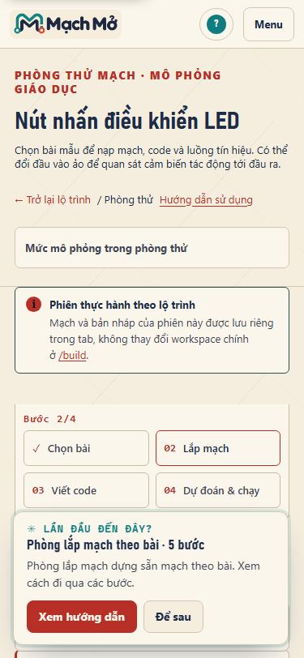
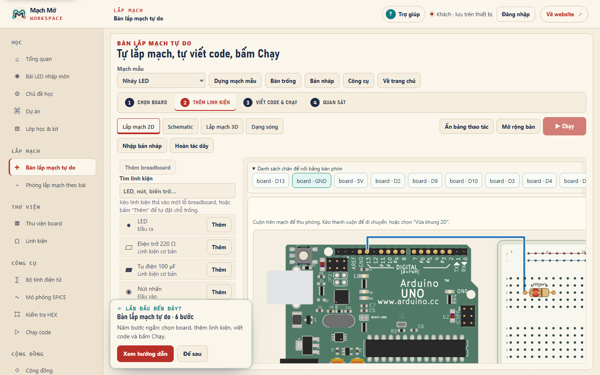
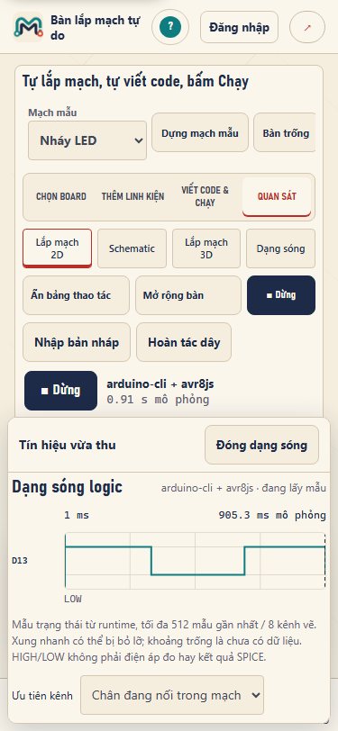

# Đánh giá Mạch Mở từ góc nhìn người học và đội vận hành

**19/11/2026 · Đối tượng đọc: founder, frontend, backend, nội dung và tester.**

Mạch Mở đã làm được một việc có giá trị cho người mới học điện tử bằng tiếng Việt. Người học có thể tự chọn board, mắc mạch, sửa code, chạy, so kết quả trên LED và dạng sóng, lưu lại rồi mở đúng thí nghiệm. Trong lượt kiểm này, tester đã đi hết chuỗi đó trên điện thoại và desktop. Trở ngại lớn nhất là người mới phải tự tìm xem bắt đầu ở đâu, thao tác ở khung nào và kết quả đang xem đến từ đâu. Trở ngại triển khai là bộ công cụ hoạt động trên máy phát triển và bản web phục vụ trên Mini PC có khả năng khác nhau.

**Ưu tiên đầu tư** là làm thật trơn tru một lượt học “dự đoán → mắc mạch → chạy → đọc tín hiệu → tìm lỗi → lưu kết quả”. Sau đó dùng chính sản phẩm người học tạo ra để họ học tiếp, gửi cho bạn và nộp cho lớp. Phần cần làm trước khi mở rộng lượng người dùng là cập nhật được Mini PC nhiều lần và khôi phục được cả web lẫn dữ liệu.

- [Kế hoạch thực hiện theo thứ tự, người phụ trách và nghiệm thu](ke-hoach-trien-khai.md)
- [Quy trình từ build đến phát hành và phục hồi trên Mini PC](van-hanh-mini-pc.md)
- [Ảnh từng màn hình ở hai kích thước](evidence/index.md) · [Biên bản tester thao tác](evidence/journeys/deep-journey-report.md)

## Phạm vi và độ tin cậy

| Cách kiểm | Kết quả và giới hạn |
|---|---|
| Mở trực tiếp bản local đang phục vụ trên cổng 5320 | 29 trang/trạng thái × 2 kích thước, 375×812 và 1440×900. Mỗi lần mở dùng phiên Chromium mới, chờ nội dung chính và phông chữ. Cả 58 lượt trả HTTP 200, không ghi nhận exception của trang, yêu cầu nội bộ HTTP lỗi hay tràn ngang toàn tài liệu. Trang không tồn tại hiển thị trang lỗi qua SPA, cũng trả HTTP 200. [Số liệu gốc](evidence/routes.json) |
| Kích hoạt các chức năng | 13 nhóm kiểm đạt ở **mỗi** kích thước. Hoàn thành 5 hoạt động nền tảng, tải lại và tiếp tục đúng chỗ. Đổi Nano → Uno, nối thủ công 3 dây bằng danh sách chân, chạy Blink có Serial, LED và đồ thị D13, chuyển schematic, tải lại, xuất và nhập JSON. Có cả lần thử mobile đầu tiên gặp khung đang che board và lần chạy lại đầy đủ. [Nhật ký và ảnh](evidence/journeys/deep-journey-report.md) |
| Khả năng tiếp cận | Quét tự động 8 trang × 2 viewport với axe, nhóm WCAG 2/2.1 A/AA, kết quả 0 vi phạm do công cụ phát hiện trên trạng thái đã tải. Cần test đọc màn hình, kéo dây bằng cảm ứng thật, focus khi đóng panel, zoom chữ 200% và hoàn thành bài không dùng chuột. |
| Dữ liệu và mạng | Phiên chụp dùng khách mới, chặn tài nguyên ngoài origin và service worker để tái lập kết quả. Không dùng tài khoản thật, không đăng bài lên hệ thống công khai. Chưa chứng thực người dùng thuộc hai tài khoản, tệp đính kèm online, offline qua SW, tải lớp đông, độ chính xác vật lý từng model hay thời gian học của người mới. |
| Bản đang chạy | Local dùng `index-3GmwjfZV.js`, SHA-256 `19df136a7cba4f65face558872dc850f948cee684db1a4d91491e019084f49d6`. Trang HTTPS công khai trả 200 qua địa chỉ Funnel phân giải bằng DNS công cộng, dùng `index-BTpSWrV6.js`. DNS mặc định ở máy kiểm thử gặp lỗi phân giải. Không ngoại suy tính năng của bản local sang bản public. [Trạng thái vận hành và điểm chưa kiểm](van-hanh-mini-pc.md) |

### Kiểm tra bổ sung

Ngoài 58 lượt có ảnh, đã mở thêm **31 trường hợp** để phủ đủ **37 URL khai báo trong danh mục**, đường vào của **11 bài thực hành** và bài nút nhấn trên Uno ở hai kích thước. Mỗi lượt đều có heading, HTTP 200, không ghi nhận exception hay tràn ngang. Việc vào được một bài chưa chứng minh tất cả tổ hợp board × bài × provider đều đúng. [Kết quả cho từng đường dẫn](evidence/route-aliases-and-lessons.json)

Chạy thêm **12/12 ca e2e** dùng chính bộ test hiện có trên bản local đang phục vụ. Tám ca đầu kiểm bài robot, canvas 3D XIAO S3, xác nhận target rồi xuất trace D13 từ HEX, chạy mạch RC bằng SPICE và tải CSV, xuất CSV kit lớp học, đính kèm cục bộ ở hai kích thước, và kênh liên hệ trên trang góp ý. Bốn ca tiếp theo kiểm Mở Bot trả lời theo board, trích nguồn và nhận ra dữ liệu thiếu, cùng thí nghiệm dự đoán điện áp bộ chia rồi đối chiếu với ngspice trên mobile. Kiểm model XIAO chỉ xác nhận viewer tải được. [Kết quả từng ca và thời gian](evidence/selected-e2e.json)

Trên HTTPS công khai, trang đầu, đường vào SPICE và file WASM đúng MIME đều trả 200. Đường dẫn trạng thái AI `/api/guide-ai/status` **trả 404** tại thời điểm kiểm. Đây là khoảng cách cụ thể cần xử lý nếu muốn người dùng public trò chuyện bằng model. [Kết quả HTTP và hash bundle](evidence/public-http.json)

### Ba bằng chứng đáng xem trước

*Bài nút nhấn với ESP32 ở đường dẫn /build. Số đo trên mobile là vùng nội dung dài tới 6.782 px và bốn vùng cuộn dọc bên trong. Đã kiểm riêng đường dẫn /app/lab với cùng bài trên Uno. Khi URL chứa bài hợp lệ, builder lưu phiên bài vào sessionStorage; đóng tab có thể mất phiên. Bàn tự do có quy trình lưu và khôi phục khác.* [Chọn nơi lưu phiên bài](../../../src/pages/CircuitBuilderPage.tsx#L208)

*Tester tự nối D13 qua điện trở và LED về GND. Sau khi xuất rồi nhập lại, sơ đồ giữ đủ ba kết nối. Ảnh khôi phục cho thấy hai cảnh báo dây cắt qua footprint. Đây là lỗi trình bày đáng sửa dù runtime vẫn chạy.* [Ảnh sau khi nhập lại](evidence/journeys/1440-import-reopened.png)

*Dạng sóng là một lợi thế đã sử dụng được. Điểm cần tối ưu là chi phí chuyển qua lại giữa chọn linh kiện, quan sát mạch và xem tín hiệu.*

## Đánh giá theo màn hình và công việc

Số px dưới đây là chiều cao cuộn lớn nhất mà phép đo tìm được ở tài liệu hoặc vùng nội dung, với cửa sổ cao 812 px. Đó là dấu hiệu cần thử, không phải bằng chứng người học đã cuộn hết hay bỏ bài. Ưu tiên **1** ảnh hưởng trực tiếp đến lượt học đầu hoặc phát hành, **2** ảnh hưởng chất lượng sử dụng lặp lại, **3** là mở rộng có điều kiện.

| Khu vực | Quan sát trên bản kiểm | Điều chỉnh và dấu hiệu đạt |
|---|---|---|
| **1 · Trang đầu, tổng quan và chủ đề** | Trang đầu 4.321 px, tổng quan 6.912 px, chủ đề 3.326 px trên mobile. Trang đầu có hero, phần tiếp tục, nguyên bàn freestyle rồi mới đến các cách bắt đầu. Bản sắc màu, font và tên tiếng Việt nhất quán. [Trang đầu](evidence/home-375.jpg) · [Tổng quan](evidence/workspace-375.jpg) | Lần đầu thấy ngay “Thử mạch đầu tiên” và lựa chọn “Tự lắp”; lần sau ưu tiên mở đúng bản đã lưu. Thay bàn đầy đủ trong hero bằng preview nhẹ mở đúng bàn hiện có. Đo từ trang đầu đến quan sát đầu tiên với người mới. |
| **1 · Nền tảng, chọn bài và board** | Chu trình dự đoán/quan sát/giải thích và khôi phục 5/5 đã qua test. Bài nút nhấn có bước chọn board. Trang LED chuyên biệt có tên ESP32, dài 5.211 px. Người mới dễ hiểu nhầm mọi bài đều bắt đầu từ board này. [Chọn board](evidence/preflight-375.jpg) · [Bài ESP32](evidence/led-375.jpg) | Giữ đường dẫn cũ và bài chuyên biệt, ghi board tương thích ở danh mục, cho chọn bài bất kỳ. Hiện trước đầu vào, kết quả và kiểu mô phỏng. Đổi board khi đang học phải xem được thay đổi chân/code và có đường quay lại bản cũ. |
| **1 · Phòng lắp theo bài và bàn tự do** | Bài nút nhấn trên ESP32 có 4 vùng cuộn dọc con trên mobile. Bàn trống đã làm đúng luồng tự chọn. Khi bảng điều khiển mở trên điện thoại, model vừa chọn bị khuất. [Bài nút nhấn](evidence/guided-375.jpg) · [Bàn trống](evidence/freestyle-375.jpg) | Trên điện thoại, chọn part xong thu panel xuống một hàng và đưa focus về part vừa thêm; dùng lại panel khi chọn part tiếp. Đặt Chạy/Dừng, lỗi quan trọng, kết quả và hoàn tác trong tầm với. Desktop giữ mạch, code và quan sát cạnh nhau. |
| **1 · Dây, sơ đồ, 3D và PCB** | Đổi schematic và quay lại giữ topology. Hai dây có cảnh báo chồng footprint sau import. PCB 2D có trang riêng với lớp đồng và nguồn CAD. Chưa kiểm hình học mỗi cổng/chân và mọi góc 3D so với đúng revision. [Schematic](evidence/journeys/1440-schematic.png) · [PCB](evidence/copper-1440.jpg) | Ưu tiên vị trí terminal, chỉnh bend, tránh thân linh kiện, phân biệt giao dây và junction; cùng net sáng ở các view. Tạo bộ ảnh chuẩn top/side và bảng chân theo revision cho từng board. Kiểm LED đúng cực, dây đủ chiều dài, PCB fit theo khung ở hai kích thước; Blue Pill/Nucleo thiếu nguồn giữ nhãn mức tin cậy. |
| **2 · Thư viện board và linh kiện** | Trang board 7.404 px và hai vùng cuộn con ở mobile; linh kiện 5.102 px. Bảng chân, model, nguồn, cách dùng có ích khi đang lắp. [Board](evidence/boards-375.jpg) · [Linh kiện](evidence/components-375.jpg) | Khi đến từ mạch, mở drawer ngay tại part/pin đã chọn, giữ vị trí mạch khi đóng. Trang thư viện độc lập dùng tìm kiếm theo tên chân, lọc theo board và vai trò; đưa thông tin cắm dây trước metadata, giữ nguồn truy cập trong một thao tác. |
| **1 · Calculator, SPICE, Sketch, HEX và quan sát** | Có bề sâu thực sự. SPICE chạy được kiểm DC 2,5 V với bản WASM đã ghim. Blink đã chạy qua arduino-cli + AVR8js trong môi trường local. Các trang công cụ có lối vào riêng; Sketch/HEX, SPICE, mô hình bài và dữ liệu vật lý dễ bị đọc như một loại kết quả. [SPICE](evidence/spice-1440.jpg) · [HEX](evidence/firmware-375.jpg) | Trên mỗi trace hiển thị nguồn, board, chân/net, trục, đơn vị và điều kiện. Chọn probe từ mạch, nhận giải thích ngắn cạnh kết quả. Vô hiệu kết quả cũ nếu đổi dây. Hiện rõ trước nút Run khi môi trường hiện tại thiếu runtime. |
| **2 · Mini-project, hồ sơ và lớp học** | Mini-project có vòng dự đoán, thí nghiệm, tải hồ sơ. Dự án và lớp học lần lượt dài 3.662 và 3.964 px trên mobile. Người học có đường xuất file cho giáo viên; vòng chia sẻ và phản hồi giữa hai tài khoản chưa được kiểm thực. [Mini-project](evidence/capstone-375.jpg) · [Lớp học](evidence/classroom-1440.jpg) | Bắt đầu từ sản phẩm đã làm. Cho trở lại giả thuyết gần nhất, tạo bản sao A/B, xem hai kết quả cạnh nhau. Giáo viên mở bài đã nộp và trả nhận xét theo đúng phiên bản. Kiểm lưu/khôi phục và chia sẻ thu hồi được trước thí điểm lớp. |
| **2 · Robot** | Trang riêng trình diễn chuyển động ở chế độ mô phỏng khái niệm. [Robot](evidence/robot-375.jpg) | Với từng tương tác, chỉ ra lệnh trái/phải, kết quả dự kiến và giới hạn mô hình. Vòng học quan sát được bằng web khi chưa có kit. |
| **1 · Cộng đồng, phản hồi, Mở Bot** | Các trang danh sách, viết bài, chi tiết và góp ý mở được. Một bình luận mẫu khẳng định đổi sang GPIO 23 hoặc 2 “là chạy”, không nêu biến thể và điều kiện dùng. Bot có tìm kiếm cục bộ theo ngữ cảnh và kiểm nguồn; có giao diện API AI, chưa chứng thực model chạy trên public. [Nội dung mẫu](../../../src/data/communitySeed.ts#L66) · [Nguồn trả lời AI](../../../src/lib/guideAi.ts) · [Góp ý](evidence/feedback-375.jpg) | Gắn board/revision, liên kết pinout và điều kiện vào lời khuyên mẫu. Phân biệt bài mẫu, nháp và bài đã đăng. Thử đăng có ảnh, hủy, báo cáo và duyệt bằng hai tài khoản ở staging. Bot dẫn tới đúng vị trí trên mạch, hỏi lại khi thiếu board và nêu rõ khi không có chứng cứ. |
| **1 · Đăng nhập, riêng tư, quản trị và đường dẫn lỗi** | Bản local quan sát được trạng thái đăng nhập/admin chưa kết nối; callback khách và đường dẫn sai hiện thông báo đúng ngữ cảnh. Dashboard analytics riêng trên Mini PC là bề mặt khác với trang admin Supabase trên bản local. [Callback](evidence/callback-375.jpg) · [Admin](evidence/admin-375.jpg) · [Trang lỗi](evidence/missing-375.jpg) | Luôn có đường tiếp tục bằng khách và cách lưu hồ sơ. Test callback sai/hết hạn ở staging; admin và báo cáo vẫn riêng tư sau mỗi release. Xác minh 404 rõ ràng cho asset/API, cân nhắc HTTP 404 cho URL nội dung không hợp lệ nếu cần lập chỉ mục. |
| **2 · Hiệu năng và tiếp cận** | Không thấy tràn ngang toàn trang trong 58 trạng thái. Dữ liệu trên đĩa của dist gồm khoảng 61,7 MiB models, 48,5 MiB CAD, 23,2 MiB licenses. Các số này không đo lưu lượng trang đầu. SW có cache vỏ ứng dụng; độ sẵn sàng offline của từng tài nguyên cần đo. [Quy tắc SW](../../../public/sw.js) | Giữ CAD/license tải theo nhu cầu; đặt ngân sách byte nén cho từng route. Test cold cache, warm cache, offline sau lần mở, bàn phím, VoiceOver/TalkBack, giảm chuyển động và thiết bị Android tầm trung trước khi tuyên bố đạt. |

**Chi tiết giao diện có thể sửa ngay.** Trên ảnh lần đầu ở 375 px, khung “Lần đầu ở đây?” chiếm phần dưới màn hình ngay trên điều hướng ở trang chủ, thư viện, lab và bàn tự do. CTA làm mạch đã có sẵn trên trang chủ. Nên giữ CTA đó, chuyển phần mời xem tour thành trợ giúp mở theo yêu cầu sau thao tác đầu tiên, rồi đo xem người mới có nhìn thấy vùng cắm dây sớm hơn không. Ở desktop, giữ khoảng thở cho khu vực giới thiệu nhưng tăng diện tích hữu dụng cho cảnh mạch ở chỗ cần thao tác. [Đối chiếu điện thoại](evidence/mobile-overview.jpg) · [Đối chiếu desktop](evidence/desktop-overview.jpg)

## Đối thủ làm tốt ở đâu, Mạch Mở nên lấy phần nào

Đối chiếu các trang và hướng dẫn chính thức với bằng chứng Mạch Mở ở trên. Ba web học trực quan còn có nhật ký tương tác trước đây. Không có số thời gian người dùng thật hoặc phép đo ngang bằng trên thiết bị giống nhau giữa các sản phẩm. [Nhật ký thử ba web học](../../research/2026-11-12-learning-sites-interaction-audit.md) · [Danh mục tham khảo mở rộng](../../research/2026-11-13-web-app-reference-links.md)

| Tham chiếu | Điểm họ làm tốt | Áp dụng vào Mạch Mở và tiêu chí kiểm |
|---|---|---|
| Learn Arduino | Bài nút bấm đặt cảnh lắp, chú thích, code, schematic và phản ứng tín hiệu gần nhau. [Bài Push a Button](https://learn-arduino-red.vercel.app/#button) | Ở bài nút nhấn, giữ nút ảo rồi nhìn thấy input, nhánh code và LED trong cùng vùng quan sát. Dùng đúng cực tính INPUT_PULLUP của bài Mạch Mở. |
| Learn ESP32 | Bài cảm biến đặt thiết bị và phản hồi vào ngữ cảnh của board. [Distance Meter](https://learn-esp32.vercel.app/#sensor) | Nhấn vào cảm biến trên cảnh để xem chân, vai trò, đơn vị và giới hạn đúng board; thay đầu vào làm kết quả đổi ngay khi provider hỗ trợ. |
| Electronics 101 | Mỗi bài xoay quanh một nguyên lý có thể thử, chẳng hạn đóng vòng mạch. [Closed Loop](https://electronics-101-six.vercel.app/closed-loop) | Mở đầu bằng một thay đổi đơn giản, ví dụ ngắt rồi nối lại đường về. Sau đó yêu cầu người học giải thích và lặp lại trên mạch tự lắp. |
| Wokwi | Editor có điểm nối và sửa đường dây trực tiếp; logic analyzer đọc kênh tín hiệu, cho xuất bản ghi VCD. [Diagram Editor](https://docs.wokwi.com/guides/diagram-editor) · [Logic Analyzer](https://docs.wokwi.com/guides/logic-analyzer) | Chọn chân → đầu dây → chỉnh đoạn gấp → chọn probe tại cùng net. Thử mạch có dây giao nhau, đổi màu/xóa dây, undo và dùng bàn phím. Gắn provenance vào dữ liệu export. |
| Fritzing | Một dự án có breadboard, schematic và PCB để theo dõi các cách biểu diễn. [Hướng dẫn dựng mạch](https://fritzing.org/learning/tutorials/building-circuit) | Một lựa chọn part/net được giữ khi đổi view. Phân biệt PCB tham chiếu của board và mạch người dùng tự mắc. Dùng fixture mở lại từ bản cũ. |
| KiCad | Highlight net, junction, nhãn phân cấp và ERC có ngữ nghĩa rõ trong schematic. [Tài liệu Eeschema](https://docs.kicad.org/9.0/en/eeschema/eeschema.html) | Ký hiệu, pin, refdes, giá trị và chấm nối đọc được trên điện thoại. Kiểm bằng fixture giao không nối và ngã ba có nối. Phân biệt cảnh báo topology bài học và ERC. |
| EveryCircuit và CircuitLab | Điều chỉnh tham số và theo dõi dạng sóng giúp thấy ngay hệ quả; CircuitLab kết hợp schematic, solver và đồ thị. [EveryCircuit](https://everycircuit.com/) · [CircuitLab](https://www.circuitlab.com/) | Đổi R/C trong mạch RC, lưu hai lần chạy, so hằng số thời gian với đồ thị và giải thích sai khác theo bước lấy mẫu. Đo cả luồng nhập sai đơn vị và net hở. |
| Adafruit IO | Dashboard ghép dữ liệu theo feed để người dùng nhìn lại kết quả của thiết bị. [Dashboards](https://learn.adafruit.com/adafruit-io-basics-dashboards/overview) | Cho học qua bộ mẫu IoT phát lại trước. Tách rõ dữ liệu ghi sẵn và thiết bị trực tiếp; để kết nối thiết bị thật sau khi đã có quyền truy cập, quota và quy trình lớp học. |

## Lợi thế cạnh tranh và cách kiểm

**Lời hứa có thể kiểm chứng:** người mới dùng tiếng Việt tự tìm ra vì sao một mạch không chạy, dựa trên đường dây, trạng thái chân và kết quả đo mô phỏng, rồi mang bằng chứng sang dự án tiếp theo. Nền tảng hiện có đủ thành phần để thử lời hứa này cho mạch LED trên Uno. Chưa có dữ liệu hành vi để kết luận Mạch Mở giữ chân tốt hơn đối thủ.

| Câu hỏi sản phẩm | Phép đo đề xuất |
|---|---|
| Người mới có tự bắt đầu được? | Mời 5–8 người tự nguyện chưa dùng sản phẩm. Từ trang đầu, tự chọn đúng bài, hoàn thành một quan sát và gọi tên nguyên nhân trong 5 phút; ghi riêng số cần trợ giúp và median thời gian. Mục tiêu thí điểm ≥4/5 nếu có 5 người. |
| Có học được cách sửa mạch? | Đưa mạch hở ở dây GND. Ghi số người tìm đúng net, sửa, chạy lại và giải thích. So hai vòng thử giao diện với cùng kịch bản, tránh dạy đáp án trước khi thử. |
| Có lý do quay lại? | Ngày 7 mời nhóm tự nguyện tiếp tục cùng dự án với một ràng buộc mới. Tính số người mở lại đúng hồ sơ **và làm thêm một thí nghiệm** trên số đã hoàn tất lần đầu và đủ 7 ngày. Phiên analytics ẩn danh theo tab chỉ dùng đếm sự kiện vận hành. |
| Có đủ tin cậy cho lớp? | Giáo viên mở lại được dự án và thấy đúng board, code, dây, nguồn kết quả và hai lần thử. Kiểm bằng hai tài khoản độc lập, thu hồi chia sẻ và phục hồi một bản đã lưu. |

**Kết luận cho lần phát hành kế tiếp:** có cơ sở để thí điểm hành trình Uno/LED với nhóm nhỏ. Chỉ mở rộng rollout khi tester tái hiện được hành trình trên đúng artifact public, người mới hoàn thành được nhiệm vụ đầu và đội vận hành diễn tập quay lại bản trước.
