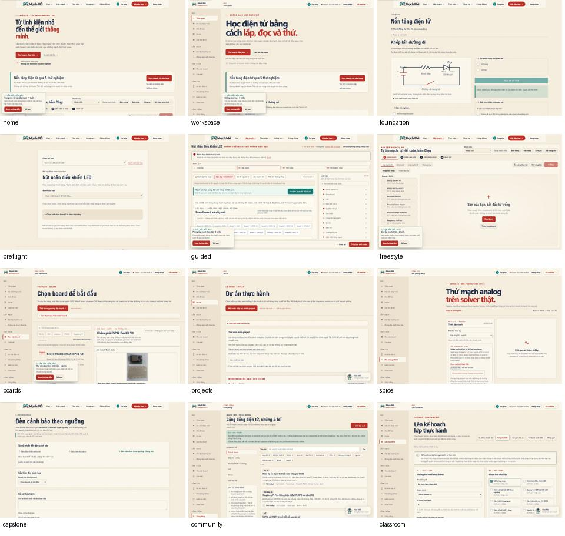
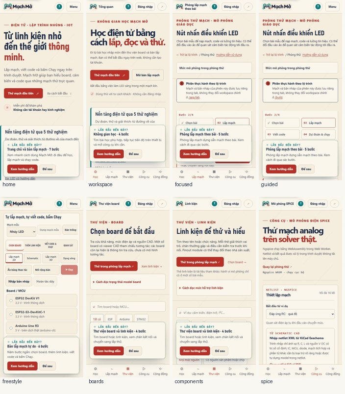

# Ảnh và dữ liệu kiểm thử Mạch Mở · 19/11/2026

Ảnh là khung nhìn thực tại thời điểm mở trang bằng Chromium. Hai kích thước lần lượt là 375×812 và 1440×900. Phiên khách mới giữ nguyên nội dung chào đầu tiên. Các ảnh thí nghiệm bên dưới chụp sau khi đã thao tác.

[Báo cáo đánh giá](../README.md) · [Bảng đo 58 lượt mở](routes.json) · [31 lượt kiểm bổ sung](route-aliases-and-lessons.json) · [12 ca chức năng](selected-e2e.json) · [Kiểm HTTPS công khai](public-http.json)

| Màn hình | URL kiểm | Mobile | Desktop | Vùng cuộn lớn nhất trên mobile (px) |
|---|---|---|---|---:|
| Trang chủ công khai | `/` | [Ảnh](home-375.jpg) | [Ảnh](home-1440.jpg) | 4321 |
| Tổng quan học tập | `/app` | [Ảnh](workspace-375.jpg) | [Ảnh](workspace-1440.jpg) | 6912 |
| Chủ đề | `/app/learn` | [Ảnh](topics-375.jpg) | [Ảnh](topics-1440.jpg) | 3326 |
| Nền tảng điện tử | `/learn/basics` | [Ảnh](foundation-375.jpg) | [Ảnh](foundation-1440.jpg) | 2915 |
| Chọn board trước bài nút nhấn | `/learn/button-led` | [Ảnh](preflight-375.jpg) | [Ảnh](preflight-1440.jpg) | 1099 |
| Bài LED chuyên biệt ESP32 | `/learn/esp32-led?board=esp32-devkit` | [Ảnh](led-375.jpg) | [Ảnh](led-1440.jpg) | 5211 |
| Bài nút nhấn với ESP32 (URL /build) | `/build?lesson=button-led&board=esp32-devkit` | [Ảnh](guided-375.jpg) | [Ảnh](guided-1440.jpg) | 6782 |
| Mini-project | `/learn/mini-project` | [Ảnh](capstone-375.jpg) | [Ảnh](capstone-1440.jpg) | 1908 |
| Robot mô phỏng | `/app/robot-simulation` | [Ảnh](robot-375.jpg) | [Ảnh](robot-1440.jpg) | 2024 |
| Bàn tự do lúc trống | `/build/freestyle` | [Ảnh](freestyle-375.jpg) | [Ảnh](freestyle-1440.jpg) | 998 |
| Thư viện board | `/app/boards` | [Ảnh](boards-375.jpg) | [Ảnh](boards-1440.jpg) | 7404 |
| Lớp đồng PCB 2D | `/app/boards?board=esp32-devkit&view=2d` | [Ảnh](copper-375.jpg) | [Ảnh](copper-1440.jpg) | 6164 |
| Thư viện linh kiện | `/app/components` | [Ảnh](components-375.jpg) | [Ảnh](components-1440.jpg) | 5102 |
| Dự án | `/app/projects` | [Ảnh](projects-375.jpg) | [Ảnh](projects-1440.jpg) | 3662 |
| Lớp học và kit | `/app/classroom-kits` | [Ảnh](classroom-375.jpg) | [Ảnh](classroom-1440.jpg) | 3964 |
| Bộ tính điện tử | `/app/tools/calculators` | [Ảnh](calculators-375.jpg) | [Ảnh](calculators-1440.jpg) | 3244 |
| SPICE | `/app/tools/spice` | [Ảnh](spice-375.jpg) | [Ảnh](spice-1440.jpg) | 2833 |
| Chạy sketch | `/app/tools/sketch` | [Ảnh](sketch-375.jpg) | [Ảnh](sketch-1440.jpg) | 1538 |
| Kiểm firmware HEX | `/app/tools/firmware` | [Ảnh](firmware-375.jpg) | [Ảnh](firmware-1440.jpg) | 1884 |
| Danh sách cộng đồng | `/app/community` | [Ảnh](community-375.jpg) | [Ảnh](community-1440.jpg) | 3460 |
| Viết bài | `/app/community/new` | [Ảnh](editor-375.jpg) | [Ảnh](editor-1440.jpg) | 2004 |
| Đọc bài | `/app/community/led-dien-tro-bao-nhieu` | [Ảnh](post-375.jpg) | [Ảnh](post-1440.jpg) | 1931 |
| Góp ý | `/app/feedback` | [Ảnh](feedback-375.jpg) | [Ảnh](feedback-1440.jpg) | 1836 |
| Quyền riêng tư | `/privacy` | [Ảnh](privacy-375.jpg) | [Ảnh](privacy-1440.jpg) | 1355 |
| Đăng nhập | `/app/login` | [Ảnh](login-375.jpg) | [Ảnh](login-1440.jpg) | 1067 |
| Callback khi chưa kết nối | `/auth/callback` | [Ảnh](callback-375.jpg) | [Ảnh](callback-1440.jpg) | 812 |
| Quản trị khi chưa kết nối | `/admin` | [Ảnh](admin-375.jpg) | [Ảnh](admin-1440.jpg) | 812 |
| Đăng nhập quản trị | `/admin/login` | [Ảnh](adminLogin-375.jpg) | [Ảnh](adminLogin-1440.jpg) | 812 |
| Trang lỗi | `/not-a-page-audit` | [Ảnh](missing-375.jpg) | [Ảnh](missing-1440.jpg) | 812 |
| Bài nút nhấn với Uno (URL /app/lab, guided=1) | `/app/lab?lesson=button-led&guided=1&board=arduino-uno-r3` | [Ảnh](focused-375.jpg) | [Ảnh](focused-1440.jpg) | Chưa đo |

## Sau khi thao tác

| Bước | 375 px | 1440 px |
|---|---|---|
| Bắt đầu nền tảng | [Ảnh](journeys/375-basics-fresh.png) | [Ảnh](journeys/1440-basics-fresh.png) |
| Hoàn thành 5 hoạt động | [Ảnh](journeys/375-basics-complete.png) | [Ảnh](journeys/1440-basics-complete.png) |
| Mạch tự đấu 3 dây | [Ảnh](journeys/375-handwired-circuit.png) | [Ảnh](journeys/1440-handwired-circuit.png) |
| Blink, Serial và dạng sóng | [Ảnh](journeys/375-runtime-waveform.png) | [Ảnh](journeys/1440-runtime-waveform.png) |
| Đổi sang schematic | [Ảnh](journeys/375-schematic.png) | [Ảnh](journeys/1440-schematic.png) |
| Mạch đã xuất và nhập lại | [Ảnh](journeys/375-import-reopened.png) | [Ảnh](journeys/1440-import-reopened.png) |

[Biên bản và các lần chạy tester](journeys/deep-journey-report.md). File JSON ghi các quan sát, kể cả lần thử đầu trên điện thoại khi panel còn mở. Ảnh khôi phục mạch ở desktop giữ được hai cảnh báo routing.
