# Review web Mạch Mở — 02/11/2026

Lượt này chỉ review. Không sửa mã nguồn, dữ liệu, model, cấu hình hay tài liệu sản phẩm. Chỉ tạo file trong thư mục này.

## 1. Tóm tắt

Các luồng chính đều chạy được: lộ trình, trang bài, preflight, phòng thử, thư viện board và linh kiện, project, công cụ. Không trang nào tràn ngang ở 375, 1024 và 1440 px. 89 link nội bộ đều mở được trang thật, 14 file tĩnh được liên kết đều trả về đúng file.

Lỗi nặng nhất nằm ở trợ năng bàn phím. Link "Đi đến nội dung chính" gần như không nhìn thấy: tương phản 1,13:1 trên website, bị topbar che trong app. Menu đầu trang không đóng bằng Escape hay click ra ngoài. Lăn chuột trên viewer 3D làm cả trang cuộn.

**Mức sẵn sàng:** đủ cho demo có người hướng dẫn và thử nghiệm với người học. Chưa nên coi là sẵn sàng phát hành công khai khi các lỗi High chưa sửa và chưa thử trên thiết bị thật hay screen reader. Mô hình 3D là CAD tham khảo, mô phỏng là parser giáo dục; review này không kiểm chứng phần cứng.

| Mức | Số finding đã tái hiện trên web |
|---|---|
| Blocker | 0 |
| Critical | 0 |
| High | 2 |
| Medium | 9 |
| Low | 5 |

Ngoài ra có 3 vấn đề chỉ thấy trong source và 5 đề xuất cải tiến, tách riêng ở mục 4.

## 2. Môi trường kiểm tra

| Mục | Giá trị |
|---|---|
| URL | http://127.0.0.1:5173/ (Vite dev server đang chạy sẵn) |
| Browser | Browser pane của Claude desktop app, Chromium 152 (`Chrome/152.0.7977.167`, Windows 10/11 x64) |
| Thời gian | 02/11/2026, khoảng 18:59–19:20 (giờ máy, UTC+7) |
| Viewport | 1440×900, 1024×768, 375×812 (emulation trong pane; 375 dùng preset mobile có user agent Android) |
| Đăng nhập | Không. Dùng chế độ khách; không mở dịch vụ ngoài |
| Service worker | Không đăng ký trên dev server, nên không kiểm tra offline |

Ảnh chụp là ảnh thật từ phiên này, đã được pane thu nhỏ nên chữ trong ảnh nhỏ hơn thực tế.

## 3. Phạm vi

Route lấy từ `src/App.tsx`; link nội bộ thu thập từ chính các trang.

| Route / luồng | Đã kiểm tra | Kết quả |
|---|---|---|
| `/` website công khai | Có: 3 khổ, bàn phím, menu desktop và mobile | Hiển thị tốt; lỗi menu và skip link (F-01, F-03, F-04, F-05) |
| `/app` dashboard | Có: CTA người học mới, click thật | CTA mở đúng bài LED |
| `/app/learn`, `/topics` | Có: 3 khổ, cấu trúc | Ổn |
| `/learn/esp32-led` | Có: mở từ dashboard, click "Thực hành" | Vào đúng lab, tiến độ ghi `blink` |
| `/learn/button-led`, `/learn/buck-boost-concept` | Cấu trúc 3 khổ, axe | Ổn |
| `/learn/khong-co` | Có | Nội dung báo không tìm thấy; tiêu đề tab sai (F-13) |
| `/boards` | Có: board có viewer (Uno), board chỉ tra cứu (ESP32-C6), lăn chuột trên canvas | Viewer chạy; lỗi lăn chuột (F-06) |
| `/components` | Có: link trực tiếp, tìm kiếm không có kết quả | Trạng thái rỗng rõ ràng |
| `/build?lesson=blink&guided=1` | Có: thêm linh kiện, xóa dây, chạy khi lỗi, nối lại bằng bảng chân, lưu project | Chạy đúng; gợi ý sửa lỗi rõ |
| `/build?lesson=button-led&guided=1&board=arduino-uno-r3` | Có: chuyển 4 view logic, sơ đồ, 3D, PCB | Cả 4 view hiển thị, không cảnh báo, console sạch |
| `/app/lab` ở 375 px | Có: đo vùng chạm và focus | Lỗi focus bị che (F-07) |
| `/projects`, `/app/projects` | Có: danh sách sau khi lưu project thử | Hiện đúng project; "Mở" chưa thử được (mục 4.4) |
| `/tools/electronics-calculators` | Có: nhập số âm, để trống | Có thông báo lỗi; thiếu liên kết ARIA (F-14) |
| `/tools/firmware-hex` | Có: nạp firmware mẫu | Phân tích được cấu trúc HEX |
| `/privacy` | Cấu trúc 3 khổ | Ổn |
| `/tools/` | Có | Trang 404; không có trang mục lục công cụ (đề xuất I-02) |
| `/admin`, `/admin/login` | Chỉ mở, không đăng nhập | Ngoài phạm vi review |

**Ma trận board × bài đã thử.** Không thử hết 26 board × 11 bài; chọn trường hợp đại diện:

| Board | Bài / màn | Lý do chọn |
|---|---|---|
| ESP32 DevKit V1 | `blink` trong lab: lắp, lỗi, chạy, lưu | Board mặc định |
| Arduino Uno R3 | `button-led` trong lab, 4 view; viewer 3D ở `/boards` | Board phụ có model nặng nhất đã tối ưu |
| ESP32-C6-DevKitC-1 | `/boards` | Board chỉ có dữ liệu tra cứu |

**Chưa thử:** board Adafruit, Pico, XIAO trong lượt này; bài analog, 7 đoạn, motor trong lab; nhập và xuất tệp project.

## 4. Finding

### 4.1 Lỗi đã tái hiện trên web

#### F-01 · High · Accessibility — Link "Đi đến nội dung chính" gần như vô hình trên website công khai

- **Route:** `/?surface=web`, mọi trang dùng shell website. Viewport 1024×768.
- **Tái hiện:** mở trang, nhấn Tab một lần.
- **Thực tế:** link hiện ra nhưng chữ trắng `rgb(255,255,255)` trên nền `rgb(234,242,244)`, tương phản 1,13:1. Axe báo `color-contrast` trên `.skip-link` ở 4 lượt quét.
- **Mong đợi:** tương phản tối thiểu 4,5:1 (WCAG 1.4.3) và nhìn rõ khi focus (2.4.7).
- **Tác động:** người dùng bàn phím không thấy lối tắt đầu tiên.
- **Mức chắc chắn:** đã tái hiện.
- **Hướng sửa:** dùng cặp màu chữ và nền có tương phản đủ trong theme tối.

#### F-02 · High · Accessibility — Trong app shell, skip link bị topbar che khi focus

- **Route:** `/app/lab?lesson=blink&guided=1`, và các trang khác trong shell app. Viewport 1024×768.
- **Tái hiện:** focus vào `.skip-link`.
- **Thực tế:** link có focus và `transform: none`, nhưng điểm (30,25) thuộc `.workspace-brand-mark` vì topbar có `z-index: 30` còn skip link chỉ `20`. Ảnh chụp khi đang focus không thấy link.
- **Mong đợi:** phần tử đang focus không bị nội dung khác che hoàn toàn (WCAG 2.4.11).
- **Tác động:** người dùng bàn phím trong app không có lối tắt nhìn thấy được.
- **Mức chắc chắn:** đã tái hiện bằng DOM và ảnh.
- **Hướng sửa:** đặt skip link trên topbar trong cả hai shell.

#### F-03 · Medium · Accessibility — Escape không đóng menu desktop

- **Route:** `/`, 1440×900.
- **Tái hiện:** focus "Thư viện", nhấn Enter, rồi nhấn Escape.
- **Thực tế:** menu vẫn mở (`details.open = true`).
- **Mong đợi:** Escape đóng menu và giữ focus ở nút mở.
- **Tác động:** người dùng bàn phím phải Tab qua hết menu hoặc bấm lại.
- **Mức chắc chắn:** đã tái hiện. Source `SiteNavigation.tsx` chỉ đóng menu khi chọn link.

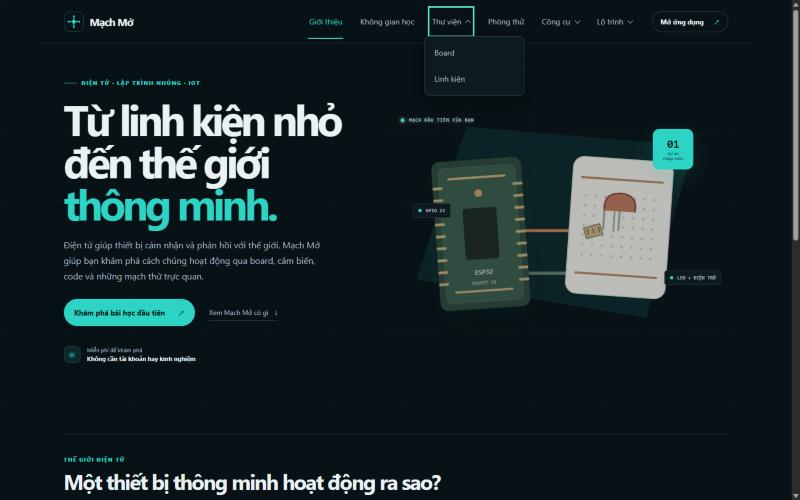

#### F-04 · Medium · Accessibility — Escape không đóng menu mobile

- **Route:** `/?surface=web`, 375×812.
- **Tái hiện:** focus nút "Menu", nhấn Enter, rồi nhấn Escape.
- **Thực tế:** `aria-expanded` vẫn là `true` sau Escape.
- **Mong đợi:** Escape đóng menu.
- **Mức chắc chắn:** đã tái hiện bằng DOM. Ảnh dưới chụp lúc menu đang mở, trước khi nhấn Escape; trạng thái sau Escape chỉ có số đo DOM.

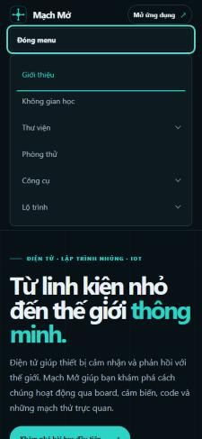

#### F-05 · Medium · UX — Menu desktop mở chồng nhau và không đóng khi click ra ngoài

- **Route:** `/`, 1440×900.
- **Tái hiện:** mở "Thư viện", rồi mở "Công cụ", rồi click chuột thật vào vùng trống của hero.
- **Thực tế:** hai menu cùng mở; sau click ra ngoài vẫn còn 2 menu mở.
- **Mong đợi:** mở menu này thì đóng menu kia; click ra ngoài thì đóng.
- **Mức chắc chắn:** đã tái hiện bằng click thật.

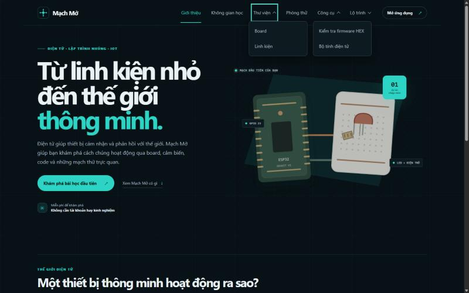

#### F-06 · Medium · Chức năng — Lăn chuột trên viewer 3D làm cả trang cuộn và báo lỗi console

- **Route:** `/boards?board=arduino-uno-r3`, 1024×768.
- **Tái hiện:** đưa chuột lên canvas 3D, lăn xuống 3 nấc.
- **Thực tế:** trang cuộn 300 px. Console báo 2 lần `Unable to preventDefault inside passive event listener invocation.`
- **Mong đợi:** lăn trên canvas chỉ phóng to hoặc thu nhỏ mô hình, như gợi ý trên viewer.
- **Tác động:** người dùng chuột vừa zoom vừa mất vị trí trang.
- **Mức chắc chắn:** đã tái hiện. Source `BoardViewer.tsx:145` gọi `preventDefault` trong `onWheel` của React, vốn là passive listener.

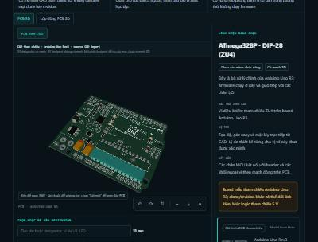
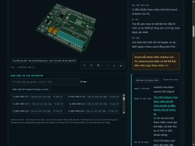

#### F-07 · Medium · Accessibility — Ở 375 px, nút "Nối dây" khi focus nằm sau thanh điều hướng đáy

- **Route:** `/app/lab?lesson=button-led&guided=1`, 375×812.
- **Tái hiện:** focus nút "⌁ Nối dây" của workspace.
- **Thực tế:** nút chiếm `top 768–812`, nằm trọn trong `.workspace-mobile-nav` (`753–812`). Trong 92 phần tử focus được đã kiểm tra, đây là phần tử duy nhất bị che.
- **Mong đợi:** phần tử focus không bị thanh cố định che (WCAG 2.4.11).
- **Mức chắc chắn:** đã tái hiện bằng đo DOM. Ảnh chụp lần đó bị lệch khung nên không dùng làm bằng chứng.
- **Hướng sửa:** thêm `scroll-padding-bottom` bằng chiều cao thanh đáy và thanh bước.

#### F-08 · Medium · UX — Canvas phòng thử nằm dưới màn hình đầu tiên trên desktop

- **Route:** `/app/lab?lesson=blink&guided=1` sau khi bấm "Thực hành trong phòng thử".
- **Thực tế:** canvas bắt đầu ở y=1212 px với viewport 1024×768, và y=1106 px với 1440×900. Người học phải cuộn qua thông báo phiên, stepper, guidance, mục tiêu bài và khối workspace.
- **Mong đợi:** người học thấy ít nhất phần đầu canvas ngay khi vào bước lắp mạch.
- **Mức chắc chắn:** đã tái hiện bằng đo DOM và ảnh.

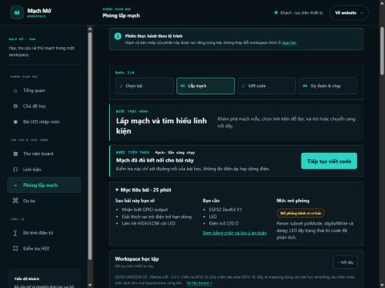

#### F-09 · Medium · UI / Typography — Nhiều chữ 8–10 px ở trang board

- **Route:** `/boards?board=arduino-uno-r3`, 1024×768.
- **Thực tế:** đếm các phần tử có chữ trong `#main-content`: 67 phần tử 8 px, 40 phần tử 9 px, 142 phần tử 10 px. Ví dụ: eyebrow, badge năng lực, nhãn bảng hồ sơ, ghi công ảnh 9,17 px.
- **Mong đợi:** chữ nội dung tối thiểu khoảng 12 px theo checklist ui-ux-pro-max (Typography). WCAG không có ngưỡng cứng; đây là vấn đề dễ đọc.
- **Mức chắc chắn:** đã đo trên web. Lượt quét 3 khổ cũng cho thấy 140–210 phần tử dưới 11 px ở `/learn/esp32-led`, `/boards`, `/components`.

#### F-10 · Medium · Accessibility — Một số điều khiển desktop nhỏ hơn 24 px

- **Route:** `/build?lesson=blink&guided=1`, 1440×900.
- **Thực tế:** nút xóa dây 33×22 px đứng cạnh nút chọn dây cao 22 px; các `summary` cao 14–17 px; link "← Trở lại lộ trình" và nút "Hướng dẫn sử dụng" cao 19 px. Axe báo thêm `target-size` cho `.builder-actions > button` ở 375 px.
- **Mong đợi:** 24×24 px hoặc thỏa ngoại lệ khoảng cách của WCAG 2.5.8.
- **Mức chắc chắn:** đã đo trên web. Chưa tính từng trường hợp có đạt ngoại lệ khoảng cách hay không.

#### F-15 · Medium · Accessibility — Chuyển trang không chuyển focus và không thông báo

- **Route:** `/app`, click "Bắt đầu bài LED".
- **Thực tế:** sau khi trang mới tải, `document.activeElement` là `BODY`. Source không có route announcer.
- **Mong đợi:** đưa focus tới `h1` hoặc `main`, hoặc thông báo tên trang qua live region.
- **Tác động:** người dùng screen reader không biết trang đã đổi.
- **Mức chắc chắn:** đã tái hiện. Chưa thử với screen reader thật.

#### F-11 · Low · Nội dung — Panel board trong lab liệt kê chân chung, lệch với bảng chân

- **Route:** `/build?lesson=blink&guided=1`, chọn ESP32 DevKit V1.
- **Thực tế:** "Chân kết nối" ghi `GPIO LED · GND · 3V3 · GPIO IN · TRIG · ECHO · 2 · 3 · 4 · 5 · 6 · 7 · 8`, trong khi bảng chân ghi `13, 14, 27, 26, 25, 33, 32`. Bảng chân của bài blink có cả TRIG, ECHO và nhãn `ECHO · GPIO 18+1`.
- **Mong đợi:** panel và bảng chân dùng cùng một nguồn; bài chỉ hiện chân liên quan; nhãn chân đọc được.
- **Mức chắc chắn:** đã tái hiện.

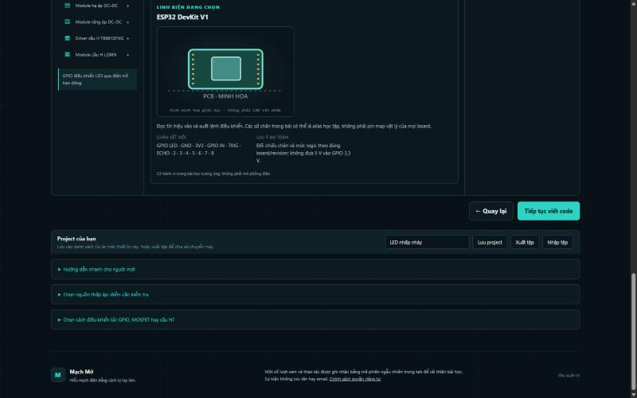

#### F-12 · Low · Nội dung / Điều hướng — Trang chủ trong app shell có tiêu đề "Về website"

- **Tái hiện:** mở `/app/lab`, rồi gõ `/` trong cùng tab, ở 375 px.
- **Thực tế:** trang giới thiệu hiện trong shell app, nhãn trang là "Về website" và nút "Về website" lặp lại ngay cạnh.
- **Mong đợi:** `/` luôn dùng shell website, hoặc có nhãn trang phù hợp.
- **Mức chắc chắn:** đã tái hiện.

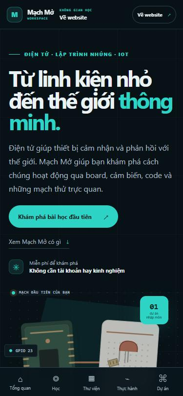

#### F-13 · Low · Nội dung — Bài không tồn tại vẫn có tiêu đề tab "Chuẩn bị bài học"

- **Route:** `/learn/khong-co`.
- **Thực tế:** nội dung báo "Không tìm thấy bài này", nhưng tab ghi "Chuẩn bị bài học — Mạch Mở".
- **Mức chắc chắn:** đã tái hiện.

#### F-14 · Low · Accessibility — Ô nhập sai trong bộ tính không được đánh dấu lỗi

- **Route:** `/tools/electronics-calculators`.
- **Tái hiện:** nhập `-5` rồi để trống ô "Điện áp nguồn".
- **Thực tế:** thông báo "V nguồn phải là số dương." hiện ra, nhưng ô không có `aria-invalid` hay `aria-describedby`.
- **Mong đợi:** screen reader đọc được lỗi gắn với đúng ô (WCAG 3.3.1).
- **Mức chắc chắn:** đã tái hiện bằng DOM.

#### F-16 · Low · Nội dung — ATmega328P mang nhãn "Chưa xác minh chức năng"

- **Route:** `/boards?board=arduino-uno-r3`.
- **Thực tế:** chi tiết ZU4 mô tả rõ đây là bộ vi xử lý chính, nhưng nhãn ghi "Chưa xác minh chức năng". Toàn bộ linh kiện Arduino mang nhãn này.
- **Mong đợi:** nhãn khớp mức bằng chứng. Nếu value CAD ghi ATmega328P thì có thể gắn "Có nguồn CAD".
- **Mức chắc chắn:** đã thấy trên web; quyết định nhãn cần chủ dự án.

### 4.2 Thấy trong source, chưa tái hiện

| ID | Vấn đề | Cần làm để xác minh |
|---|---|---|
| S-01 | `.builder-part-inspector` là `aria-live="polite"` cho cả panel; mỗi lần chọn linh kiện có thể đọc lại toàn bộ khối | Thử với NVDA hoặc VoiceOver |
| S-02 | Canvas viewer có `role="application"`; chưa rõ screen reader có giữ phím mũi tên ở đó hay không | Thử với screen reader |
| S-03 | "Mở" và "Xóa" project dùng `window.confirm`; không đổi được ngôn ngữ nút và không theo theme | Thử trên browser thật; cân nhắc hộp thoại trong trang |

### 4.3 Đề xuất cải tiến, không phải lỗi

| ID | Đề xuất |
|---|---|
| I-01 | Thêm nút "Xóa bộ lọc" cho `/components` giống `/boards` |
| I-02 | Có trang mục lục `/tools`, vì menu "Công cụ" tồn tại nhưng `/tools/` trả về 404 |
| I-03 | Rút gọn phần đầu lab khi người học đã đọc mục tiêu, ví dụ gập mặc định ở lần vào sau |
| I-04 | Ở bài blink, bảng chân chỉ hiện chân dùng trong bài, có lựa chọn "Hiện tất cả chân" |
| I-05 | Gom nhãn 8–10 px thành một thang chữ tối thiểu 12 px |

### 4.4 Giới hạn môi trường

- Hộp `window.confirm` bị pane tự đóng, nên chưa thử được "Mở" project. Mình cũng không muốn thay workspace có sẵn trên trình duyệt này.
- Cuộn mượt và ảnh chụp đôi khi trễ khi pane bị ẩn; các kết luận chính dựa trên số đo DOM, ảnh chỉ để minh họa.
- Chỉ có Chromium 152 trong pane. Chưa thử Firefox, Safari, điện thoại hay máy tính bảng thật, cảm ứng thật, screen reader hay phần cứng thật.
- Dev server không đăng ký service worker, nên chưa đánh giá chế độ offline.

## 5. Kết quả từng khu vực

- **Học tập:**
    - CTA ở dashboard mở đúng bài LED; "Thực hành trong phòng thử" vào đúng lab và ghi tiến độ `blink`.
    - Lộ trình, trang bài và preflight không lỗi cấu trúc ở 3 khổ.
    - Thiếu chuyển focus khi đổi trang (F-15).
- **Board:**
    - Uno có ảnh tham khảo kèm ghi công, bảng hồ sơ, viewer 3D, nhãn bằng chứng. Board tra cứu hiện hồ sơ riêng.
    - Lỗi lăn chuột trên canvas (F-06); chữ nhỏ (F-09).
- **Linh kiện:**
    - Link trực tiếp hoạt động; trạng thái rỗng khi tìm không thấy có hướng dẫn và báo rõ mục đang xem nằm ngoài bộ lọc.
    - Danh mục đếm 24 mục có nguồn sản phẩm hoặc chip.
- **Lắp mạch:**
    - Thêm LED từ thư viện được.
    - Xóa dây thì guidance chuyển sang "Cần sửa", kèm cách sửa và chân bắt đầu.
    - Bấm chạy khi mạch lỗi thì bị chặn, focus chuyển tới thông báo.
    - Nối lại dây qua bảng chân thì trở về "Sẵn sàng chạy".
- **2D/3D/sơ đồ/PCB:** với Uno ở bài nút nhấn, cả 4 view hiển thị, không có `role=alert`, console không lỗi.
- **Code/mô phỏng:** nút chạy bị chặn đúng khi mạch lỗi. Chưa chạy trọn mô phỏng thành công ở lượt này.
- **Project:**
    - Lưu project thử có thông báo "Đã lưu … vào Dự án trên thiết bị này".
    - `/projects` hiện project kèm thời gian và tên bài.
    - Chưa thử Mở, Xuất, Nhập (mục 4.4).
- **Công cụ hỗ trợ:**
    - Bộ tính báo lỗi khi nhập số âm hoặc để trống (F-14 về ARIA).
    - Công cụ HEX nạp firmware mẫu và hiện "Cấu trúc hợp lệ", 36 byte, 4 bản ghi.

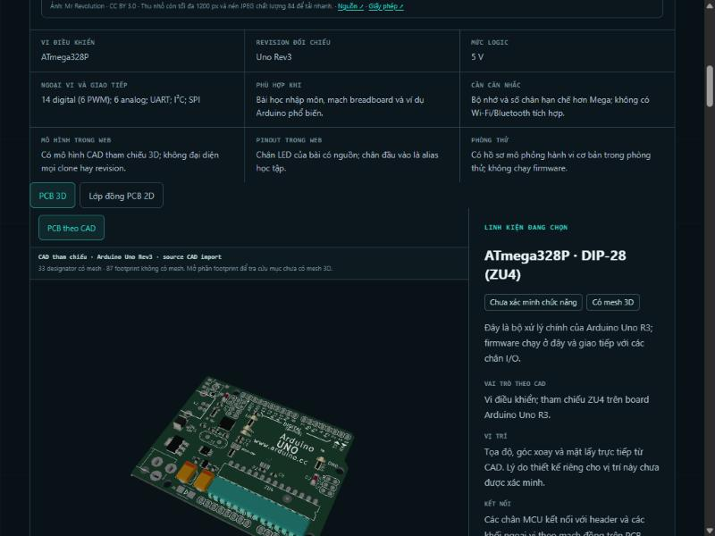
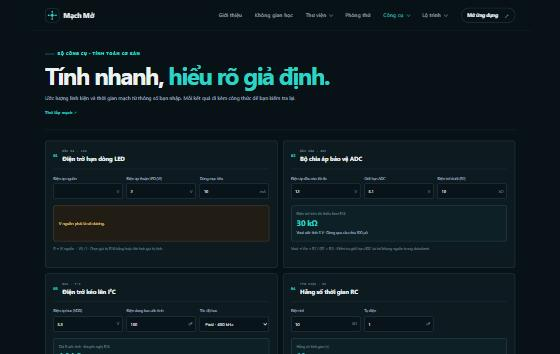
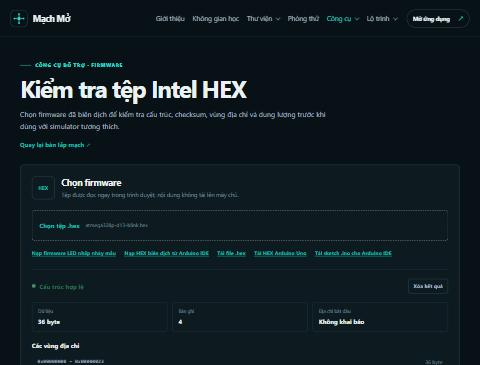
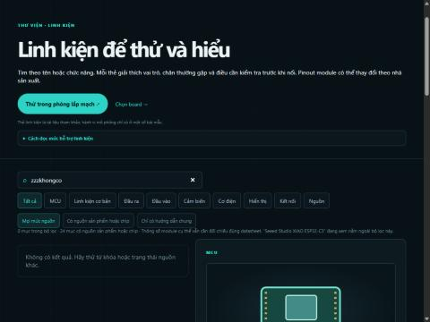

## 6. Responsive, bàn phím, accessibility, console, network

- **Responsive:** quét cấu trúc 24 route × 3 khổ (375, 1024, 1440): không route nào tràn ngang, mỗi trang có 1 `h1`, không nhảy cấp heading.
- **Vùng chạm:**
    - Ở 375 px các route chính gần như đạt 44 px; ngoại lệ là nút trên canvas và chấm trên cảnh 3D, vốn có điều khiển tương đương bên ngoài.
    - Ở desktop còn điều khiển dưới 24 px (F-10). Nút "Menu" mobile cao 42 px.
- **Bàn phím:**
    - Bảy lần Tab đầu trên `/` đi đúng thứ tự skip link → logo → các mục menu, đều có viền focus 3 px.
    - Menu mở bằng Enter được nhưng không đóng bằng Escape (F-03, F-04).
- **Axe-core 4.10.3:** bộ luật WCAG 2.0/2.1/2.2 A, AA và best-practice, chạy trong iframe cùng origin.
    - Phạm vi: 14 route × 3 khổ = 42 lượt, trạng thái mặc định của từng trang.
    - Kết quả: 5 node. `color-contrast` trên `.skip-link` 4 node: `/components?component=hc-sr04` ở 375 và `/build?lesson=blink&guided=1` ở 375, 1024, 1440. `target-size` 1 node: `.builder-actions > button` ở 375.
    - Không suy rộng sang các trạng thái tương tác hay các route khác.
- **Console:** chỉ có log debug của Vite và React DevTools, cộng lỗi passive wheel (F-06). Không có lỗi tải module.
- **Network:** 89 link nội bộ mở được trang thật; 14 file tĩnh (NOTICE, STEP, ZIP, HEX, INO) trả 200 với dung lượng thật. Không đo hiệu năng tải.

## 7. Điểm đang hoạt động tốt, nên giữ

- **Guidance trong lab:** nêu một việc cần làm, cách sửa và chân bắt đầu; chặn chạy khi mạch lỗi.
- **Ghi rõ mức xác minh:** CAD tham khảo, minh họa giáo dục, alias học tập đều ghi rõ, không nói quá năng lực.
- **Deep link:** link trực tiếp tới board và linh kiện giữ đúng lựa chọn; trạng thái rỗng có hướng dẫn.
- **Lưu project:** có phản hồi rõ ràng qua live region.
- **Bố cục:** không trang nào tràn ngang ở 3 khổ.
- **Lab ở 375 px:** thanh điều hướng đáy và thanh bước dễ dùng.

## 8. Chưa thể kết luận

| Điểm | Cần thêm |
|---|---|
| Đọc bằng screen reader (S-01, S-02, F-15) | Thử NVDA trên Windows và VoiceOver trên iOS |
| Mở, nhập, xuất project | Browser thật cho phép hộp xác nhận, và một workspace thử |
| Cảm ứng, kéo linh kiện trên canvas | Điện thoại hoặc máy tính bảng thật |
| Board Adafruit, Pico, XIAO; bài analog, 7 đoạn, motor | Thêm một lượt theo ma trận ở mục 3 |
| Hiệu năng tải model trên mạng chậm | Đo trên bản build và thiết bị thật |
| Độ chính xác so với board và linh kiện thật | Board vật lý, ảnh, datasheet đúng mã |

## 9. Backlog đề xuất

1. **Lỗi chặn người dùng bàn phím:** F-01, F-02 (skip link), F-03, F-04 (Escape đóng menu).
2. **Chức năng:** F-06 (lăn chuột trên viewer), F-05 (menu chồng nhau).
3. **Trợ năng và UX:** F-07 (focus bị che ở mobile), F-15 (focus khi đổi trang), F-10 (vùng chạm desktop), F-14 (ARIA cho lỗi nhập), F-08 (canvas dưới màn hình đầu).
4. **Nội dung:** F-11, F-12, F-13, F-16.
5. **Cải tiến:** F-09 cùng I-05 (thang chữ), I-01 đến I-04.

## 10. Skill và công cụ đã dùng

| Skill / công cụ | Cách dùng |
|---|---|
| `ui-ux-pro-max` | **Cài trong lượt này.** Nguồn: https://github.com/nextlevelbuilder/ui-ux-pro-max-skill, commit `3a13158ff1f32156cbe144108de48eda2ecaed9a`, giấy phép MIT. Clone vào thư mục tạm, xem nội dung, chỉ chép `.claude/skills/ui-ux-pro-max` vào `~/.claude/skills/`, không chạy script cài đặt hay npm. Đã gọi qua công cụ Skill, đọc `references/quick-reference.md`, chạy `scripts/search.py` cục bộ cho 3 truy vấn UX (focus bị che, kích thước vùng chạm, deep link) |
| `accessibility-review`, `frontend-design`, `testing-strategy`, `verification-before-completion`, `systematic-debugging` | Đã có sẵn và đọc trong các lượt trước của cùng phiên; áp dụng checklist của chúng ở lượt này, không gọi lại |
| `code-review` | Không gọi; lượt này review hành vi web, không review diff |
| Browser pane của Claude desktop app (`mcp__Claude_Browser__*`) | Mở trang, click, gõ, phím, lăn chuột, chụp ảnh, chạy JS đo DOM |
| axe-core 4.10.3 | Lấy từ gói `.tgz` đã có trong thư mục tạm của phiên. Phục vụ cục bộ tại `127.0.0.1:5198` chỉ trong lúc quét, sau đó đã dừng |

## 11. Xác nhận phạm vi

- Lượt này chỉ review. Không sửa, định dạng, xóa hay di chuyển mã nguồn, dữ liệu, model, cấu hình hay tài liệu sản phẩm. File được tạo chỉ có `REPORT.md` và thư mục `screenshots/`.
- **Dữ liệu thử:** tạo một project tên "AUDIT-TEST claude 2026-11-02" và đã xóa đúng project đó. Không tạo dữ liệu ngoài trình duyệt.
- **Dữ liệu trình duyệt đã xóa ngoài dữ liệu thử:** đầu phiên đã xóa khóa `machmo-learning-progress-v1` và `sessionStorage` của tab; phiên kiểm tra sau đó lại ghi tiến độ thử vào khóa này. Các phiên test trước của Claude cũng ghi và xóa khóa này, nên nhiều khả năng đây chỉ là dữ liệu thử, nhưng không xác nhận được nội dung trước khi xóa. Các khóa khác không bị đụng tới.
- Không đăng nhập, không gửi biểu mẫu ra ngoài, không đưa website lên Internet.
