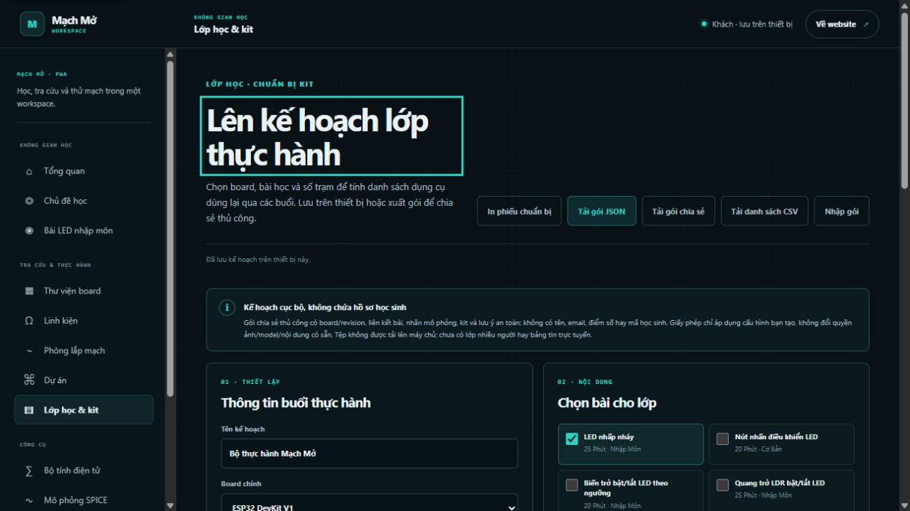

# Mạch Mở — rà soát hiện trạng ngày 04/11/2026

## Kết luận

Mạch Mở hiện là một ứng dụng học và thực hành điện tử local-first có nhiều luồng chạy được. Đã vượt mức website giới thiệu/model viewer đơn thuần, nhưng **chưa hoàn thành bản final và chưa đủ điều kiện phát hành công khai bản build hiện tại**. Không nên lấy số route, số model hoặc số test để quy thành phần trăm hoàn thành sản phẩm.

Hai bề mặt website và `/app` dùng chung React/Vite SPA. App hiện là workspace web có nền PWA, chưa phải ứng dụng desktop/mobile native độc lập. Có ba lớp mô phỏng riêng: bài học giáo dục, firmware ATmega328P giới hạn và ngspice analog. Chúng chưa hợp thành simulator MCU + mạch điện tổng quát.

Lượt này do Codex thực hiện độc lập, không gọi Claude. Chỉ tạo báo cáo và ảnh bằng chứng, không triển khai feature mới, không stage/commit/push hay phát hành. Các thay đổi mã từ lượt trước đã có sẵn khi bắt đầu được kiểm tra như một phần source hiện hành.

## Phạm vi và bằng chứng mới

- Đối chiếu đặc tả final ở `../docs/mach-mo-final-product-spec-web-app.md` (tính từ thư mục gốc dự án), roadmap tám phân hệ, README, nhật ký trạng thái, registry, router, module lưu trữ, mô phỏng, model và công cụ kit.
- Kiểm tra cấu trúc code toàn dự án và đọc sâu các điểm rủi ro; đây không phải chứng nhận đã đọc từng dòng của mọi asset/generated file hoặc pentest.
- Chạy lại toàn bộ test hiện có, typecheck, build nội bộ, audit ngspice, gate phát hành, audit GLB/hotspot và đối chiếu thân bo STEP/GLB.
- Trình duyệt: dashboard → bài nút nhấn → guided lab → nhấn input ảo → chạy từng bước → cảnh lắp 3D; mở danh mục board, deep link XIAO ESP32-S3 và trang lớp học/kit.
- URL cũ `127.0.0.1:5193` không truy cập được đầu lượt. Dev server trong sandbox không phục vụ được browser; đã dùng Vite chỉ trên loopback `127.0.0.1:5194` ngoài sandbox để kiểm tra. Đây là môi trường thử riêng, không phải deployment.
- Không chạy lại toàn bộ ma trận mobile, axe, browser engines, service worker production/offline, phần cứng, cloud admin hoặc hành vi nhập/xuất qua UI. Báo cáo cũ không được tính thành phép thử mới.

| Kiểm tra mới | Kết quả |
|---|---|
| `node --test --test-concurrency=1 tests/*.test.mjs` | **348/348 đạt**, không skip; khoảng 116,6 giây |
| `npm.cmd run typecheck` | Exit 0 |
| `npm.cmd run build:local` | Exit 0 |
| `npm.cmd run audit:spice-engine` | Hash/runtime khớp; mạch DC chia áp ra **2,5 V** |
| `npm.cmd run check:public-release` | **Bị chặn có chủ đích**: ngspice artifact chưa cleared |
| `npm.cmd run audit:board-models` | 15 scene, gồm 14 board + 1 scene lắp LED; không thiếu node hotspot hoặc orphan; pin bật picking không nằm ngoài bounds theo phép đo script |
| `npm.cmd run audit:board-model-geometry` | **8/8 cặp** thân PCB STEP/GLB khớp, tolerance 0,005 mm |

Lưu ý: kiểm kê GLB không chứng minh mọi linh kiện có mesh, đúng vị trí, đúng SKU hoặc đúng board thật. 8/8 chỉ đo thân PCB nguồn ↔ model, không đo toàn bộ assembly, pad, pinout hay BOM.

## Số liệu lấy từ source hiện tại

| Hạng mục | Số lượng và ý nghĩa |
|---|---|
| Board catalog | **28 hồ sơ**; tất cả có trường revision, nhưng có trường mô tả tham chiếu/biến thể chứ không phải bằng chứng vật lý |
| Board 3D | **14 board có CAD viewer**, 14 hồ sơ còn lại tra cứu |
| PCB copper viewer | **4 board**: ESP32 DevKit clone 30 pin, Uno R3, Nano classic, Mega 2560 R3 |
| Profile trong builder | **21**; profile alias giáo dục không đồng nghĩa 21 MCU emulator |
| Danh mục linh kiện | **58 mục**, gồm cả board/module; cả 58 có nguồn qua `source` hoặc `componentReferences` |
| Palette bàn lắp | **28 loại**, không đồng nghĩa đủ 58 mục có hành vi/mounting |
| Manifest mesh linh kiện | **37**: 12 mesh CAD package KiCad, 25 mesh tham số; mesh package không xác nhận part/module cụ thể |
| Bài học | **11**: 8 bài code subset, 3 kịch bản khái niệm |
| Firmware | **2 target board cùng một MCU**: Uno R3/Nano classic ATmega328P |

Không dùng riêng trường `components[].source` để kết luận thiếu nguồn: phần lớn tài liệu được tách sang `componentReferences.ts`.

## Hiện trạng theo tám phân hệ đã chốt

| Phân hệ | Đã triển khai | Chưa hoàn thiện so với final |
|---|---|---|
| **1. Học tập** | Lộ trình bốn chặng; 11 bài; bài LED dài và preflight cho các bài khác; vật tư/chân/nguồn/lưu ý; guided lab; dự đoán và thử thách theo khả năng provider; tiến độ tự khai báo, tiếp tục học và lịch sử bắt đầu chạy cục bộ | Chưa có bằng chứng người mới hoàn thành độc lập; lịch sử chưa là bài nộp/đánh giá; chưa sync; chất lượng và độ sâu giữa bài chưa đồng đều; chưa có toàn bộ chương trình đào tạo final |
| **2. Board & linh kiện** | Tìm/lọc/so sánh board; ảnh hoặc render có ghi nguồn; revision/datasheet/pinout; 14 CAD viewer; chọn nhóm mesh/feature, xem thông tin, chọn pad trên một số board; 58 mục linh kiện có giải thích/nguồn; hình minh họa và mesh | 14 board chưa có viewer; chưa định danh đầy đủ từng linh kiện; một số footprint không có mesh; mesh generic và nhóm chưa định danh còn nhiều; ảnh online không thay phép xác minh board vật lý; chưa có CAD đúng part number cho mọi module |
| **3. Lắp mạch 3D** | WebGL/GLB, board + linh kiện + dây; xếp theo topology/lưới breadboard; panel Tổng quan/Chân/Ví dụ/Lưu ý/Nguồn; tương tác chọn và nối; lưu layout; xử lý model lỗi; thao tác 2D có thêm/xóa/xoay/nhân bản/undo/redo và chế độ tự nối lại | Chưa là lắp ráp cơ khí đã xác nhận fitment; chân module tham số là minh họa; breadboard điện vẫn là các node nhóm, chưa mô hình đầy đủ từng lỗ; chọn quá dày phải ẩn điểm trên cảnh; kéo dây trực tiếp, touch và mọi board chưa có nghiệm thu mới đầy đủ |
| **4. Schematic, PCB & net** | Sơ đồ giáo dục sinh từ LearningCircuit; net theo dây/endpoint ổn định; highlight giữa các view học tập; copper/pad/net CAD tĩnh cho bốn board; nhập subset XML netlist KiCad sang SPICE | Chưa có một tài liệu schematic/EDA chỉnh sửa tổng quát; chưa đồng bộ điện giữa layout 3D, schematic và PCB; không có ERC/DRC tổng quát hay PCB routing/fabrication workflow; chưa chuyển mọi board/PCB thành SPICE |
| **5. Code, tính toán & mô phỏng** | Editor khối/C++; parser subset; đầu vào ảo; bốn bộ tính LED/chia áp ADC/I²C/RC; export sketch trong phạm vi hỗ trợ; đọc Intel HEX; AVR8js Worker có D13/UART0, run ID/stop/timeout; firmware mẫu; trace CSV; SPICE `.op/.tran/.ac/.dc`, plot/bảng/CSV, subset model bán dẫn; handoff workspace/result có fingerprint/TTL/giới hạn | Chưa compiler/upload/device bridge tích hợp; chưa ESP32/Pico/STM32 firmware; chưa emulation đầy đủ các ngoại vi/cảm biến; chưa MCU-SPICE co-simulation; SPICE chỉ nhận phần tử được hỗ trợ, thông số rõ; không suy điện từ hoạt ảnh dây hoặc model CAD |
| **6. Project & PWA** | Lưu project/revision cục bộ; JSON import/export có validation và giới hạn; recovery/rollback; route riêng theo app; service worker cache shell và JS/CSS đã tải, offline fallback | Chưa cloud sync/cộng tác; chưa IndexedDB/offline asset library; model/firmware/WASM không được cache bởi SW này; update/offline/quota recovery chưa được xác nhận đầy đủ trên browser production trong lượt này |
| **7. Lớp học, cộng đồng & kit** | Trang lập kế hoạch: chọn board/bài/số trạm, tính số lượng tái dùng theo bài lớn nhất; sửa số lượng; JSON/CSV/share pack, in; import gói đã giới hạn; lưu local và ghi rõ không có dữ liệu học sinh | Chưa lớp thật/tài khoản/roster/giao bài/nộp/chấm; chưa chia sẻ server/remix/moderation; chưa kho/mua hàng/giao hàng; BOM kit mới là ước lượng từ preset, chưa đủ cấu hình SKU, dây/USB/nguồn và xác nhận một trạm thật |
| **8. Website & app workspace** | Website giới thiệu; app shell; registry route/feature; lazy routes; error boundaries; privacy; điều hướng, tải/lỗi/rỗng/focus có nền; Supabase admin/analytics có code và SQL | Chưa native app; phần lớn là cùng page trên hai namespace; chưa chứng minh vận hành backend/admin/RLS ngoài môi trường local; chưa CI cho dự án; chưa bộ nghiệm thu toàn trình trên các trình duyệt/thiết bị thật |

“Đã triển khai” nghĩa là có code/dữ liệu tương ứng, được kiểm chứng trong phạm vi ghi ở trên; không phải mọi dòng trong bảng đã qua browser và phần cứng.

## Các vướng mắc và lỗi/nợ còn thấy

### Chặn phát hành

1. **ngspice WASM thiếu provenance của đúng binary.** Runtime audit báo ngspice 45.2, wrapper `eecircuit-engine@1.8.0`, SHA-256 `ed7995425b6f7af02db874539d13ea10d07759d5f2be6b79969343459ae886e4`. Thiếu source commit phù hợp, build recipe/toolchain pin, inventory code/license đã link và review gắn với hash. Test solve đúng không giải quyết điều kiện này. Giữ gate; hướng kỹ thuật ưu tiên là build artifact mới có thể tái lập hoặc lấy build record của artifact hiện tại.
2. **Nguồn và quyền asset còn cần hoàn tất theo từng asset.** `boardModelSources.ts` vẫn ghi XIAO C3 archive thiếu LICENSE độc lập, đồng thời cho phục vụ local với `published: true`. Ngspice gate không thay gate toàn thư viện. Chấp thuận share-alike của chủ dự án đã có, nhưng không tự bổ sung được nguồn/điều khoản mà upstream còn thiếu. Chưa thấy LICENSE sản phẩm ở thư mục gốc dự án.
3. **Mạch Mở còn là cây untracked trong repo StartupOS.** Chưa có baseline commit/diff/CI riêng có thể dùng làm mốc phát hành. Không tự stage toàn cây vì repo cha có thay đổi của dự án khác.

### Độ chính xác model chưa đạt yêu cầu “mọi linh kiện đều rõ”

- Uno: 87/120 feature không có mesh; Nano: 19/37; Mega: 33/72. Đây là footprint/pad inventory, không phải số linh kiện chắc chắn bị thiếu khi lắp thật; cần phân loại DNP/testpoint/pad/logo/linh kiện có lắp trước khi dựng thêm mesh.
- Feather #5323: 14 feature không có mesh; #5483: 17; XIAO C3: 21. Có mesh chưa định danh/gom nhóm, đặc biệt STEP thiếu designator/BOM mapping.
- XIAO S3 có bốn nhóm feature CAD; không phải mọi tụ/trở/IC đều được định danh độc lập. OPL anchor không ghi revision, còn giới hạn căn outline được công khai.
- ESP32-S3 DevKitC-1 là tái dựng giáo dục từ PADS/BOM; hồ sơ trước ghi 1.331 phát hiện DRC, 3 item chưa nối, lệch chiều dài outline 0,125 mm so với PDF. Chưa chạy lại DRC KiCad trong lượt này và không dùng import này để chế tạo.
- Chưa có bằng chứng vật lý cho toàn bộ pinout, placement, chiều, height, package và các biến thể. Ảnh giúp phát hiện sai SKU/nhầm bố cục, không đủ để xác nhận kích thước chính xác.

### Nợ kỹ thuật và nội dung cần sửa tiếp

**Lỗi mới tái hiện trên browser:** mở danh mục board/XIAO S3 phát sinh React console error `Encountered two children with the same key` cho URL guide Seeed. `boards.ts` khai báo hai `referenceDocs` khác nhãn nhưng cùng URL; `BoardCatalogPage.tsx` dùng `key={doc.url}` khi render. Cần gộp mục trùng hoặc cấp identity riêng cho mục tài liệu; kiểm tra cả `BoardProfile.tsx` vốn cũng render link theo URL. Mức ưu tiên P2: trang vẫn mở, nhưng reconciliation có thể bỏ/lặp mục khi cập nhật. **Lượt rà này ghi nhận, chưa sửa.** Thông báo được thấy trong log Vite của phiên browser khi kết thúc kiểm tra; không phải lỗi do cố ý chặn asset.

| Mục | Bằng chứng | Hướng xử lý |
|---|---|---|
| Nhãn firmware ở board thiếu nhất quán | `getBoardSupportSummary` trong `boardCapabilityRegistry.ts` vẫn nói “không chạy firmware” cho mọi target, gồm Uno/Nano; bảng so sánh trên browser cũng hiện như vậy | Tách năng lực bài học, firmware và solver thành các trường/nhãn riêng từ registry |
| Dashboard diễn giải SPICE chưa sát khả năng mới | `AppHomePage.tsx:144` chỉ nói netlist riêng, chưa giải thích rõ handoff subset có kiểm tra từ workspace | Viết rõ thao tác chuyển mạch được hỗ trợ và các mạch bị từ chối |
| Nhật ký và bảng tổng hợp dễ gây hiểu nhầm | Roadmap baseline còn 48 linh kiện/7 viewer; status và asset inventory chứa số liệu/hash/model cũ xen cập nhật | Tạo snapshot hiện hành sinh từ registry; giữ lịch sử có ngày, không dùng số lịch sử làm headline |
| Builder vẫn tập trung quá nhiều trách nhiệm | `CircuitBuilderPage.tsx` 930 dòng, gồm history, file/worker, session, layout, code, project và UI | Tách controller/hooks cho firmware, history, project IO và các view; giữ schema và hồi quy hiện có |
| Hai đường parser chưa thống nhất | `parseSupportedArduinoSubset.ts`, `educationalProgram.ts` và IR đã cùng tồn tại | Chuyển qua IR chung theo từng lesson, kiểm tra code sinh từ khối ↔ parser ↔ evaluator |
| Nguồn URL model cảnh lắp bị khai báo riêng | `assemblyLayout.ts` có board asset map với version cố định, trong khi catalog có asset lock/hash version | Dùng một resolver model/anchor/version; kiểm browser cache khi thay asset |
| Kit chưa đủ BOM thực tế | Browser preset LED chỉ tính board/breadboard/LED/resistor; chưa có dòng jumper/USB trong inventory mặc định | Thêm consumables/accessories tách khỏi linh kiện mạch, cấu hình SKU và checklist thử một trạm |
| Bằng chứng E2E chưa thành kiểm tra lặp lại | Node tests không thay thao tác kéo thật, WebGL, download/upload, SW/offline hoặc quota | Đóng từng flow với browser regression, gồm trạng thái lỗi và dữ liệu cũ |

Không coi các dòng này là lỗi nghiêm trọng đã tái hiện nếu chỉ có bằng chứng source; chúng được phân biệt rõ với lỗi build/test. Không có test failing trong suite hiện tại.

## Thứ tự triển khai đề xuất

Ước lượng dưới đây là độ lớn tương đối (nhỏ/vừa/lớn), không phải cam kết lịch giao.

1. **Chốt baseline và tính nhất quán — nhỏ/vừa, ưu tiên ngay.** Snapshot nguồn dữ liệu duy nhất; sửa nhãn firmware/SPICE; tách nhật ký khỏi hiện trạng; chọn source/asset manifest policy; đưa source vào quản lý phiên bản có phạm vi; CI typecheck/test/model audit/build nội bộ, public build giữ gate.
2. **Đóng luồng Học tập + Board hiện hữu — vừa.** Ma trận 11 bài × board hỗ trợ; kiểm cả CTA, chọn pin, nguồn, mục tiêu, chạy sai, lưu/mở, keyboard/mobile. Lập ma trận từng model/feature: exact CAD → generic package → pad-only → unidentified → physical pending. Dựng thêm mesh chỉ khi biết feature có lắp và đúng package; ưu tiên Uno/Nano/Mega và XIAO/Pico trước tăng số board.
3. **Đóng lắp mạch và net — vừa/lớn.** Nghiệm thu kéo dây bằng chuột/cảm ứng; hủy/undo; cắm breadboard không tạo nối điện ngầm; thống nhất model/anchor resolver. Sau đó thiết kế connectivity chung cho schematic/breadboard để mọi view đọc cùng net; copper CAD vẫn tách cho tới khi mapping có nguồn.
4. **SPICE có thể phát hành — lớn nhưng có thể làm song song.** Tạo build reproducible gắn source/toolchain/hash/notices; chạy solver regression; đóng handoff workspace → solver → đúng workspace và trường hợp hết hạn/quota. Mở rộng phần tử/model theo whitelist có giá trị kỹ thuật, chưa ghép firmware vào solver khi chưa có clock/event contract.
5. **Firmware có chiều sâu — lớn.** Ưu tiên hoàn chỉnh Uno/Nano: GPIO trace/input mapping, UART hai chiều và ngoại vi đúng bài, editor → compile → HEX → run với giới hạn rõ. Sau đó chọn một target tiếp theo bằng spike khả thi; không đổi nhãn profile thành “đã mô phỏng” trước khi engine chạy được.
6. **Project/PWA đáng tin cậy — vừa.** Tách builder trước khi thêm engine; đo import/export/rollback/quota, SW update/offline, ngân sách asset cache. Cloud sync chỉ sau version/conflict/access policy.
7. **Lớp học/cộng đồng/kit — lớn.** Hoàn chỉnh kit BOM offline trước. Khi có mô hình lớp thật, mới thêm role/assignment/progress/consent/deletion; cộng đồng có attribution/moderation/reporting; bán kit là nhánh vận hành riêng.
8. **Hoàn thiện trải nghiệm website/app liên tục.** Giữ một codebase; tối ưu người mới theo kết quả dùng thử. Native app chỉ khi có nhu cầu thiết bị/compiler/engine vượt browser được chứng minh.

## Phần tự triển khai và phần cần chủ dự án

**Codex có thể tự làm tiếp trong phạm vi local đã cho phép:** sửa nhãn và tài liệu, refactor có kiểm tra, browser regression, mapping CAD có nguồn, cải thiện schematic/net subset, rebuild toolchain ở D sau khi chốt artifact/source, mở rộng solver/AVR trong các lát đã xác định, kit BOM và PWA.

**Cần chủ dự án tại đúng mốc:** chốt ranh giới Release 1/đối tượng học và mô hình tài khoản lớp; chọn license sản phẩm; duyệt nội dung an toàn và hồ sơ asset; bố trí người mới dùng thử. Người duyệt nội dung đã được chốt là chủ dự án, không hỏi lại ai duyệt.

**Cần điều kiện ngoài phần mềm:** muốn xác nhận board vật lý phải có người cầm đúng SKU/revision, phép đo/continuity và chạy firmware trên board. Có thể tự tìm ảnh/tài liệu, chọn module mẫu và chuẩn bị protocol, nhưng không thể gọi đó là đã đo phần cứng. Nếu chưa có thiết bị, giữ nhãn source/CAD-backed.

Không cần cấp thêm quyền để đọc source, viết local, chạy test hay build nội bộ. Không có hành động gửi dữ liệu/đăng nhập GrabCAD/cài công cụ mới trong lượt rà này.

## Ảnh bằng chứng

Trang lớp học/kit đã có công cụ cục bộ thật, nhưng ghi rõ chưa có lớp nhiều người/cộng đồng trực tuyến:

## Tệp đối chiếu chính

- `src/data/{boards,components,componentReferences,componentRegistry,componentModels,curriculumSchema,boardCapabilityRegistry,boardModelSources,productRoutes,productFeatureRegistry}.ts`
- `src/pages/{CircuitBuilderPage,AppHomePage,BoardCatalogPage,FirmwareHexToolPage,SpiceWorkbenchPage,ClassroomKitPage}.tsx`
- `src/lib/{assemblyLayout,circuitNets,workspaceSpice,kicadSpiceImport,firmwareTarget,firmwareWorkflow,learningProgress,projectBundle,savedProjects,workspaceStorage,registerServiceWorker}.ts`
- `src/simulation/`, `src/workers/`, `public/sw.js`, `public/licenses/spice-engine-provenance.json`
- `docs/board-model-accuracy-audit-2026-11-03.md`, `docs/spice-redistribution-audit-2026-11-03.md`, `docs/MACH-MO-MVP-STATUS.md`

Không chỉnh các tài liệu lịch sử thành “đã hoàn tất”; báo cáo này là snapshot có ngày và phạm vi xác minh riêng.
